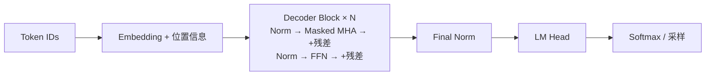

# Transformer 与生成机制

本页先讲 Transformer 基础（注意力、多头、掩码、FFN、归一化、复杂度、KV Cache），再集中维护生成目标和模型层结构的实例，避免只在面试回答中出现完整原理。对应八股题见 [[05_面试与算法/03_大模型面试问答]]。位置编码见 [[01_大模型/01_模型结构/02_位置编码与上下文扩展]]，稀疏专家见 [[01_大模型/01_模型结构/03_MoE混合专家模型]]，推测解码与服务性能见 [[01_大模型/03_推理与接口/03_vLLM与推理优化]]。不同模型的 MTP 结构应分别理解，通用多预测头示意不代表所有实现。

## 配套代码实践

[[01_大模型/code/transformer/README|Transformer 知识实践]]提供带中文注释的完整 Encoder–Decoder 实现。先运行 `inspect_model.py` 观察 Embedding、Q/K/V、三种注意力和掩码，再运行 `train_copy.py` 在 CPU 上训练复制任务，比较 Teacher Forcing 与自回归生成。指南包含阅读顺序、断点、修改练习和测试入口。

## Transformer 基础

Transformer 出自 2017 年论文 *Attention Is All You Need*，用**自注意力（Self-Attention）**取代 RNN 的循环结构，使序列中任意两个位置可以一步直接交互，训练时所有位置可以并行计算。现代大模型基本都是它的变体。

### 整体架构与三种变体

原始 Transformer 是 **Encoder-Decoder** 结构，用于机器翻译：

- **Encoder**：N 层（原文 N=6），每层 = 多头自注意力 + FFN，每个子层外包残差连接与 LayerNorm；可以看到全部输入（双向）。
- **Decoder**：N 层，每层 = **带因果掩码的**多头自注意力 + **交叉注意力（Cross-Attention）** + FFN。交叉注意力的 Q 来自 Decoder，K/V 来自 Encoder 最后一层输出。
- **输入**：Token Embedding（乘以 $\sqrt{d_{model}}$）+ Sinusoidal 位置编码；**输出**：线性层 + Softmax 得到词表概率。
- 原文超参数：$d_{model}=512$，$h=8$ 个头，$d_k=d_v=64$，$d_{ff}=2048$，Dropout 0.1，Label Smoothing 0.1，warmup 学习率调度。



上图是现代 Decoder-only 大模型（Pre-Norm）的数据流，原始论文是 Post-Norm 的 Encoder-Decoder。

| 变体 | 注意力可见范围 | 预训练目标 | 代表模型 | 擅长 |
|------|--------------|-----------|---------|------|
| Encoder-only | 双向 | MLM 掩码语言模型（BERT 另有 NSP） | BERT、RoBERTa | 理解、分类、Embedding、Reranker |
| Encoder-Decoder | Encoder 双向，Decoder 因果 + 交叉注意力 | Span Corruption / Seq2Seq | T5、BART | 翻译、摘要等输入输出明确的任务 |
| Decoder-only | 因果（单向） | Next Token Prediction | GPT、Llama、Qwen、DeepSeek | 通用生成、对话、In-Context Learning |

> [!info] 为什么现在主流大模型几乎都是 Decoder-only？
> - **训练信号密**：每个位置都在预测下一个 token，所有 token 都贡献 loss；MLM 只对约 15% 被遮盖的 token 计算 loss。
> - **训练与推理一致**：预训练就是生成任务，天然支持 Zero/Few-shot 和 In-Context Learning。
> - **工程友好**：因果结构可以直接复用 KV Cache；结构单一，便于扩展和优化。
> - **经验上的 Scaling 表现好**，生态（推理框架、对齐方法）也都围绕它建设。
> - 另有观点认为双向注意力矩阵容易低秩、因果注意力矩阵是下三角且对角元为正，表达能力更好；这是一种解释，不是定论。

### Embedding 层：从 Token ID 到向量

**Token Embedding 层是一张可训练的向量表，将离散的 Token ID 转换成连续向量。** 分词器负责把文本转换成编号，Embedding 层再按编号取出对应行，交给后续 Transformer 层处理。一个 token 不一定是一个完整的词，也可能是字、子词或字节片段。

以“我喜欢篮球”为例，假设分词得到三个 token：

```text
文本片段：      我           喜欢          篮球
Token ID：     12           358           902
Embedding：   E[12]        E[358]        E[902]
输出：         每个 token 对应一个 D 维向量
```

上面的分词和编号仅用于说明查表过程，不对应某个实际分词器。

#### 参数表形状与输入输出形状

设词表大小为 $V$，向量维度为 $D$，本次输入长度为 $T$，批量大小为 $B$：

| 对象 | 形状 | 含义 |
| ---- | ---- | ---- |
| Embedding 参数表 $E$ | $V\times D$ | 每种 token 各有一个 D 维向量 |
| 单条输入的 Token ID | $T$ | 本次输入的 T 个编号 |
| 单条输入查表后的输出 | $T\times D$ | 每个输入位置对应一个向量 |
| 批量输入的 Token ID | $B\times T$ | 补齐或整理为相同长度后的输入 |
| 批量查表后的输出 | $B\times T\times D$ | 每个样本、每个位置对应一个向量 |

例如，$V=100000$、$D=2560$、$T=100$ 时，参数表是 **100000 × 2560**，本次查表输出是 **100 × 2560**。具体接口与形状定义见 [PyTorch Embedding 文档](https://docs.pytorch.org/docs/stable/generated/torch.nn.Embedding.html)。

> [!important] 不要把输入长度当成向量维度
> 参数矩阵是“词表大小 × 向量维度”，输出矩阵是“输入长度 × 向量维度”。输入越长，取出的向量越多，但参数表本身不会变大。这里用 T 表示输入长度，避免与下文表示模型层数的 L 混淆。

#### 参数量与显存

Embedding 参数量为 $P_{\text{embed}}=V\times D$。以上述词表和维度为例：

- 参数量：$100000\times2560=2.56\times10^8$，即 **2.56 亿参数**。
- FP16/BF16 权重占用：$2.56\times10^8\times2=5.12\times10^8$ 字节，即 **0.512 GB**（十进制，约 0.477 GiB）。
- 若模型总参数量恰为 4B，这张表占总参数的 **6.4%**。模型标注的总参数量通常已包含它，估算总权重显存时不要重复加算。

输出向量属于运行时张量，仍会额外占显存。训练时，若这一层参与更新，还需计算相应梯度和优化器状态；若被冻结，则不为其维护这些可训练状态。完整估算见 [[01_大模型/02_训练与对齐/03_DeepSpeed与显存估算#4B 模型的训练与推理显存示例]]。

#### 向量如何学到含义

Embedding 参数通常随模型训练，通过反向传播更新。每一维不一定对应一个明确的人类概念。同一个 Token ID 在输入查表时通常得到相同的初始向量，后续 Transformer 层再结合位置与上下文生成不同表示。例如“苹果很好吃”和“苹果发布电脑”中的同一 token，初始查表向量相同，后续上下文表示可以不同。

输入 Embedding 与输出 LM Head 可能共享同一份权重；共享时只统计一次，不共享时分别统计。输入 Token Embedding 也不同于 RAG 中将整段文本编码为检索向量的 Embedding 模型。

### 缩放点积注意力

输入 $X\in\mathbb{R}^{n\times d}$ 经三个线性投影得到 $Q=XW_Q$、$K=XW_K$、$V=XW_V$：

$$
\text{Attention}(Q,K,V)=\text{softmax}\left(\frac{QK^\top}{\sqrt{d_k}}+M\right)V
$$

- $QK^\top$（$n\times n$）：每个 Query 与所有 Key 的相似度，即"该看谁"；
- Softmax 按行归一化成权重，再对 $V$ 加权求和，即"看到什么"；
- $M$ 是掩码，被屏蔽位置取 $-\infty$，Softmax 后权重为 0。

**为什么除以 $\sqrt{d_k}$**：假设 $q,k$ 各分量独立、均值 0、方差 1，则 $q\cdot k=\sum_{i=1}^{d_k}q_ik_i$ 的方差为 $d_k$。$d_k$ 较大时点积数值很大，Softmax 进入饱和区，输出接近 one-hot，梯度接近 0。除以 $\sqrt{d_k}$ 把方差拉回 1，保持梯度稳定。

**为什么 Q、K 用不同的投影矩阵**：若 $Q=K$，注意力矩阵 $XW W^\top X^\top$ 是对称的，A 对 B 的关注必然等于 B 对 A 的关注，且每个 token 往往最关注自己。分开投影让"查询"和"被查询"处在不同空间，表达能力更强。

**为什么用点积而不是加性注意力**：两者理论复杂度相近，但点积可以写成一次矩阵乘法，GPU 上快得多；配合缩放后效果相当。

### 多头注意力

将 $d_{model}$ 拆成 $h$ 个头，每头维度 $d_k=d_{model}/h$，各自独立做注意力后拼接，再经输出投影 $W_O$：

$$
\text{MHA}(X)=\text{Concat}(\text{head}_1,\dots,\text{head}_h)W_O,\quad \text{head}_i=\text{Attention}(XW_Q^i,XW_K^i,XW_V^i)
$$

- **为什么多头**：不同头可以在不同子空间关注不同关系（如语法依存、指代、局部邻近），类似 CNN 的多通道；单头的一次 Softmax 只能产生一种加权分布。
- **计算量不变**：总维度仍是 $d_{model}$，多头与单头全维注意力的参数量、FLOPs 基本相同。
- **头数不是越多越好**：$d_k$ 过小时单头表达能力下降；研究也发现训练后不少头可以剪掉而影响不大。

### 掩码机制

| 掩码 | 作用 | 用在哪里 |
|------|------|---------|
| Padding Mask | 屏蔽 batch 内补齐的 `<pad>` 位置 | Encoder、Decoder、交叉注意力 |
| Causal Mask（因果/前瞻掩码） | 上三角置 $-\infty$，位置 $t$ 只能看到 $\le t$ 的 token | Decoder 自注意力 |

因果掩码让训练时可以**一次前向并行计算整段序列所有位置的 loss**（Teacher Forcing），同时保证不会偷看答案。

### 前馈网络与激活函数

FFN 对每个位置**独立**地做同一个两层 MLP（Position-wise）：

$$
\text{FFN}(x)=\text{ReLU}(xW_1+b_1)W_2+b_2,\quad W_1\in\mathbb{R}^{d\times d_{ff}},\ d_{ff}=4d
$$

- **分工**：Attention 负责 token 之间的信息交换，FFN 负责对单个 token 的表示做非线性变换；有研究把 FFN 看作存储知识的 key-value 记忆。
- **参数占大头**：FFN 约占每层参数的 2/3。
- **激活函数演进**：ReLU（原始 Transformer）→ GELU（BERT、GPT-2）→ **SwiGLU**（PaLM、Llama、Qwen）。

$$
\text{SwiGLU}(x)=\left(\text{SiLU}(xW_{gate})\odot xW_{up}\right)W_{down}
$$

SwiGLU 有三个矩阵，为保持参数量与原始 FFN 相当，$d_{ff}$ 通常取约 $\frac{8}{3}d$（如 Llama-7B：$d=4096$，$d_{ff}=11008$）。门控结构让网络可以按输入动态选择通过的信息，实验效果更好。

### 残差连接与归一化

- **残差连接** $x+\text{Sublayer}(x)$：为梯度提供直通路径，缓解深层网络的梯度消失和退化问题。
- **为什么用 LayerNorm 而不是 BatchNorm**：
  1. NLP 序列长度可变、存在 padding，按 batch 统计均值方差不稳定；
  2. BN 依赖 batch 统计量，小 batch 和推理时需用滑动均值，训练推理不一致；
  3. LN 对每个 token 的特征维度独立归一化，与 batch 大小和序列长度无关。
- Pre-Norm/Post-Norm 与 RMSNorm 的细节见下文 [[#Qwen3 的归一化与层结构]]。

### 参数量与计算复杂度

以隐藏维度 $d$、层数 $L$、词表 $V$、序列长度 $n$ 计（忽略 bias 与 Norm）：

| 组件 | 参数量 | 计算复杂度 |
|------|-------|-----------|
| Attention（$W_Q,W_K,W_V,W_O$） | $4d^2$ | 投影 $O(nd^2)$；$QK^\top$ 与加权 $V$ 为 $O(n^2d)$ |
| FFN（$d_{ff}=4d$） | $8d^2$ | $O(nd^2)$ |
| 每层合计 | 约 $12d^2$ | $O(nd^2+n^2d)$ |
| Embedding / LM Head | $Vd$（权重共享时只算一次） | — |

- **总参数** ≈ $12Ld^2+Vd$。例：Llama-7B（SwiGLU，$d=4096$，$L=32$，$d_{ff}=11008$，$V=32000$，不共享权重）：每层 $4d^2+3d\cdot d_{ff}\approx202\text{M}$，×32 ≈ 6.48B，加两份 Embedding 约 0.26B，总计约 **6.74B**。
- **FLOPs 经验公式**：前向每 token 约 $2N$ FLOPs（$N$ 为参数量），训练（前向 + 反向）每 token 约 $6N$。
- **序列长度的瓶颈**：$n\ll d$ 时 FFN/投影主导；长上下文时注意力的 $O(n^2)$ 计算和显存成为瓶颈，催生了 FlashAttention、稀疏/滑动窗口注意力、线性注意力等方案。
- **FlashAttention** 不改变 $O(n^2)$ 计算量，而是通过分块（Tiling）+ 在线 Softmax 避免把 $n\times n$ 注意力矩阵写回显存，减少 HBM 读写，结果精确、显存降为 $O(n)$。详见 [[01_大模型/03_推理与接口/03_vLLM与推理优化#4.1 FlashAttention 与 FlashInfer]]。

### KV Cache 与 MQA、GQA、MLA

自回归推理时历史 token 的 K/V 不变，缓存起来避免重复计算，即 **KV Cache**。其显存为：

$$
\text{KV Cache}=2\times L\times n_{kv\_heads}\times d_{head}\times \text{seq\_len}\times \text{batch}\times \text{bytes}
$$

例：Llama-2-7B（MHA，32 层，32 头 × 128 维，FP16）每 token 约 $2\times32\times4096\times2\text{B}=0.5\text{MB}$，4K 上下文单条请求约 2GB。为压缩 KV Cache，出现了以下变体：

| 方案 | 做法 | KV Cache | 代表 |
|------|-----|---------|-----|
| MHA | 每个 Q 头有独立 K/V 头 | 基准 | 原始 Transformer、Llama-1 |
| MQA | 所有 Q 头共享 1 组 K/V | $1/h$，质量损失较明显 | PaLM、Falcon |
| GQA | Q 头分 $g$ 组，每组共享 1 组 K/V | $g/h$，质量接近 MHA | Llama-2-70B、Llama-3、Qwen |
| MLA | K/V 先压缩成低秩潜向量再缓存，推理时可吸收投影矩阵 | 远小于 MHA | DeepSeek-V2/V3 |

Decode 阶段主要受**显存带宽**限制（每步要读完整 KV Cache 和权重），所以减少 KV 头数能直接提升吞吐与可支持的并发/长度。PagedAttention 等内存管理见 [[01_大模型/03_推理与接口/03_vLLM与推理优化]]。

### 训练与推理的差异

| | 训练（Teacher Forcing） | 推理（自回归生成） |
|---|---|---|
| 输入 | 完整的真实序列 | 模型自己已生成的序列 |
| 并行性 | 所有位置一次前向并行计算 | 逐 token 串行（Prefill 阶段可并行） |
| 掩码 | 因果掩码保证不看未来 | 天然只有历史 |
| 问题 | — | **Exposure Bias**：训练从没见过自己的错误，推理时错误会累积 |

### 极简实现

```python
import math
import torch
import torch.nn as nn
import torch.nn.functional as F

class MultiHeadAttention(nn.Module):
    def __init__(self, d_model: int, n_heads: int):
        super().__init__()
        assert d_model % n_heads == 0
        self.h, self.d_k = n_heads, d_model // n_heads
        self.qkv = nn.Linear(d_model, 3 * d_model, bias=False)
        self.out = nn.Linear(d_model, d_model, bias=False)

    def forward(self, x, causal: bool = True):
        B, T, C = x.shape
        q, k, v = self.qkv(x).chunk(3, dim=-1)
        # (B, T, C) -> (B, h, T, d_k)
        q, k, v = (t.view(B, T, self.h, self.d_k).transpose(1, 2) for t in (q, k, v))
        scores = q @ k.transpose(-2, -1) / math.sqrt(self.d_k)    # (B, h, T, T)
        if causal:
            mask = torch.triu(torch.ones(T, T, dtype=torch.bool, device=x.device), 1)
            scores = scores.masked_fill(mask, float("-inf"))
        attn = F.softmax(scores, dim=-1)
        y = (attn @ v).transpose(1, 2).reshape(B, T, C)          # 拼接各头
        return self.out(y)

class DecoderBlock(nn.Module):
    """Pre-Norm Decoder Block（简化：用 LayerNorm + GELU FFN）"""
    def __init__(self, d_model: int, n_heads: int):
        super().__init__()
        self.ln1, self.ln2 = nn.LayerNorm(d_model), nn.LayerNorm(d_model)
        self.attn = MultiHeadAttention(d_model, n_heads)
        self.ffn = nn.Sequential(
            nn.Linear(d_model, 4 * d_model), nn.GELU(), nn.Linear(4 * d_model, d_model)
        )

    def forward(self, x):
        x = x + self.attn(self.ln1(x))
        x = x + self.ffn(self.ln2(x))
        return x
```

实际工程中直接用 `F.scaled_dot_product_attention(q, k, v, is_causal=True)`，它会自动选择 FlashAttention 等高效内核。面试手撕时需能写出上面的 MHA，并讲清每一步的张量形状。

---

## Multi Token Prediction

Multi Token Prediction（MTP）是 Meta 和 DeepSeek 等在研究中使用的技术，让模型在单次前向传播中同时预测未来多个 token，而不仅仅是下一个 token。

### 标准 Next Token Prediction 的局限

标准 LM 在位置 $t$ 只预测 $t+1$ 的 token：

```
输入：[x1, x2, x3, x4]
目标：[x2, x3, x4, x5]     ← 只预测 next 1 token
```

### MTP 的实现方式

在主预测头之外，额外添加 $D$ 个独立的预测头，每个头预测未来第 $k$ 个 token：

```python
# 伪代码结构
hidden_states = transformer_backbone(input_ids)   # 主干网络共享

# 主预测头（next-1 token）
logits_1 = lm_head_1(hidden_states)   # 预测 t+1

# 额外预测头
logits_2 = lm_head_2(hidden_states)   # 预测 t+2
logits_3 = lm_head_3(hidden_states)   # 预测 t+3

# 训练 loss = λ1*CE(logits_1, target_1) + λ2*CE(logits_2, target_2) + ...
```

关键设计：主干网络只跑一次（共享计算），额外的预测头参数量很小，训练额外成本可控。

### MTP 的两个作用

**训练阶段**：提供更丰富的训练信号，让模型每个位置同时学习短程和长程依赖，相当于数据增强，实验显示能提升模型在代码和推理任务上的准确率。

**推理阶段（结合 Speculative Decoding）**：
```
1. 用 MTP 头同时"草稿"预测 t+1, t+2, t+3
2. 主模型用一次前向验证这 3 个 token 是否可接受
3. 若全部接受，直接输出 3 个 token（相当于 1 次前向生成了 3 个）
4. 若第 2 个 token 被拒绝，只接受第 1 个，重新从第 2 个位置开始
```

理论上接受率越高，吞吐量提升越大（DeepSeek-V3 报告约 1.8~2x 吞吐提升）。

---

## Qwen3 的归一化与层结构

Qwen3 在归一化上的设计与当前主流大模型（Llama、Mistral）保持一致，核心有以下几点：

### 使用 RMSNorm 而非 LayerNorm

**LayerNorm** 计算每个 token 的均值和方差，再做标准化：

$$\text{LayerNorm}(x) = \frac{x - \mu}{\sqrt{\sigma^2 + \epsilon}} \cdot \gamma + \beta$$

**RMSNorm** 只计算 RMS（均方根），去掉均值计算，去掉 bias 项：

$$\text{RMSNorm}(x) = \frac{x}{\sqrt{\frac{1}{d}\sum x_i^2 + \epsilon}} \cdot \gamma$$

优点：计算量更小（省去均值统计），效果与 LayerNorm 相当，是现代大模型的标配。

### Pre-Norm 架构

Qwen3 采用 **Pre-RMSNorm**（在 Attention 和 FFN 之前归一化），而不是 Post-Norm：

```
Pre-Norm（Qwen3、Llama 等）：
  x_out = x + Attention(RMSNorm(x))   ← 先 Norm，再加残差

Post-Norm（原始 Transformer、BERT 等；GPT-2 使用 Pre-Norm）：
  x_out = LayerNorm(x + Attention(x))   ← 先加残差，再 Norm
```

Pre-Norm 通常更容易优化，但最终效果依赖深度、初始化与训练配置，不能普遍断言 Post-Norm 更好。

### Qwen3 的 RMSNorm 位置

标准 Qwen3 将 token embedding 直接送入 decoder，没有独立的 Embedding 后额外 RMSNorm。每个 block 含 Attention 前和 MLP 前的 Pre-RMSNorm，Attention 内含 Q/K Norm，所有 block 后还有输出 RMSNorm。第一层 block 的 input_layernorm 属于该 block。[实现源码](https://github.com/huggingface/transformers/blob/main/src/transformers/models/qwen3/modeling_qwen3.py)。

### 无 Bias（Weight-Only）

所有 Linear 层和 RMSNorm 均去掉 bias 项，减少参数量，同时在量化时更友好（有 bias 的 Linear 层在 INT8 量化时需要额外处理 bias 的精度）。

## Tokenize 与 BBPE

**常见分词算法**：

| 算法 | 核心思想 | 代表模型 |
|------|---------|---------|
| BPE（Byte Pair Encoding） | 从字符级迭代合并频率最高的相邻 pair | GPT-2 |
| BBPE（Byte-level BPE） | 以字节（byte）而非字符为最小单元做 BPE | GPT-3、LLaMA |
| WordPiece | 类似 BPE，但合并策略是最大化语料似然而非频率 | BERT |
| SentencePiece | 与语言无关，支持 BPE 和 Unigram LM，无需预分词 | T5、LLaMA2、Qwen |
| Unigram Language Model | 从大词表开始剪枝，保留最大化语料似然的最小词表 | AlBERT |

**BBPE 为什么使用字节级（Unicode）编码**：

1. **消除 OOV 问题**：词汇表基础单元是 256 个字节（覆盖所有可能字节值），任何字符序列都能被分解为字节序列，永远不会出现未知词（OOV/`<UNK>`），对罕见语言、emoji、特殊符号完全兼容
2. **词表规模极小**：基础词表只需 256 个 token，BPE 合并后总词表通常在 32K~128K，远小于逐字符词表（中文字符就有数万个）
3. **UTF-8 天然兼容**：UTF-8 将任何 Unicode 字符编码为 1~4 个字节，BBPE 在字节序列上操作，无需对每种语言单独维护字符级词表，一个词表处理全语言
4. **对比普通 BPE 的优势**：普通 BPE 以字符为最小单元，遇到词表外字符（如生僻汉字、小语种字母）直接报错；BBPE 退化到单字节表示，仍能正常处理，不丢失信息

---

## 自回归生成与结束条件

**完整流程**：

1. **Tokenization**：Query 文本 → 分词器（BPE/SentencePiece）→ Token ID 序列
2. **Embedding 查表**：Token ID → Token Embedding。位置机制按架构处理：RoPE 在 Attention 中旋转 Q/K，ALiBi 向注意力分数添加偏置，均不是在 Embedding 上直接相加。
3. **Transformer Decoder 前向传播**：经过 N 层 Decoder Block，每层：
   - Masked Multi-Head Self-Attention（含 KV Cache 复用历史 K/V 计算结果）
   - FFN（前馈网络，通常是 SwiGLU 激活）
   - RMSNorm + 残差连接
4. **LM Head**：最后一层隐状态 → 线性投影层 → 词汇表大小的 Logits
5. **采样/解码**：对 Logits 做 Temperature 缩放 → Top-p / Top-k 过滤 → 采样得到下一个 Token
6. **自回归循环**：将新 Token 追加到序列末尾，带入步骤 3 重新前向（借助 KV Cache 跳过已算部分），直到输出终止条件

**如何判断输出结束**：
- 模型输出特殊 Token `<EOS>`（End of Sequence），解码器识别后停止循环
- 或达到 `max_new_tokens` 硬截断上限
- 或遇到自定义 `stop` 词列表中的字符串

**自回归生成**：常规逐 token 解码依赖前序 token。KV Cache 保存历史 K/V，下一步只计算新 token 的 Q/K/V，再让新 Q 关注历史 K/V。固定模型维度时，第 t 个缓存解码步的全注意力成本为 O(t)，生成 n 个 token 的累计 Attention 成本仍为 O(n²)；若每步重算整个前缀，累计可为 O(n³)。prefill 成本单独计入，不能笼统说整个生成从 O(n²) 降为 O(n)。

---

## 生成与采样参数

| 参数                          | 作用                                   | 典型值      | 实践建议                          |
| --------------------------- | ------------------------------------ | -------- | ----------------------------- |
| `temperature`               | 控制 Logits 缩放，越低越确定，越高越随机；设为 0 近似贪心解码 | 0.0~2.0  | 事实性生成用 0.0~0.1；创意/改写用 0.7~1.0 |
| `top_p`（核采样）                | 只从累积概率达到 p 的最小候选集中采样，过滤长尾低概率 token   | 0.9~0.95 | 与 temperature 配合，不建议两者都设为极端值  |
| `top_k`                     | 只从概率最高的 k 个 token 中采样                | 20~50    | top_p 和 top_k 通常二选一，top_p 更常用 |
| `max_tokens`                | 最大输出 token 数，防止无限生成                  | 按业务定     | RAG 回答约 512，用例生成约 2048        |
| `frequency_penalty`         | 按已出现频率惩罚 token，出现越多惩罚越重，降低重复率        | 0.0~2.0  | 0.3~0.7 可有效减少啰嗦               |
| `presence_penalty`          | 对任何已出现过的 token 施加固定惩罚（与频率无关），鼓励话题多样性 | 0.0~2.0  | 长文生成时用于增加词汇多样性                |
| `repetition_penalty`（HF 格式） | 将已出现 token 的 logit 除以该系数（>1 降低重复）    | 1.1~1.3  | Transformers 库参数，与上两者不通用      |
| `stop`                      | 遇到指定字符串立即截断，不等 EOS                   | 按业务定     | 避免用 `}` 作 JSON stop，可能在嵌套对象处截断       |

**实践**：RAG 系统生成答案时 temperature=0.1 用于降低采样随机性，但不保证事实正确；Query 改写时 temperature=0.7 增加问法多样性；结构化 JSON 输出时配合 Function Calling 原生支持比纯靠参数控制更可靠。

---
