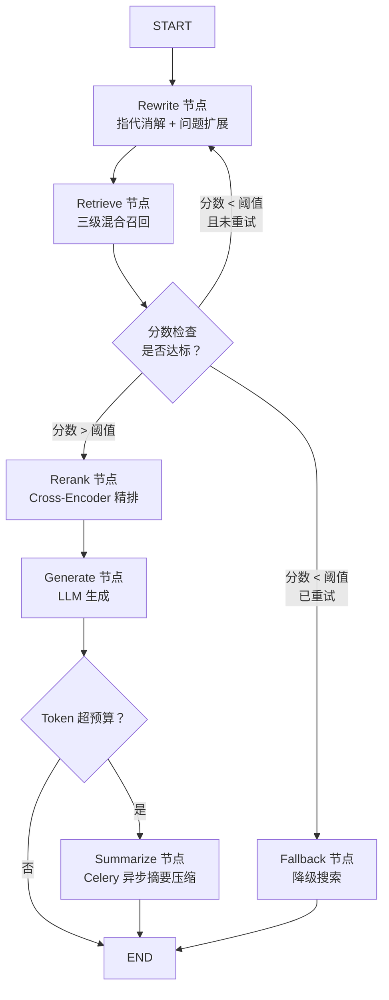

# 答案生成与上下文管理

维护本项目生成模型、历史摘要、Token 预算与精确答案缓存策略。通用记忆机制见 [[03_Agent系统/05_记忆与上下文管理]]；引用、拒答和幻觉治理见 [[02_RAG系统/10_防幻觉机制]]。历史模型推荐和时延数字不作为当前通用选型结论。

## 上下文与对话记忆管理

在多轮对话场景中，盲目拼接历史记录不仅会导致大模型的 Token 快速耗尽上限，还会导致“注意力稀释”。为此我们在记忆模块实现了**多级状态管理与动态修剪机制**：

### 1. 基于 LangGraph 的状态流转与记忆存储（Memory）

多轮状态改用 LangGraph 与持久化 checkpointer 管理，与 Redis 结果缓存是不同职责。缓存策略区分两类：设计上保留满足复用条件的精确答案缓存，停用仅凭问题向量相似度直接返回旧答案的语义缓存。精确答案缓存、Reranker 缓存是否上线仍需部署配置核实，本地演示代码的行为另见代码总结。

**① 统一结构化持久状态 (AgentState & Checkpoint)**
- 核心代码定义了包含 `messages`（历史消息序列）、`retrieved_docs`（召回文档候选池）、`rewrite_queries`（改写子问题）等成分的全局上下文数据状态类（State）。 
- checkpointer 按 `thread_id` 组织状态，但它不自动提供身份认证、租户授权或并发顺序控制。应用需校验 thread_id 的任务归属、绑定 tenant/user，并处理同会话并发更新与 checkpoint 命名空间，才能建立会话隔离。

**③ LangGraph 状态图完整节点与边定义**



- **条件边（ScoreCheck → Rewrite）**：当检索打分极差且尚未重试时，系统回退到 Rewrite 层进一步衍生 5~6 句等价短语再次检索，最多重试 1 次
- **降级边（ScoreCheck → Fallback）**：重试后仍低于阈值，执行 Return Fast 降级策略

**② 保留精确查询缓存，停用仅凭语义相似度复用答案的缓存**

- **相同问题，满足条件时可以复用答案**：例如，用户再次问“SIB1 是什么”，如果知识库、模型和 Prompt 版本、用户权限以及影响答案的对话上下文都没变，就可以使用精确答案缓存，减少重复检索和生成的时间与费用。缓存键应包含这些影响答案的条件，不能只使用 Query 文本；命中后仍需检查有效期和当前权限。知识库更新或相关配置变化后，相关旧缓存应失效。对于“它是什么”这类依赖上下文的问题，无法确认上下文一致时，应跳过答案缓存。
- **相似问题，不直接共用答案**：例如，“SIB1 是什么”和“SIB2 是什么”虽然问法相似、讨论的对象也有关联，但答案不能互换。即使两个问题的向量接近，也只能说明它们相关，不能证明旧答案适用于新问题。因此，设计上停用仅凭向量相似度直接返回旧答案的语义缓存。这不等于认定 Embedding 失效，也不能未经测试就断言它们必然误命中。
- **未命中有效精确缓存时，再走检索生成流程**：在权限校验后，依次执行 Query 改写、带权限与版本过滤的 BM25 + 向量混合检索、融合、重排和答案生成。通过关键词匹配、元数据约束和重排进一步区分术语；这些机制能降低答错对象的风险，实际效果仍需评测，不能保证绝不出错。

> 一句话解释：**完全相同的问题，相关条件没变时可以用缓存；只是看起来相似的问题，不直接拿旧答案回复。**上述为设计策略，生产是否启用精确答案缓存仍需核对部署配置。

### 2. 动态滑动窗口与 Token 计费
- **事前 Token 估算**：并非机械地保留“最近 5 轮对话”，而是引入了与大模型严格对齐的本地 Tokenizer（如 tiktoken 或 Qwen 原生分词器）。在每次发起组合请求前，先计算历史队列的总体 Token 排量。
- **保留与裁剪规则**：
  1. **System Prompt 永驻**：系统级人设指令必须占用前置固定 Token。
  2. **优先保留当前问题**：保留当前提问（Query）及紧邻的上一轮 Q&A 轮次。
  3. **中间轮次按需断尾**：当历史累计超过设定预算（例如 4000 Tokens 阈值），按照时间线从旧到新依次剔除闲聊或过渡轮次。

### 3. 超长对话的摘要压缩机制（Summarization）
当用户在一个 Session 中深度探讨复杂技术且轮次极长时，直接截断会导致关键线索丢失。此时系统会触发旁路异步能力：
- 后台任务（[[04_工程与框架/06_Celery]] 调度）侦测到历史 Token 超过预算，会调用一个轻量级模型（如 Qwen3-4B）传入历史内容并指令：`“请总结上述用户与 AI 的交互核心技术点与已确认的客观事实，需以精简的要点呈现。”`
- 将摘要打包为一条 `{"role": "system", "content": "前情提要:..."}`，放在新一轮对话前部，以减少历史消息占用的 Token，并保留后续回答需要的背景信息。

---

## 单次查询 Token 消耗精细估算

为了科学地制定记忆预算和模型上下文窗口选型，我们对每次 RAG 查询的 Token 消耗进行了分项拆解（以 Qwen 原生分词器为基准）。

### 输入 Token (Input) 构成

| 组成部分 | 最小值 | 典型值 | 最大值 | 说明 |
| ---- | ---- | ---- | ---- | ---- |
| **System Prompt** | ~400 | ~500 | ~650 | 角色定义 + 防幻觉约束 + 引文格式说明，固定负担 |
| **多轮历史对话** | 0 | ~2,000 | ~4,000 | 受动态裁剪预算上限控制（详见下节分析） |
| **当前 Query（改写后）** | ~15 | ~50 | ~100 | 中文技术问题，含指代消解展开后的版本 |
| **Top 10 召回 Chunk** | ~5,500 | ~7,500 | ~15,000 | ⚠️ 最大变量，详细拆解见下表 |
| **XML 元数据标记开销** | ~400 | ~500 | ~600 | 每片 `<doc id="..." title="...">` 约 +50 tokens，×10 片 |

**Top 10 Chunk 大小分场景拆解：**

| 召回策略 | 单片 Tokens | ×10 片总计 |
| ---- | ---- | ---- |
| 纯叶子节点（512–800 tokens/片） | ~650 | ~6,500 |
| 父子索引 → 返回 Parent 文档（≤2K） | ~1,500 | ~15,000 |
| **实际混合场景（中位估算）** | ~700 | **~7,500** |

### 输出 Token (Output) 估算

| 回答类型 | 估算 Token |
| ---- | ---- |
| 简短事实性回答（单段） | 100–300 |
| 标准技术说明（带 inline citation） | 300–600 |
| 复杂综合推理（多段落报告式） | 600–1,200 |
| **典型均值** | **~450** |

### 单次请求总量汇总

```
┌─────────────────────────────────────────────┐
│       单次查询 Token 消耗（典型场景）           │
├──────────────────────┬──────────────────────┤
│ 输入（Input）         │ ~10,000 tokens        │
│  ├ System Prompt      │   ~500                │
│  ├ 历史对话           │  ~2,000               │
│  ├ 当前 Query         │    ~50                │
│  └ 召回 Context       │  ~7,500               │
├──────────────────────┼──────────────────────┤
│ 输出（Output）        │    ~450 tokens        │
├──────────────────────┼──────────────────────┤
│ 合计（Total）         │ ~10,450 tokens / 次   │
└──────────────────────┴──────────────────────┘

最小（首轮，无历史）：  ~8,500 tokens
典型（2-4 轮多轮）：   ~10,000 - 13,000 tokens
最大（深度长对话）：   ~18,000 - 20,000 tokens
```

---

## 记忆 Token 上限分析与推导

理论上，记忆预算 = **模型总上下文窗口** - **不可压缩的固定消耗** - **安全缓冲量**。

### 固定消耗（不可裁剪）

```
System Prompt          ~500 tokens   （固定）
Top 10 召回 Context   ~7,500 tokens  （每次查询重新填充）
当前 Query             ~  50 tokens  （固定）
输出保留预算           ~ 600 tokens   （max_new_tokens 预留）
XML 元数据标记         ~ 500 tokens   （固定）
─────────────────────────────────────
固定合计：            ~9,150 tokens
```

### 记忆可用空间推导
以 **Qwen2.5-72B-Instruct**（推荐选型，见下节）128K 上下文窗口为例：

$$\text{记忆预算} = 128{,}000 - 9{,}150 = 118{,}850 \text{ tokens（理论上限）}$$

然而，**理论上限远不等于实践推荐值**。研究表明，LLM 存在"**中间迷失（Lost in the Middle）**"现象：当上下文过长时，模型对头尾信息的注意力权重高于中间段，导致长对话历史中的关键细节被忽视。

### 实践推荐与分档策略

| 对话阶段               | 建议历史 Token 预算       | 对应约 N 轮 | 触发策略                        |
| ------------------ | ------------------- | ------- | --------------------------- |
| **常规对话**（1~5 轮）    | ≤ 4,000 tokens      | 约 4~6 轮 | 正常裁剪，丢弃最老轮次                 |
| **深度技术探讨**（5~12 轮） | 4,000–6,000 tokens  | 约 6~9 轮 | 触发 Celery 摘要压缩，历史浓缩为 `前情提要` |
| **超长会话**（12 轮+）    | ≤ 2,000 tokens（压缩后） | 压缩摘要    | 保留压缩摘要 + 最近 1~2 轮原文         |

> [!IMPORTANT]
> **本方案将历史记忆预算设为 4,000 tokens（硬上限）**，超出后触发摘要压缩。按当前估算，可保留约 5～6 轮上下文，并为 Context（7.5K）与 System Prompt（0.5K）预留空间，将 Prompt 控制在约 13,000 tokens 以内。该预算是否合适，需结合召回质量、回答准确性和 TTFT 验证。

---

## RAG 答案生成模型选型分析

答案生成模型会影响回答质量，但最终效果也取决于检索结果、上下文组织和提示词。以下根据系统需求分析模型选型。

### 核心需求清单

| 维度 | 要求 |
| ---- | ---- |
| **上下文窗口** | 至少 32K，最好 ≥ 128K（应对深度多轮 + 大 Context） |
| **指令遵循能力** | 能稳定遵循防幻觉提示词，并按要求添加原文引用 |
| **中文语言质量** | 优秀（5G 技术文档语境，大量专有名词） |
| **结构化输出** | 支持 JSON / 带引文的 Markdown 格式输出 |
| **推理时延** | 搭配 vLLM 后 TTFT ≤ 3s，TPS ≥ 30 tokens/s |
| **部署灵活性** | 支持私有化本地部署（企业数据合规要求） |

### Qwen2.5 系列横向对比

| 模型 | 参数量 | 上下文 | 指令遵循 | 中文质量 | 推理速度 | 私有部署显存需求 | 推荐度 |
| ---- | ---- | ---- | ---- | ---- | ---- | ---- | ---- |
| Qwen2.5-7B-Instruct | 7B | 128K | ⭐⭐⭐ | ⭐⭐⭐ | ⭐⭐⭐⭐⭐ | ~14 GB (fp16) | 🟡 资源极限场景 |
| Qwen2.5-14B-Instruct | 14B | 128K | ⭐⭐⭐⭐ | ⭐⭐⭐⭐ | ⭐⭐⭐⭐ | ~28 GB (fp16) | 🟡 中档备选 |
| Qwen2.5-32B-Instruct | 32B | 128K | ⭐⭐⭐⭐⭐ | ⭐⭐⭐⭐⭐ | ⭐⭐⭐⭐ | ~64 GB (fp16) | 🔵 次选（算力受限） |
| **Qwen2.5-72B-Instruct** | **72B** | **128K** | **⭐⭐⭐⭐⭐** | **⭐⭐⭐⭐⭐** | **⭐⭐⭐⭐** | **~144 GB (fp16)** | **✅ 首选推荐** |
| Qwen2.5-7B-Instruct-1M | 7B | **1M** | ⭐⭐⭐ | ⭐⭐⭐ | ⭐⭐⭐⭐ | ~14 GB | 🔵 未来超长文档场景 |

### 最终推荐：Qwen2.5-72B-Instruct

作为企业核心应用，服务全员日常研发查询，质量是第一优先级，硬件成本是第二位的考量——因此选用旗舰级 **Qwen2.5-72B-Instruct**。

**推荐理由（逐条分析）：**

**① 候选模型的回答质量**
历史选型记录将 Qwen2.5-72B-Instruct 作为高质量回答的候选，并列出 MMLU、C-Eval 和指令遵循等比较维度。笔记中的 8–12% 质量增益仍需对应的评测报告支持，不能仅凭通用榜单推断领域问答效果。

**② 对复杂指令的遵循能力**
System Prompt 包含禁止捏造、添加 inline citation 和角色约束等要求。历史选型倾向使用 72B 模型，期望提高指令遵循的稳定性；是否优于 32B，以及引用错误减少多少，需要领域评测验证。

**③ 128K 上下文窗口提供容量余量**
根据当前 Token 预算估算，单次请求最多约 20,000 tokens。128K 窗口提供超过 6 倍的容量余量，可用于更长历史或更多检索片段；实际可用长度与长文本效果仍需验证。

**④ 搭配 vLLM 可满足 TTFT < 3s 时延目标**
在 vLLM + PagedAttention 加速下，Qwen2.5-72B 在 **4×A100 (80G)** 张量并行部署时，可实现 **25–40 tokens/s** 的生成速度，TTFT 稳定控制在 **2–3s** 范围内，满足系统时延硬性要求。

> [!note] vLLM 推理部署配置细节
> - **引擎**：vLLM v0.4+，底层利用 PagedAttention v2 实现动态 KV Cache 分页管理，避免静态预分配造成的显存浪费
> - **并行策略**：4× A100-80G 上采用 Tensor Parallelism（`--tensor-parallel-size 4`），模型权重均匀切分至 4 张卡
> - **Batch 调度**：启用 Continuous Batching（连续批处理），最大并发请求数 `--max-num-seqs 64`，动态合并短请求以最大化 GPU 利用率
> - **量化降本路线**：AWQ 4-bit 量化后，可在 2× A100-80G 上部署，TTFT 增加约 15%，质量损耗 < 3%
> - **关键参数**：`--max-model-len 32768`（限制单次请求最大上下文，防止 OOM），`--gpu-memory-utilization 0.90`

**⑤ 企业级私有化部署，数据不出域**
fp16 全精度需 ~144GB 显存（4 张 A100-80G 或 2 张 H100-80G 即可）。如需进一步降本，可使用 **AWQ / GPTQ 4-bit 量化**，显存需求压缩至 ~40GB（2 张 A100-80G），质量损耗 < 3%，完全可接受。

> [!NOTE]
> **降级备选方案说明（按算力排序）：**
> - **算力受限（2×A100-80G）**：选用 `Qwen2.5-32B-Instruct`（fp16 ~64GB），综合性能仍超越 Qwen2-72B，是性价比最高的次选。
> - **单卡场景（1×A100-40G）**：选用 `Qwen2.5-14B-Instruct`，AWQ 4-bit 量化后约 7GB，适合 POC 验证或内部测试环境。
> - **未来演进方向**：关注 `Qwen2.5-14B-Instruct-1M`（100 万 token 上下文），探索减少切片、直接处理完整章节或书籍的长上下文方案。

---
