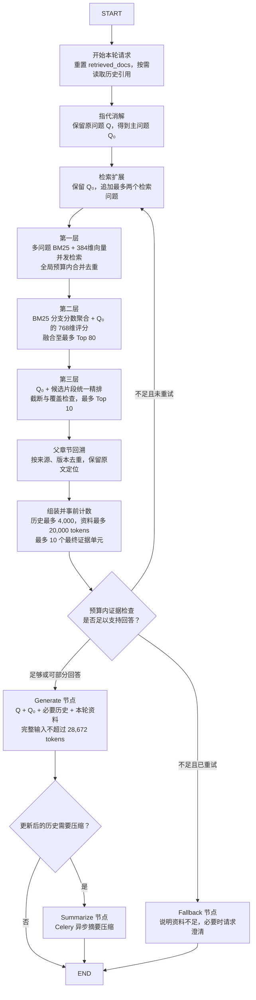

# 答案生成与上下文管理

维护本项目生成模型、历史摘要、Token 预算与精确答案缓存策略。通用记忆机制见 [[03_Agent系统/05_记忆与上下文管理]]；引用、拒答和幻觉治理见 [[02_RAG系统/10_防幻觉机制]]。历史模型推荐和时延数字不作为当前通用选型结论。

## 生成时使用哪个问题

本节为 2026-10-25 确定的设计方案。检索过程见 [[02_RAG系统/04_查询改写与检索排序]]：保留用户原问题 Q，消解指代得到主问题 Q₀，再生成最多两个补充检索问题。扩展问题在第一层找资料，第二层语义评分和第三层精排统一围绕 Q₀；最终生成只回答用户原需求。

| 生成输入 | 用途与边界 |
| --- | --- |
| 用户原问题 Q | 保留对象、条件、限制和回答形式等原始要求 |
| 主问题 Q₀ | 补全“它”“这个方案”等指代；与 Q 相同时无需重复传入 |
| 必要历史或摘要 | 补充本轮仍然有效的背景与约束，不自动包含历史参考文档正文 |
| 本轮最终资料及来源 | 父子检索后按父章节去重、选择原文，最多 10 个最终证据单元，并受资料 Token 预算约束 |
| 用户明确事项清单（按需） | 例如“优势、配置步骤”，用于检查回答是否遗漏；不加入扩展时新增的背景事项 |

**扩展问题列表默认不传给生成模型。** 它们通过检索到的资料间接影响答案，不代表用户追加了任务。若原问题和主问题发生实质冲突，应重新检查指代消解，不把改写结果当作新的用户指令。

示例：上文讨论载波聚合，用户问“它有哪些优势，怎么配置？”，主问题为“载波聚合有哪些优势，如何配置？”。检索可以扩展出“CA 的性能收益”“载波聚合配置前提”，答案仍围绕优势与配置展开；前提信息仅在解释步骤需要时补充。若只找到优势资料，应说明配置部分证据不足，不用通用知识编造步骤。

组装生成上下文时，将原问题与主问题分别标明，附上必要历史、资料和引用 ID，并要求模型综合互补证据、逐项回应明确事项。整体预算需计入这两个问题字段；不拼接所有扩展问题来增加生成负担。

## 上下文与对话记忆管理

本节为 **2026-10-28 更新的设计方案**，不代表已经修改代码或验证生产配置。父子索引下，参考资料按本轮问题重新选择；历史问答按预算保留，**历史参考文档正文不强行保留，也不随对话轮次累加**。

### 1. 基于 LangGraph 的状态流转与记忆存储（Memory）

设计上使用 LangGraph 与持久化 checkpointer 管理多轮状态，与 Redis 结果缓存分开。持久化记录用于恢复和追溯，不意味着整份 checkpoint 都要发送给模型。精确答案缓存、Reranker 缓存是否上线仍需部署配置核实，本地演示代码的行为另见代码总结。

**① 统一结构化持久状态 (AgentState & Checkpoint)**

| 状态字段（建议） | 保存内容 | 下一轮使用规则 |
| --- | --- | --- |
| `original_query` / `resolved_query` / `expanded_queries` | 原问题 Q、主问题 Q₀、最多两个扩展问题 | 每轮重新生成；扩展问题默认不进入生成 Prompt |
| `messages` | 用户提问与最终回答，保留引用标识，不嵌入参考文档全文 | 按相关性和历史预算选取，供指代消解与对话衔接 |
| `summary` | 用户已确认的对象、版本、限制、当前事项和未解决问题 | 与选中的原始问答合计计入历史预算；不作为知识库原文证据 |
| `retrieved_docs` | 本轮候选、父章节回溯结果及最终证据 | 新一轮用户请求开始时重置，采用替换语义，不跨轮自动追加 |
| `evidence_refs` | 按轮记录文档 ID、版本、父子片段 ID、章节位置和引用映射 | 用于追溯或按需读取；只传 ID 不能代替正文，也不预留历史正文配额 |

字段名为设计建议，不作为代码已实现的证明。原文保存在知识库；checkpoint 或审计记录即使保留过往检索结果，也不自动将其带入下一轮 Prompt。

- checkpointer 按 `thread_id` 组织状态，但它不自动提供身份认证、租户授权或并发顺序控制。应用需校验 thread_id 的任务归属、绑定 tenant/user，并处理同会话并发更新与 checkpoint 命名空间，才能建立会话隔离。

**② 历史参考文档的使用规则**

1. **普通追问重新检索**：用必要历史消解指代，得到 Q₀，再执行本轮检索与父章节回溯。不因某文档上一轮被引用，就强制保留其正文。
2. **明确追问旧文档时按需读取**：例如“刚才那份文档的第二条是什么”，先通过 `evidence_refs` 确定来源，再校验权限与版本、读取相应原文，作为本轮资料参与选择。无法确定来源或原文不可用时说明缺口。
3. **资料统一去重和计费**：重新取回的旧资料与本轮新资料共用最多 10 个证据单元和同一资料 Token 上限；同文档、同版本、同父章节只放一份，父章节已覆盖的子片段不重复拼接。
4. **历史回答只提供对话背景**：旧回答和会话摘要不替代原文。若本轮结论依赖旧资料，应把相应原文重新选入本轮 `<context>`；没有选入的旧引用不能作为本轮事实依据。

例如：第一轮取回父章节 P，第二轮检索得到 Q、R，则第二轮默认只携带选中的 Q、R 和必要历史问答。若第二轮再次命中 P，或用户明确追问 P 的内容，再将 P 的必要原文纳入本轮预算；并非一律禁止使用历史文档。

**③ LangGraph 建议状态流转**

- **条件边（ScoreCheck → Expand）**：证据不足时最多重试一次，保留 Q₀，仅替换补充检索问题；每次仍为总计 1~3 个检索问题，沿用同一候选预算，并设置整轮请求的总时限。相似度或精排分数不能单独证明资料足以回答。
- **降级边（ScoreCheck → Fallback）**：重试后仍缺少证据时说明资料不足；能回答一部分时明确区分有依据与缺失的事项。若问题本身存在指代歧义，应在指代消解阶段澄清。
- **生成前必须通过预算检查**：后台摘要只优化后续请求，不能代替本轮调用前的计数与裁剪。裁剪后重新检查证据覆盖，不能为了满足长度而删掉关键条件后照常生成完整结论。

**④ 保留精确查询缓存，停用仅凭语义相似度复用答案的缓存**

- **相同问题，满足条件时可以复用答案**：例如，用户再次问“SIB1 是什么”，如果知识库、模型和 Prompt 版本、用户权限以及影响答案的对话上下文都没变，就可以使用精确答案缓存，减少重复检索和生成的时间与费用。缓存键应包含这些影响答案的条件，不能只使用 Query 文本；命中后仍需检查有效期和当前权限。知识库更新或相关配置变化后，相关旧缓存应失效。对于“它是什么”这类依赖上下文的问题，无法确认上下文一致时，应跳过答案缓存。
- **相似问题，不直接共用答案**：例如，“SIB1 是什么”和“SIB2 是什么”虽然问法相似、讨论的对象也有关联，但答案不能互换。即使两个问题的向量接近，也只能说明它们相关，不能证明旧答案适用于新问题。因此，设计上停用仅凭向量相似度直接返回旧答案的语义缓存。这不等于认定 Embedding 失效，也不能未经测试就断言它们必然误命中。
- **未命中有效精确缓存时，再走检索生成流程**：在权限校验后，依次执行 Query 改写、带权限与版本过滤的 BM25 + 向量混合检索、融合、重排和答案生成。通过关键词匹配、元数据约束和重排进一步区分术语；这些机制能降低答错对象的风险，实际效果仍需评测，不能保证绝不出错。

> 一句话解释：**完全相同的问题，相关条件没变时可以用缓存；只是看起来相似的问题，不直接拿旧答案回复。**上述为设计策略，生产是否启用精确答案缓存仍需核对部署配置。

### 2. 动态滑动窗口与 Token 计费

使用生成模型对应的 tokenizer 与实际 chat template，对**完整组装输入**计数，包含 System Prompt、Q/Q₀、历史、资料正文、XML 元数据及消息边界。不能只统计历史消息，也不能把另一个模型的 tokenizer 计数当作精确值。

保留与裁剪规则：

1. **保留系统约束与当前需求**：Q 与 Q₀ 相同时只传一份；输入本身超长时先处理或澄清，不能静默删掉用户限制。
2. **历史问答目标 2,000、硬上限 4,000 tokens**：摘要和选中的原始问答合并计数。最近一轮优先保留，但不保证无论多长都原样保留；过长时保留必要对象、约束与未解决事项。
3. **本轮参考资料目标 15,000、硬上限 20,000 tokens**：含正文与来源标记。先按父章节去重，再删除无关内容或选取包含命中位置及适用条件的连续原文。最多 10 个证据单元是上限，不要求凑满。
4. **总量超限时同步裁剪**：先移除重复内容和无关历史，再压缩更早问答，最后减少低相关资料或缩小父章节原文范围。仍放不下时返回可支持的部分答案或说明缺口，不挤占输出与安全预留。

上述为待评测的起始预算。历史参考文档没有独立的“必须保留额度”；按需读取的旧原文统一计入本轮资料预算。

### 3. 超长对话的摘要压缩机制（Summarization）
历史接近或超过 4,000 tokens 时，可通过 [[04_工程与框架/06_Celery]] 调度轻量模型异步生成摘要。即使后台任务尚未完成，下一次请求仍需同步裁剪到预算内。

- **摘要目标不超过 1,000 tokens**：记录用户已确认的对象、版本、限制、当前事项和未解决问题；保留必要来源引用作为查找线索，不复制父章节全文，也不把旧回答自动提升为已核验事实。
- **摘要与近期问答共用 4,000 tokens**：优先保留最近 1～2 轮的相关内容，不按固定轮数保证完整保留。摘要中已覆盖且不再需要逐字保留的旧消息移出活动历史，审计记录可另存。
- **摘要作为带标签的对话背景**：通过独立历史区域传入，不提升为高优先级 System 指令，也不充当 `<context>` 内的原文证据。
- **版本校验后更新状态**：只压缩本次读取的旧历史，保留其后新增消息，避免异步任务覆盖更新的问答。

---

## 父子索引下的 Token 预算

### 1. 以实际部署窗口为上限

沿用本文部署示例的 `--max-model-len 32768`，将 **32,768 tokens** 作为本次设计的请求总窗口。模型标称支持更长窗口，不代表当前服务允许使用同样长度；生产值仍需核对。

| 预算项 | 起始设置 | 计数口径 |
| --- | --- | --- |
| 请求总窗口 | 32,768 | 输入与输出共享的有效窗口 |
| 输出预留 | 2,048 | 每次调用预留并设置生成上限，不是每次必然生成的长度 |
| 安全余量 | 2,048 | 不分配给历史或参考资料，不能替代准确计数 |
| 完整输入硬上限 | 28,672 | 32,768 − 2,048 − 2,048，包含 chat template 等全部输入开销 |
| 历史问答与摘要 | 目标 2,000；硬上限 4,000 | 不包含历史参考文档正文；摘要目标不超过 1,000，计入同一历史额度 |
| 本轮参考资料 | 目标 15,000；硬上限 20,000 | 包含父章节或原文片段、引用 ID、标题、版本与 XML 标记 |
| 最终证据单元数量 | 最多 10 个 | 父章节去重并按预算选择后的数量；新资料与按需重取的旧资料共用 |

System Prompt、Q/Q₀、消息边界及其他实际传入字段从输入预算中按真实长度扣除。各分项上限不是必须用满的配额；完整输入硬上限始终优先。若部署窗口或输出上限变化，先重新计算完整输入上限，不能直接沿用本表。

### 2. 父章节回溯后的资料选择

父子索引的检索粒度与生成粒度不同，不能继续按“10 个约 650 tokens 的叶子块”估算生成输入。

| 本轮资料情况                     | 正文大小示例（不含来源标记）                | 组装方式                               |
| -------------------------- | ----------------------------- | ---------------------------------- |
| 10 个子块命中同一父章节              | 若该章节为 1,500 tokens，正文只计 1,500 | 按文档、版本、父章节去重，不复制 10 份              |
| 10 个子块命中 10 个不同父章节         | 平均每章 1,500，正文约 15,000         | 加上来源标记后计数，必要时减少或节选资料               |
| 10 个不同父章节接近 2,000 tokens/章 | 正文已接近 20,000                  | 来源标记仍占预算，不能默认把 10 章全部塞满            |
| 父章节超过 2,000 tokens         | 不把整章长度默认压成 2,000              | 取包含命中位置与必要条件的原文范围，保留位置映射；仍受总资料上限约束 |

非叶子节点的摘要可用于导航和综述召回，不能据此声称已提供完整原文。涉及数值、配置前提、例外或跨段关系时，补取必要原文再回答。对已经提供的父章节，不再重复附加其内部相同子片段。

### 3. 单次请求估算示例

以下为预算示例，不是实测均值或固定最小值；参考资料一栏已包含来源标记，不能再次单独加一遍 XML 开销。

| 组成                      | 示例 Token 数           |
| ----------------------- | -------------------- |
| System Prompt           | 500                  |
| 历史问答与摘要                 | 2,000                |
| Q 与 Q₀                  | 100                  |
| 本轮资料及来源标记               | 15,000               |
| chat template 与消息边界（暂估） | 200                  |
| **输入合计**                | **17,800**           |
| 输出预留                    | 2,048                |
| 安全余量                    | 2,048                |
| **总预算占用**               | **21,896，低于 32,768** |

若资料达到 20,000、历史达到 4,000，其他输入仍按上述示例的 800 计，则输入为 24,800，总预算占用为 28,896。实际请求仍须以 tokenizer 对完整输入计数，不能把示例当作对任意问题长度的保证。

### 4. 历史记忆的动态额度

$$B_{history} = \max\left(0,\min\left(4{,}000,\ 28{,}672 - T_{system+query+template} - T_{docs}\right)\right)$$

其中 `T_docs` 包含本轮重新取回的旧原文与新资料，不含未发送的历史引用记录。目标保留约 2,000 tokens 的相关历史；本轮资料较少时也不自动填满历史额度。

| 情况                   | 处理方式                                         |
| -------------------- | -------------------------------------------- |
| 历史在预算内且仍相关           | 保留必要问答，不补入其当时的整份参考文档                         |
| 历史接近或超过 4,000 tokens | 生成目标不超过 1,000 tokens 的摘要，与近期相关问答合计控制在有效历史额度内 |
| 可用历史额度不足             | 优先保留指代对象、用户限制与未解决事项，压缩旧问答；必要信息仍不足时澄清         |
| 用户追问历史文档细节           | 按引用定位并读取原文，作为本轮资料计费，不挤入历史问答额度                |

> [!IMPORTANT]
> **历史参考文档不强行保留，历史问答与本轮资料分开计费。** 4,000 是历史问答与摘要的硬上限，不是完整 Prompt 上限；20,000 是本轮资料硬上限，不是每轮新增后永久累积的额度。当前预算为设计起点，需用领域问答质量、证据覆盖、TTFT 和实际 Token 消耗评测后调整。

---

## RAG 答案生成模型选型分析

答案生成模型会影响回答质量，但最终效果也取决于检索结果、上下文组织和提示词。以下根据系统需求分析模型选型。

### 核心需求清单

| 维度 | 要求 |
| ---- | ---- |
| **上下文窗口** | 当前预算按服务实际开放的 32,768 tokens 设计；更长窗口作为经过评测后可调整的选项 |
| **指令遵循能力** | 能稳定遵循防幻觉提示词，并按要求添加原文引用 |
| **中文语言质量** | 优秀（5G 技术文档语境，大量专有名词） |
| **结构化输出** | 支持 JSON / 带引文的 Markdown 格式输出 |
| **推理时延** | 搭配 vLLM 后 TTFT ≤ 3s，TPS ≥ 30 tokens/s |
| **部署灵活性** | 支持私有化本地部署（企业数据合规要求） |

### Qwen2.5 系列横向对比

| 模型                       | 参数量     | 上下文      | 指令遵循      | 中文质量      | 推理速度     | 私有部署显存需求           | 推荐度         |
| ------------------------ | ------- | -------- | --------- | --------- | -------- | ------------------ | ----------- |
| Qwen2.5-7B-Instruct      | 7B      | 128K     | ⭐⭐⭐       | ⭐⭐⭐       | ⭐⭐⭐⭐⭐    | ~14 GB (fp16)      | 🟡 资源极限场景   |
| Qwen2.5-14B-Instruct     | 14B     | 128K     | ⭐⭐⭐⭐      | ⭐⭐⭐⭐      | ⭐⭐⭐⭐     | ~28 GB (fp16)      | 🟡 中档备选     |
| Qwen2.5-32B-Instruct     | 32B     | 128K     | ⭐⭐⭐⭐⭐     | ⭐⭐⭐⭐⭐     | ⭐⭐⭐⭐     | ~64 GB (fp16)      | 🔵 次选（算力受限） |
| **Qwen2.5-72B-Instruct** | **72B** | **128K** | **⭐⭐⭐⭐⭐** | **⭐⭐⭐⭐⭐** | **⭐⭐⭐⭐** | **~144 GB (fp16)** | **✅ 首选推荐**  |
| Qwen2.5-7B-Instruct-1M   | 7B      | **1M**   | ⭐⭐⭐       | ⭐⭐⭐       | ⭐⭐⭐⭐     | ~14 GB             | 🔵 未来超长文档场景 |

### 最终推荐：Qwen2.5-72B-Instruct

作为企业核心应用，服务全员日常研发查询，质量是第一优先级，硬件成本是第二位的考量——因此选用旗舰级 **Qwen2.5-72B-Instruct**。

**推荐理由（逐条分析）：**

**① 候选模型的回答质量**
历史选型记录将 Qwen2.5-72B-Instruct 作为高质量回答的候选，并列出 MMLU、C-Eval 和指令遵循等比较维度。笔记中的 8–12% 质量增益仍需对应的评测报告支持，不能仅凭通用榜单推断领域问答效果。

**② 对复杂指令的遵循能力**
System Prompt 包含禁止捏造、添加 inline citation 和角色约束等要求。历史选型倾向使用 72B 模型，期望提高指令遵循的稳定性；是否优于 32B，以及引用错误减少多少，需要领域评测验证。

**③ 标称窗口与部署窗口分开核算**
模型选型记录中的 128K 不是当前请求预算。本文部署示例将有效窗口限制为 32,768 tokens，因此按输入最多 28,672、输出预留 2,048、安全余量 2,048 核算。后续开放更长窗口时，仍需评测资料选择、回答质量、并发和 TTFT，不以容量增加为理由自动保留全部历史参考文档。

**④ 搭配 vLLM 可满足 TTFT < 3s 时延目标**
在 vLLM + PagedAttention 加速下，Qwen2.5-72B 在 **4×A100 (80G)** 张量并行部署时，可实现 **25–40 tokens/s** 的生成速度，TTFT 稳定控制在 **2–3s** 范围内，满足系统时延硬性要求。

> [!note] vLLM 推理部署配置细节
> - **引擎**：vLLM v0.4+，底层利用 PagedAttention v2 实现动态 KV Cache 分页管理，避免静态预分配造成的显存浪费
> - **并行策略**：4× A100-80G 上采用 Tensor Parallelism（`--tensor-parallel-size 4`），模型权重均匀切分至 4 张卡
> - **Batch 调度**：启用 Continuous Batching（连续批处理），最大并发请求数 `--max-num-seqs 64`，动态合并短请求以最大化 GPU 利用率
> - **量化降本路线**：AWQ 4-bit 量化后，可在 2× A100-80G 上部署，TTFT 增加约 15%，质量损耗 < 3%
> - **关键参数**：`--max-model-len 32768`（限制单次请求最大上下文，防止 OOM），`--gpu-memory-utilization 0.90`

**⑤ 企业级私有化部署，数据不出域**
fp16 全精度需 ~144GB 显存（4 张 A100-80G 或 2 张 H100-80G 即可）。如需进一步降本，可使用 **AWQ / GPTQ 4-bit 量化**，显存需求压缩至 ~40GB（2 张 A100-80G），质量损耗 < 3%，完全可接受。

> [!NOTE]
> **降级备选方案说明（按算力排序）：**
> - **算力受限（2×A100-80G）**：选用 `Qwen2.5-32B-Instruct`（fp16 ~64GB），综合性能仍超越 Qwen2-72B，是性价比最高的次选。
> - **单卡场景（1×A100-40G）**：选用 `Qwen2.5-14B-Instruct`，AWQ 4-bit 量化后约 7GB，适合 POC 验证或内部测试环境。
> - **未来演进方向**：关注 `Qwen2.5-14B-Instruct-1M`（100 万 token 上下文），探索减少切片、直接处理完整章节或书籍的长上下文方案。

---
