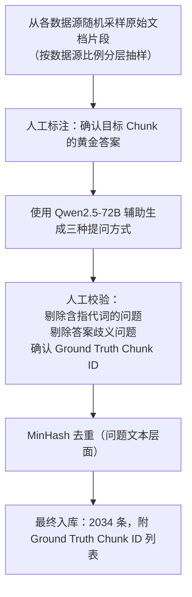
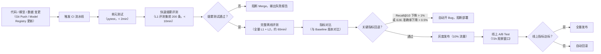

# RAG 评测系统构建全景

> [!note] 记录口径（2026-10-10 修订）
> 文中包含设计方案、历史配置与效果数字。未关联数据集版本、运行 ID、checkpoint 或评测日志的数字需核实，不直接作为实测结论；本地示例代码与生产部署状态分别说明。

> 本笔记记录针对无线豆包 RAG 系统的完整评测体系，涵盖数据集构造、指标定义、框架选型、CI/CD 集成与问题定界方法。

---

## 为什么需要自建评测体系

通用 RAG 评测框架（如 RAGAS、TruLens）默认面向开放域问答，存在以下与本系统的根本性错配：

| 问题 | 说明 |
|------|------|
| **领域词汇缺失** | 5G 专有词汇（SIB、PDCP、gNodeB）在通用 NLP 模型的语义空间中没有有效表征，BERTScore 等指标失真严重 |
| **文档结构特殊** | 3GPP 协议、设计文档、iCase 各自有独特的引用与层次结构，标准评测集无法覆盖 |
| **语义相似陷阱** | SIB1 与 SIB2 这类仅差一字却语义截然不同的术语，会导致基于向量相似的自动评分器打出错误高分 |
| **权限维度缺失** | RBAC 与 1+X+Y 标签过滤是系统核心能力，通用评测集无法构造带权限约束的测试用例 |

因此，评测体系以**自建领域评测集 + 分层指标 + 自动化流水线**为核心。

---

## 评测集构建

### 整体分层框架

评测集按三个能力层级递进：

```
L1 单文档上下文获取     → 评测基础检索链路是否合理
L2 多文档 / 多跳推理     → 评测跨文档比较与复杂推理能力
L3 Agent 作业上下文获取  → 评测 RAG 是否能支撑 Agent 精准获取上下文
```

### L1 单文档评测集

**规模**：2034 条用例

**采样策略**：

```
数据源覆盖
├── Support 文档（含图、表、附件）
├── Wiki（目录层级结构）
├── iCase（反思案例，不切片整篇入库）
├── 设计文档（含版本管理与 PDU 信息）
├── 3GPP 协议（特殊缩进格式）
└── 华为知道 / 华为案例

格式覆盖
├── 纯文本段落
├── 表格内容
├── 代码块
├── 图片描述（OCR 结果）
└── 数学公式 / 协议规范文本
```

**提问方式**：每个评测目标按三种方式各构造一条问题

| 提问方式 | 构造规则 | 示例 |
|----------|----------|------|
| 原文 | 直接截取文档原文的关键句作为 Query | "随机接入过程中 Msg3 的最大重传次数是多少？" |
| 总结 | 针对检索目标生成总结性需求描述 | "介绍一下随机接入的 Msg3 重传机制" |
| 容错 | 引入部分表达错误（错别字、术语缩写混用） | "随机接入 msg3 最大重发次数" |

**构造流程**：



**标注格式**（JSONL）：

```json
{
  "qid": "L1_0001",
  "query": "随机接入过程中 Msg3 的最大重传次数是多少？",
  "query_type": "原文",
  "source_doc_id": "support_12345",
  "source_chunk_ids": ["chunk_support_12345_007"],
  "difficulty": "easy",
  "format_type": "text",
  "knowledge_set": ["1", "软件"],
  "expected_top_k": 10
}
```

### L2 多文档 / 多跳评测集

**规模**：约 300 条（持续扩充中）

**构造策略**：

- **比较类**：选取两份描述同一协议不同版本（如 LTE vs NR）的文档片段，构造"对比 A 和 B 的差异"类问题
- **推理链类**：选取存在逻辑依赖关系的多个 Chunk（如设计文档引用 3GPP 协议），构造"A 这么设计的依据是什么"类问题
- **聚合类**：选取同一主题分散在多个文档的内容，构造"列举所有 X 的场景"类问题

**难度分级**：

| 级别 | 跳数 | 涉及文档数 |
|------|------|-----------|
| Medium | 2 跳 | 2 篇 |
| Hard | 3+ 跳 | 3+ 篇 |

### L3 Agent 场景评测集

**规模**：约 100 条（与 Agent 团队协同构建）

**覆盖场景**：

- Agent 在执行多步作业时，需要先检索 A 文档中的参数，再检索 B 文档中的配置规则
- 需要 RAG 返回结构化的工具调用上下文（非散文式回答）
- 带有严格的权限约束（特定 PDU 内部文档）

---

## 评测指标体系

### 检索层指标

检索层指标独立于生成层评估，可精确定位是召回问题还是生成问题。

| 指标 | 计算方式 | 目标值 | 评测层级 |
|------|----------|--------|---------|
| **Recall@K** | 每个查询 Top K 命中的相关 Chunk 数 / 该查询全部相关 Chunk 数，再对查询取平均 | Recall@10 ≥ 88%，Recall@20 ≥ 93% | 粗筛、精排各自测量 |
| **Hit@K** | Top K 是否至少命中一个相关 Chunk，再对查询取平均 | 按任务设定 | 只有每个查询恰有一个 GT Chunk 时才与 Recall@K 相同 |
| **MRR（Mean Reciprocal Rank）** | $\frac{1}{N}\sum_{i=1}^{N}\frac{1}{rank_i}$ | ≥ 0.75 | 衡量正确结果的排名位置 |
| **NDCG@K** | 考虑位置权重的归一化折损累计增益 | NDCG@10 ≥ 0.80 | 衡量排序质量 |
| **Precision@K** | Top K 中正确 Chunk 的比例 | Precision@10 ≥ 0.60 | 衡量精度 |

**三级召回的分层指标**：

```
第一层（粗筛，BM25 + 384维向量）
  目标：Recall@3000 ≥ 99%（正确答案在候选集中的概率）

第二层（精筛，RSF 融合）
  目标：Recall@80 ≥ 95%

第三层（精排，Reranker）
  目标：Recall@10 ≥ 88%，Recall@20 ≥ 93%
```

**评分等级**（L1 评测集使用）：

| 等级 | 定义 |
|------|------|
| 正确召回 | Ground Truth Chunk 完整出现在 Top K 结果中 |
| 部分召回 | 仅召回了 Ground Truth 的部分 Chunk（适用于多 Chunk 答案） |
| 无召回 | Top K 结果中不含任何 Ground Truth Chunk |

### 端到端（E2E）指标

E2E 指标评估从用户提问到最终回答的完整链路质量。

| 指标 | 计算方式 | 目标值 |
|------|----------|--------|
| **E2E 准确率** | 人工判定回答是否正确（二分类） | ≥ 93%（当前线上水平） |
| **引文准确率** | 回答中引用的来源是否确实支持该论断 | ≥ 90% |
| **拒答率** | 对超出知识库范围的问题正确拒答的比例 | ≥ 85% |
| **幻觉率** | 回答包含知识库中不存在信息的比例 | ≤ 5% |

**E2E 评分细则**（人工评审标准）：

```
满分 5 分制：
5 分 - 完全正确，引文准确，覆盖全部关键事实
4 分 - 主体正确，存在轻微遗漏但无错误
3 分 - 部分正确，有明显遗漏但无明显错误
2 分 - 有错误，但错误非核心
1 分 - 主要内容错误或严重幻觉
0 分 - 完全错误、无法回答或越权回答
```

### 延迟与吞吐指标

| 指标                   | 目标值       | 说明                       |
| -------------------- | --------- | ------------------------ |
| **TTFT（首 Token 时延）** | ≤ 3s（P95） | 从用户发送到第一个 Token 返回       |
| **三级召回耗时**           | ≤ 2s      | 第一层 0.5s，第二层 0.5s，第三层 1s |
| **改写耗时**             | ≤ 1s      | Qwen3-4B 改写单次耗时          |
| **精确缓存命中率** | 仅在启用该缓存时监控 | 线上启用状态待部署配置核实 |

> [!warning] 缓存质量与部署状态
> 历史方案记录停用语义答案缓存，避免 SIB1/SIB2 等近似术语误命中；本地演示代码仍含缓存路径。精确缓存是否上线需单独核实。命中率升高不是必然异常，应结合错命中率、查询分布和版本失效检查。

---

## 评测框架

### 核心工具栈

| 组件     | 工具             | 用途                     |
| ------ | -------------- | ---------------------- |
| 离线批量评测 | 自研 Python 评测脚本 | 跑全量评测集，输出各层指标          |
| LLM 裁判 | Qwen2.5-72B    | 自动化评估 E2E 回答质量（替代人工初筛） |
| 人工评审   | 内部标注平台         | 对 LLM 裁判评分结果的 5% 抽样复核  |
| 指标追踪   | MLflow         | 记录每次实验的指标、超参与模型版本      |
| 可视化    | Grafana        | 线上指标实时监控（延迟、吞吐、错误率）    |
| 评测数据管理 | 内部 Git 仓库      | 版本化管理评测集（JSONL 格式）     |

### 开源评测框架的引入：RAGAS 与 DeepEval

#### 能不能用？

可以用，但要清楚**它们能覆盖哪一层，不能覆盖哪一层**。

这两个框架本质上都是**生成质量的 LLM-as-Judge 封装**，对检索层的评测支持有限，且默认使用 OpenAI API 作为 Judge 后端，需要替换为内部的 Qwen2.5-72B 才能在私有化部署场景中使用。

#### RAGAS

**版本与接口**：0.4 推荐基于 experiment 的评测架构、新 metrics collections 与 `llm_factory` 等入口；旧 `evaluate` 和 Wrapper 路线存在弃用变化，弃用并不等于所有旧代码立即无法运行。新指标调用还涉及 `MetricResult` 返回值。[官方迁移指南](https://docs.ragas.io/en/stable/howtos/migrations/migrate_from_v03_to_v04/)

原文示例保留为当时版本。知识上需要记住：指标名称相同，不代表不同库版本、Judge 模型、提示词和样本字段下的结果可以直接比较。评测数字应与这些条件一起记录。

RAGAS 提供了一套面向 RAG 管道的标准化指标，其核心指标与本系统的适配情况如下：

| RAGAS 指标                  | 含义                                 | 本系统是否适用        | 备注                            |
| ------------------------- | ---------------------------------- | -------------- | ----------------------------- |
| **Faithfulness**          | 回答中的每个论断是否都能在召回的 Chunk 中找到依据       | **适用**         | 直接对应幻觉率，是最有价值的指标              |
| **Answer Relevancy**      | 回答是否切题（与 Query 相关）                 | 适用，但需关注        | 用向量相似度计算，5G 术语歧义可能导致虚高        |
| **Context Precision**     | 召回的 Chunk 中有多少是真正有用的（精度）           | **适用**         | 可补充 Precision@K               |
| **Context Recall**        | Ground Truth 答案所需的信息是否被 Chunk 完整覆盖 | **适用，需提供参考答案** | 需要评测集中有 `reference_answer` 字段 |
| **Context Entity Recall** | 参考答案中的实体是否在召回 Chunk 中出现            | 慎用             | 通用 NER 模型对 5G 术语识别率差，容易漏判     |

**历史版本示例**：将当时 RAGAS 的 LLM backend 替换为 Qwen2.5-72B，配合已有评测集运行；当前 0.4 的入口按上面的版本说明理解：

```python
from ragas import evaluate
from ragas.metrics import faithfulness, answer_relevancy, context_precision, context_recall
from ragas.llms import LangchainLLMWrapper
from langchain_community.chat_models import ChatOpenAI  # 指向内部 vLLM 端点

# 将 Judge 替换为内部部署的 Qwen2.5-72B
internal_llm = LangchainLLMWrapper(ChatOpenAI(
    base_url="http://internal-vllm/v1",
    model="Qwen2.5-72B-Instruct",
    api_key="internal-key"
))

result = evaluate(
    dataset=hf_dataset,          # 从 JSONL 评测集转换
    metrics=[faithfulness, answer_relevancy, context_precision, context_recall],
    llm=internal_llm,
)
```

#### DeepEval

DeepEval 的优势在于**与 pytest 深度集成**，可以直接嵌入 CI 流水线的单元测试阶段，在代码合并前做快速质量门禁。

| DeepEval 指标 | 对应本系统关注点 | 推荐用途 |
|--------------|----------------|---------|
| **GEval**（自定义标准） | 可配置成本系统的 5 分制评分标准 | 替代手写 Judge Prompt |
| **FaithfulnessMetric** | 幻觉检测 | 关注相似目标，但评分实现与结果不可默认等价 |
| **ContextualRecallMetric** | 召回覆盖度 | 适合在 CI 中做快速召回冒烟 |
| **AnswerRelevancyMetric** | 回答切题性 | 烟雾测试中使用 |

**CI 示例**：`load_smoke_test_samples`、`internal_llm` 和 `run_rag_with_trace` 由项目实现。适配器必须返回同一次执行的答案与实际检索上下文，不能用历史样本上下文配新答案。

```python
import pytest
from deepeval import assert_test
from deepeval.metrics import ContextualRecallMetric, FaithfulnessMetric
from deepeval.test_case import LLMTestCase


@pytest.mark.parametrize("sample", load_smoke_test_samples(n=50))
def test_rag_quality(sample):
    result = run_rag_with_trace(sample["query"])
    test_case = LLMTestCase(
        input=sample["query"],
        actual_output=result["answer"],
        expected_output=sample["reference_answer"],
        retrieval_context=result["retrieved_chunks"],
    )
    assert_test(
        test_case,
        [
            FaithfulnessMetric(threshold=0.85, model=internal_llm),
            ContextualRecallMetric(threshold=0.80, model=internal_llm),
        ],
    )
```

##### 任务与过程指标

DeepEval 当前包含任务完成、步骤效率、计划质量/遵循度和工具参数正确性等 Agent 指标，部分指标依赖 tracing 与完整轨迹。它们可帮助区分“检索结果差”“工具调用错”和“最终回答差”，不能全部用最后一句答案替代输入。[官方指标说明](https://deepeval.com/docs/metrics-introduction)

RAG 的 groundedness 与任务成功也不是同一指标：答案有引用但未完成任务，或者任务完成但引用不支持结论，都应分别识别。业务状态、工具副作用等仍适合确定性检查，LLM Judge 不替代全部断言。

关联：[[03_Agent系统/07_Agent评测体系设计]]、[[02_RAG系统/07_检索模型微调总览与协同部署]]。

#### 分工建议：与自研脚本如何配合

这两个框架不能直接替代分层诊断脚本：若只传入最终结果，它们无法知道 GT Chunk 在哪一层被过滤掉。仍需记录三级检索的中间结果，并补充对应指标。建议分工如下：

```
自研评测脚本（必须保留）
  职责：检索层 Recall@K / MRR / NDCG，三级逐层诊断，失败用例分类
  触发：每次 CI 全量评测，问题定界

RAGAS（补充）
  职责：Faithfulness（幻觉率）、Context Precision/Recall
  触发：生成模型或 Prompt 变更时，专项验证生成质量

DeepEval（补充）
  职责：CI 烟雾阶段的快速质量门禁（50 条 × 3 指标，< 5min）
  触发：每次 PR 合并前自动运行
```

#### 主要局限与注意事项

> [!warning] 在本系统中使用 RAGAS / DeepEval 的已知风险

1. **术语泛化问题依然存在**：两个框架的 Judge 都依赖 LLM，即使换成 Qwen2.5-72B，仍可能将 SIB1/SIB2 这类仅差一字的术语视为等价，导致 Faithfulness 虚高。需要在 Judge Prompt 中注入专有术语等价表（与自研 Judge 同样的纠偏措施）。
2. **Context Recall 需要参考答案**：RAGAS 的 LLM Context Recall 需要参考答案；项目可用 `reference_answer`，调用 RAGAS 时映射到所用版本的 `reference` 字段，而本系统的评测集以 Ground Truth Chunk ID 为核心，需要额外步骤把 GT Chunk 文本拼接成参考答案。
3. **需要补充分层诊断**：只评测最终召回结果，无法区分文档是在第一层粗筛还是第三层精排被过滤；需要自行记录各层候选并计算指标。
4. **调用成本**：调用次数由指标实现、版本、重试与分块决定。当前检查的 RAGAS Faithfulness 主要分为论断提取与批量支持判断两阶段，并非每个论断单独请求一次；应记录实际请求数、输入输出 tokens 与服务吞吐。

### LLM 裁判（Judge）设计

Faithfulness 衡量答案受上下文支持的程度，不能独立保证上下文本身真实或版本正确。用参考答案、适用版本与专家复核补充事实正确性评测。

使用 Qwen2.5-72B 作为自动化评分器，Judge Prompt 核心设计原则：

```
1. 给定原始 Query、召回的 Chunk 列表、系统回答
2. 要求 Judge 先输出 CoT（逐步推理），再输出评分
3. 明确禁止 Judge 使用自己的知识（避免与知识库冲突时评分偏向训练知识）
4. 提供 5 分制评分标准的详细说明和 3~5 个评分示例（Few-Shot）
5. 对于含专有术语的问题，额外提示 Judge 以术语准确性为优先判断维度
```

**LLM Judge 已知偏差与纠偏措施**：

| 偏差类型   | 描述             | 纠偏方式                      |
| ------ | -------------- | ------------------------- |
| 长度偏好   | 倾向给较长回答更高分     | Prompt 中明确说明简洁准确优于冗长      |
| 术语泛化   | 将近似术语视为等价      | 构建专有术语等价表，注入 Judge Prompt |
| 自我知识污染 | 用训练知识而非知识库内容评判 | 明确要求"仅基于提供的 Chunk 评判"     |

---

## CI/CD 集成

### 流水线架构



### 触发条件

| 变更类型 | 触发评测范围 | 说明 |
|----------|-------------|------|
| 改写模型（Qwen3-4B）更新 | 全量 L1 + L2 | 改写质量直接影响召回覆盖率 |
| Reranker 模型更新 | 全量 L1（重点 Recall@10） | 影响最终精排结果 |
| Embedding 模型更新 | 全量 L1 + 向量空间漂移检测 | 需同步重新构建向量库 |
| RSF 权重参数调整 | L1 快速评测（500 条） | 参数调整影响有限，快速验证即可 |
| 知识库数据更新 | 增量评测（仅对新增数据源采样） | 全量重测成本过高 |
| API / 路由逻辑变更 | 单元测试 + E2E 烟雾 | 与检索质量无关，快速验证即可 |

### 时间估算

以下是算术示例，不是压测结果。假设召回 2s/条、完整 RAG 8s/条、Judge 3s/次，且 20 workers 互不争用资源；并发列仅为理想除以 20，实际通常更慢。

| 评测阶段 | 样本量 | 假设单条成本 | 串行估算 | 理想 20 workers |
|----------|--------|-------------|----------|-----------------|
| L1 检索层 Recall/MRR/NDCG | 2034 | 2s | 67.8 min | 3.39 min |
| L1 E2E + 单次 Judge | 2034 | 8s + 3s | 372.9 min（6.22h） | 18.65 min |
| L2 多跳检索层 | 300 | 2s | 10 min | 0.5 min |
| 已有答案与上下文的 RAGAS Faithfulness | 2034 | 2 阶段 × 3s | 203.4 min（3.39h） | 10.17 min |

Faithfulness 行假设每阶段各调用一次且无重试/分块，未包括 RAG 生成耗时。平均 6 个论断不意味着 6 次调用。DeepEval 同时跑多个指标、RAGAS 全套的请求数与延迟需按所用版本单独测量，不能直接套两次或固定三倍。

**CI 时间口径**：单元测试、50 条烟雾、200 条检索快速评测可作为 PR 门禁；Merge 后跑全量检索、E2E 与多跳，生成模型/Prompt 变更时按需增加生成评测。具体门禁窗口应由实际 trace 的 P50/P95、队列时间、重试和 GPU 利用率确定。当前未提供压测日志，不宣称固定 5/35/60 分钟完成。

#### 并发度调优建议

| 瓶颈来源              | 建议并发度 | 原因                                |
| ----------------- | ----- | --------------------------------- |
| 三级召回（ES + Milvus） | 20~30 | 向量库与 ES 均支持高并发，主要受网络 I/O 限制       |
| Reranker（GPU 推理）  | 8~16  | 受 GPU 显存限制，过高并发会触发排队反而变慢          |
| LLM Judge（vLLM）   | 10~20 | 取决于 vLLM 的 max_num_seqs 配置，通常设 16 |
| RAGAS 多指标并行       | 5~10  | 单条样本内多指标串行，过高并发反而争抢 vLLM 队列       |

### 评测报告格式

每次 CI 评测自动生成 Markdown 报告，包含以下结构：

```markdown
# 评测报告 - {版本号} - {时间戳}

## 摘要
| 指标 | 当前版本 | Baseline | 变化 | 状态 |
|------|----------|----------|------|------|
| Recall@10 | 88.3% | 87.9% | +0.4% | ✅ |
| Recall@20 | 93.1% | 92.8% | +0.3% | ✅ |
| NDCG@10 | 0.812 | 0.805 | +0.007 | ✅ |
| TTFT P95 | 2.8s | 2.9s | -0.1s | ✅ |

## 分层指标
（第一层、第二层、第三层各自的 Recall 详情）

## 分数据源指标
（按 Support / Wiki / iCase / 设计文档 / 3GPP 分别报告）

## 失败用例分析（Top 20 最差用例）
（qid、query、失败原因分类、定界建议）

## 变更说明
（本次变更的内容摘要）
```

---

## 问题定界方法

当 E2E 准确率或 Recall 出现下降时，使用以下系统化定界流程将问题归因到具体模块。

### 定界分层框架

```
问题现象（E2E 准确率下降）
│
├─ Step 1：检查是否是数据问题
│    └─ 新增知识库数据质量差？切片不合理？元数据标签错误？
│
├─ Step 2：检查召回层（Retrieval Diagnostic）
│    ├─ 第一层 Recall@3000 是否 ≥ 99%？
│    │    └─ 否 → BM25 分词词表缺失 / 向量库未更新
│    ├─ 第二层 Recall@80 是否 ≥ 95%？
│    │    └─ 否 → RSF 权重 α 参数问题 / 384维向量质量问题
│    └─ 第三层 Recall@10 是否 ≥ 88%？
│         └─ 否 → Reranker 模型问题 / Cross-Encoder 对领域词泛化
│
├─ Step 3：检查改写层（Rewrite Diagnostic）
│    └─ 改写后的子问题是否覆盖了正确的语义方向？
│         手动检查失败 Query 的改写输出
│
└─ Step 4：检查生成层（Generation Diagnostic）
     ├─ 正确的 Chunk 已在 Top 10，但回答仍然错误？
     │    └─ System Prompt 约束问题 / LLM 幻觉 / 引文格式问题
     └─ 拒答率异常？
          └─ 检查 System Prompt 中的拒答阈值设置
```

### 失败用例分类体系

每条失败用例需标注失败原因，共分为以下类别：

| 失败类型 | 代码          | 典型特征                        | 优先排查方向                  |
| ---- | ----------- | --------------------------- | ----------------------- |
| 召回缺失 | `R_MISS`    | Ground Truth Chunk 不在 Top K | 检索三层逐层诊断                |
| 召回有噪 | `R_NOISE`   | 正确 Chunk 在但被低排名噪声淹没         | Reranker 精排质量           |
| 改写失效 | `Q_REWRITE` | 改写后子问题偏离原意                  | Qwen3-4B 改写模型           |
| 权限过滤 | `P_FILTER`  | 正确文档因 RBAC 被过滤              | 1+X+Y 标签与 SAP 画像匹配      |
| 数据质量 | `D_QUALITY` | Ground Truth Chunk 本身内容不完整  | 知识预处理流水线                |
| 生成幻觉 | `G_HALLUC`  | 召回正确但 LLM 生成了错误内容           | System Prompt / 生成模型    |
| 生成遗漏 | `G_OMIT`    | 召回正确但 LLM 遗漏了关键信息           | Context 组装顺序 / Token 预算 |
| 术语混淆 | `T_AMBIG`   | 近似术语（SIB1 vs SIB2）混淆        | 向量空间术语分布 / BM25 权重      |
|      |             |                             |                         |

### 专项诊断工具

**召回诊断脚本**（核心逻辑）：

```python
def diagnose_retrieval(query: str, ground_truth_chunk_ids: list[str], top_k: int = 20):
    """
    对单条 query 执行完整三层召回，并在每层后检查 GT chunk 是否在候选集中。
    输出每层的 Recall 状态，精确定位是哪一层丢失了正确答案。
    """
    # 第一层：粗筛
    layer1_results = bm25_retriever.search(query, top_k=1500) + \
                     vector_384_retriever.search(query, top_k=1500)
    layer1_ids = {r.chunk_id for r in layer1_results}
    layer1_recall = any(gt in layer1_ids for gt in ground_truth_chunk_ids)

    # 第二层：精筛
    layer2_results = rsf_fusion(layer1_results, query, top_k=80)
    layer2_ids = {r.chunk_id for r in layer2_results}
    layer2_recall = any(gt in layer2_ids for gt in ground_truth_chunk_ids)

    # 第三层：精排
    layer3_results = reranker.rerank(layer2_results, query, top_k=top_k)
    layer3_ids = {r.chunk_id for r in layer3_results}
    layer3_recall = any(gt in layer3_ids for gt in ground_truth_chunk_ids)

    return {
        "layer1_recall": layer1_recall,
        "layer2_recall": layer2_recall,
        "layer3_recall": layer3_recall,
        "failure_layer": None if layer3_recall else
                         ("layer3" if layer2_recall else
                          ("layer2" if layer1_recall else "layer1"))
    }
```

**权限过滤诊断**：

当怀疑是 RBAC / 1+X+Y 标签过滤导致的召回缺失时，使用超级管理员身份（不带任何标量过滤）重新执行相同 Query，若召回结果恢复正常则确认是权限配置问题。

---

## 特殊场景评测

### 术语歧义专项评测集

针对 5G 领域存在大量近似术语的问题，单独维护一个**术语歧义评测集**（约 200 条）：

```
构造规则：
1. 筛选出文档中存在多个"仅一字之差"的术语对（如 SIB1/SIB2、PDCP/PDCCH）
2. 对每个术语对，分别构造两条问题，答案指向不同文档
3. 评测时检查系统是否能正确区分，即两条问题不互相串答
```

**关键指标**：术语区分率 ≥ 98%（不得串答）

### 多轮对话评测

专门评测指代消解能力，构造多轮对话序列：

```json
[
  {"turn": 1, "query": "随机接入是什么", "expected_topic": "RACH"},
  {"turn": 2, "query": "它有哪些关键技术", "expected_topic": "RACH key technologies"},
  {"turn": 3, "query": "和上行调度有什么区别", "expected_topic": "RACH vs UL scheduling"}
]
```

**评测指标**：多轮指代消解正确率（改写后的子问题是否还原了正确主语）

### 冷启动 / 新数据源评测

每次新数据源接入后，执行以下专项评测：

1. 从新数据源中抽取 50~100 条样本构造临时评测集
2. 检查新数据源的 Recall@10 是否与全库水平一致
3. 重点检查切片边界是否破坏了关键语义单元

---

## 线上监控与报警

### 关键监控指标

```yaml
# Grafana 监控看板配置（核心指标）

metrics:
  - name: request_latency_p95
    alert_threshold: 5s      # 超过 5s 报警

  - name: retrieval_score_avg
    alert_threshold: 0.65    # Reranker 平均分低于 0.65 报警（可能是数据质量问题）

  - name: empty_result_rate
    alert_threshold: 5%      # 无召回率超过 5% 报警

  - name: fallback_rate
    alert_threshold: 3%      # 降级触发率超过 3% 报警

  - name: cache_exact_hit_by_term_pair
    alert_type: anomaly      # 精确缓存出现特定术语对的高命中，触发术语混淆告警
```

### 用户反馈回路

线上用户可对每条回答进行点踩（负反馈），系统将负反馈数据自动录入到**待分析问题池**：

1. 人工每周对负反馈问题进行批量分析，按失败类型分类
2. 高频出现的失败模式触发专项优化任务
3. 修复验证后，将对应问题加入评测集作为回归用例（防止复现）

---

## 评测集版本管理

### 版本策略

```
eval_dataset/
├── v1.0/          # 初始版本，2034 条 L1
├── v1.1/          # 新增 iCase 来源用例，修正若干标注错误
├── v1.2/          # 新增术语歧义专项集（200 条）
├── v2.0/          # 新增 L2 多跳评测集（300 条）
└── current -> v2.0   # 软链接指向当前版本
```

### 评测集质量保证

- 每次评测集更新都经过 **Inter-Annotator Agreement（IAA）** 检验，要求标注一致性 κ ≥ 0.85
- 禁止将评测集内容用于模型训练（防止数据污染）
- 评测集本身每半年做一次**漂移检测**：检查知识库更新后，部分评测集的 Ground Truth Chunk 是否已被删除或内容发生变化

---

## 当前基线与里程碑

| 指标 | v1.0 基线 | 当前水平 | 目标 |
|------|-----------|----------|------|
| E2E 准确率（TOP20 条件下） | 68% | **93%** | 95% |
| Embedding 微调后 Recall@10 | 62% | **88%** | 90% |
| 三级召回整体耗时 | 4.5s | **2s** | ≤ 1.5s |
| 术语区分率 | 未测量 | 监控中 | ≥ 98% |
| LLM Judge 与人工评审一致率 | - | 约 89% | ≥ 92% |

---

## 相关笔记

- [[02_RAG系统/00_项目总览]] — 系统整体架构与各模块详细说明
- [[02_RAG系统/code/RAG系统代码总结]] — 代码实现细节与项目结构

## 领域评测集的项目背景

公司研发资产具有以下特性：

- **使用场景化**：遵循 IPD 研发流程，资产有特定的消费方式
- **信息复杂化**：包括非结构化文档、结构化数据库、代码仓等多种资产形态
- **高度专业化**：包含大量专业术语及内部流程用语，如 AR、IR 等
- **逻辑关系复杂**：包括增量/全量关系、设计-开发-测试分层挂接文档

因此需要构建**专用的评测集**，以贴合公司的实际应用场景。

## 线上反馈与分层诊断闭环

RAG 各模块会相互影响，例如修改词表可能改变检索分数和最终回答。因此，需要**端到端（E2E）评测**与分层指标共同验证变更效果。

### 离线研发层全量回归评估（E2E Eval Pipeline）

RAGAS 0.4 的 experiment 架构与 Agent 轨迹指标提供新的组织方式；评测应记录库版本、Judge、提示词、输入字段和评分规则，避免把不同口径分数直接当作连续基线。详见 [[02_RAG系统/11_RAG评测系统]]、[[03_Agent系统/07_Agent评测体系设计]]。以下数据与流程属于原项目记录。
在更新底层底座库、调参切块（Chunk Size）或者重构 System Prompt 后，必须经由 CICD 准入触发包含 **2034 题金标准用例库（Golden Dataset）** 的自动化批量跑批。我们借鉴了开源 RAGAS 及 TruLens 框架的思想，并在内部重写了四大核心评估算子池：
1. **端到端生成准确率 (E2E Accuracy)**：目前录得 **93% 的通过率**，代表输出答案与预先专家撰写的 Ground Truth 在核心要点与意图上的高度重合。
2. **上下文精确度与召回率 (Context Precision & Recall)**：评价召回。**Recall** 测度“系统是否把所需的全部核心知识捞出来了”（防漏捞）；**Precision** 则判定“在这个 Top 10 片段库中，到底有多少比例是废话噪声文件”（防无关资料污染 Token）。
3. **事实忠实度 (Faithfulness/Hallucination Check)**：评价生成层抗幻觉。采用“逆向声明提取算法”（大模型提炼自己的回答为N句断言），然后再利用大模型核对这 N 个断言是否严丝合缝地源于被给予的 `<context>` 文本块。
4. **回答相关度 (Answer Relevance)**：用于过滤那些“啰嗦车轱辘话”或“答非所问”的情况，利用 Embedding 模型交叉对比生成答案与最初 Query 的语义距。

> [!note] 核心评估算子的计算逻辑
> **Faithfulness（事实忠实度）计算流程**：
> 1. 将大模型生成的回答拆分为 N 个原子声明（Claims），使用 LLM 进行 claim extraction
> 2. 对每个声明，使用 NLI（Natural Language Inference）模型判断其是否能被 `<context>` 中的文本蕴含（Entailment）
> 3. $\text{Faithfulness} = \frac{\text{被蕴含的声明数}}{N}$
>
> 它衡量回答是否受到给定上下文支持，不保证上下文真实、最新或适用于当前版本；需另测事实正确性、版本适用性与引用质量。
>
> **Context Recall 计算流程**：
> 1. 将 Ground Truth 答案拆分为 M 个要点
> 2. 判断每个要点是否能在 Top-K 召回的 Context 中找到支持证据
> 3. $\text{Context Recall} = \frac{\text{有支持证据的要点数}}{M}$
>
> **Answer Relevance 计算流程**：
> 1. 使用 LLM 基于生成的答案逆向生成 K 个可能的原始问题
> 2. 计算每个逆向问题与原始 Query 的 Embedding 余弦相似度
> 3. $\text{Answer Relevance} = \frac{1}{K} \sum_{i=1}^{K} \text{cos\_sim}(q_{\text{original}}, q_i^{\text{reverse}})$

### 利用线上反馈持续改进（Flywheel Effect）
- **显性与隐性埋点追踪**：系统不仅包含明显的“有用 / 没用（点赞点踩）”及“意见反馈框”，更带有“直接点击并复制了某代码块”的隐性采纳追踪指标。
- **夜间自动诊断流程（Auto-Diagnosis）**：将用户点踩、未采用回答便大幅改写问题等行为作为排查线索，通过 Kafka 汇总到待诊断队列。此类行为不一定代表回答错误，仍需检查具体样本。
- **按阶段定位问题**：先检查支持答案的源文档是否进入 Top 160：未进入则排查 BM25/向量召回；进入但未进入 Top 10 则排查重排；已进入 Top 10 但回答仍错误，则检查上下文组织与生成。汇总诊断结果，作为下一轮优化的依据。

## 通用方法

Judge 校准、数据隔离和版本比较见 [[04_工程与框架/13_评测通用方法与LLM裁判]]；Agent 动作与轨迹见 [[03_Agent系统/07_Agent评测体系设计]]。
