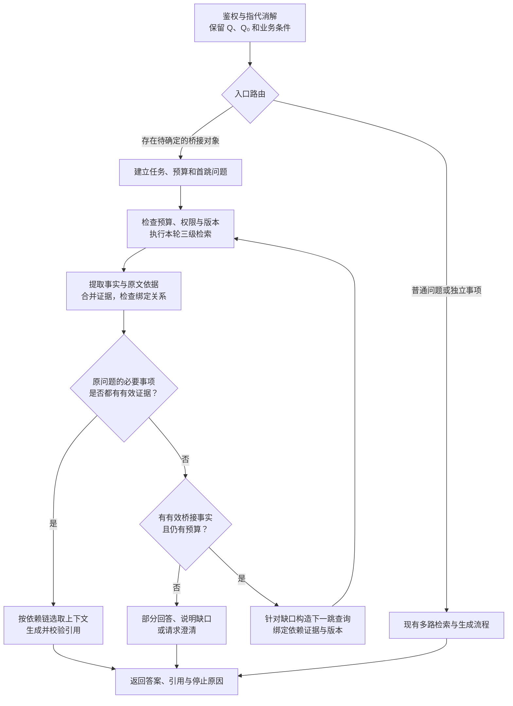

# 多跳检索与推理演进设计

本章讨论无线豆包 RAG 如何从“预先扩展问题、一次召回资料”演进为“根据已获得的证据，继续查询尚未解决的问题”。复用现有 BM25、384/768 维向量检索、RSF、Cross-Encoder、父子文档和 LangGraph 设计，先实现受预算约束的两跳流程，再根据评测扩展。

> [!note] 状态与范围
> 本章为 **2026-10-25 新增的演进方案，尚未实现或验证**，不代表当前代码或生产系统已经支持完整多跳检索。现有设计见 [[02_RAG系统/04_查询改写与检索排序]]、[[02_RAG系统/05_答案生成与上下文管理]]；统一状态见 [[02_RAG系统/01_项目事实与实现状态]]。文中的配额均为实验起点，不是已测得的最佳配置或性能承诺。

## 1. 从现有能力出发：多跳需要增加什么

### 1.1 当前设计的能力边界

当前主链路是：消解指代得到主问题 Q₀，生成最多两个补充检索问题，并发进行 BM25 与向量检索，合并后统一精筛、精排，再交给生成模型。

| 能力 | 现有文档所述设计 | 对多跳的意义 |
| --- | --- | --- |
| 问题分解与多路检索 | 可以预先拆出独立子问题，合并多路候选 | 支持比较、聚合，以及所需证据已一次召回的推理 |
| 多文档联合回答 | 将多个相关片段放入生成上下文 | 模型可以组合已有证据，但缺失证据不会自动出现 |
| 证据不足时重试 | 保留 Q₀，替换扩展问题，最多重试一次 | 提供继续检索的入口，尚未明确下一查询如何依赖中间事实 |
| 父文档回溯 | 根据子块取回章节上下文 | 减少上下文割裂，不自动完成跨文档的依赖追踪 |
| L2 多跳评测 | 包含比较、聚合与推理链场景 | 表达评测需求，不能单凭评测集名称证明能力已经实现 |

**三级检索描述的是粗筛、精筛、精排三个处理阶段；多跳关注的是事实之间的依赖关系。** 一轮检索能召回多份证据，多次检索也可能只是重复换一种问法，需要分别记录。

### 1.2 多跳的关键：下一步查询取决于当前证据

以一个示意问题为例：

> 设备 A 的 V2 版本中，特性 F 使用的定时器，其协议取值范围和本产品默认值分别是什么？

用户没有提供定时器名称，系统需要先查设计文档，确定具体定时器，再查对应协议和参数手册。

```text
用户问题
  → 查设备 A / V2 / 特性 F 的设计文档
  → 原文指出：使用定时器 TIMER_X，并引用协议文档 SPEC_P 的某节
  → 将 TIMER_X 和明确的协议版本绑定到后续问题
  → 查协议取值范围、产品默认值
  → 联合引用设计文档、协议和产品手册，回答原问题
```

`TIMER_X`、`SPEC_P` 均为占位符，不是实际协议字段。第二轮查询的对象来自第一轮原文，不能由模型凭印象补齐。

若所需资料已经在第一轮全部命中，可以直接回答，无需为了满足“两跳”而强行再检索。多跳推理也可能在一次召回后完成；本章主要补齐的是**依赖中间结果的后续检索**。

## 2. 演进路线：先做受控两跳，再增加复杂度

| 阶段 | 目标与改动 | 验收重点 |
| --- | --- | --- |
| 阶段 0：建立基线 | 保留现有链路，补充逐阶段候选、最终证据和缺失事项的 trace | 能区分未召回、精排丢失、上下文丢失、生成错误 |
| 阶段 1：两跳闭环 | 增加证据提取、桥接事实校验、下一跳规划和证据累积；最多两轮检索 | 第二轮确实使用第一轮有来源的事实，最终保留完整证据链 |
| 阶段 2：依赖任务调度 | 用小型依赖表管理子问题；独立任务并发，依赖任务等待；按评测尝试更深链路 | 复杂度增加有实际收益，分支不丢证据、不突破总预算 |
| 阶段 3：按失败类型优化 | 若引用关系稳定则补章节/引用索引；若标签不足则补桥接样本；若规划弱则考虑蒸馏 | 每项投入对应明确错误类型，有消融对比 |

第一版采用单条明确依赖链，不同时维护大量候选推理分支。先使用结构化提示词和现有可用模型验证流程，不把知识图谱、新模型微调或完整 Agent 工具体系作为前置条件。

## 3. 目标架构：在三级检索外增加受控循环



新增循环只在同一用户请求内运行。对话中的上一轮用户提问不计为本次检索的一跳；现有“证据不足重试”在多跳路径中并入统一控制器，不能在每一跳外再各自套一轮重试。

### 3.1 什么时候进入多跳路径

入口路由读取 Q₀ 和必要历史，先判断是否存在一个尚未确定、但后续查询必须使用的对象或关系。

| 问题 | 建议路径 | 理由 |
| --- | --- | --- |
| “SIB1 是什么？” | 原有路径 | 查询对象明确 |
| “载波聚合有什么优势，怎么配置？” | 原有问题分解路径 | 两个事项可以预先独立检索 |
| “比较 LTE 与 NR 的某项机制” | 优先独立检索后比较 | 多份文档不必然存在查询依赖 |
| “本特性采用的算法，其参数在协议中如何定义？” | 多跳路径 | 必须先确定算法或参数名称 |
| “设备 A 的这个定时器怎么配？”且上下文不足 | 先澄清 | 多跳检索不能替代必要的对象确认 |

第一版可用规则与结构化分类提示词组合，不仅依靠“问题较长”触发。普通路径也可能发现需要继续查证：仅在剩余总预算允许时升级，否则说明当前证据缺口，不能无记录地追加一整套预算。路由漏判率单独评测。

### 3.2 一跳内部仍使用现有检索组件

每个检索任务固定一个当前子问题 qₜ，可为它生成最多两个同义或术语扩展问题。它们只补充同一检索目标，不在这一轮中提前猜测下游答案。同轮可以执行依赖已满足的独立事项，各任务共用本轮总预算。

本轮仍执行 BM25 + 384 维向量召回、768 维语义精筛和 Cross-Encoder 精排。需要调整的是：**多跳路径的语义评分与精排以当前子问题 qₜ 为依据**，主问题 Q₀ 则用于检查子任务是否仍服务于用户目标，并始终保留产品、版本、制式、接口等必要条件。

现有文档“所有候选都相对 Q₀ 评分”的规则保留用于普通路径；多跳路径需有独立的评分上下文。否则“某协议字段的取值范围”可能很好地回答第二跳，却因与原问题表面措辞差异而被降权。

不直接比较不同跳的 Reranker 原始分数，也不将所有轮次候选合并后仅按分数选全局 Top 10。跨跳整合依据任务覆盖、来源和依赖关系，避免丢掉分数较低但必需的桥接证据。

## 4. 状态设计：保存事实、依赖和依据

第一版用请求内的结构化状态即可。以下字段是接口设计，不代表仓库中已存在相应实现。

| 状态字段 | 内容 | 约束 |
| --- | --- | --- |
| `original_query` / `resolved_query` | Q 与 Q₀ | 用户目标固定，不被扩展问题替换 |
| `scope` | 产品、版本、制式、接口及其他适用条件 | 区分用户给定、原文绑定、待确认，不悄悄放宽 |
| `auth_context` / `knowledge_snapshot` | 当前权限、可见文档版本目录或索引快照标识 | 每轮查询、原文取回和缓存都执行相同边界 |
| `tasks` | 子问题、依赖任务、状态与支持证据 ID | 未解决依赖不能作为已知条件执行 |
| `facts` | 结构化事实及其条件、来源、校验状态 | 生成的文字本身不是知识来源 |
| `evidence_store` | 原始片段、版本、位置、原文与事实的对应关系 | 追加并去重；后轮不覆盖前轮依据 |
| `executed_queries` | 查询、过滤条件、所属任务、轮次和索引版本 | 用于识别无进展的重复查询 |
| `rounds_used` / `dependency_depth` | 实际检索轮数与最长证据依赖深度 | 检索重试不自动增加事实依赖深度 |
| `budget` | 命中条数、重排对数、模型调用、Token、截止时间 | 全请求共享，各节点不得重置 |
| `missing_items` / `conflicts` | 未解决事项及相互冲突的证据 | 进入规划、停止判断和最终回答 |
| `stop_reason` / `trace_id` | 停止原因与完整调用追踪 | 能解释为何继续、为何停止 |

### 4.1 每条证据保留哪些字段

证据最少包含：`evidence_id`、`doc_id`、`doc_version`、`chunk_id`、章节或页码、原文位置、原文摘录、命中任务与轮次，以及访问和版本校验所需的引用信息。父章节补取后也作为可追溯的证据记录，不能只留下摘要。

每条事实保存其支持证据 ID 和适用范围。例如：“设备 A / V2 / 特性 F 使用 TIMER_X”，必须能定位到说明这层对应关系的原文，而不是分别在两处看到“特性 F”和“TIMER_X”就建立关联。

事实状态至少区分 `supported`（已通过既定证据检查）、`unresolved`（尚无足够依据）、`conflict`（存在未解决冲突）、`invalid`（来源或绑定无效）。`supported` 是流程状态，不意味着模型判断绝对正确，仍需独立评测。

### 4.2 桥接事实如何校验

1. **校验来源和位置**：证据 ID 必须来自本请求已授权获取的资料；摘录能在对应版本原文中定位，数值、单位与否定条件不能丢失。
2. **校验实体与关系**：核对原文是否真的说明“该特性使用该定时器”，而不是仅在相邻段落共同出现。必要时补取同版本父章节，并计入预算。
3. **校验适用范围**：产品 V2 不自动等于协议 Release 2；分别保存产品版本、协议编号与协议版本。找不到映射时保留缺口，不默认套用最新版。
4. **校验语义支持**：规则能检查字段、位置与明确条件；语义蕴含仍可能需要模型辅助核对和人工抽查。引用存在不等于结论成立，模型自报置信度不能单独作为通过条件。
5. **传播失效状态**：若桥接事实后续被否定或来源失效，将依赖它的子任务和结论一起标为待重查，不能继续沿用旧答案。

检索资料中的操作要求按资料内容处理，不作为调度指令。权限过滤由应用从鉴权上下文生成，规划模型无权修改。

## 5. 从证据缺口生成下一跳查询

### 5.1 规划器输入与输出

规划器输入限定为 Q₀、必要业务条件、已校验事实、相应原文片段、任务状态、缺失事项和剩余预算。无需把全部历史候选和整段中间草稿都传入。

| 输出字段 | 用途 |
| --- | --- |
| `action` | `search`、`answer`、`partial`、`clarify` 或 `stop` |
| `target_task` / `depends_on` | 本次要解决的子问题及依赖的任务 |
| `query` / `expansions` | 已绑定对象的当前问题及至多两个等价扩展 |
| `bindings` | 查询中新引入的实体或关系及其支持证据 ID |
| `source_constraints` | 原文明确提供的协议编号、章节、版本等来源线索 |
| `missing_items` | 当前仍缺哪些必要证据 |
| `reason_code` | 简短调度依据，便于追踪和统计 |

应用校验字段结构、任务依赖和绑定引用。对于业务实体、版本、参数名等承载事实的新增约束，要求来自用户、可信元数据或已支持事实；同义表达和一般检索词可来自既有词表，但不能据此声称业务事实已确认。无来源的对象猜测不进入第一版的确定性后续查询。

规划提示词应明确：只解决用户提出的事项；缺少对象先找对象；缺少版本对应关系先查关系；没有证据则返回缺口或澄清；不先编出答案再为答案找引用。

### 5.2 完整两跳示例

以下为构造的演示轨迹，文档 ID、字段和取值均为占位符。

| 步骤 | 输入或动作 | 证据与状态变化 |
| --- | --- | --- |
| 入口 | 设备 A / V2 / 特性 F 所用定时器的协议范围及产品默认值是什么？ | 缺定时器名称，建立首跳任务 T1 |
| 首跳查询 | “设备 A V2 特性 F 定时器 设计依据” | 在设计文档中定位 E1 |
| 桥接提取 | E1 明确说明使用 TIMER_X，并指向协议 SPEC_P、版本 R、章节 C | 支持事实 F1；建立依赖 T1 的 T2、T3 |
| 次跳任务 T2 | “SPEC_P 版本 R 章节 C TIMER_X 取值范围” | 找到 E2，说明范围为集合 S |
| 次跳任务 T3 | “设备 A V2 TIMER_X 默认值 参数手册” | 找到 E3，说明默认值为 D |
| 证据合并 | 保留 E1、E2、E3，检查默认值与范围的单位及枚举映射 | 不能只因 D 与 S 数字相似就视为一致 |
| 停止与生成 | 对象、协议范围、产品默认值三项证据齐备且无未解决冲突 | 回答使用 TIMER_X [E1]，范围 S [E2]，默认 D [E3] |

T2 和 T3 都等待 T1 完成，因此第二轮才获得有效查询对象。它们在第二轮内可并发，关系深度仍为两层，不因执行了两路子任务就记为三跳。第一版控制器可将 T2、T3 表示为同一末级目标下的两个检索事项，不实现任意任务图。

若只找到 E1 和 E2，回答应明确“已确认定时器与协议范围，当前资料未确认产品默认值”，不把协议范围中的某个值当成默认配置。若 E1 没有明确的协议版本 R，则先解决版本映射；预算不够时保留缺口，不能把本来需要三层依赖的任务假装压成两跳。

## 6. 证据整合与最终生成

### 6.1 保留桥接证据，再组织最终上下文

每轮候选可以裁剪，但已支持必要关系的证据需进入累积证据池。最终选取按依赖关系进行：先选末级答案的依据，再递归补齐其上游桥接依据，最后在剩余预算内补充必要上下文。

**区分对话轮次与检索跳次**：按照 2026-10-28 的记忆设计，上一轮用户请求的参考文档正文不强制带入下一轮，按需重新检索或按引用读取。这里的累积证据池只针对同一次用户请求中的多跳检索；不能以“不保留历史文档”为由删除支持本次答案的桥接原文。

最终配额为**全请求最多 10 个证据单元**，父章节去重后资料及来源标记目标 15,000、硬上限 20,000 tokens，完整生成输入最多 28,672 tokens，沿用 [[02_RAG系统/05_答案生成与上下文管理]] 的 32,768 窗口预算。不是每跳各取 10 个或各用 20,000 后全部拼接；必要事实表等额外生成输入也必须计数。若完整证据链放不下，应缩小回答范围或调整经过评测的上下文预算，不静默删除桥接环节后照常给出完整结论。

跨跳选择遵循：

- 按片段和内容去重，同一文档中提供不同关系的片段可同时保留。
- 覆盖用户事项及其必要前提，不能仅保留对末级问题得分最高的片段。
- 原文片段优先用于数值、条件和版本依据；压缩摘要只作导航，不能替代被删掉的原文证明。
- 对照条件存在冲突时保留双方证据，先查是否版本、适用场景不同；无法消解则说明冲突。

父章节取回属于补充上下文，不自动增加依赖深度，但仍消耗 I/O、Token 和时间预算；章节内新发现的引用若触发独立查询，则作为后续检索动作记录。

### 6.2 生成输入与引用规则

生成模型读取 Q、Q₀、必要历史、适用条件、最终证据、简短事实依赖表及明确缺口。规划器的自由草稿不作为事实证据，也不需要将内部中间推演全文展示给用户。

生成要求是：先回答用户事项，涉及跨文档推导时引用每个必要前提；区分“设计文档确认”“协议规定”“产品手册默认值”；单位、枚举、版本对应关系必须有依据；未解决的事项明确保留。

输出后检查引用 ID 是否存在且可访问、关键结论是否有相应依据、条件是否一致。引用格式检查只能发现部分错误，不能取代语义核验。若生成阶段才发现证据不足，第一版返回部分答案；后续如需再次检索，仍须经过同一个控制器和预算检查。

## 7. 停止条件、失败处理与预算

### 7.1 继续检索需要同时满足三个条件

**有尚未解决的必要事项、有来源可靠且可执行的下一查询、剩余预算允许。** 仅仅“还没得到理想答案”不构成无限继续搜索的理由。

| 情况 | 动作与停止原因 |
| --- | --- |
| 必要事项及依赖都得到支持，无未解决关键冲突 | 生成答案，`complete` |
| 用户对象或版本存在必须澄清的歧义 | 请求澄清，`needs_clarification` |
| 部分事项有依据，但缺少有效下一查询 | 部分回答，`missing_evidence` |
| 关键证据冲突且无法在预算内消解 | 说明冲突，`evidence_conflict` |
| 没有新增有效事实，下一查询与已执行查询等价 | 停止无进展循环，`no_progress` |
| 轮数、命中数、模型调用、Token 或时间达到上限 | 用已有证据降级，`budget_exhausted` |
| 来源不可用或权限校验未通过 | 仅使用仍有效的授权证据，`source_unavailable` |

“没找到”只表示当前授权范围与检索预算内未找到依据，不能推出“知识库绝对没有”或“业务上不存在”。低 Reranker 分数也不能单独证明无答案；高分同样不能证明证据链完整。

### 7.2 第一版的预算配额示例

预算以整次用户请求为单位。下表是多跳路径的候选实验配置；普通路径仍可使用原单轮预算，比较时需报告实际消耗。

| 项目 | 候选配额 | 计数口径 |
| --- | --- | --- |
| 最大检索轮数 | 2，包含首轮 | 同一批就绪任务执行后才进入下一轮；同轮允许独立事项并发 |
| 第一层返回命中总数 | 首轮最多 2000，次轮最多 1000，全请求最多 3000 | 按各请求返回条数求和，在去重前计数；每轮全部问题、通道共用配额 |
| Cross-Encoder 打分总量 | 首轮最多 50 对，次轮最多 30 对，共 80 对 | 按实际子问题—片段对计数，同一片段对两个子问题评分算两对 |
| 最终上下文 | 全请求最多 10 个证据单元；资料及标记最多 20,000 tokens，完整生成输入最多 28,672 | 父章节去重，必须包含所用结论的完整上游依赖；与普通路径共用生成预算，不按跳数倍增 |
| 规划与证据核验模型调用 | 首版每轮最多一次“事实提取 + 缺口 + 下一步建议”，必要的独立语义核验另预留配额 | 两轮最多两次合并调用，不含入口改写和最终生成；每次调用均计入全请求账本 |
| 总时限与 Token 配额 | 从产品 SLO、模型窗口及实测成本确定 | 发起每次调用前检查剩余预算，为最终生成预留额度 |

多跳路径每轮先分配任务配额，再在任务内分配扩展问题和检索通道。例如首轮只有一个任务、三个问题、两种通道时，共六路，每路最多取 `floor(2000 / 6) = 333` 条，总计最多 1998 条。第二轮若有两个独立任务，先将 1000 条分给两个任务，不能让每个任务各使用 1000 条。

每轮 RSF 输出数量按该轮剩余重排配额确定。两跳合计 80 对的配额是为了便于与单轮 80 对方案比较，不代表两者质量相同。若对同一候选追加 Q₀ 评分，也属于额外打分对，必须计数。

重试、父文档读取、精确章节查找和补充核验都纳入对应的请求数、I/O、模型调用、Token 和时间预算；不会因“重试”或“精确查找”获得免费额度。预留次轮配额可能降低首轮覆盖率，需与增大首轮召回、静态问题分解一起做消融。

### 7.3 Token 与输入长度

“不额外设置 512/1024 上限”的长度策略仍受每个模型的有效窗口、显存和延迟约束，见 [[02_RAG系统/09_Reranker领域微调与标注#3.4.5 训练超参数]]。多跳增加的是调用和累积证据，不意味着将所有轮次文本一次拼接给模型。

Reranker 以自身 tokenizer 统计当前子问题、片段和特殊 token 的总长；超过有效上限时分窗口，并保留窗口与原文位置映射。规划器与生成模型分别计算自己的输入输出预算。分窗口会增加重排对数，不能只按原始文档数计费；窗口裁切也不能丢掉适用条件后沿用原标签。

## 8. 权限、版本与缓存的一致性

复用 [[02_RAG系统/03_知识治理与权限隔离]] 的边界，每一跳、父块和引用原文读取都执行授权校验。第一跳引用了另一份文档，不代表当前用户自动获得那份文档的访问权限。

请求开始时记录可见版本目录或快照，区分产品版本、协议版本与索引版本。若底座无法提供一致快照，则在每次原文读取时验证已记录版本是否仍有效；中途更新导致桥接依据失效时，明确中止或在预算内重新开始相关任务，不混用旧桥接关系和新末级结论。

第一版先关闭多跳最终答案的复用缓存，保留请求内去重；确有性能需求后再增加带版本和权限校验的中间检索缓存。沿用现有缓存时，至少需要核对 Q₀、业务条件、权限范围、知识版本、检索/规划/生成版本等影响结果的条件。含个人会话事实的中间证据不能跨用户复用。

## 9. 映射到现有工程：具体改造清单

以下是后续开发落点，**本章没有新增这些 Python 模块，也未修改现有接口**。本地示例与文档设计仍需分别核实。

| 组件或拟议落点 | 所需改动 | 第一版范围 |
| --- | --- | --- |
| `generation/query_rewriter.py` | 将 Q、Q₀、扩展问题分开返回，保留业务条件；支持当前子问题的等价扩展 | 不凭空绑定下一跳实体 |
| `core/abstractions.py`、`retrieval/pipeline_retriever.py` | 为单轮检索显式传入当前子问题、授权/版本条件和本轮预算；返回阶段分数与来源 | 复用现有检索组件，补齐本轮评分上下文 |
| 拟新增 `retrieval/multihop_controller.py` | 调度轮次、依赖、证据检查、下一查询和预算，产出停止原因 | 两轮检索，一条明确依赖链 |
| 拟新增 `generation/evidence_planner.py` | 结构化提取事实、缺口与下一动作建议 | 通过提示词实现，不先微调 |
| 拟新增 `models/multihop_state.py` | 定义任务、事实、证据引用、预算和 trace 的结构与校验 | 可先请求内保存，需恢复时再接 checkpointer |
| `api/routes.py` 与生成接口 | 非流式、流式入口使用同一个控制器结果；生成消费累积证据与缺口 | 检索完成前可返回进度事件，最终答案在证据稳定后流式输出 |
| `eval/` | 加入两跳依赖、桥接失效、预算、冲突和权限用例 | 与原链路按固定数据与预算比较 |

第一批可执行的开发顺序：

1. 固定普通路径基线、模型/索引版本及一小批人工确认的两跳样本，补齐 trace。
2. 定义状态和单轮检索输入输出契约，让控制器能复用检索器并准确计费。
3. 实现首轮检索、原文事实提取与绑定检查，先验证能否可靠得到桥接对象。
4. 加入第二轮查询、证据累积、完整性检查和部分回答，不启用任意深度循环。
5. 统一流式与非流式行为，补齐版本、权限、超时和重复查询处理。
6. 完成离线对比后按开关灰度；不达标时直接回退普通路径。未来 Python 代码完成后使用 Ruff 格式化，并运行相关行为测试。

## 10. 评测：证明增益来自依赖检索

### 10.1 将现有 L2 拆成不同能力集合

[[02_RAG系统/11_RAG评测系统#L2 多文档 / 多跳评测集]] 中的比较、聚合和推理链应分开统计。文档数量和跳数没有固定的一一对应关系：一篇文档可以包含多层关系，多篇文档也可能只是互相独立的比较材料。

| 集合 | 样本特征 | 要检查的能力 |
| --- | --- | --- |
| 单跳控制集 | 一份明确事实即可回答 | 增加路由后不能明显拖慢或误导普通问题 |
| 独立多文档集 | 比较、聚合，检索对象在问题中已知 | 静态问题分解是否已经足够 |
| 桥接两跳集 | 必须先发现问题中未提供的实体、引用或版本映射 | 下一查询是否正确使用第一跳依据 |
| 更深依赖集 | 需要三层及以上事实关系 | 超过第一版能力时是否正确停止、部分回答 |
| 失败与边界集 | 桥接歧义、版本冲突、无答案、断链、越权、重复查询、超时 | 是否误绑定、编造或突破预算 |

人工标签需包含原问题、必要关系、支持证据位置及版本、允许的替代证据链、应答事项和预期缺口。按源文档及近重复版本分组划分数据，避免相似问答跨训练与评测泄漏。参考链是一个有效路径，不要求系统必须采用唯一措辞或唯一检索顺序。

### 10.2 多跳应补充哪些指标

| 指标 | 本项目建议口径 |
| --- | --- |
| 桥接绑定准确率 | 输出的桥接事实中，关系及适用条件均正确且有原文支持的比例；同时报告应绑定样本的覆盖率 |
| 完整证据链覆盖率 | 最终上下文至少包含一条可支持答案的完整依赖链的问题占比，不能用“命中任意一篇”替代 |
| 各环节证据保留率 | 分别统计召回、精排、累积池和最终上下文，定位桥接依据在哪一步丢失 |
| 事项覆盖与答案正确性 | 对用户必要事项逐项核验，并单独统计结论所需关系是否成立 |
| 引用支持性 | 引用原文是否真正支持对应结论，包含关系、单位、版本条件 |
| 路由和停止质量 | 多跳入口漏判/误判率、过早停止率、无效继续率，以及无依据完整作答率 |
| 成本与时延 | 实际轮数、后端请求数、命中数、重排对数、Token、模型调用数、P50/P95 与超时比例 |

人工构造少量“替换或删除桥接证据”的对照用例：将 E1 中的 TIMER_X 替换为另一占位对象，下一查询应随有效原文变化；删除桥接依据后，系统应保留缺口。该实验帮助检查控制器是否真的使用中间证据，不单凭最终答案正确就宣称检索链路有效。

### 10.3 对照组与上线依据

至少比较四组：现有普通链路、静态问题分解、只换问法的重试、按证据绑定的两跳链路。固定语料与版本、基础模型和最终上下文预算，优先在总命中数、重排对数等主要资源相同的条件下比较；额外规划调用和耗时单独报告。

再逐项消融桥接校验、当前子问题评分、依赖证据保留和继续检索判定，判断收益来自哪里。分别展示独立多文档和依赖两跳集合的结果，不能用比较题的提升代替依赖查询能力。

上线前应确认：桥接两跳的完整链覆盖与答案质量有收益；单跳控制集在约定退化范围内；版本、权限、失效传播及预算测试通过；P95、Token 与算力开销满足业务约束。具体门槛由基线与产品要求确定，不预设未经测量的“两跳仍为 2 秒”或固定准确率承诺。

## 11. 后续何时需要更多能力

阶段 1 的结果决定后续投入方向：

- 若大量问题需要三层依赖，再引入显式子任务依赖表，记录任务就绪、阻塞、完成和失败状态；同一深度的独立任务可以并发，总预算仍在控制器统一分配。
- 若主要失败是跨章节引用漏召回，可先在摄入时提取协议编号、版本、章节和文档引用，建立可检索的元数据关系；需要广泛关系遍历时再评估图数据库。
- 若桥接文档在精排中持续丢失，补充“当前子问题—桥接片段”的正例，以及同参数异版本等难负例；不将“不直接回答原问题”的桥接片段一律标负。
- 若结构化规划准确但成本高，使用经过原文核验的轨迹训练或蒸馏小模型；标签保留任务、绑定、证据和动作，不直接把模型自写草稿当作正确轨迹。
- 若出现多个同样合理且无法消歧的桥接候选，先澄清；确有评测收益后再设计少量分支探索及回退，不在第一版引入无限树搜索。

## 12. 方法来源与本项目的取舍

[IRCoT（ACL 2023）](https://aclanthology.org/2023.acl-long.557/) 讨论了交替进行中间推理与检索，让已得到的信息影响后续知识获取。本章借鉴这种依赖驱动的检索思路，将中间信息限制为有来源的结构化事实与待查事项。

[Iter-RetGen（EMNLP 2023 Findings）](https://aclanthology.org/2023.findings-emnlp.620/) 研究检索与生成的迭代协同。本项目采用更受约束的第一版：先验证桥接事实，再生成下一查询，最后统一回答；不把整段生成答案当作已经核实的知识继续传播。

论文方法证明的是各自实验条件下的结果，本项目的两跳配额、评分方式、停止条件和上线门槛均需用通信领域数据独立验证。
