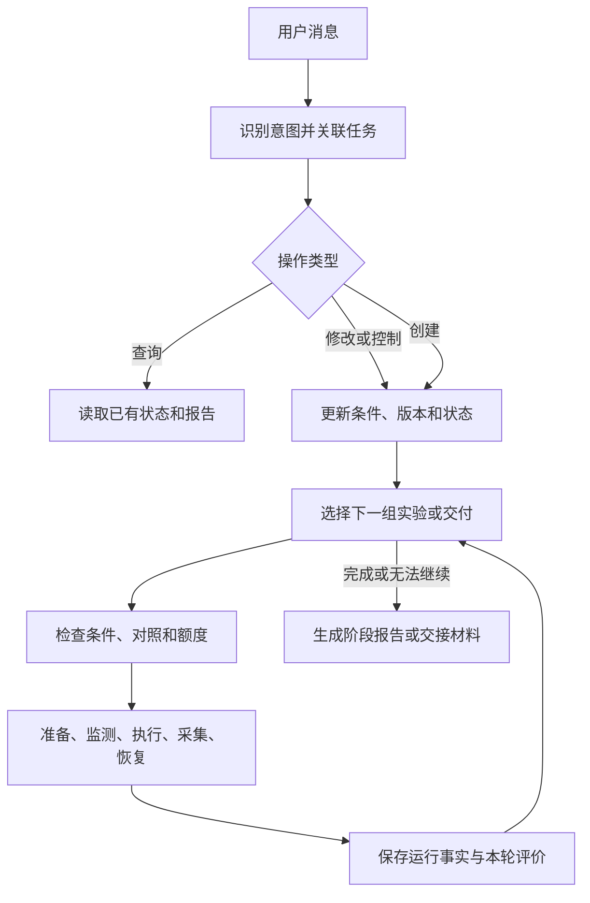

# 新版 Agent：它到底帮工程师做什么

## 从一次普通的故障说起

工程师收到一条反馈：

> “升级以后，手机坐车经过几个基站时，视频偶尔卡住。平时没问题，常规测试也通过了。”

已有脚本能执行测试，但这句话还不能直接交给脚本。工程师得先想：应该模拟什么场景？先测新旧版本，还是先看负载？没测出来怎么办？日志里的超时是不是原因？

这些决定要随着结果不断调整。以前是工程师一轮一轮地推动，现在希望让 Agent 接手其中相当一部分工作。

**这个项目要做的是：既能按要求跑测试，也能在出现问题后，继续帮助工程师复现和排查。**

## 原来的测试功能继续保留

如果用户说“验证这个版本的下载速度”，系统就找合适的用例，确认设备和标准，执行测试，收集结果，给出报告。

测试完成了，就可以结束。用户不需要因为用了 Agent，就接受一大堆额外测试。

如果用户说“失败后继续查，查到能复现为止”，系统把这句话记下来。只有测试失败，才继续调查，而且只做到约定的程度。

这两种要求用同一个输入框。系统先听懂用户要干什么，后面的处理可以不同。

## 一次排查怎样进行

还是用“移动视频卡顿”的例子。

**先把问题说清楚。** 查设备、软件版本、发生时间和已有记录。用户不知道当时负载，就把负载当作接下来需要尝试的条件；设备到底是哪一台，则必须查清或询问。

**再在实验室里尝试重现。** 保持视频传输，模拟移动和基站间切换。先确认业务监测真的在工作，否则视频断了也可能没有记录。

**接着换条件比较。** 比如旧版本和新版本各跑一组，普通负载和高负载各跑一组。如果异常集中在新版本的高负载连续切换场景，就优先沿着这个方向继续查。

**然后把复现步骤变简单。** 原来要跑半小时、开多种业务才能出现。逐项删减后，可能发现保留高负载和两次连续切换就够了。把这个方法重新跑几轮，确认别人照着也能复现。

**再检查可能原因。** 日志如果提示资源没有及时释放，就继续比较正常与异常运行中的资源变化。只有一条报错还不够，需要检查其他解释。

**最后验证修复。** 开发给出修复版后，照原来的步骤再跑，同时检查是否变慢、是否影响其他相关业务。

这些步骤可以来回调整。新结果不支持原来的猜测，就换方向；删减后测不出来，就把必要条件加回来。

## 模型、脚本和人分别做什么

模型主要处理这些问题：“用户说的现象应该怎样测？”“当前结果说明了什么？”“下一组测试最值得改哪个条件？”

脚本和程序负责把动作做准确：检查设备、启动测试、等待完成、收集数据、计算指标、按明确标准判定，以及恢复环境。

工程师提供系统查不到的现场信息，确认重要要求，检查具体代码并完成修复。系统已经拿不到关键日志时，也需要把查到的内容整理好交给人。

例如，模型决定比较新旧版本；程序负责保证两组使用相同配置；脚本负责执行；模型再解释差别。不能只让模型写一句“其他条件相同”，就假定实际相同。

## 工程师最后拿到什么

以前可能只拿到：

> “测试失败，日志在附件。”

现在希望拿到：

> “在指定新版本、高负载和短间隔连续切换时，可以重复出现视频停顿。已附简化步骤、新旧版本比较和相关日志。目前怀疑资源处理有问题，但还需要开发检查内部状态。”

这里已经省去了不少人工：找条件、重跑、收集、比较和准备材料。即使还没确认具体代码错误，也可以帮助开发更快开始工作。

## 测试失败，不代表 Agent 没做好

如果任务是“找到复现方法”，系统稳定复现出一个产品问题，任务就可能已经完成。

报告需要分别说明：产品测试有没有通过，排查到了哪一步，原因确认到什么程度，设备有没有恢复好。比如：

> “产品测试未通过；复现方法已确认；具体原因尚待检查；实验环境已恢复。”

比一个笼统的“成功”或“失败”更容易理解。

## 第一版先做到哪里

先选一种有现成测试工具、有日志、也有专家经验的异常。在实验室里，让系统能接收描述、做几组比较、找到复现方法，并整理报告。

等这些确实减少了人工，再增加原因验证和修复检查。是否微调、是否使用多个 Agent，都可以在实际测试以后决定。

判断效果时，看工程师少做了多少操作、材料能不能直接用于排查、测试花费是否合理。模型调用很多次、报告很长，都不是效果好。

想看完整对话和测试过程，可以读 [完整案例](17_完整案例与对外讲述.md)。想看一句话怎样被分配到不同流程，可以读 [统一入口](11_统一入口与意图识别.md)。

## 技术展开：三个层次怎样接起来

可以把新版看成“外层选择实验，内层可靠执行”。外层不需要决定每隔几秒轮询一次，内层也不负责凭一条日志猜根因。

| 层次 | 决定或保证什么 | 当前落点 |
| --- | --- | --- |
| 调查管理 | 用户目标、下一组比较、何时停止 | 任务服务、决策模型、假设记录 |
| 实验管理 | 计划版本、对照关系、重复次数、运行记录 | 实验计划、实验记录、计划校验器 |
| 测试执行 | 一次动作的观测、判定与收尾 | 已登记脚本、仿真或设备平台适配器 |

一次普通测试只需产生指定条件的实验。异常调查反复使用同一执行层，但每轮的 `question`、`kind` 和条件可能改变。修复验证建立关联任务，引用原复现条件，再做原异常版对照和修复版测试。

## 旧版技术在新版中的位置

旧版的 ReAct 体现为“看结果、选动作、再观察”的控制循环。新版把模型动作收窄为结构化的意图和实验计划，固定执行步骤交给程序，因此不必让模型自由安排每个底层调用。

旧版的三个闭环也需要换成当前口径：

1. **一次运行的执行闭环**：准备、监测、动作、采集、判定、恢复。
2. **一次问题的调查闭环**：初筛、对照、简化、独立复核，按目标继续查原因或验证修复。
3. **跨任务的改进闭环**：专家审核记录，修订知识和方法；必要时离线训练、评测和发布模型。

第三个闭环发生在任务之外。保存一条反馈不会立即更新模型参数。第一、二个闭环也有不同编号：一个任务可以有多个实验，每个实验包含多次实际运行。

## 判定仍保留规则与语义两部分

程序根据适用规则计算数值是否达标，模型根据证据解释差异、提出替代解释和下一步。旧版所谓“双轨判定”，在新版中应理解为这两种职责的配合，不是把两个模型分数平均。

例如，业务停顿超过已确认门限，可以判该项失败；“资源回收延迟”日志只能作为原因线索。模型解释得很肯定，也不能把缺失监测补成完整数据。

最终报告至少分开保存产品判定、调查进展、原因确认程度和环境恢复。任务是否完成另用 `task_result` 表达：复现任务完成、产品判定失败，二者可以同时成立。

## 这份设计怎样用于学习

先理解任务、实验、运行、证据的关系，再学习工具协议与状态机，最后看评测和训练。可以用确定性模拟器复现整个交互，不必先准备真实设备和 GPU。

工程技术栈可以从一个应用和一个数据库开始。LangGraph 适合表达循环与中断，数据库保存业务记录，后台执行器处理长测试；是否使用它们，由学习目标和系统复杂度决定。完整模块关系见 [工程设计](14_系统架构与工程实现设计.md)，示例与假设口径见 [范围与约定](01_项目事实与实现状态.md)。
