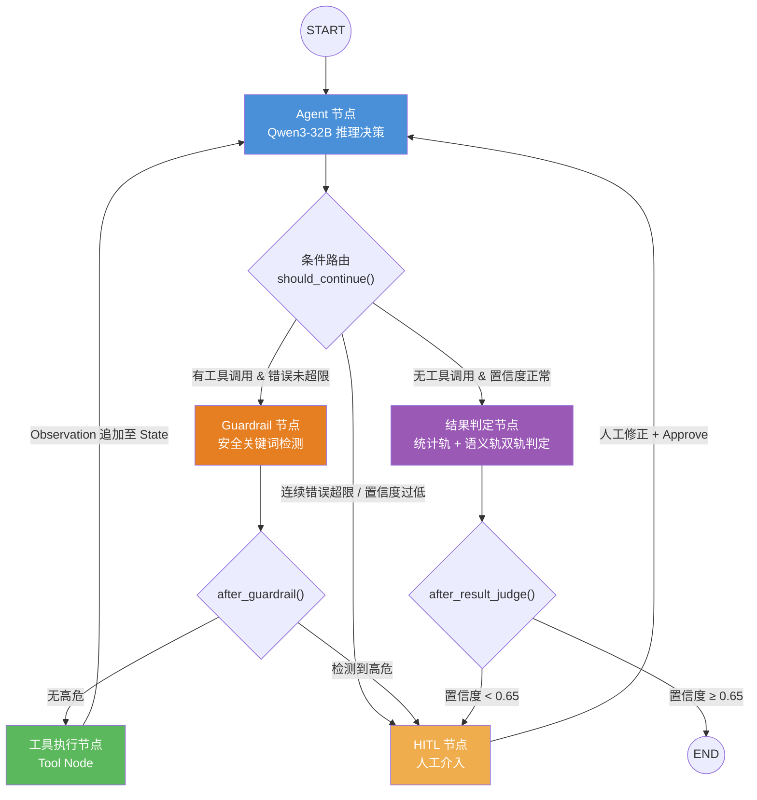

# 5G 测试 Agent 项目总览

这是 5G 测试 Agent 的唯一项目总览。设计、教学实现、生产事实分开记录；规模、模型、性能和效果的证据状态统一见 [[03_Agent系统/01_项目事实与实现状态]]。

- [[03_Agent系统/02_Agent基础与运行模式]]
- [[03_Agent系统/04_工具设计与完整调用示例]]
- [[03_Agent系统/06_安全机制与异常恢复]]
- [[03_Agent系统/07_Agent评测体系设计]]
- [[03_Agent系统/08_Agent模型后训练SFT_DPO]]
- [[03_Agent系统/05_记忆与上下文管理]]
- [[03_Agent系统/code/学习指南]]

## 三个嵌套闭环

在深入任何技术细节之前，先建立整体视角。本系统的本质是**三个运行在不同时间尺度上的嵌套闭环**：

```
┌─────────────────────────────────────────────────────────┐
│  闭环 3：学习飞轮（离线，天/周级）                         │
│  HITL数据 → SFT/DPO → 模型更安全                        │
│  专家确认用例 → Embedding入库 → RAG更准确                 │
│                                                          │
│  ┌─────────────────────────────────────────────────┐    │
│  │  闭环 2：安全围栏（请求级，秒~小时）               │    │
│  │  置信度熔断 / 高危拦截 → HITL → 人工修正后恢复    │    │
│  │                                                  │    │
│  │  ┌─────────────────────────────────────────┐    │    │
│  │  │  闭环 1：ReAct 推理循环（毫秒级）          │    │    │
│  │  │  Agent → Guardrail → Tool → Observation  │    │    │
│  │  └─────────────────────────────────────────┘    │    │
│  └─────────────────────────────────────────────────┘    │
└─────────────────────────────────────────────────────────┘
```

| 闭环 | 解决的问题 | 时间尺度 |
|:---|:---|:---|
| **闭环 1：ReAct** | 怎么完成一次任务 | 毫秒到分钟 |
| **闭环 2：安全围栏** | 怎么保证任务安全可控 | 分钟到小时（含人工等待）|
| **闭环 3：学习飞轮** | 怎么让系统越用越聪明 | 天到周（持续微调）|

三个闭环的数据流也是串联的：闭环 1 产生的工具调用日志、闭环 2 拦截的 HITL 案例，全部汇入闭环 3 的训练数据池，用于后续模型改进。

---

## 业务背景与目标

### 业务问题

5G 基站大规模商用后，网络验收与回归测试面临三个核心矛盾：

- **规模庞大**：测试用例超过 2 万条，覆盖信道、切换、干扰、容量等多维场景，人工全量执行单局点需要 3 天
- **标准化缺失**：测试结论高度依赖领域专家经验（日志分析、信令细节、KPI 趋势判断），难以形成标准闭环
- **漏测累积**：人工疲劳、经验差异导致的漏测问题在版本迭代中持续堆积，缺陷逃逸率居高不下

### 核心目标

研发一套 LLM 驱动的自主网络测试 Agent，实现**测试需求解析 → 用例生成 → 自动执行 → 结果智能判定**的端到端全自动闭环，并通过 HITL 机制保障工业级安全可靠性。

---

## 项目技术架构

### 4.1 技术栈总览

| 层次       | 组件                                                        | 职责                               |
| :------- | :-------------------------------------------------------- | :------------------------------- |
| **模型层**  | Qwen3-32B（主干推理）/ Qwen3-4B（前置增强、Guardrail）                 | LLM 推理、安全检测                      |
| **编排层**  | LangGraph（状态机）/ LangChain（工具抽象）                           | Agent 图控制流                       |
| **推理服务** | vLLM + PagedAttention                                     | 并发请求与 KV Cache 管理，30+ tokens/s   |
| **知识层**  | Milvus（HNSW）+ Elasticsearch（BM25）+ Cross-Encoder Reranker | 三级混合检索                           |
| **异步层**  | Celery + Kafka                                            | 长时任务解耦、HITL 告警推送                 |
| **接口层**  | FastAPI + SSE                                             | 实时状态流推送至前端                       |
| **持久化层** | Postgres（Checkpoint）/ Redis（缓存）                           | State 快照、断点恢复                    |
| **可观测性** | LangSmith                                                 | 全链路 Trace：Prompt、Token、延迟、节点 I/O |

### 4.2 LangGraph 状态机图结构

LangGraph 将 Agent 流程抽象为**有向图 + 状态机**，而不是简单的 `while` 循环。这是与教科书式 ReAct 最核心的工程区别：**控制流显式可见、可审计、可在任意节点插入中断**。



**核心 State 设计**：

```python
class AgentState(TypedDict):
    messages: Annotated[list, add_messages]  # 对话历史（按消息 ID 合并）
    current_step: str                        # 当前执行阶段
    tool_outputs: dict                       # 工具返回缓存，供结果判定节点使用
    error_count: int                         # 连续工具错误计数（软熔断判据）
    confidence_score: float                  # 当前决策置信度
    hitl_required: bool                      # 是否需要人工介入
    hitl_feedback: str                       # 人工审核后的反馈文本
    final_result: Optional[str]              # 最终判定结果（JSON 字符串）
```

### 4.3 完整系统架构

```
┌─────────────────────────────────────────────────────────────────────┐
│                    5G 智能测试验证 Agent 系统                        │
├─────────────────────────────────────────────────────────────────────┤
│                                                                     │
│   用户 / CI 系统                                                    │
│       │ 测试需求（自然语言 / YAML）                                  │
│       ▼                                                             │
│   FastAPI 接口层 ──SSE推流──► 前端实时状态展示                       │
│       │                                                             │
│       ▼                                                             │
│   ┌────────────────────────────────────────────────────────┐        │
│   │                 LangGraph 状态机引擎                    │        │
│   │                                                        │        │
│   │  [Agent节点] ──► [Guardrail节点] ──► [Tool节点]         │        │
│   │      ▲                │高危              │             │        │
│   │      │                ▼                 │ Observation  │        │
│   │      │           [HITL节点] ◄───────────┘             │        │
│   │      │                │ Approve                       │        │
│   │      └────────────────┘                               │        │
│   │                    置信度正常                          │        │
│   │      ──────────────────────────► [结果判定节点]        │        │
│   │                                  统计轨 + 语义轨        │        │
│   └────────────────────────────────────────────────────────┘        │
│                                                                     │
├──────────────────── 知识层（RAG）──────────────────────────────────-┤
│  Milvus（语义向量）  Elasticsearch（BM25）  Cross-Encoder Reranker   │
│  3GPP协议文档 | 历史Bugzilla缺陷库 | 专家确认Golden Cases           │
├──────────────────── 工具层（Tool Layer）───────────────────────────-┤
│  Test_Case_Query  Simulation_Runner  Metrics_Collector              │
│  Baseline_Comparator  Log_Analyzer  Fleet_Manager                   │
├──────────────────── 基础设施层 ─────────────────────────────────────┤
│  Postgres（Checkpoint）  Kafka（异步消息）  Redis（缓存）             │
│  Celery（任务队列）  vLLM（推理服务）  LangSmith（可观测性）          │
└─────────────────────────────────────────────────────────────────────┘
```

### 4.4 工具链

| 工具 | 职责 |
|:---|:---|
| `Test_Case_Query` | 按场景/频段/特性从知识库检索测试用例 |
| `Simulation_Runner` | 触发 5G 仿真平台执行测试，返回 session_id |
| `Metrics_Collector` | 通过 SSH/RPC 从网元实时拉取 KPI 日志 |
| `Baseline_Comparator` | 与历史安全版本做统计对比（T-Test / KS-Test）|
| `Log_Analyzer` | 解析 RRC/NAS/PDCP 信令日志，识别协议级异常 |
| `Fleet_Manager` | 多局点并发探针集群调度（全网验收场景）|

---

## 知识层与用例生成边界

通信领域存在严重的 OOV（Out-of-Vocabulary）问题：`PRACH`、`BWP`、`N2 interface` 等专有名词纯靠 Embedding 模型容易产生语义漂移。系统采用三级混合检索架构：

```
用户查询 / 用例生成需求
      │
      ├──► ES (BM25) ────────────── 精确命中通信专有名词、缩写
      │
      └──► Milvus (HNSW) ─────────── 语义向量捕捉长难句意图
                │
                ▼
      自研 RSF 融合算法（按问题长度自适应调权）
                │
                ▼
      Cross-Encoder Reranker + 动态阈值过滤噪声
                │
                ▼
         Top-K Context → 注入 LLM Prompt
```

**自适应调权逻辑**：短查询（精确名词匹配）偏向 BM25，长查询（语义意图理解）偏向向量检索，不是固定 50/50。

**检索前置增强**：
- Qwen3-4B 执行**指代消解**（将"它的切换成功率"解析为"基站A→B Xn接口切换成功率"）
- Qwen3-4B 执行**多路问题扩展**（将一个查询扩展为多个角度，提升召回覆盖率）
- AutoPhrase 构建专有分词词典，解决通信术语被错误切分的问题（如 `NR_PDCP` 被切成 `NR` + `PDCP`）

**知识库构成**：

| 知识源 | 检索方式 | 作用 |
|:---|:---|:---|
| 3GPP 协议文档 | BM25 精确匹配 | 保证用例有协议依据 |
| 历史 Bugzilla 缺陷库 | 向量语义检索 | 补全边界场景，防止重蹈历史漏测 |
| 专家确认的 Golden Cases | 向量 + BM25 混合 | 经专家确认的参考样本 |

**数据飞轮**：专家确认后的用例自动 Embedding 入库，知识边界随系统使用持续自我拓展。

## 结果判定双轨机制

```
测试执行完成
  │
  ├──► 统计轨（硬规则）                ├──► 语义轨（LLM）
  │    KPI 均值/方差                   │    PCAP 信令序列解析
  │    T-Test / KS-Test               │    RRC/NAS/PDCP 日志语义理解
  │    阈值包络对比基线                 │    根因关联推理与溯源
  │    → 明显违规直接 FAIL             │    → 隐性协议异常深度诊断
  │                                   │
  └──────────────── 综合判定 ──────────┘
                        │
               ┌────────▼────────┐
               │  置信度评分输出  │
               │ ≥0.65 → 自动结论 │
               │ <0.65 → HITL   │
               └─────────────────┘
```

**统计轨的典型判定**：
- KPI 均值（下行吞吐量、切换成功率）与 Baseline 做 T-Test，p < 0.05 且均值下降 > 5% 判 FAIL
- P99 延迟、丢包率等超出阈值包络直接判 FAIL

**语义轨的典型价值**：
- 统计 KPI 不明显，但信令层有异常——如 `SN Status Transfer` 超时（Xn 回传丢包），纯统计轨看不出来
- 根因输出："FAIL，根因：Xn 回传链路拥塞导致序列号同步失败，非空口问题，建议排查承载网络"

## 典型业务场景

### 场景一：5G 切换失败综合诊断

**用户输入**："近期配置变更后，怀疑基站 A 向基站 B 的 Xn 接口切换有问题，请验证并给出结论。"

**Step 1 — 意图解析与用例生成（Planning）**
- RAG 检索《3GPP TS 38.331 Xn 切换信令流程规范》及历史切换失败缺陷库
- Qwen3-32B 生成 JSON 仿真控制脚本：终端移动速度、A3 事件触发阈值、并发 100 次切换

**Step 2 — Guardrail 拦截（Safety）**
- 扫描生成的 JSON，发现频段参数错误配置为受限频段（幻觉）
- State 序列化至 Postgres，Celery 推送钉钉告警
- 专家修改为合法实验频段后 Approve，Agent 从断点恢复

**Step 3 — 自动化执行（Acting）**
- `Simulation_Runner` 触发仿真平台执行 100 次切换
- 长时任务异步监控，主线程挂起等待回调

**Step 4 — 双轨判定（Reasoning）**
- **统计轨**：切换成功率 85%，低于基线 99%，直接判 FAIL
- **语义轨**：`Log_Analyzer` 分析 15 次失败的 PCAP，发现 `SN Status Transfer` 丢包超时——根因在 Xn 回传链路而非空口

**Step 5 — 结论与知识回流（Reflection）**
- 报告输出："FAIL。根因：基站 A→B Xn 回传链路拥塞丢包，建议排查承载网络，非空口问题。"
- 专家确认 Golden Case 后，将其编码并写入知识库，供后续任务检索复用

### 场景二：新局点 5G SA 全网验收跑批（Multi-Agent 自动驾驶模式）

**业务问题**：新 5G 基站开通，工程师需赴现场人工执行 100+ 验收项目，耗时以天计。

**Agent 工作流**：

1. **任务规划（Planning）**：通过网管北向接口获取基站配置，按局点类型（室分/高铁宏站）在 1 分钟内生成包含 100+ 验收项的 YAML 执行编排图

2. **多集群并发执行（Parallel Acting）**：`Fleet_Manager` 工具下发并激活现场无人测试探针集群，同步执行 VoNR 呼叫、FTP 大包拉测、信号干扰边界构造

3. **Map-Reduce 流式推演（Streaming Reasoning）**：GB 级 NAS/RRC 信令日志并行分发给多个 Worker Agent，各自提炼握手时延、寻呼成功率等核心 KPI，主控 Agent 汇总研判

4. **自动签发验收报告（Reflection）**：所有 KPI 核心项 PASS 后，自动生成 PDF 验收报告，最终由人员一次鉴权点击，Agent 调用 `Network_Config_Write` 工具完成基站割接入网

---

## 部署与可观测性

### 高并发推理（vLLM）

基于 vLLM 部署 Qwen3-32B，通过 PagedAttention 管理 KV Cache，减少显存分配浪费。历史记录中的 30+ tokens/s 和并发表现，仍需结合硬件、请求长度、负载与日志核实。

### 长时任务异步解耦（FastAPI + Celery）

测试执行耗时从分钟到数小时不等。FastAPI 接收请求后将"长图执行逻辑"打包至 Celery 异步队列，用户不被阻塞，节点状态（"正在执行仿真..." / "正在分析日志..."）通过 SSE 长连接实时推送至前端。

### 可观测性（LangSmith）

每次 LLM 调用的 Prompt、Completion、Token 用量、延迟，每个节点的 I/O，工具调用的入参和返回值，全部自动 Trace，在 LangSmith UI 可查看完整节点调用树。这是定位幻觉和工具误用的关键基础设施。

---

## 后训练与评测入口

SFT/DPO 的数据与项目配置见 [[03_Agent系统/08_Agent模型后训练SFT_DPO]]；通用算法见 [[01_大模型/02_训练与对齐/02_偏好对齐算法_PPO_DPO_GRPO]]。评测集、任务结果、工具轨迹、安全与成本见 [[03_Agent系统/07_Agent评测体系设计]]。收益和效果数字统一在 [[03_Agent系统/01_项目事实与实现状态]] 维护，不能由架构图推导。

## LLM 的职责与生成边界

### LLM 在 Agent 中的核心职责

LLM 是 Agent 的决策模型，具体负责：

1. **意图理解**：解析用户的自然语言请求，识别需要验证的测试场景、频段、特性等关键信息。
2. **工具选择与参数生成**（Function Calling）：根据当前 Thought，从注册的工具列表中选择最合适的工具，并生成符合 Schema 约束的参数 JSON。
3. **Observation 解读**：看到工具返回结果后，判断是否达到目标，还是需要继续调用下一个工具。
4. **根因推理**：在结果判定节点，LLM 解读信令日志中的异常（如 HARQ 重传率过高），结合协议知识给出根因分析文本。
5. **最终报告生成**：综合所有 KPI 和对比结果，生成结构化的测试结论供人工审阅。

### LLM 是否参与测试用例的生成

**离线阶段（参与度高）**：

使用 Qwen2.5-72B 从 3GPP 协议文档和设计文档中大批量合成 QA 对，这些 QA 对作为 Embedding/Reranker 微调的训练数据（48 万条）。合成逻辑是：给 LLM 一段文档 chunk，让它生成"什么问题会检索到这段内容"，以此构建 (query, positive_doc) 对。

**在线阶段（参与度低，有约束）**：

在线阶段 LLM 不会直接"凭空"生成新用例，而是：
- 通过 RAG 检索已有的用例作为参考
- 基于现有用例 + 协议约束生成参数变体（如同一场景换频段）
- 所有 LLM 生成的用例变体必须经 HITL 专家审核（`is_golden=false`），审核通过后才能标记为可信用例，回流训练集

核心原则：LLM 生成的内容不直接入库，必须经过人工或统计验证。

---

## 测试代码与工具参数的边界

### 当前系统的做法

在我们的 5G 测试 Agent 系统中，LLM 对测试用例"代码"（YAML/Python 格式的用例脚本）的处理主要有两条路径：

1. **RAG 查找**（主路径）：通过 `Test_Case_Query` 工具检索相关用例，将用例内容注入上下文，LLM 读取后决定参数配置或触发执行。LLM 不直接生成执行脚本，而是生成工具调用参数。
2. **参数生成**（辅助路径）：LLM 根据用户描述和检索到的协议内容，生成 `Simulation_Runner` 的 `env_config` 参数（如 `{"band": "n78", "channel_model": "CDL-C"}`），本质上是结构化 JSON 生成，而不是代码生成。

### 是否可以做后训练

可以，但需要明确收益和成本：

**值得做后训练的场景**：
- 协议参数精确匹配率低（如模型生成的 `preambleTransMax` 数值范围不符合 3GPP 约束）
- 用例 YAML 格式错误率高（字段名拼写错误、必填项遗漏）

**推荐方案**：
```
数据来源：HITL 阶段专家修正的工具调用参数（专家改了 LLM 生成的 env_config）
训练方式：LoRA 微调（rank=16~32），不做全参数更新，节省显存
基座选择：在当前使用的推理模型基础上微调，避免引入新的部署复杂度
评测指标：协议参数精确匹配率（Exact Match）+ 用例 Schema 校验通过率
```

**不建议做的情况**：当前 RAG + Prompt Engineering 已能覆盖 90%+ 的用例，追求最后 10% 的准确率可以先考虑改进工具的 description 和示例，比做微调的 ROI 更高。

---
