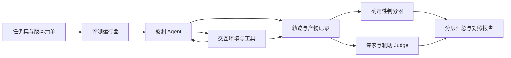

# Agent 评测：任务集、交互环境、判分与对照实验

## 一、直观理解

主线定位：从完整交互轨迹核验结果，并比较系统质量、人工投入和资源花费。完整链路见 [系统运行全流程与交互拓扑](18_系统运行全流程与交互拓扑.md)。

前半部分说明评测为什么这样设计；“详细技术拆解”从评测运行器开始，展开任务数据、轨迹字段、判分代码、统计口径和报告。重点是让一项分数能够回到具体事实。

最重要的问题是：**在不把事情做错的前提下，它让工程师少做了多少工作？**

不能只看模型有没有给出答案。它可能猜对了原因，却用了错误条件；也可能没有确认最终原因，但已经整理出可靠的复现步骤，替工程师省下不少时间。

### 先与原来的做法比较

选一批有代表性的问题，记录工程师使用现有脚本时怎样处理、用了多少主动操作和分析时间、最后拿到什么结果。

然后让 Agent 在相同工具、资料和可用次数下处理，比较结果。

有固定排查流程的任务，还可以加入“不用模型、只按固定流程”的比较。这样才能看出收益来自新增日志能力、自动执行，还是模型选择下一步的能力。

人工已经熟悉同一个问题，第二次处理可能更快。对比时要记录经验和熟悉程度，合理分配任务。

### 测试题不能只选顺利的

除了普通测试和成功复现，还要包括这些情况：

- 用户说得模糊，但信息可以查到；
- 两个条件同时出现才触发；
- 问题很偶发，几次没出现；
- 是测试环境失败，不是产品失败；
- 新结果不支持原来的猜测；
- 关键日志拿不到；
- 修复后原问题改善，却让其他指标变差；
- 用户中途改要求、暂停或取消。

这些情况才能看出系统是不是在认真根据结果做决定。

### 先检查入口有没有听错

用户问“现在怎么样”，系统应该查进度，而不是开新测试。

用户说“目标改成 C 到 D，其他不变”，它应该保留环境和配置，只更新有关部分。

用户说“失败再查”，它应先测；用户说“只看日志”，它不应运行实验。

总分类准确率可以统计，但误启动、错对象和错误取消要单独列出来。这些错误的代价不一样。

### 调查效果具体看什么

| 想知道的事 | 实际检查方法 |
| --- | --- |
| 复现方法靠不靠谱 | 在新的运行中照步骤重做，看是否出现同类异常 |
| 条件是否找得有依据 | 检查比较是否公平，是否保留不符合猜测的结果 |
| 简化步骤是否有用 | 删减后前提和监测仍在，其他人能按新方法重现 |
| 原因有没有说过头 | 报告的肯定程度，是否与实际日志和实验相符 |
| 修复验证是否完整 | 有没有按原条件测，并检查相关影响 |
| 材料能不能直接用 | 工程师是否还要反复追问版本、参数和日志 |
| 原有功能是否变差 | 普通测试、查询和取消是否仍然正确 |

不要求它走与专家完全一样的顺序。不同路线也可能合理，重点看结果和依据。

### 让它真正选择下一步

把完整调查记录一次给模型，让它总结，只能测试阅读和写报告。

要测试会不会调查，环境得根据它实际选的条件返回相应结果。它选高负载，就得到高负载测试的结果；选旧版本，就得到旧版本结果。

可以用真实平台，也可以用经过检查的模拟环境。模拟的内部答案不能提前告诉模型。

只有历史回放时，模型选了历史里没有做过的步骤，就应说明这条路径无法评估。不能不管选什么，都返回预写好的结果。

### 人工时间和机器时间分开算

人工主动时间包括查资料、配置、看结果、分析和整理材料。等待测试时，人可能在做其他工作，不能把这段全算作人工节省。

另外记录测试运行时间、排队、等资料、等修复、设备占用、模型费用和重跑。

一个方案少花人工但多占很多设备，也不一定划算。质量、人工和资源放在一起看。

### 谁有资格判断对错

程序检查编号、参数、状态、次数、规则、文件引用和环境恢复。

专家检查实验为什么有用、解释是否成立、材料是否足够。其他模型可以帮忙初筛，但不能成为唯一裁判。

使用模型评分时，固定版本和评分说明，并抽查争议题。评审模型说“很好”，不能代替真实平台完成记录。

### 训练后怎样测

比较原模型、改进提示的模型、微调模型，尽量保持其他条件相同。调查变好以后，也要检查普通测试有没有退步。

同一个故障换几种说法，不能一部分用来训练、一部分用来证明处理新问题的能力。按原始问题和来源分开，保留没用过的测试任务。

反复用于调整方案的题，已经不算独立的最终测试。

### 最后的评测报告写什么

写清任务类型和数量、版本、比较条件、实际结果、人工与资源花费、失败例子和没测到的情况。

成功复现、确认原因、合理停止和无法完成分别统计，避免用一个“成功率”把它们混在一起。先取得基线，再决定达到什么水平值得采用。

需要训练时怎样准备数据，见 [微调](08_Agent模型后训练SFT_DPO.md)。

## 二、详细技术拆解

### 先确定究竟在评什么

一次 Agent 调查包含多层行为。把这些行为压成“答案与标准答案一致”会漏掉关键错误。例如复现任务正确地报告产品 FAIL，反而可能说明 Agent 完成了任务。

| 评测层 | 输入与测试对象 | 应检查的结果 | 适合的判分方式 |
| --- | --- | --- | --- |
| 组件 | 一次意图识别、检索或计划决策 | 字段、引用、允许动作与关键条件 | schema、集合匹配、规则与专家量表 |
| 执行协议 | 已登记的运行与平台事件 | 去重、状态、取消、版本和恢复 | 故障注入与状态断言 |
| 完整任务 | 从用户要求到结束的一整段交互 | 目标是否达成、依据是否充分 | 动态环境与任务专用判分器 |
| 调查质量 | 实验、假设变化和交付材料 | 有无区分力、反证、可复核性 | 结构化核验加盲审 |
| 业务收益 | 人工基线与 Agent 处理同类任务 | 主动人工、设备、时长与费用 | 配对比较、分层统计与案例分析 |

组件评测用于定位错误，完整任务评测用于判断系统是否可靠，业务对照用于判断是否值得使用。三者不能相互代替。

### 1. 评测系统的五个模块



**任务集**定义用户目标、可见输入和验收契约。**交互环境**根据实际动作产生观测。**运行器**负责隔离、预算、重复和超时。**判分器**用轨迹与环境事实检查结果。**汇总器**计算分层指标和不确定性。

Agent 和判分器可以读同一份公开规则，但隐藏故障规则、期望结果和测试器内部状态只对评测端可见。不要把 `expected_root_cause` 放进 Agent 会读到的初始任务 JSON。

### 2. 一条任务怎样表示：公开输入与私有规则分开

下面两份 YAML 是教学数据结构，数字均为示例。

公开任务 `public_case.yaml`：

```yaml
case_id: mobility-017
source_group: issue-family-07
request: 升级后移动视频偶发停顿，只在实验室查到能复现
context:
  device_id: device-A
  software_version: build-new
  baseline_version: build-old
  config_ref: config-A
  observation_rule: BUSINESS-R1
allowed_changes: [software_version, load, handovers, background_traffic]
budget:
  max_runs: 40
  max_experiments: 10
goal_contract: reproduce-v1
```

评测端的 `private_grading.yaml`：

```yaml
case_id: mobility-017
fixture_version: mobility-environment-v2
fault_family: version_load_sequence_interaction
hidden_behavior:
  affected_version: build-new
  required_load: high
  minimum_handovers: 2
grading:
  required_goal: REPRODUCE
  confirmation_contract: confirm-fixed-budget-v1
  require_fresh_confirmation: true
  require_valid_observation: true
  forbid_unsupported_cause_confirmation: true
  require_cleanup_resolution: true
```

隐藏行为是模拟环境的构造设定，不代表真实故障机制。正式数据里还应绑定规范、工具目录、资料快照与判分器版本，保证下次运行仍能重建同一个任务。

`confirmation_contract` 应另行定义有效运行数、同类异常标准和停止安排。用 3 次中至少出现 1 次可以检查教学闭环，但不能把它解释成统计意义上的“稳定触发”。现实确认要求应按异常概率、代价和允许的不确定性设计。

### 3. 评测集怎样分层与拆分

至少按任务类型、故障家族、工具能力、观测缺失、用户干预和难度打标签。建议覆盖：

| 任务层 | 应包含的变化 | 为什么需要 |
| --- | --- | --- |
| 正常按需测试 | 通过、真实产品失败、无法判定 | 防止把所有 FAIL 都当 Agent 失败 |
| 异常复现 | 单因素、因素交互、低概率、环境漂移 | 检查探索和重复策略 |
| 原因检查 | 可区分解释、证据冲突、工具不支持干预 | 检查推理强度与合理交接 |
| 修复验证 | 有效修复、无效修复、性能副作用 | 检查原问题与回归是否同时报告 |
| 交互控制 | 查询、修改、暂停、继续、取消 | 检查语言理解是否改变真实动作 |
| 执行异常 | 迟到回调、重复回调、提交超时、恢复失败 | 检查长流程的一致性 |

按原始问题分组拆分，问题改写、同调查多个决策点、修复跟进和相近派生样本不能跨训练与最终测试。开发集用于调试；最终集只用于确定版本的评估。

故障家族完全留出的测试更接近“处理未见问题”，而同家族换配置的测试更接近“同类泛化”。二者都可测，但报告要注明，不把措辞改写当成新故障。

### 4. 评测运行器怎样运行一次 episode

这里把一次从开始到结束的交互称为 episode。一次 episode 可以包含多次模型请求、多组实验和大量工具事件。

```text
1. 固定模型、提示、工具、资料、规则、环境和判分器版本。
2. 为本次 episode 建立独立环境状态、任务存储和资源预算。
3. 只把公开输入交给 Agent，保存输入哈希。
4. 运行 Agent；每次工具请求经过真实参数检查，再进入环境。
5. 记录调用、实际执行、观测、条件修改、等待、错误与费用。
6. 到达交付、合理交接、取消、预算或总超时边界后停止新增动作。
7. 完成必要收尾，导出报告和结构化轨迹。
8. 判分器读取环境事实与轨迹，产生逐项结果。
9. 保存失败阶段；汇总时按故障家族和任务类型分层。
```

模型请求失败后的重试也属于 episode，不能丢掉前几次失败只保留成功输出。环境启动失败可单列基础设施错误；Agent 自己选错参数造成的运行失败则属于被测结果，不能排除出分母。

同一版本建议对部分任务重复运行。环境随机种子与模型采样种子分别记录；温度为零也不意味着服务端在所有条件下完全可复现。

比较不同 Agent 时可以共享预先生成的外部场景安排，但不要按“第几次工具调用”机械返回相同观测，因为不同策略的调用顺序不同。随机因素应绑定明确的场景、配置、重复编号或外部时序，避免 Agent 通过重复请求重新抽取有利结果。

### 5. 轨迹记录：判分需要哪些最小字段

每条事件建议保存：

```json
{
  "event_id": "evt-104",
  "episode_id": "episode-017-02",
  "task_id": "task-01",
  "sequence": 18,
  "event_type": "run_completed",
  "decision_id": "decision-04",
  "experiment_id": "exp-04",
  "run_id": "run-12",
  "plan_version": 3,
  "occurred_at": "2026-10-30T10:00:00Z",
  "payload": {
    "execution_status": "COMPLETED",
    "validity": "VALID",
    "test_verdict": "FAIL",
    "cleanup_status": "COMPLETED",
    "evidence_refs": ["ev-12"]
  }
}
```

模型调用额外记录输入快照、输出、延迟、输入输出 token、工具目录版本和解析错误。计划事件保存“当时可见证据”，否则无法判断模型是否使用了未来信息。

逻辑序号负责本地顺序，发生时间负责跨系统关联。迟到事件与重复事件单独识别，不能只按时间字符串排序后当成完整因果链。

### 6. 任务成功不能只看最终 verdict

分别定义 `goal_met`、`execution_compliant`、`evidence_supported` 和 `cleanup_resolved`。可以把四项的合取作为严格完成口径，同时保留各分量用于诊断。

| 任务 | goal_met 的主要条件 |
| --- | --- |
| TEST | 约定用例完成，对可判定项按适用规则正确判定，缺项明确披露 |
| REPRODUCE | 可执行复现材料、有效同类观测、与搜索数据分开的确认运行 |
| NARROW | 达到预先约定的范围缩小要求，所用对照可比 |
| CHECK_CAUSE | 达到本任务约定的原因证据等级；不能默认要求工具做不到的代码确认 |
| VERIFY_FIX | 原异常版对照、修复版同条件验证、约定回归与逐项结论 |

合理交接是单独结果。没有资源时交接得好有价值，但不能算完成原先未达成的复现目标。评测集里明确要求“识别无法继续并交接”的任务，可以按其自己的契约算达成。

下面是简化的判分代码。它接收的是评测端根据轨迹核实的事实，不是 Agent 自报的布尔值。

```python
from dataclasses import dataclass
from typing import Literal


@dataclass(frozen=True)
class EvaluationFacts:
    goal: Literal["TEST", "REPRODUCE", "VERIFY_FIX"]
    specified_tests_completed: bool = False
    verdict_matches_rules: bool = False
    reproduction_material_complete: bool = False
    fresh_confirmation_passed: bool = False
    original_fault_observed: bool = False
    fix_comparison_completed: bool = False
    required_regressions_completed: bool = False
    constraints_preserved: bool = False
    references_verified: bool = False
    report_matches_facts: bool = False
    unsupported_cause_claim: bool = False
    cleanup_resolved: bool = False


def grade_episode(facts: EvaluationFacts) -> dict[str, bool]:
    goals = {
        "TEST": facts.specified_tests_completed and facts.verdict_matches_rules,
        "REPRODUCE": (
            facts.reproduction_material_complete and facts.fresh_confirmation_passed
        ),
        "VERIFY_FIX": (
            facts.original_fault_observed
            and facts.fix_comparison_completed
            and facts.required_regressions_completed
            and facts.verdict_matches_rules
        ),
    }
    components = {
        "goal_met": goals[facts.goal],
        "execution_compliant": facts.constraints_preserved,
        "evidence_supported": (
            facts.references_verified
            and facts.report_matches_facts
            and not facts.unsupported_cause_claim
        ),
        "cleanup_resolved": facts.cleanup_resolved,
    }
    return {**components, "strict_success": all(components.values())}
```

例如修复版存在时延退步，Agent 正确完成比较并报告 FAIL，`goal_met` 仍可为真。代码刻意不要求“修复版必须 PASS”，因为那是产品质量，不是 Agent 的调查能力。

需要核验的正向事实默认未满足。只有判分器取得相应依据才设为真，避免缺少恢复或引用记录时默认给通过。

#### 6.1 这些布尔事实怎样从原始记录得到

`constraints_preserved` 对每次实际提交检查对象、环境、固定字段与当时有效计划；`references_verified` 解析引用并核对对象与时间；`report_matches_facts` 比对报告中的版本、分母、异常数和产品判定；恢复结果则来自执行和复核事件。

以 `fresh_confirmation_passed` 为例，不能只检查模型写了“已独立确认”。需要确认方法在运行之前已冻结、运行未被搜索阶段使用、实际配置与方法匹配、观测有效，并满足预定确认契约。

下面是一个简化规则核验器。`runs` 应由评测端从执行事件构造；字段不能直接取自模型报告。重复或冲突编号应在事件接入时去重或报错，这里也拒绝重复计数。

```python
def verify_confirmation(
    runs: list[dict],
    search_run_ids: set[str],
    *,
    method_frozen_sequence: int,
    expected_config_hash: str,
    expected_rule_id: str,
    minimum_valid_runs: int,
    minimum_anomalies: int,
) -> bool:
    run_ids = [run["run_id"] for run in runs]
    if len(run_ids) != len(set(run_ids)):
        return False
    if set(run_ids) & search_run_ids:
        return False
    eligible = [
        run
        for run in runs
        if run["started_sequence"] > method_frozen_sequence
        and run["actual_config_hash"] == expected_config_hash
        and run["rule_id"] == expected_rule_id
        and run["validity"] == "VALID"
        and run["observation_complete"]
    ]
    anomalies = sum(run["same_anomaly_observed"] for run in eligible)
    return len(eligible) >= minimum_valid_runs and anomalies >= minimum_anomalies
```

项目还应核对动作序列、实际负载、执行顺序和预算等条件；示例中的配置指纹可以覆盖这些已冻结设置，动态负载仍需单独查观测。最低样本与异常数是确认契约，不是由该函数自动推导出的统计保证。

### 7. 指标定义与一个具体计算例子

对任务 i 记严格完成为 `s_i∈{0,1}`，则完成率为 `Σs_i/N`。组件错误可另外统计，但不能用高格式正确率替代该指标。

| 指标 | 计算口径 | 需要额外说明 |
| --- | --- | --- |
| 严格任务完成率 | 严格成功任务数 / 可评任务数 | 各目标分开统计，披露无法评估与基础设施错误 |
| 意图精确匹配 | 动作、目标任务、类型、关键补丁全部正确的消息 / 已评消息 | 单字段准确率作为诊断 |
| 误启动率 | 应只读或等待却启动执行的消息 / 应只读或等待消息 | 观察真实执行事件，不能只看回复 |
| 无效运行率 | 对预定判断无效的运行 / 已开始运行 | 披露无效原因，产品 FAIL 可以是有效运行 |
| 无依据确认率 | 未达证据要求却声称原因确认的报告 / 已评原因报告 | 只确认相关性也应检查措辞 |
| 证据支持精确率 | 可解析、归属正确且支持主张的关键引用 / 所有待核验关键引用 | 单纯文件存在不够 |
| 缺陷召回率 | 被正确识别且有证据的目标缺陷 / 评测契约中的目标缺陷 | 非本任务范围的隐藏缺陷不计漏检 |
| 缺陷报告精确率 | 被正确识别的缺陷 / 报告声称的缺陷 | 防止靠列出大量猜测刷召回 |
| 环境恢复率 | 完成所需恢复且有复核记录的运行 / 需要恢复的运行 | FAILED 与 UNKNOWN 分开 |

假设评测 20 个复现任务：16 个拿到候选方法，14 个独立确认，1 个确认任务引用错设备，另有 1 个确认任务未恢复环境，且两类错误不重叠。则严格完成数为 12，严格完成率 60%；候选产出率 80%，独立确认率按全部任务口径为 70%。

若还报告“提交确认的方法里 14/16 通过”，必须标明分母是候选方法，不能用 87.5% 替代总体完成率。没有缺陷的任务，其缺陷召回记 N/A，不填 1 后混入平均。

### 8. 参数与动作怎样评分才不被表面匹配误导

参数评价先做单位与枚举规范化，再检查字段值与来源。40 MHz 与 `bandwidth_mhz=40` 可以等价；其他任务的合法 `session_id` 不能算正确。

工具选择使用允许动作集合，或使用必须满足的依赖关系，而不是唯一参考序列。例如日志与指标查询可以交换，但必须在当前运行存在以后，报告引用也必须来自已经取得的数据。

轨迹距离可作为调试信息。步数效率只在质量约束满足后比较，并说明“步”是模型请求、工具调用还是实际运行。省掉监测、确认或恢复得到更短轨迹，应判缺步骤，不能奖励。

### 9. 实验价值与报告质量怎样做专家评分

建议把量表拆开，每项 0、1、2 分，并要求引用轨迹依据。

| 维度 | 0 分 | 1 分 | 2 分 |
| --- | --- | --- | --- |
| 实验目的 | 无明确问题 | 问题明确但区分作用弱 | 能区分当前合理解释 |
| 对照质量 | 关键条件混杂且忽略 | 有偏差并披露，仍有局限 | 关键条件可比，偏差有处理 |
| 反证处理 | 忽略或删除反证 | 提及但未调整判断 | 有依据地修订假设或下一步 |
| 结论强度 | 无依据确认原因 | 披露部分限制但表述混乱 | 与证据等级一致，缺口明确 |
| 交付材料 | 无法接手 | 需要补问若干关键信息 | 可按步骤复核，引用和限制齐全 |

不要把分数直接相加后抵消错对象等严重问题。程序硬条件先单列，量表用于评价通过基本约束后的质量与差异。

辅助 Judge 接收固定量表、去标识后的候选和证据摘录，输出分项分数、证据引用及不确定项。对部分样本交换候选位置，检查位置偏差；有分歧时回到原始证据并由专家复核。

### 10. 比较两个版本时怎样报告不确定性

同一任务分别运行 A、B，按原问题或故障家族配对。报告两者成功率、配对差值和分歧任务，不只报告两个孤立平均数。

同一问题的多次重复不是多个独立问题。可在问题层聚合后做 bootstrap，或按问题簇重采样；不能把几十个改写当成独立样本制造很窄的区间。配对 bootstrap 要一起抽取同一任务在 A、B 下的记录。

成功率可给二项比例区间，但这要求统计单位与假设相符。零错误也有上界：在独立固定概率、预先确定 n 次的假设下，0/n 次错误的单侧 95% 上界为 `1-0.05^(1/n)`。0/100 约为 2.95%，不是零风险。

目标完成、主动人工和设备成本存在取舍，应先核查质量约束，再比较人工与资源。持续看结果反复调阈值时，该集合属于开发反馈，不再是独立最终验证。

#### 10.1 主动人工和资源收益怎样具体计算

记人工基线的主动分钟为 `H_base`，Agent 方案中提交、审核、纠错、分析和接手的主动分钟为 `H_agent`：

$$\text{主动人工节省比例}=\frac{H_{base}-H_{agent}}{H_{base}}$$

例如 40 分钟降到 25 分钟，主动人工减少 37.5%。但若设备占用从 30 分钟升到 90 分钟，还要报告额外占用，不能单凭人工减少就判整体更优。这些数字只是演算。

墙钟时间另外记录执行、排队、等待信息与修复。并行阶段可能重叠，不能简单把所有子调用耗时相加当总历时；设备占用则按实际资源与时间结算。

费用换算可写成：

$$C=C_{human}+\frac{T_{in}}{10^6}P_{in}+\frac{T_{out}}{10^6}P_{out}+C_{device}+C_{other}$$

其中 token 与费用来自实际调用，人工与设备使用明确费率。缓存、重试与不同模型的计费单列；没有可靠费率时直接比较人时、token 与设备时，不强行凑一个货币结论。

同时给出全部任务的质量和成本，以及成功任务子集的效率。只比较成功任务会受到选择偏差影响：某模型主动交接困难任务，可能让剩余任务看起来特别快。

### 11. 一份示例评测报告怎样组织

```yaml
evaluation_id: evaluation-v3
scope: 教学模拟环境，不代表真实设备效果
versions:
  model: model-v2
  prompt: prompt-v5
  tools: tools-v3
  corpus: corpus-2026-10
  grading: grading-v2
units:
  source_groups: 20
  episodes_per_group: 3
  total_episodes: 60
results:
  strict_task_success: 按原问题聚合后填入比例与区间
  unsupported_cause_claims: 填入分子和分母
  human_active_minutes: 填入配对差值和分布
  device_minutes: 填入总量与每类任务分布
failures:
  - case_id与轨迹引用、失败阶段、原因分类、是否可复现
```

至少对照工程师使用原脚本、固定调查流程、基础模型、改进提示、SFT 和可选 DPO。工具、资料与预算保持一致；若模型变更同时引入新工具，应做单独消融，避免把工具收益算成训练收益。

### 12. 如何把评测接进学习迭代

每次改动先跑 schema、版本、去重与恢复等确定性回归，再跑固定小任务集，最后按需要运行较大动态集与专家盲审。规则、工具和提示修改都可能改变结果，不只有换模型才要评测。

失败轨迹分类到入口、检索、计划、执行、观测、解释或报告。工具没有采到证据就修工具；证据已提供而模型持续误判，才进入提示或训练候选。候选训练记录仍需专家审核，不能直接把 Judge 分数当真值。

学习时可以先实现规则判分器和可交互模拟环境，把一份评测报告算明白，再接 LangSmith、DeepEval 等追踪或评测平台。平台保存和展示运行记录，不替你决定“复现成功”究竟意味着什么。

#### 12.1 接到评测平台时，target 应包装整个 episode

如果 target 只调用一次 LLM，平台测到的就是一次生成；要评整套调查，target 必须运行到任务结束、交接或预定边界，并返回报告、轨迹引用和评测端判分。

以 LangSmith 的“target 函数 + evaluator”方式为例：

```python
def make_evaluation_target(harness):
    def target(inputs: dict) -> dict:
        episode = harness.run_case(inputs["case_id"])
        return {
            "report": episode["report"],
            "trace_ref": episode["trace_ref"],
            "trusted_grading": episode["grading"],
        }

    return target


def strict_task_success(outputs: dict) -> bool:
    return bool(outputs["trusted_grading"]["strict_success"])


def evaluate_dataset(client, harness, dataset_name: str):
    return client.evaluate(
        make_evaluation_target(harness),
        data=dataset_name,
        evaluators=[strict_task_success],
        max_concurrency=1,
    )
```

这里 harness 是前文评测运行器，`trusted_grading` 由评测端根据轨迹生成，不能直接采用 Agent 返回的自评分。它只交给评测平台，不回流给正在作答的 Agent。共享实验资源尚未隔离时先单并发，环境独立后再提高并发。

Dataset 保存 case_id 和公开输入，实验元数据绑定模型、工具、环境和判分器版本。平台里的 experiment 与业务的 Experiment 不同：前者是一轮数据集评测，后者是一组回答具体问题的测试运行，记录时应使用不同字段名区分。[LangSmith target 与 evaluator 约定](https://docs.langchain.com/langsmith/define-target-function)

DeepEval 等平台同样可以承载辅助 Judge 或轨迹指标，但复现确认、版本关系、实际动作与恢复仍由本项目的确定性判分器负责。这样换评测平台时，业务成功口径不会随之改变。
