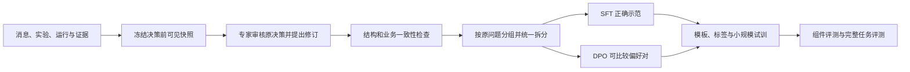

# Agent 后训练：数据、SFT、LoRA、DPO 与完整验证

## 一、直观理解

主线定位：在任务之外利用审核后的决策快照训练模型，再通过评测决定是否发布。完整链路见 [系统运行全流程与交互拓扑](18_系统运行全流程与交互拓扑.md)。

本章前半部分解释什么时候值得训练；“详细技术拆解”按真实学习顺序展开：从调查记录构造样本，生成训练批次，计算损失与梯度，配置 SFT，再按需要进行 DPO，最后用完整任务判断是否改善。

**阅读约定：本章按“可落地技术方案＋示例演算”准备面试，不代表已经完成生产微调。** 第 1～14 节讲训练原理与基础实现；第 15～25 节把动机、完整轨迹、数据规模、参数选择、框架、资源、效果和追问串成一套方案。所有示例成功率、数据量和耗时都需要用真实实验日志替换后，才能作为项目成果讲述。

| 面试重点 | 直接阅读 |
| --- | --- |
| 为什么需要 SFT、为什么还考虑 DPO | 第 15 节：训练目标与方法边界 |
| 一条轨迹到底怎么构造、怎么变成训练数据 | 第 16～18 节：逐步轨迹、监督单元与偏好对 |
| 数据量、模型与超参数怎样确定 | 第 19～20 节：统一实验规模与调参顺序 |
| 为什么选择这些框架、几张卡、训练多久 | 第 21～22 节：框架分工与资源演算 |
| 效果到底提升多少、怎样证明归因 | 第 23 节：对照表、统计口径与消融 |
| 训练失败怎样定位、面试怎样完整回答 | 第 24～25 节：排障与回答提纲 |

先举一个适合讨论微调的问题。

系统已经把最新条件、之前结果和工具说明都交给模型了。模型却反复犯同类错误：两组条件不同也直接比较，看到一条超时就宣布原因，或者新结果明显不支持原猜测，它仍然沿原方向查。

这时，训练模型学专家怎样做决定，才有明确意义。

如果最新条件根本没传进去，或者工具没有采到日志，先修程序。训练不能把丢失的信息补回来。

### 第一步，先跑原模型，看看错在哪里

固定模型、提示、工具和资料，用完整任务检查。

是入口听错？是参数用错？是没保留用户限制？还是调查时总安排没有价值的实验？

先把问题分开。资料版本错了就更新资料，计算错了就修计算。提示里没写清的地方先改提示和例子。

这些做好后仍然持续出错，再考虑微调。第一版不必以训练为前提。

### 训练要教哪些行为

除了正确调用工具，还要教模型怎样推进调查。

例如：

> 现在只测了新版本。正确下一步是安排相同条件的旧版本比较，而不是直接宣布新版本有缺陷。

或者：

> 低负载也出现了同类异常。应该重新检查“高负载是必要条件”的判断，而不是忽略这条结果。

再比如：

> 现有工具读不到内部资源。应该说明需要补什么记录，而不是写“已确认资源泄漏”。

正确报告失败、承认证据不足、达到次数后停止，都应进入训练示范。

### 专家记录比最终答案更重要

只给模型“问题是什么、最终原因是什么”，它学不到中间怎样选择。

更好的记录包含：当时知道什么、用户限制是什么、做了哪些测试、每次返回什么、专家下一步选择什么以及简短理由。

要保留当时可见的信息。后面才确认的原因，不能偷偷放进前面安排实验时的输入。

如果专家改了用例或参数，后续结果也要重新取得，或使用明确标注且检查过的模拟结果。不能把不再适用的旧结果接在新计划后面。

### SFT：给模型看正确示范

SFT 是监督微调。简单说，就是在原模型基础上继续训练，让它在类似上下文里更容易输出专家确认的做法。

示范可以是下一次工具调用、一小段实验计划、一次正确的条件修改，或者一份合理的停止说明。

训练时要分清谁说了什么。工具返回的实际结果是模型读到的信息，模型要学习的是自己该怎样回应和操作。

数据转成训练格式以后，抽几条真正解码看看，确认工具调用和正确回答确实被训练到了，关键条件没有被截掉。

先做小规模试训，再运行完整任务检验。训练损失下降，只表示它更会预测训练内容，不等于真实调查一定变好。

### DPO：比较两个决定，告诉模型哪个更合适

有时两种回答格式都对，但做法有明显差别。

在相同信息下：

- 先核对两组实际条件，比直接认定版本缺陷更合适；
- 为区分两个原因补查记录，比无理由地重复原测试更合适；
- 承认没有足够依据，比编一个确定原因更合适。

DPO 是一种偏好训练方法，可以利用这样的成对比较。

偏好要有理由。两个实验都可能合理，不能只因为其中一个后来碰巧找到答案，就倒推它在当时一定更好。比较时看到的信息也要相同。

实现时要固定参考模型、输入格式和数据处理方式。做完仍要测原来的工具能力。SFT 已经足够，或者没有可靠比较数据，就可以不做 DPO。

### 数据怎样分开

把同一个故障及其改写放在同一组。训练用一部分问题，调整参数用另一部分，最后再用没参与调整的问题检查。

不能把同一个案例换设备名字以后，分到训练和最终测试。SFT 和 DPO 数据也要一起检查，防止绕一圈把测试题用来训练。

除了成功调查，还要保留未复现、日志缺失、猜测被否定、工具失败和普通测试。否则模型可能变得过于积极，任何任务都想查到底。

### 显卡和训练时间怎样估

可以考虑 LoRA：保留原模型的大部分参数，只训练附加的一小部分，减少部分训练开销。但原模型和长输入仍要占显存，不能直接认为一张小显卡就够。

先固定模型、输入长度、批次、精度和训练方式，用一小批有代表性的数据试跑。测稳定更新速度、最长样本的峰值、验证和保存耗时，再规划正式资源。

实现时，有效批次约等于每卡样本数 × 设备数 × 梯度累积次数。更新步数结合数据量和轮数计算，实际以训练器记录为准。

生成数据、专家审核、工具等待、训练、评测和发布分别计时。原项目用过的显卡和时长，不直接作为当前系统预算。

### 怎么决定采用哪个模型

用同一组工具和任务，比较原模型、改提示后的模型、SFT 和可选 DPO。

看入口错误、条件保持、实验选择、错误原因判断、人工投入与费用。还要测普通按需测试、查询、暂停和取消。

模型更谨慎但把所有任务都交给人，不一定更好；查得更多但浪费大量实验，也不一定更好。

### 系统不会用一次就自动学会

保存日志、专家修改、经验入库，都没有直接改变模型参数。

需要定期整理记录、审核、训练、评测，再发布新版本。保留旧模型和回退办法，出现退步时能够恢复。

具体怎么比较效果，见 [评测](07_Agent评测体系设计.md)；资料什么时候更新，见 [知识库](16_知识库与经验沉淀.md)。

## 二、详细技术拆解

### 训练对象是决策策略

当前系统主要学习的是：在当时已知的信息和约束下，选择什么动作、提出怎样的实验、怎样调整假设、何时交付或交接。训练不是让模型记住每次测试结果，也不是让模型替代执行器保存事实。

用 `s_t` 表示当前业务状态，`c_t` 表示构造给模型的可见上下文，`a_t` 表示模型输出。我们训练的是近似的条件策略 `πθ(a_t | c_t)`。工具执行得到的观测会更新业务状态，再产生下一轮输入。完整任务表现还依赖工具、规则、状态管理和调度，不能只由单次 loss 推断。

### 1. 四类训练行为怎样分开

| 训练单元 | 输入 | 输出目标 | 主要错误 |
| --- | --- | --- | --- |
| 意图理解 | 用户新消息、候选任务与当前条件 | IntentDecision 与字段补丁 | 错关联任务、只读误执行、丢失约束 |
| 调查决策 | 目标、实验摘要、反证、能力与预算 | PlanDecision / ExperimentPlan | 无效比较、重复探索、忽略反证 |
| 工具使用 | 任务信息、工具定义和已取得返回 | 合法调用及参数 | 虚构编号、前提未满足、乱用单位 |
| 阶段解释 | 已保存事实、规则、证据和当前目标 | 有证据的解释与交付 | 数字转述错误、原因说过头、遗漏限制 |

可以共享一个模型，但要标记任务模板与目标 schema。若把四类数据混在一起，模型却只收到“你是助手”，它可能在该输出计划时写报告，或在只读咨询时生成执行请求。

先单独评估每类行为，选择需要训练的部分。规则判定、计数、任务版本和环境恢复仍由程序负责，不作为可自由生成的真值。

### 2. 数据从运行记录变成监督样本



原记录包含最终结果，但导出的第 t 个输入只包含第 t 个动作前已经取得的信息。应依据当时保存的 `context_snapshot_id` 构造，不从最终报告逆向生成一段看似合理的前因。

专家修订计划后，如果需要接续完整轨迹，必须让新动作真正产生相应观测，或使用标明来源的可验证模拟。单纯改了动作文本，不能继续沿用原动作的后续工具结果。

#### 2.1 一份完整的决策样本应包含哪些信息

下面把业务内容与训练元数据分开显示。实际 JSONL 可序列化为 messages；`target` 是希望模型生成的对象，而不是工具测量。

```yaml
sample_id: decision-sample-017
metadata:
  source_group: issue-family-07
  decision_id: decision-04
  context_snapshot_id: context-04
  reviewer: expert-01
  review_status: approved
  sample_type: experiment_decision
input:
  goal: REPRODUCE
  fixed_conditions:
    environment: lab
    device_id: device-A
    bandwidth_mhz: 100
  known_results:
    - experiment_id: exp-new-high
      conditions: {version: build-new, load: high, handovers: 3}
      valid_runs: 20
      anomalies: 6
  missing_evidence: [旧版本在相同条件下的观测]
  remaining_runs: 20
target:
  action: EXPERIMENT
  explanation: 只有新版本结果，先补版本对照，不能直接认定升级缺陷
  plan:
    question: 旧版本在同条件下是否出现同类异常？
    reason: 排除与版本无关的共同环境因素
    kind: control
    conditions:
      environment: lab
      device_id: device-A
      bandwidth_mhz: 100
      version: build-old
      load: high
      handovers: 3
    repeats: 20
    comparison_id: exp-new-high
    rule_id: BUSINESS-R1
```

这些观测是假设示例。target 不包含未来的“旧版本 0/20”，因为此刻尚未执行。输入中出现的实验 ID 可以复制使用；下一次运行 ID 由程序分配，不要求模型学会编随机编号。

本章与评测章沿用同一个教学场景说明格式，不表示真实训练集与最终测试集可以收录同一来源组。实际数据必须按下面的分组规则隔离。

#### 2.2 messages、工具定义和工具返回怎样序列化

意图或实验决策可以用 `system + user(snapshot) + assistant(target)`。学习工具循环时，则保存 assistant 的调用、tool 的实际返回和下一次 assistant 行为，并保留调用 ID 对应关系。

工具定义同样必须对模型可见。某个 schema 出现在元数据里，不代表聊天模板一定把它送入模型；需要检查 token 化后的完整输入。工具结果与助手调用是不同角色，不能全部塞进一条 assistant 文本。

如果部署使用原生工具标记，训练也要使用该模型支持的工具模板；如果部署只读取计划 JSON，则训练计划 JSON。二者可以分别训练，但不能假设普通文本 `Action: xxx` 与原生调用格式天然等价。

### 3. 拆分与清洗：在 token 化之前完成

以原问题为分组单位，统一拆分 SFT、DPO 与评测。一个问题的不同措辞、不同决策点、简化过程和修复跟进保持同组。跨故障家族留出与同家族新配置测试分别报告。

检查重复与近重复时，不只比较文本：设备别名、参数名替换后，实验结构和故障关系可能仍相同。人工确认高相似样本的来源，避免将相同事实复制到不同集合。

| 清洗层 | 应检查什么 | 失败时处理 |
| --- | --- | --- |
| 结构 | 角色、字段、目标 schema、调用与返回配对 | 拒收或修订，不靠训练器静默容错 |
| 来源 | 对象、编号、规则、工具返回能否追溯 | 缺失则回到原记录补齐 |
| 时序 | 本轮输入是否含未来结果 | 重建快照或淘汰 |
| 业务 | 条件保持、可比性、监测、预算、停止依据 | 专家审核，必要时重做实验 |
| 标签 | 只教预期的助手行为 | 修模板或掩码 |
| 偏好 | 同输入、同可见信息、理由可辨 | 不确定或相同候选不做 DPO |

数据分布要覆盖普通测试、合理探索、反证、未复现、缺工具、暂停取消和修复副作用。只保留“找到根因”的成功故事，会教出过度积极且不愿承认证据不足的模型。

### 4. 从一条样本到一个训练批次

处理顺序为：加载消息 → 使用目标模型聊天模板 → 得到 token 与助手区域 → 长度检查 → 构造 labels → 组成批次与 padding → 输入模型。

对常见因果语言模型，设批次大小 B、序列长度 L、词表大小 V：

| 张量 | 常见形状 | 含义 |
| --- | --- | --- |
| input_ids | `[B, L]` | 模板后的全部输入 token |
| attention_mask | `[B, L]` | 有效输入位置，padding 通常为 0 |
| labels | `[B, L]` | 目标 token ID；忽略位置为 -100 |
| logits | `[B, L, V]` | 每个位置对后续 token 的未归一化打分 |

规则、用户消息和工具返回保留在 input_ids 中，作为后续预测的依据，但本项目不对它们直接计算监督损失。assistant 的工具调用和计划属于监督目标，不能因为有“工具”二字就一并屏蔽。

#### 4.1 因果位移怎样对齐

假设简化 token 序列如下，数字只代表位置示意，不是真实分词：

```text
位置：          0       1        2       3        4         5
input_ids：   [规则]  [用户]  [助手头]  [计划1]  [计划2]  [结束]
labels：       -100    -100     -100    计划1    计划2     结束
用哪行 logits：                           2        3        4
```

第 2 个位置的 logits 预测第 3 个 token，依此类推。框架模型传入 labels 时通常已内部处理这一位移；下面的函数只用于学习损失计算，不与模型自动 loss 同时重复位移。

```python
import torch
import torch.nn.functional as F


def causal_token_loss(logits: torch.Tensor, labels: torch.Tensor):
    shifted_logits = logits[:, :-1, :].contiguous()
    shifted_labels = labels[:, 1:].contiguous()
    valid_tokens = (shifted_labels != -100).sum()
    if valid_tokens.item() == 0:
        raise ValueError("批次没有可学习的下一 token 目标")
    loss_sum = F.cross_entropy(
        shifted_logits.reshape(-1, shifted_logits.size(-1)),
        shifted_labels.reshape(-1),
        ignore_index=-100,
        reduction="sum",
    )
    return loss_sum / valid_tokens, valid_tokens
```

若两个目标 token 的正确概率分别为 0.8 与 0.5，平均负对数似然约为 `(-ln 0.8-ln 0.5)/2=0.4581`。训练降低的是这类预测损失，不是直接最大化复现率。

#### 4.2 损失的归一化也会改变训练权重

上面按有效目标 token 平均，长回答含更多目标，因而对总损失贡献更多。按每条样本先平均再平均，则每条样本权重更接近。两种目标不同，应明确选择。

梯度累积时，若每个微批次有效 token 数不同，简单平均微批次 mean loss 不完全等于按整组 token 平均。自定义训练循环要按总有效 token 处理；分布式时还要考虑跨进程归约和梯度平均。使用训练器也要核对其实际口径，避免把优化目标差异误解为随机波动。

#### 4.3 padding、截断与 packing 的边界

padding 的 attention mask 为 0，labels 为 -100。若 pad token 与 eos token 相同，也应按真实 padding 位置屏蔽，不能把所有相同 ID 的结束 token 都删掉。

长样本优先减少无关日志、合理拆分决策点。截断后必须仍保留目标所需的规则和观测；不能把前面的用户限制截掉，只留下一个看似正确的答案。

packing 把多条样本装进较长序列以减少 padding，但要确认样本边界、注意力隔离与标签仍符合目标。不同实现不完全相同，学习第一轮先关闭 packing，检查清楚后再比较效率。

模板支持时可取得助手区域掩码；不能用搜索字符串 `assistant` 的方式判定所有模型的边界。assistant-only 与 completion-only 分别按角色和提示/续写划分，也不是同一个开关。[TRL SFT 训练配置说明](https://huggingface.co/docs/trl/en/sft_trainer)

### 5. LoRA 的参数、前向与反向传播

对线性层 `W0∈R^(d_out×d_in)`，标准 LoRA 使用 `A∈R^(r×d_in)`、`B∈R^(d_out×r)`：

$$h=W_0x+\frac{\alpha}{r}BAx$$

基础权重冻结，梯度仍要通过相关网络传播以更新 A、B；冻结不表示可以跳过整条前向或不保存任何激活。常见初始化会让适配器初始增量为零，之后逐步学习，但具体方式由所用实现决定。

新增参数为 `r×(d_in+d_out)`。对 `4096×4096` 矩阵、r=16，为 131,072 个；加在多个层与多个投影后要求和，不能直接把单层数字当整模型的可训练参数。

| 参数 | 改变什么 | 选择方法 |
| --- | --- | --- |
| r | 适配器容量与参数量 | 对比较小与较大 r 的任务质量和成本 |
| alpha | 增量缩放 | 与 r、学习率一起记录；本文公式为标准 LoRA |
| target_modules | 哪些矩阵接收增量 | 核对模型实际模块名与注入结果 |
| dropout | 训练适配器输入的随机屏蔽 | 依据验证而非固定“最佳值” |
| learning_rate | 可训练参数更新幅度 | 检查收敛、退步和数值稳定性 |

若使用 rank-stabilized LoRA 等变体，缩放公式可能改变，不能继续照抄 `alpha/r`。冻结原权重也不保证通用行为保持不变，因为推理路径已经加入适配器。[PEFT LoRA 说明](https://huggingface.co/docs/peft/en/package_reference/lora)

### 6. 一份可解释的 SFT 配置

以下是教学起点，用于解释配置关系，不是针对所有模型的推荐最优值。

```yaml
training_goal: experiment_decision
precision: bf16
sequence_length: 4096
packing: false
assistant_only_loss: true
lora:
  rank: 16
  alpha: 32
  dropout: 0.05
  target_modules: [q_proj, v_proj]
optimization:
  learning_rate: 0.00005
  epochs: 1
  per_device_batch_size: 1
  gradient_accumulation_steps: 8
  warmup_ratio: 0.03
  lr_scheduler: cosine
  max_grad_norm: 1.0
```

BF16 需要相应硬件和软件支持；4096 需要用真实长度分布和关键证据保留率检查；q/v 模块名也不是所有架构通用。先确认实际 trainable parameters，再启动短试训。

下面的构造函数展示数据、模板、配置与 PEFT 的衔接，不会自行下载数据或启动训练。调用前必须提供已按原问题拆分的数据，以及兼容的模型与 tokenizer。

```python
from peft import LoraConfig
from trl import SFTConfig, SFTTrainer


def make_sft_trainer(model, tokenizer, train_data, validation_data, output_dir):
    args = SFTConfig(
        output_dir=output_dir,
        max_length=4096,
        packing=False,
        assistant_only_loss=True,
        per_device_train_batch_size=1,
        gradient_accumulation_steps=8,
        num_train_epochs=1,
        learning_rate=5e-5,
        warmup_ratio=0.03,
        lr_scheduler_type="cosine",
        max_grad_norm=1.0,
        bf16=True,
        gradient_checkpointing=True,
        eval_strategy="steps",
        eval_steps=50,
        save_steps=50,
        report_to="none",
    )
    adapter = LoraConfig(
        task_type="CAUSAL_LM",
        r=16,
        lora_alpha=32,
        lora_dropout=0.05,
        target_modules=["q_proj", "v_proj"],
        bias="none",
    )
    model.config.use_cache = False
    return SFTTrainer(
        model=model,
        args=args,
        processing_class=tokenizer,
        train_dataset=train_data,
        eval_dataset=validation_data,
        peft_config=adapter,
    )
```

这个例子走训练器的自动助手掩码路线，不再额外传一份可能冲突的手工 labels。模板需要支持助手区域。短训练不足 50 步时仍要主动执行最终验证，不能因为没触发周期事件就省略评估。

具体接口以锁定的依赖版本为准；学习时可从构造函数追踪到最终批次，确认 messages 怎样被转成 token，而不是只记参数名称。

### 7. 一次参数更新究竟发生什么

```text
取得一组微批次
  → 前向得到 logits
  → 按有效 labels 计算损失
  → 反向传播，梯度累积到可训练参数
  → 到达累积边界，检查与裁剪梯度
  → optimizer.step 更新适配器
  → scheduler.step 更新学习率
  → 清空梯度，进入下一组
```

验证使用未参与更新的数据，不执行 optimizer.step。梯度检查点会在反向时重算部分前向中间结果，用计算换显存；它与保存训练 checkpoint 是两种不同机制。

检查训练时既看 loss，也看有效标签数量、梯度范数、非有限值、token 吞吐与长样本峰值。训练 loss 持续下降、完整任务却没有改善，可能是只学会 JSON 风格、样本偏置或目标与部署格式不一致。

### 8. DPO 的偏好对怎样收集

输入 x 完全相同，生成两个候选，由专家按当时信息选择。候选必须回答同一种问题：不能把一个有新日志的决定与一个无日志的决定直接配成“同输入”的优劣。

```yaml
source_group: issue-family-07
prompt_ref: context-04
chosen_ref: 经审核的完整版本对照计划
rejected_ref: 未做对照就声称版本缺陷的完整输出
preference_dimensions:
  - evidence_sufficiency
  - condition_preservation
review_reason: 只有新版本异常记录，不能排除共同环境
```

存储时引用需要解析成实际 prompt/chosen/rejected 内容，并绑定内容版本。两个同样合理的实验，不因其中一个后来碰巧触发异常就强行标优。必要时保留不确定标注，暂不进入标准二元偏好训练。

将“短但缺证据”与“长且完整”比较时，注意模型可能学到只偏爱长文本。增加长度相近、格式相同但决策质量不同的对照，并在评测中单独看长度、拒绝和交接倾向。

### 9. DPO 损失逐项计算

定义完整候选的条件序列对数概率为各目标 token 对数概率之和，prompt 只提供条件，不加入候选似然。候选结束标记的处理在 policy 与 reference 中保持一致。

它可以从 logits 这样取得；labels 在 prompt 与 padding 位置为 -100，在候选位置保留目标 token。下面先做因果位移，再只聚合候选部分：

```python
import torch
import torch.nn.functional as F


def sequence_log_probs(logits: torch.Tensor, labels: torch.Tensor) -> torch.Tensor:
    targets = labels[:, 1:]
    mask = targets != -100
    if (mask.sum(dim=-1) == 0).any().item():
        raise ValueError("每个候选都必须有有效目标 token")
    safe_targets = targets.masked_fill(~mask, 0)
    token_log_probs = F.log_softmax(logits[:, :-1, :].float(), dim=-1)
    selected = token_log_probs.gather(-1, safe_targets.unsqueeze(-1)).squeeze(-1)
    return selected.masked_fill(~mask, 0.0).sum(dim=-1)
```

chosen 与 rejected 各自用“相同 prompt + 对应候选”前向，reference 使用同样 token、掩码和聚合方式，但不构造训练梯度。为了理解直接写出 log_softmax；大模型可采用更省中间存储的等价实现，不必实际保留整份对数概率张量。

$$r_w=\log\pi_\theta(y_w|x)-\log\pi_{ref}(y_w|x)$$
$$r_l=\log\pi_\theta(y_l|x)-\log\pi_{ref}(y_l|x)$$
$$\mathcal L=-\log\sigma\big(\beta(r_w-r_l)\big)$$

policy 初始与 reference 完全相同时，`r_w=r_l=0`，单对 loss 为 `ln 2≈0.6931`。假设更新后两者的对数概率分别为：

| 候选 | policy | reference | 相对参考的变化 |
| --- | --- | --- | --- |
| chosen | -80 | -82 | +2 |
| rejected | -100 | -95 | -5 |

若 beta=0.1，输入 sigmoid 的值为 `0.1×(2-(-5))=0.7`，loss 约 0.4032。这个例子说明目标在比较相对于参考的优势，不是只提高 chosen 的绝对概率。

```python
import torch
import torch.nn.functional as F


def dpo_pair_loss(
    policy_chosen: torch.Tensor,
    policy_rejected: torch.Tensor,
    reference_chosen: torch.Tensor,
    reference_rejected: torch.Tensor,
    beta: float = 0.1,
) -> torch.Tensor:
    preferred_gain = policy_chosen - reference_chosen.detach()
    rejected_gain = policy_rejected - reference_rejected.detach()
    margin = beta * (preferred_gain - rejected_gain)
    return -F.logsigmoid(margin).mean()
```

这段代码假设输入已经是正确聚合的候选 log probability；它不负责 token 化和掩码。不能把未经说明的每 token 均值替换进标准序列目标，也不能把 prompt 部分算进候选似然。

DPO 在特定偏好建模假设下建立目标，不代表它与任意 RLHF 训练流程都完全等价。完整推导见 [DPO 原论文](https://arxiv.org/abs/2305.18290)。

### 10. reference 与 policy 怎样组织

通常从选定的 SFT 模型开始，policy 可训练，reference 固定。若 SFT 用 LoRA，必须确认 reference 包含 SFT 行为：只关掉唯一的 SFT adapter 可能退回原始基座，得到的就不是预期 SFT 参考。

| 组织方式 | 优点 | 必须核对 |
| --- | --- | --- |
| SFT 合并后，独立冻结 reference | 概念直接，便于检查 | 双份基础权重及其显存与分片 |
| 共享基座，独立固定与可训练适配器 | 减少部分权重重复 | reference 适配器固定且切换语义正确 |
| 固定 reference 预计算 log probability | 训练时可少驻留一条参考路径 | 数据、模板、截断、token 化配置绑定缓存 |

标准固定参考的实验不要意外开启 reference 同步。重新 token 化或修改候选后，旧参考缓存不能继续使用。具体 PEFT 与缓存选项应按锁定版本核对。[TRL DPOTrainer 说明](https://huggingface.co/docs/trl/en/dpo_trainer)

### 11. DPO 配置与监控看什么

可从较小学习率、少量轮次和固定参考做短试训，再对 beta 与学习率做小规模验证。示例 `beta=0.1、learning_rate=1e-6` 只是待比较起点，不能脱离数据解释为最佳值。

同时监控 preference accuracy、偏好 margin、chosen/rejected log probability、验证 loss、输出长度和完整任务结果。训练偏好正确率升高，可能只是记住标注或长度特征，不表示会调查未见问题。

更谨慎而把所有任务交给人，也不是可靠改进。将拒绝率、合理交接率、目标完成率和主动人工一起评估，普通 TEST 与查询控制能力继续回归。

### 12. 显存、步数与时间怎样形成一份预算

常规数据并行下：

$$B_{effective}=b_{per\ device}\times N_{data\ parallel}\times G_{accumulation}$$

不 packing、无额外重采样时，总更新步数近似 `epochs×ceil(train_samples/effective_batch)`，实际以训练器记录为准。张量并行卡数不应不加区分地再乘进数据并行度。

假设 10,000 条训练样本，每卡 1 条、4 个数据并行进程、累积 8 次，有效批次 32。每轮约 313 步，两轮约 626 步。若短试训测到 8 秒每更新步，纯更新时间约 1.39 小时，加载、验证和保存另计。这里是演算，不是实测。

显存包括基础权重、适配器及其梯度和优化器、激活、词表输出与临时计算、通信缓冲。32B 模型 BF16 权重约 64 GB，仅为权重部分；LoRA 不消除长输入的激活开销。

ZeRO-3 分片参数、梯度和优化器状态；梯度检查点用重算换激活存储；CPU 卸载用主机内存与传输换设备存储。不能把权重除以卡数当峰值显存。

DPO 两候选的非 padding 输入规模粗略为 `2×prompt_tokens+chosen_tokens+rejected_tokens`，参考计算还会增加开销。先用代表性长度预热，再测若干更新步，另测长样本、验证和保存，不能只用短样本速度外推长调查轨迹。

### 13. 数据生成与审核的成本也要计算

目标保留 N 条、留存率 q，则期望候选约 N/q。并发 C 个工作槽、每候选生成与工具及评审时间 T，理想耗时约 `N×T/(q×C)`，受限流、依赖和长尾影响会增加。

人工审核单列。例如 1,000 条合格记录、每条 2 分钟，单看合格记录即约 33.3 人时；淘汰样本与争议复核另计。DPO 的每对偏好也需要有效判断，不是导出文件后就自动获得真值。

请求费用用实际 usage 计算，多轮重复发送上下文也计入。文件字节、消息条数和 token 数不是固定换算关系。

### 14. 一轮训练的实际操作顺序与交付物

| 步骤 | 操作与检查 | 产物 |
| --- | --- | --- |
| 1 | 固定任务集与基线，分类错误 | 基线报告与训练目标 |
| 2 | 导出决策前快照，审核计划和结果关系 | 原始样本、审核记录 |
| 3 | 统一来源分组，拆分 SFT/DPO 与评测 | 分组清单、数据版本与哈希 |
| 4 | 固定模型与模板，检查真实批次 | 输入与有效标签解码样例 |
| 5 | 短试训、长度峰值与速度检查 | 资源记录和可恢复 checkpoint |
| 6 | SFT，按验证与完整任务选择保存点 | adapter 或明确基座的模型版本 |
| 7 | 有可靠偏好且仍有明确问题时做 DPO | policy、reference 与数据配置 |
| 8 | 基础模型、提示、SFT、DPO 同条件对照 | 组件与完整任务评测报告 |
| 9 | 核对部署模板、合并或适配器加载 | 模型清单、回退版本与限制 |

用于恢复训练的 checkpoint 要保存相应优化器、调度器等状态；只保存 adapter 或合并模型不等于能无缝恢复原优化过程。分布式保存与合并按对应工具流程进行，不让多个进程任意覆盖同一目录。

采用哪个保存点，不只看最低训练 loss。先满足证据与执行约束，再比较目标完成、人工、设备与模型成本。最终测试集在选择前保持独立，不能反复用它挑 checkpoint。

SFT 足够就停在 SFT。资料更新解决动态事实，Skill 表达可复用方法，程序管理状态和规则，后训练改善模型在相同信息下的行为选择。

### 15. 面试先讲动机：为什么是 SFT，再考虑 DPO

#### 15.1 先定义真正要改善的能力

本方案训练的是**证据驱动的下一步决策**：给定目标、最新约束、已有实验、可用工具和剩余预算，输出 `PlanDecision`。例如补版本对照、简化复现条件、遇到缺失观测时补测、证据不足时交接。工具结果、规则计算、事务提交和任务版本仍由程序维护。

可以这样解释业务动机：

> 通用模型已经能理解测试需求，也能生成合法 JSON，但合法动作不一定是有价值的调查动作。我们要验证它在长流程中是否保留最新条件、设计可比对照、处理反证，并在证据不足时正确停止。只有这些问题在工程和提示优化后仍反复出现，才进入后训练。

这里的错误是**待验证的训练假设**。不能还没有基线，就宣称原模型“不会调用工具”或“准确率只有某个数字”。

| 现象 | 优先处理 | 适合训练的剩余部分 |
| --- | --- | --- |
| 新规则没有进入上下文 | 更新检索和资料版本 | 有规则仍持续误用时，补规则应用示范 |
| 最新带宽被摘要丢掉 | 修状态管理和上下文裁剪 | 条件实际可见仍沿用旧值时，补约束保持示范 |
| 工具漏采视频指标 | 修工具和观测有效性检查 | 已明确缺指标仍声称成功时，补证据边界示范 |
| JSON 经常无法解析 | schema 约束、模板、少样本示例 | 仍存在稳定格式与调用错误时，用 SFT 学协议 |
| 合法计划反复做无区分作用的实验 | 审核目标和实验信息是否充分 | SFT 学专家动作；DPO 比较同状态下的动作质量 |

#### 15.2 SFT 和 DPO 的分工

SFT 的训练信号是“在这个上下文里，正确输出是什么”。它提供领域行为的正向覆盖，尤其适合教计划结构、引用已有实验、遵守约束、按观测推进和合理交接。单纯把错误输出也放进 assistant 目标，会提高模型复现错误的概率。

DPO 的信号是“相同上下文里，两个完整输出哪个更好”。当两种计划都能解析，但一个改了多项条件导致无法比较，另一个只改变待验证因素时，偏好对能明确表示这种区别。普通 SFT 只看到正确示范，并没有直接利用这个 rejected 候选。

| 方法 | 这套系统里承担的作用 | 不足与使用条件 |
| --- | --- | --- |
| Prompt / few-shot | 明确流程和约束，快速建立基线 | 长流程是否稳定遵循仍需验证 |
| RAG / Skill | 提供最新规范、用例、经验和可复用方法 | 提供材料后，动作选择仍可能不合理 |
| SFT | 学会在项目状态下生成正确的计划与停止动作 | 依赖示范覆盖；离线正确不等于自主运行正确 |
| DPO | 利用可信比较，进一步校准计划偏好和结论强度 | 标签噪声、长度捷径和过度保守都可能造成退步 |
| 在线强化学习 | 让策略从实际交互和任务反馈中改进 | 需要可信奖励与大量交互；真实设备试错昂贵 |

**先 SFT 再 DPO 是本方案的工程选择，不是数学上的强制顺序。** SFT 先让模型适应领域输出和基本行为，再从这个策略实际会生成的候选里收集偏好，比较更有针对性。已有模型表现足够且偏好数据可靠时，也可以直接开展偏好训练实验。

选择离线 DPO 的理由是：可以复用审核过的候选，不必在每次参数更新中重新运行设备，也不必先单独训练奖励模型。它并没有自动优化真实任务成功率；偏好与实际任务效果之间仍要通过闭环评测验证。[DPO 原论文](https://arxiv.org/abs/2305.18290)

### 16. 从一次完整调查构建轨迹：每一步只使用当时信息

#### 16.1 先冻结任务契约

沿用“升级后移动视频卡顿”的业务背景，下面独立构造一个**教学轨迹**，不复用第 19 章的次数和预算。目标只到 `REPRODUCE`；固定实验室、设备、频段、100 MHz 带宽、移动速度和业务脚本，允许改变版本、负载和连续切换次数。计划使用不超过 160 次运行，另设实验数和总超时上限。

假设每组 20 次运行，采用同一业务异常规则。观测先通过完整性检查，再统计同类异常。20 次是演示样本量，是否足够取决于真实异常概率与任务契约，不自动保证统计显著或稳定复现。

| 决策点 | 动作前已经知道什么 | 专家动作 | 执行后的观测，不能放入本步输入 |
| --- | --- | --- | --- |
| D1 | 用户描述升级后卡顿，尚无实验 | 新版本、高负载、3 次连续切换，先建立候选场景 | E1：6/20 次同类异常 |
| D2 | 只有 E1，不能排除环境共同因素 | 旧版本保持其他条件相同，做版本对照 | E2：0/20 |
| D3 | E1 和 E2 有差异，但负载作用不明 | 新版本改为普通负载，其余同 E1 | E3：0/20 |
| D4 | 高负载是候选相关条件，3 次切换可能冗余 | 新版本高负载，将切换次数降为 2 | E4：5/20 |
| D5 | 2 次仍可触发，继续检查是否能简化 | 同条件改为 1 次切换 | E5：0/20 |
| D6 | 搜索阶段支持“新版本＋高负载＋2 次连续切换” | 冻结候选方法，安排新的确认运行 | E6：7/20，运行与搜索阶段不重叠 |
| D7 | E1～E6、有效性检查与收尾记录齐全 | 交付复现材料、对照、证据和局限 | 结束；不宣称已经确认代码根因 |

这条轨迹共 6 组实验、120 次运行、7 个模型决策点。若拆成单步监督，可得到至多 7 个候选样本，审核后可能更少；不能把 120 次运行算成 120 条独立决策示范。

0/20 不表示异常概率为零，E2/E3/E5 也不能单独证明某条件在所有场景下必不可少。这里得到的是已测条件下的复现与对照证据，因果确认需要另行设计干预。D6 的确认规则应在执行前确定，不能看到 7/20 后再选择一个刚好通过的门槛。

#### 16.2 每条轨迹实际保存什么

保存原始事件和决策快照两个层次。事件记录实际提交、实际运行、异步结果和恢复；快照保存**真正发送给模型的内容**，包括摘要、工具定义、检索片段及它们的版本。只保存数据库最终状态，无法重建模型当时是否看到某条证据。

| 字段 | 用途 |
| --- | --- |
| `source_group`、`issue_id`、`episode_id` | 原始问题分组、具体调查与一次运行；修复跟进继承来源组 |
| `decision_id`、`context_snapshot_id`、`sequence` | 关联动作前输入与时序 |
| `task_version`、`plan_version` | 区分用户修改前后以及过期计划 |
| `messages`、`tools`、资料版本 | 还原模型实际可见内容；计划 JSON 路线可不带原生 tools |
| 原输出、解析结果、业务检查结果 | 区分格式合法、业务合规和真正执行 |
| `experiment_id`、`run_id`、证据引用 | 将动作关联到其实际产生的结果 |
| 审核人、修订、偏好理由、审核版本 | 追溯标签来源与争议处理 |
| 模型/模板/采样配置、输入输出 token 与延迟 | 复现候选生成并计算成本 |

不要要求模型生成内部隐藏推理。训练目标包含可审核的简短理由、明确计划和证据引用即可；“为什么选择这个对照”属于业务解释，不必编造一篇事后合理化的长思维过程。

#### 16.3 专家改了动作以后，后面的结果怎么办

假设模型在 D2 错误地提出“旧版本、普通负载”，专家改为“旧版本、高负载”。处理分两种：

1. **只导出本步 SFT/DPO**：输入是 D2 的原快照，目标是经审核的新计划；无需为了监督这个动作伪造后续观测。
2. **继续构造新多轮轨迹**：执行修订后的动作，在真实平台或已标注的模拟环境中取得对应观测，再生成 D3。原来“旧版本、普通负载”的返回不能接到新计划后面。

真实事件不能被专家修订覆盖。原动作、原观测、修订建议与重新执行分开保存，才能同时支持审计和训练。

### 17. SFT 样本怎么拆：完整轨迹、决策快照和有效标签

#### 17.1 本方案以单个决策快照为主要监督单元

每条样本使用 `system + user(当前快照) + assistant(正确 PlanDecision)`。当前快照已经包含到本步为止的有效历史摘要，所以单步监督仍可学习多轮状态下的决策，而非只学习第一轮问答。

这样选择是为了控制长度、逐步核对未来信息泄漏，也方便判断某类决策是否欠缺。它保留的是“基于历史做下一步决定”，并不直接优化整条任务的累计收益。

| 训练方式 | 优点 | 注意事项 |
| --- | --- | --- |
| 完整多轮轨迹，监督所有正确 assistant 轮次 | 展示工具循环和任务推进 | 长度大；不能把未修复的错误动作也当正例 |
| 单决策快照＋一个正确目标，本方案主线 | 标签清楚、便于去重和分组、较少重复上下文 | 必须保留必要历史，部署也应使用一致快照结构 |
| 多个增长中的完整前缀，监督每个前缀所有助手轮次 | 容易从原对话导出 | 早期动作被重复监督，长轨迹得到更大权重 |

特别注意第三种：导出 D1 前缀、D1～D2 前缀、D1～D3 前缀，再对每条中的全部助手轮次计算损失，D1 会被重复训练。若选择前缀方案，应只监督新增目标，或明确重采样/权重。当前主线把历史转换为 user 快照，仅最后一个 assistant 为目标，避免这类重复。

#### 17.2 一条可落到现有教学数据契约的示例

下面以 D2 为例，用 YAML 展示一条记录，实际导出时每行序列化成 JSON。版本枚举、`env`、`comparison_id` 和目标包装与当前教学 `PlanDecision` 一致；设备等更丰富字段可保存在快照中，生产 schema 扩展时训练与部署同步改。

```yaml
metadata:
  source_group: teaching-issue-017
  sample_type: experiment_decision
  target_schema: PlanDecision
  reviewer: expert-01
  context_snapshot_id: teaching-context-D2
messages:
  - role: system
    content: 你负责安排下一组沙盒实验。只根据当前信息决策，保持用户条件，不伪造结果。
  - role: user
    content: |
      {"goal":"REPRODUCE","fixed_conditions":{"env":"sandbox","source_cell":"A","target_cell":"B","background_traffic":true,"band":"n78","bandwidth_mhz":100,"speed_kmh":120},"known_results":[{"experiment_id":"E1","conditions":{"version":"new","load":"high","handovers":3},"valid_runs":20,"anomalies":6}],"remaining_runs":140,"allowed_versions":["old","new"],"rule_id":"SANDBOX-BUSINESS-1"}
  - role: assistant
    content: |
      {"action":"EXPERIMENT","plan":{"question":"旧版本在相同条件下是否发生同类异常？","reason":"只有新版本结果，先做版本对照，避免把共同环境影响误判为版本问题","conditions":{"env":"sandbox","source_cell":"A","target_cell":"B","version":"old","load":"high","handovers":3,"background_traffic":true,"band":"n78","bandwidth_mhz":100,"speed_kmh":120},"repeats":20,"kind":"control","comparison_id":"E1","rule_id":"SANDBOX-BUSINESS-1"},"explanation":"保持其他条件，先补旧版本对照，暂不确认原因"}
```

这个样本不能出现 E2 的 0/20。`metadata` 用于审核和拆分，不自动拼进模型输入。模型应学习最后一个 assistant 的 JSON，包括结构 token、动作、参数、引用和结束标记；system/user 仍供注意力读取，但 labels 屏蔽。原生工具路线还要监督 assistant 的工具名和调用参数，不监督 tool 角色的实际测量值。

当前训练入口只接收 `PlanDecision` 决策数据。若扩展到 `IntentDecision`、报告生成或原生工具循环，需要分别补数据导出、schema 和批次检查；不能因为正文讨论了四类能力，就认为现有脚本已全部覆盖。

#### 17.3 数据来源与质量控制

优先使用专家真实操作或专家审核的 Agent 记录；缺少覆盖时，在可控模拟环境中改变任务约束、异常机制、观测缺失和用户干预。教师模型可以提出候选计划，工具或模拟器负责生成环境结果。教师写出的“工具返回”本身不是执行证据。

审核至少分为：程序核验结构与引用、专家核验实验合理性、抽查实际上下文和标签。对某个子类连续发现质量问题，应扩大该类复核或重做，而不是仅靠全体平均抽查比例掩盖问题。双人复核有争议的样本，分歧无法解决时暂不入训练。

#### 17.4 训练后重新运行，收集模型自己走到的状态

SFT 使用的是审核过的前文，部署时模型会走到自己产生的状态，二者有分布差异。例如错选了实验后，后续缺的证据与专家轨迹不同，只学习正常路径不一定能恢复。

第一轮 SFT 后，在**训练来源的任务或新采集的训练任务**上自主运行，收集反复探测、误解反证、工具失败等状态；冻结这些状态，请专家给出下一步，再审核加入下一版训练。若接续多轮，同样执行修订动作取得观测。验证和最终测试来源保持隔离，不能把评测失败原题直接回流后继续沿用原测试成绩。

### 18. DPO 偏好对具体怎么构建

#### 18.1 从选定 SFT 策略生成候选，再进行可比审核

对同一个训练快照，使用固定版本的 SFT 模型生成例如 4 个候选，保存采样配置、随机种子和原始输出。4 是采集预算示例；候选可以来自多次采样和专家修订，但不是候选越多越可靠。

程序先检查 schema、引用、约束、预算与实验前提；再由专家比较实验价值、反证处理、交付边界。当前教学数据准备器要求 chosen/rejected 都能解析为 `PlanDecision`，所以这里重点收集**两者结构都合法、但业务决策存在实质差别**的偏好对。无法解析的原输出可用于错误分析和 SFT 修正示范；直接拿它构建当前 DPO 数据会被准备器拒绝。

相同 prompt 下，chosen 是一份完整计划，rejected 也是完整计划；不能只把被修改的 `load` 字段作为 rejected。对 D2，chosen 可用第 17.2 节的旧版本高负载计划，rejected 则保持同样包装但同时改成旧版本普通负载。后者形式正确，却不能隔离版本差异。

落盘时使用 `prompt: [system 消息, user 快照]`、`chosen: 完整正确 JSON 字符串`、`rejected: 完整错误 JSON 字符串` 和同一份来源元数据。这里的 prompt 直接复用第 17.2 节前两条消息，绝不包含 assistant 正确答案；训练入口再将两个候选各包装为 assistant 消息。SFT 正例与 DPO chosen 来自同一训练问题是允许的，关键是不能穿过来源拆分边界。

当前 `export_decision_reviews` 已支持“原计划作为 rejected、专家修订作为 chosen”的导出路径；前述多候选采样与偏好筛选属于扩展采集方案，需要另行接入，不能把它描述为现有脚本已自动完成的功能。即使原计划与修订文本不同，也仍需确认存在明确业务偏好，不能仅凭字符串不相等就认定标签可靠。

| 同一状态下的候选 | chosen 的依据 | rejected 的具体问题 |
| --- | --- | --- |
| 旧版本高负载 vs 旧版本普通负载 | 仅改变版本，与 E1 可比 | 同时改变版本和负载，无法解释差异 |
| 缺指标时补采或重测 vs 宣布未复现 | 承认当前观测无效 | 把缺失观测当阴性结果 |
| 得到反证后调整假设 vs 原条件再跑一遍 | 新实验针对反证区分解释 | 没有重复理由，消耗预算 |
| 冻结复现方法后独立确认 vs 直接交付成功 | 满足事先约定的确认流程 | 只用搜索阶段结果宣称确认 |
| 工具能力足够时安排对照 vs 无理由交接 | 在预算内能继续推进 | 过早放弃，让模型学到过度保守 |

#### 18.2 用局部、明确的差异减少捷径

优先构造改动较小但业务质量不同的候选，尽量控制格式、长度、语气和解释数量。不让所有 chosen 都长且礼貌、所有 rejected 都短且粗糙，否则模型可能学到表面样式。

也不能只用极其低级的错误：如果 SFT 策略本来就不会生成它们，DPO 的训练准确率很高，部署收益却有限。优先选当前策略确实会犯、专家能够可靠区分的错误；对可接受的多条路径保留并列，不硬凑胜负。

4 个候选最多有 6 个无序组合，这些组合共享状态并且相关。建议每个快照只保留少量有明确依据的代表偏好对，限制单个问题贡献的总权重，避免把同一来源的组合数量当成独立数据规模。

#### 18.3 单步偏好与整条轨迹偏好要分开

本方案优先用“同快照、下一步完整输出”的单步偏好。它便于核实当时信息，但只能改善局部行为，完整效果仍要跑任务。

整条轨迹也可以从同一初始任务生成两条真实 rollout，分别执行动作取得各自观测，再比较结果。两条轨迹后续观测不同是正常的，不能强行拼成相同工具返回。若使用多轮轨迹 DPO，实现必须明确哪些 assistant token 计入策略似然、工具观测如何作为条件，不能把整段 transcript 当普通助手续写，顺带训练模型生成工具测量。当前教学入口没有实现这种轨迹级目标。

最终成功可辅助评审，但一次碰巧成功不说明所有中间决策都更好。需要结合可比条件、约束、证据、预算和重复结果，不能用结果倒灌替代当时的判断。

### 19. 建立一套数字一致的实验方案

以下第 19～23 节使用同一组**假设规模**演算，和前面小规模原理示例分开。它们是准备实验的输入，不是已经拥有的数据资产，也不是最低数据要求。

真正实施先做一轮小试点：从训练来源中选几十个独立问题，整理数百条审核决策，完成批次检查、短训、保存恢复和开发任务评测；确认训练目标能改善具体错误后，再扩大规模。小试点用于检验链路与收益方向，无法证明跨家族泛化，也不能把少量问题扩写成 12,000 条就当作达到了下表的覆盖。

#### 19.1 模型选择

以历史笔记中的 `Qwen/Qwen3-32B` 作为待验证主模型，从公开的已后训练模型继续做领域 SFT。面试时“基座”应说明是这份起始 checkpoint，避免与未经指令训练的 Base 模型混淆。`Qwen3-0.6B` 仅用于现有脚本的 CPU 结构演练，不能把它的一步损失或速度外推到 32B。

同时设置一个较小模型对照，例如同系列 8B，使用相同业务数据和评测协议比较完成率、延迟与资源。如果小模型已经满足要求，就没有必要仅为了模型规模部署 32B；不能没有对照就断言 32B 必然更适合。

Qwen3-32B 支持 thinking/non-thinking。此处的计划生成方案选择显式关闭 thinking，输出计划 JSON 和简短业务解释，降低模板与输出协议的复杂度。候选生成、SFT/DPO 数据处理、评测和部署保持模式一致；若需要比较 thinking 模式，单独建立实验，不把模式变化的收益算作训练收益。需检查实际模板与推理服务是否正确传入模式开关，当前脚本未提供一个通用的命令行 thinking 开关。[Qwen3-32B 官方模型说明](https://huggingface.co/Qwen/Qwen3-32B)

#### 19.2 来源分组、规模和覆盖

| 项目 | 假设规模与口径 |
| --- | --- |
| 独立来源组 | 2,000 个原始问题；问题改写、派生场景和修复跟进不额外算独立组 |
| 分组拆分 | 演算按 1,600/200/200 组划分训练/验证/最终测试；实际按分组清单统计 |
| SFT 合格数据 | 12,000 个决策快照，演算取训练 9,600、验证 1,200、封存测试 1,200 |
| DPO 合格数据 | 6,000 对，演算取训练 4,800、验证 600、封存测试 600；与 SFT 共用来源分配 |
| 完整任务评测 | 最终测试来源中的 200 个独立任务；离线快照测试与闭环任务评测分别报告 |
| SFT 完整长度 | 模板化后假设均值 2,400 token，P95 为 3,900，上限 4,096 |
| SFT 目标长度 | 假设每条平均 450 个有效 assistant 目标 token，以最终 labels 计数 |
| DPO 长度 | 假设 prompt 平均 1,800、chosen 350、rejected 350 token；每路上限 4,096 |

当前准备脚本采用来源组哈希做约 80/10/10 分配，并不保证组数和样本数恰好等于本表。真实运行以 `groups.json` 和文件统计为准；来源少、每组大小差异大时，比例可能明显偏移。

封存的离线测试样本和完整任务都来自最终测试来源，不能用于调参。故障家族完全留出另做泛化评测：普通 issue 分组只能防同一问题泄漏，不能自动保证跨家族泛化。

训练集覆盖可以先设计为约 50% 调查与对照、20% 缺失观测/执行失败后的恢复、15% 普通测试与修复检查计划、15% 用户修改条件/预算边界/等待交接。比例需要根据基线错误和真实任务分布调整，不作为固定最佳配方。普通测试与成功推进示范不能缺失，否则模型容易把全部任务都转为调查或交接。

有效样本数除了总条数，还要报告独立问题数、家族数、长度分布和每组贡献。12,000 条来自 2,000 组，与来自 20 组的 12,000 个改写，覆盖能力完全不同。

#### 19.3 训练 token 与审核成本

SFT 训练 2 轮时，非 padding 输入约为 `9,600×2,400×2=46,080,000` token；有效监督目标约为 `9,600×450×2=8,640,000` token。监督目标较短，不表示其余上下文无需参与前向计算。

DPO 每对两路输入约为 `2×1,800+350+350=4,300` token，4,800 对训练 1 轮约 20,640,000 token，尚未计参考模型计算。最大长度应按每一路的 prompt 加对应候选检查，不能把两路相加后误判为每路超长。

人工不能省略：若 12,000 条 SFT 每条审核 2 分钟，仅该环节约需 400 人时；6,000 对偏好按 1 分钟/对约 100 人时，争议、淘汰和返工另计。这只是工作量演算。真实工程可先人工精审小批建立准则，再做分层审核与机器检查；不能把少量抽检描述为逐条专家审核。

数据生成也单列。若要保留 12,000 条、合格率假设 60%，需生成约 20,000 个候选；每候选平均占工作槽 30 秒、有效并发 10 时，理想历时约 16.7 小时。限流、设备独占和轨迹内顺序依赖会使其更长，不能把纯模型推理吞吐当真实实验吞吐。

### 20. 超参数为什么这样选，怎样有顺序地调

#### 20.1 一份明确但尚未验证的起始配置

以下是本轮实验方案，**不是一份可直接传给任意框架的通用配置文件**。具体字段需映射到锁定版本；现有教学脚本只暴露其中部分参数，更多配置需要在训练器中显式设置。不要把学习用默认值说成搜索得到的最优值。

| 参数 | SFT 方案起点 | DPO 方案起点 | 选择依据与检查 |
| --- | --- | --- | --- |
| 训练方式 | BF16 LoRA | SFT 合并模型上新建 BF16 LoRA | 控制更新规模；DPO 的新 adapter 依赖合并后的 SFT 基座 |
| 目标模块 | `q_proj, v_proj` | 同左 | 与教学代码一致，先用较小干预；不足时再对比扩大范围 |
| rank / alpha | 16 / 32 | 16 / 32 | 标准缩放为 2；先固定缩放比较容量 |
| LoRA dropout | 0.05 | 0.05 | 起始正则化选择，需与 0 对照验证 |
| 学习率 | `5e-5` | `1e-6` | DPO 从已适配策略继续小幅更新；数值仍需验证 |
| 训练轮次 | 2 | 1 | 限制小数据重复；保存中间 checkpoint，用开发集选版本 |
| 每卡微批次 | 1 条样本 | 1 对偏好 | 先确保长序列显存可用 |
| 数据并行度 | 4 | 4 | 第 22 节按 4 卡计算 |
| 梯度累积 | 8 | 4 | 对应有效批次 32 条、16 对 |
| 最大长度 / packing | 4,096 / 关闭 | 每路 4,096；不混拼偏好对 | 用真实长度与证据保留率检查 |
| 优化器 | AdamW，betas=(0.9,0.999)，eps=`1e-8` | 同左 | 明确实现与状态精度，避免跨框架隐式默认差异 |
| weight decay | 0.01，待比较 | 0，待比较 | 记录实际被衰减的参数组，不能只记录配置字符串 |
| warmup / scheduler | 3% 更新步 / cosine | 3% 更新步 / cosine | 本例约 18 / 9 个预热步；脚本可用 `warmup_steps` 设置 |
| 梯度裁剪 | 1.0 | 1.0 | 记录裁剪前梯度范数和非有限值 |
| DPO loss / beta | 不适用 | sigmoid / 0.1 | 固定参考，标准 DPO 起点 |
| eval / save | 每 50 更新步，结束额外验证 | 同左 | 验证与保存对齐；最终仍做完整任务评测 |

梯度累积允许小微批次形成更大的有效批次，但不与直接大批次在所有数值细节上完全相同。改变 GPU 数量时，应同时核对有效批次、总步数、调度器和归一化，不能只修改卡数继续对比。

#### 20.2 调参顺序：先数据与目标，再容量和偏好强度

1. **先查批次**：解码 20～50 条覆盖不同长度和类型的真实输入/labels，确认目标存在、未来结果未泄漏、关键条件未截断。可以在极小训练子集上验证模型是否能拟合，诊断完成后不拿该子集成绩当泛化成绩。
2. **固定数据、rank 和批次，比学习率**：例如 SFT 比较 `2e-5、5e-5、1e-4`，先用训练来源的固定子集筛除不稳定配置，再给入围配置完整预算。短跑用于筛选，不能把未收敛长跑与短跑不公平比较。
3. **再比容量和模块**：例如 r=16 与 r=32，alpha 分别为 32 和 64，保持标准缩放为 2；再单独比较 q/v 与更多投影或 MLP。若改动太多，无法解释哪个因素产生效果。
4. **再定轮次与采样**：看开发任务完成率及分项错误是否改善，别用最低训练 loss 决定多训几轮；发现某类状态不足时先补覆盖。
5. **SFT 确定后才做 DPO 小搜索**：固定 beta=0.1 比较 `5e-7、1e-6、2e-6`，再在入围学习率上比较 beta=0.05/0.1/0.2，使用同一数据与开发任务。这样先做约 5 个不同配置，避免一开始展开所有组合。

排序规则可以预先约定：先满足执行约束、证据要求和普通任务能力，再看严格完成率；差异不明确时保留成本低、改动小的候选。重要结果可增加训练随机种子复验，最终测试集只用于冻结方案后的报告。

#### 20.3 beta 面试容易答反

在 DPO 对应的 KL 正则化推导下，beta 是相对参考策略的约束系数，较大 beta 对应更强的偏离约束。但实际 sigmoid 损失里，beta 也直接缩放 margin 和初始梯度；因此不能简单说“beta 越大，单步更新一定越小”，更不能把它当学习率。

调 beta 要同时看实际策略漂移、偏好 margin、chosen/rejected 似然和完整任务表现。单看 loss 或训练偏好准确率无法决定模型是否更好。[DPO 推导与目标](https://arxiv.org/abs/2305.18290)

#### 20.4 为什么先 LoRA，不直接全参或 QLoRA

LoRA 冻结原权重，只优化低秩增量，减少可训练参数和相应梯度/优化器开销，并便于保存、切换领域适配器；它仍会改变模型输出，仍可能损害原有能力。[LoRA 原论文](https://arxiv.org/abs/2106.09685)

QLoRA 进一步量化冻结权重，并通过这些权重反传以更新适配器，适合显存受限时做对照。4-bit 主要节省权重存储，激活、临时反量化与其他状态仍占显存；也不能默认训练更快。若 BF16 LoRA 已能满足资源要求，本方案先减少量化这一变量，再决定是否比较 QLoRA。[QLoRA 原论文](https://arxiv.org/abs/2305.14314)

全参微调作为容量对照需要更多参数状态预算；只有数据、资源及 LoRA 对照结果支持时再评估，不能没有实验就断言全参一定更好或 LoRA 一定等效。

### 21. 框架怎么选：训练接口、参数方法和分布式各司其职

#### 21.1 本方案主线选择 TRL＋PEFT

选择理由来自当前任务：需要直接检查多轮样本、助手掩码、候选 log probability 和固定 reference，已有教学脚本也沿用这套接口。它提供了可追踪的数据到损失路径，方便面试时解释实现。**这是一项适配需求的工程选择，没有跨框架速度实测时，不宣称它最快。**

| 层次 | 本方案选择 | 负责什么 |
| --- | --- | --- |
| 模型与分词 | Transformers | 加载 checkpoint、tokenizer、模板与前向计算 |
| SFT/DPO 训练器 | TRL | 训练目标、批次处理、评估与记录 |
| 参数高效方法 | PEFT LoRA | 注入和保存低秩增量，管理适配器 |
| 多进程与设备 | Accelerate / Trainer 集成 | 启动与协调分布式训练 |
| 参数分片 | DeepSpeed ZeRO-3，按资源验证后采用 | 分片参数、梯度和优化器状态 |
| 轨迹与业务评测 | 本项目运行器与判分器 | 运行完整 Agent，检查实际动作和证据 |

TRL 是训练库，LoRA 是方法，DeepSpeed 是分布式优化组件，LangGraph 是 Agent 编排框架，vLLM 是推理服务组件。它们不是同一层的互斥选项，不能回答“用 LoRA 代替 DeepSpeed”或“用 LangGraph 做 SFT”。

TRL 的 assistant-only 训练依赖正确的聊天模板生成区域；标准 DPO 则使用 prompt/chosen/rejected 与参考策略。版本升级后要重新检查真实批次和参考路径。[TRL SFT 文档](https://huggingface.co/docs/trl/en/sft_trainer)、[TRL DPO 文档](https://huggingface.co/docs/trl/en/dpo_trainer)

#### 21.2 另外两个可选框架怎样比较

| 方案 | 为什么会考虑 | 本项目采用前核对什么 |
| --- | --- | --- |
| TRL＋PEFT | 当前脚本直接可读，便于检查目标与数据变换 | 自行管理实验配置、来源分组和发布流程 |
| LLaMA-Factory | 希望配置驱动地管理模型适配、SFT/DPO 和 LoRA 实验 | 把统一来源分组结果作为独立文件输入，核对数据格式、工具模板、目标掩码与参考模型行为 |
| ms-swift | 团队已使用其模型适配与训练部署工具链 | 核对目标模型支持、模板/损失语义及固定版本下的分布式行为 |

LLaMA-Factory 和 ms-swift 均提供多种后训练与参数高效训练能力；上表是本项目的选择标准，不是性能排名。[LLaMA-Factory 官方仓库](https://github.com/hiyouga/LlamaFactory)、[ms-swift 官方仓库](https://github.com/modelscope/ms-swift)

真正比较时，先确认同一批数据经各自模板产生等价的监督目标，再比较同模型、长度、有效批次与硬件下的质量、峰值显存、吞吐和排障成本。不能一个框架开 packing，另一个关 packing，就把速度差全归因于框架。

#### 21.3 版本与现有代码的边界

当前教学 `code/pyproject.toml` 的训练依赖固定为 torch 2.10.0、Transformers 5.4.0、datasets 4.8.2、PEFT 0.18.1、TRL 1.1.0、Accelerate 1.13.0。它是仓库的教学复现组合，不是 32B 多卡训练的认证矩阵，也不是对各库最新版本的推荐。

正式 32B 训练还要锁定 Linux、CUDA、驱动、DeepSpeed、注意力内核等，先做数据批次、SFT/DPO 短跑、分片保存和恢复验证。现有脚本显式加载独立 SFT reference，但不能仅凭传入 `--deepspeed` 就认定 reference 已按预期分片；要检查对应训练器的准备路径与各卡实际内存。

实现入口见 [训练 README](code/training/README.md)、[SFT](code/training/train_sft.py)、[DPO](code/training/train_dpo.py)、[统一分组](code/training/prepare_investigation_data.py) 和 [专家审核导出](code/learning.py)。本次扩展的是技术说明，没有执行大模型训练。

### 22. GPU、显存与训练时间：怎样从短跑得到预算

#### 22.1 硬件方案与显存账本

为第 19 节的 32B 方案暂定单机 **4×A100 80GB、卡间高速互连、Linux、本地 NVMe**，使用 BF16 LoRA、梯度检查点、经兼容性验证的注意力实现，按需要配置 ZeRO-3。它是一套容量规划候选，不能据此保证任何长度和训练器实现都不会 OOM。

32B 权重按每参数 2 字节粗算约 64 GB，即约 59.6 GiB；只是近似权重体积，不含激活、适配器、优化器、词表输出、临时缓冲与通信。GB 按十进制，GiB 按二进制，报告不能混用。

根据 Qwen3-32B 的公开结构，64 层、hidden=5,120、64 个 Q 头、8 个 KV 头、head_dim=128：q_proj 为 `8192×5120`，v_proj 为 `1024×5120`。仅对 q/v 使用 r=16 时，LoRA 参数约为：

$$64\times16\times[(8192+5120)+(1024+5120)]=19,922,944$$

约 1,992 万参数，相对 320 亿约 0.062%。这是由指定模块推导的数值，真实加载后仍要核对模块和 `trainable parameters`，扩大到 MLP 后不能沿用该比例。[Qwen3-32B 官方结构配置](https://huggingface.co/Qwen/Qwen3-32B/blob/main/config.json)

| 组成 | 怎样估算或测量 |
| --- | --- |
| SFT 基础权重 | 若理想均匀分片，64 GB / 4≈16 GB/卡；实际有聚合与缓冲峰值 |
| DPO policy＋独立 reference | 两份权重粗约 128 GB；两者均正确分片时静态权重约 32 GB/卡，不是峰值 |
| LoRA 参数与状态 | 记录实际参数 dtype、梯度、优化器和可能的 master weights；不能只算 adapter 文件大小 |
| 激活与输出 | 随实际长度、微批次、词表和内核变化，使用代表批次与最长批次实测 |
| 保存、验证、合并 | 可能触发参数聚合或不同批量，单独测峰值 |

ZeRO-1 分片优化器状态，ZeRO-2 进一步分片梯度，ZeRO-3 还分片参数。冻结大权重时，只有优化器分片通常不能解决基础权重本身的驻留问题。分片引入通信开销，CPU 卸载引入传输开销，所以省显存不等于更快。[DeepSpeed ZeRO 官方说明](https://www.deepspeed.ai/tutorials/zero/)

独立 reference 便于理解但占资源。如果采用参考 log probability 预计算或共享基座双 adapter，重新验证“参考仍是选定 SFT 策略”，并重新测速度和内存；不能直接沿用双模型预算。

#### 22.2 短跑应测什么

先用小样本完成一次保存与恢复，再用覆盖真实长度分布的批次预热并测 20～50 个稳定更新步。不同进程以同一窗口计时，在设备计算完成后取墙钟时间；分布式关注最慢进程，不能只计 rank 0 发起异步操作的时间。

同时记录每步实际非 padding token、有效目标 token、峰值 allocated/reserved 显存、数据等待、通信、验证与保存耗时。另跑最长样本组合，平均长度通过不代表长尾不会 OOM。若把验证与保存包含在每步均值中，后面就不能再次加相同开销。

#### 22.3 一个完整的训练耗时演算

下面**假设**短跑测得 SFT 为 24 秒/更新步、DPO 为 40 秒/更新步，均已包含梯度累积，尚未包含周期验证和保存。这里不是设备 benchmark，也不是对 4×A100 的速度承诺；真实开工后必须替换这些数值。

| 项目 | SFT | DPO |
| --- | --- | --- |
| 训练规模 | 9,600 条 | 4,800 对 |
| 每卡微批次 × 数据并行度 × 累积 | 1×4×8 | 1×4×4 |
| 有效批次 | 32 条/更新 | 16 对/更新 |
| 轮次 | 2 | 1 |
| 更新步数 | `9,600÷32×2=600` | `4,800÷16=300` |
| 假设稳定更新耗时 | 24 秒/步 | 40 秒/步 |
| 纯更新时间 | `600×24÷3600=4.0` 小时 | `300×40÷3600≈3.33` 小时 |
| 假设加载、验证、保存等额外开销 | 0.5 小时 | 约 0.67 小时 |
| 单次作业墙钟合计 | 约 4.5 小时 | 约 4.0 小时 |
| 按整机 4 卡计 GPU 小时 | 约 18 GPU·h | 约 16 GPU·h |

因此这组假设下，**一组 SFT＋一组 DPO 共约 8.5 小时、34 GPU·h**。该数字不包含模型下载、候选数据生成、人工审核、超参数搜索、完整 Agent 评测与部署。8.5 小时是作业串行历时，34 GPU·h 是资源用量，不能混称“训练了 34 小时”。

还可以反查数量级：SFT 每更新步平均处理 `32×2,400=76,800` 个输入 token，假设 24 秒，则 4 卡合计约 3,200 输入 token/s；有效监督目标约 `32×450÷24=600` token/s。DPO 两路合计约 `16×4,300÷40=1,720` token/s，这个口径不含 reference 的额外前向 token，不能直接当作完整训练算力吞吐比较。

若实测步时慢一倍，纯更新时间也近似翻倍；若长度或内核改变，应重新测量而非机械线性缩放。实际步数受采样补齐、尾批和训练器实现影响，以运行记录为准。

#### 22.4 面试问“整个微调用了多久”要给出四类时间

分别回答数据准备与审核的人时/历时、单次训练的墙钟与 GPU 小时、多组搜索的累计资源、闭环评测与发布历时。它们可能重叠，人工人时也不能直接加成日历天数。

例如 200 个任务每个平均 10 分钟，理想并发 4 且环境独立时，一版本完整评测约 `200×10÷4=500` 分钟，即 8.3 小时；四版本约 33.3 小时，还未算重复种子、重跑和基础设施长尾。真实设备较慢时，评测完全可能比训练更耗时。

磁盘至少分别规划原始基座、SFT 合并模型、DPO 发布模型、恢复 checkpoint 和 token/参考缓存；三份约 64 GB 权重本身已约 192 GB。实际预留量取决于保留策略和分片保存形式，不用一个固定数字替代检查。

### 23. 微调前后效果怎么展示，怎样证明来自训练

#### 23.1 先固定对照，再看收益

同一组任务分别运行：A 原模型＋初版提示；B 原模型＋优化提示；C SFT＋与 B 一致的运行配置；D SFT 后 DPO＋同一运行配置。工具、知识库、预算、环境版本、生成模式与判分器固定。

运行配置包含采样设置和最大输出长度。需要比较不同设置时另做消融，不能给微调后更大的工具预算和更好的检索，再把总收益都归到权重更新。

单步离线评测用于检查计划、参数和证据判断；完整任务评测让模型自主选择并实际接收对应观测，运行到结束或边界。前者相同快照下答得对，不保证后者能走到正确状态。

#### 23.2 示例结果表：只用于演示怎么报告

**以下全是人为构造的演算数字，没有执行对应训练和评测。不能在面试中当作已经取得的结果，也不是预期必须达到的目标。** 假设 200 个独立任务，各版本各运行一次；其中预先确定的 40 个为普通 TEST。约束和无依据原因确认按全部 200 条完整轨迹检查，成功条件沿用第 07 章。

| 指标 | A 原模型 | B 优化提示 | C SFT | D SFT＋DPO |
| --- | --- | --- | --- | --- |
| 严格任务完成率 | 112/200=56% | 136/200=68% | 158/200=79% | 166/200=83% |
| 全程保持约束的任务 | 180/200=90% | 190/200=95% | 197/200=98.5% | 198/200=99% |
| 出现无依据原因确认的任务 | 19/200=9.5% | 12/200=6% | 5/200=2.5% | 2/200=1% |
| 普通 TEST 严格完成率 | 33/40=82.5% | 35/40=87.5% | 37/40=92.5% | 37/40=92.5% |
| 每任务平均主动人工 | 24 分钟 | 20 分钟 | 15 分钟 | 14 分钟 |
| 每任务平均设备占用 | 52 分钟 | 49 分钟 | 46 分钟 | 48 分钟 |

逐个指标保留分子分母和轨迹依据。主动人工包含提交、审核、纠错和接手，按全部任务统计；设备占用独立统计，不把更长的等待隐藏在“人工节省”里。还应另报中位数、P90、模型 token/费用、等待时间，以及失败和交接任务的分布。

按该假设表计算：

- 提示优化贡献为 A→B，完成率增加 12 个百分点。
- SFT 相对优化提示 B→C，增加 11 个百分点；相对提升约 `11÷68=16.2%`。
- DPO 的增量为 C→D，增加 4 个百分点；相对提升约 `4÷79=5.1%`。
- B→D 是该条件下完整后训练方案的差值，增加 15 个百分点，不能全部记作 DPO 收益。
- C→D 的无依据确认从 2.5% 降到 1%，下降 1.5 个百分点、相对减少 60%；这两个说法口径不同。
- B→D 的平均主动人工从 20 降到 14 分钟，减少 30%；但 DPO 相比 SFT 每任务多占用 2 分钟设备，要结合资源目标判断是否采用。

这些计算只是教怎样区分“百分点、相对比例、质量和成本”。后训练没有一个可以脱离模型、数据和任务承诺的统一提升幅度。

#### 23.3 平均值之外，要看配对变化和不确定性

可以为上表 C 与 D 构造如下配对结果：154 个任务都成功，12 个从失败变成功，4 个从成功变失败，30 个都失败。则 C 为 158/200，D 为 166/200，净增 8 个。

这说明 DPO 仍会造成退步，必须检查那 4 个问题的类型，不能只看净收益。只有 16 个任务发生分歧，单靠“增加 4 个百分点”还不足以断言差异可靠；应做配对统计或按来源组 bootstrap，报告区间和实际业务代价。

正式评测可对每个任务运行多次，例如 3 个模型采样种子，保留环境随机性并按来源组聚合。200 个任务各重复 3 次是 600 个 episode，仍不是 600 个独立问题。同一任务在各模型下使用匹配的外部场景安排，环境返回仍由实际动作决定。

对于严重错误和普通能力退步可事先设置采用标准，不能看到结果后再挑有利指标。若差异不明确、成本更高或关键约束退步，可以继续使用 SFT，DPO 不是必选发布阶段。

#### 23.4 哪些消融最有解释力

| 对照 | 要回答的问题 |
| --- | --- |
| 原模型优化提示 vs SFT，同工具与资料 | 权重适配是否有独立收益？ |
| SFT vs SFT＋DPO | 可靠偏好是否提供额外改进？ |
| SFT 继续训练 chosen vs DPO，尽量匹配数据与计算预算 | 收益来自额外正例，还是成对偏好信号？ |
| 只保留成功轨迹 vs 加入失败恢复与正常测试 | 是否改善恢复，且避免过度调查或过度交接？ |
| 单决策快照 vs 完整多轮目标，控制来源和监督 token | 学习单元与历史覆盖怎样影响闭环任务？ |
| q/v r=16 vs 更高 rank/更广模块 | 增加容量是否值得额外成本？ |
| 同家族新配置 vs 故障家族完全留出 | 学到了可迁移策略，还是记住故障模板？ |

除 chosen-only 对照外，如果把 DPO 样本的 chosen 同时加入 SFT，则要明确标注该版本的数据配方，不能仍称为“仅改变训练目标”。完整报告绑定数据哈希、模型与 adapter、参考模型、模板、软件版本、训练日志和失败轨迹。

### 24. 常见训练问题，怎样定位到具体环节

| 症状 | 优先检查 | 下一步 |
| --- | --- | --- |
| SFT loss 降，任务不改善 | 监督目标是不是只有格式；历史是否被截断；训练和部署模板是否一致 | 解码真实 labels，按决策类型看错误，再补覆盖 |
| 模型编造看似真实的工具结果 | tool 消息是否误放进 assistant 目标；是否用教师虚构返回 | 修角色与掩码，保留真实观测为条件 |
| 训练集好，未见问题差 | 同源泄漏、问题组过少、轮次过多、样本重复权重 | 按来源/家族重拆，减少重复并补独立问题 |
| DPO preference accuracy 高，任务退步 | 长度捷径、低级负例、偏好噪声、参考错误 | 盲审分歧对，检查 reference 与候选似然 |
| 模型变得凡事交接 | 偏好只奖励谨慎，缺少可继续推进的正例 | 增加“有能力就继续”的同状态对照，评测交接与完成 |
| 初始 DPO loss 明显偏离预期 | policy/reference 是否相同，dropout、模板、精度和量化是否一致 | 在 dropout 关闭、相同 token 下核对两边 log probability；实际差异需解释 |
| chosen、rejected 的绝对似然都下降 | DPO 优化的是相对优势，并不强制 chosen 绝对似然上升 | 结合完整任务与漂移判断；必要时试验显式 SFT 辅助目标 |
| 平均长度能跑，偶发 OOM | 长尾批次、DPO 双候选、验证批次、保存聚合峰值 | 缩小微批次，重测长度，调整检查点/分片；不盲目截掉关键证据 |
| 保存后部署行为不同 | 加载的基座/adapter、合并、量化、模板、模式或停止 token 不一致 | 用同一输入比较合并前后和服务端输出，再做闭环回归 |

理论上 policy 与 reference 完全相同且计算确定时，标准 DPO 起始 loss 约为 ln2；真实系统受到精度和实现影响，不能把每个 batch 不等于 0.6931 都判为故障。训练偏好正确率在零 margin 时的边界定义也依实现，不用这个数字代替任务评测。

发布保存完整版本清单。SFT adapter 依赖原始起点模型；若 DPO 在合并后的 SFT 模型上训练，新 adapter 就依赖这份 SFT 合并模型，不能直接挂回最初公开模型。发布后继续监控同类错误，回退版本需能还原权重、模板、资料和运行配置。

### 25. 面试回答：先给主线，再让细节经得起追问

#### 25.1 两分钟回答模板，按方案口径表述

> 我设计的是面向通信测试和异常调查的离线后训练方案。先用相同工具、资料和预算跑原模型与提示优化基线，确认剩余问题来自决策策略，例如没有做可比对照、忽略反证或结论超过证据，而不是状态、检索或工具漏信息。
>
> SFT 用专家审核的决策前快照，目标是完整 PlanDecision。轨迹按当时可见信息拆分，工具观测作为条件，模型只学习助手动作。专家改了计划，如果还要继续多轮，就要重新执行拿到匹配观测。同一问题的改写与修复跟进统一分组，SFT、DPO、验证和测试一起隔离。
>
> SFT 后，如果仍有明确的动作偏好问题，再从同快照生成候选，构造格式相近但决策质量不同的 chosen/rejected，例如只改变版本的对照优于同时改变版本和负载。偏好不明确就不训练。DPO 固定参考为选定 SFT 策略，避免意外退回原模型。
>
> 工程上主线采用 TRL＋PEFT LoRA，按实测显存决定分片；学习率、rank 和 beta 分阶段在开发集比较。训练时间先由有效批次算更新步数，再用代表性短跑的秒/更新步估算，审核、搜索和闭环评测单列。最终比较优化提示、SFT、SFT＋DPO 的严格完成率、无依据结论、普通任务回归、人工与设备成本，而不是只看 loss。

如果被问“你已经取得什么效果”，当前事实口径是：**技术方案与示例演算已整理，尚未开展对应 32B 正式训练，因此没有可以报告的实测提升和真实训练时长。** 第 23 节的表用于解释实验设计与计算，不能改成过去时讲述。

#### 25.2 需要准备的高频追问

| 追问 | 回答必须落到的技术细节 |
| --- | --- |
| 轨迹是怎么来的？ | 决策前快照、原输出、真实工具事件、专家审核；合成数据注明模拟环境与核验方法 |
| 一条轨迹有多少条样本？ | 按监督单元计数；本例 6 组实验、120 次运行、7 个决策点，不等于 120 条独立示范 |
| 为什么不是只训最后报告？ | 最终答案缺少动作选择和证据状态，无法直接示范如何取得可比证据 |
| 多轮数据如何算 loss？ | 说明全轨迹助手掩码还是单步快照；本方案主线只监督当前 PlanDecision，工具观测不作目标 |
| DPO 的坏答案怎么造？ | 当前策略多候选加专家修订；两份完整输出，同 prompt，实质差异可解释，避免只有长度差异 |
| 为什么不直接继续 SFT chosen？ | DPO 额外利用 rejected 表达相对偏好；设计 chosen-only 对照验证是否真的有增量 |
| 为什么不做 RL？ | 当前先复用离线审核数据；在线设备交互昂贵，奖励和环境尚需验证，不预设所有任务都需要 RL |
| 为什么 LoRA 只加 q/v？ | 当前起点控制干预与成本；通过更广模块消融判断，不把 q/v 当普遍最佳选择 |
| beta 增大是什么意思？ | 区分 KL 推导里的偏离约束与实际 sigmoid 梯度缩放，和学习率联合看漂移与效果 |
| DPO reference 是谁？ | 选定的 SFT checkpoint；明确独立模型、双 adapter 或缓存路径，不能误用原公开模型 |
| 几张卡、训练多久？ | 报模型、精度、长度、微批次、并行度、累积、更新步数与实测秒/步，再给墙钟与 GPU 小时 |
| 提升多少？ | 先说明实测还是假设；给相同任务下的分子分母、百分点、配对变化、区间和成本 |
| DPO 一定优于 SFT 吗？ | 不一定；看关键错误、普通任务退步和资源代价，必要时保留 SFT |
| 新日志会自动让模型学会吗？ | 不会；记录→审核→分组→离线训练→评测→发布才改变参数，检索更新是另一条路径 |

#### 25.3 真正开跑前要补齐的实验记录

用一份实验表记录：起始模型 revision、tokenizer 与模板哈希、thinking 模式、数据版本及来源组清单、训练/验证规模、实际长度与标签统计、LoRA 注入模块与参数量、所有训练参数、参考模型路径、硬件和软件版本、峰值显存、稳定秒/更新步、总步数、验证和保存开销、选定 checkpoint、闭环评测逐任务结果与人工审核记录。

这份记录补齐后，就可以把本章中的“假设”逐项替换为“实测”，并解释数字是怎样得到的。
