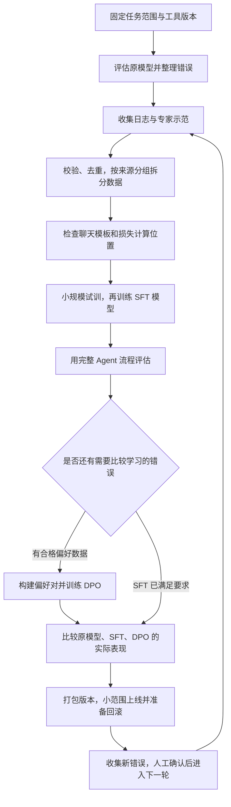

---
tags:
  - Agent
  - SFT
  - DPO
  - 模型微调
  - 后训练
status: active
---

# Agent 主力模型后训练全流程：SFT + DPO

> [!note] 记录口径（2026-10-10 修订）
> 文中包含设计方案、历史配置与效果数字。未关联数据集版本、运行 ID、checkpoint 或评测日志的数字需核实，不直接作为实测结论；本地示例代码与生产部署状态分别说明。

**设计与实现状态**：正式统计检验的本地模块、生产接入与历史说明分别记录，当前状态见 [[03_Agent系统/01_项目事实与实现状态]]。单次聚合 KPI 不能替代独立重复观测。

> 本文档详细描述 5G 测试验证 Agent 系统中 Qwen3-32B 主力模型的后训练过程，包括为什么要做、数据如何产生、训练细节和方案选型逻辑。

> [!tip] 初学者阅读顺序（2026-10-26 补充）
> 先读第零节，了解一次训练从哪里开始、到哪里结束；再读 §3.2 的“损失目标与 assistant mask”，理解模型到底在学什么。其余各节提供数据构建细节与配置说明。本次以项目文档为依据扩写训练方案，没有执行 GPU 训练；配置值和历史效果表仍需与实际训练记录对应。

## 零、以本项目为例，从一次测试请求走完后训练流程

### 0.1 后训练到底改变了什么

你的系统使用一个已经具备通用语言能力的 Qwen3-32B 模型。**后训练，就是在这个模型的基础上，用项目数据继续训练，调整它生成回答和工具调用的方式。** 不需要重新从海量通用文本开始训练。

但 Agent 是整个应用，不只是一个模型。在本项目中，各部分的分工是：

| 部分 | 本项目中的工作 | 训练主模型时是否直接修改它 |
| --- | --- | --- |
| Qwen3-32B 主模型 | 读懂需求，选择工具，填写参数，读懂返回结果，组织结论 | 是，采用 LoRA 时更新附加的小矩阵 |
| LangGraph 流程 | 保存状态、决定下一节点、暂停等待人工、限制调用次数 | 否，需要修改应用代码 |
| 工具执行器 | 查询用例、提交仿真、采集指标，检查权限和参数 | 否，需要修改工具实现 |
| 知识库 | 提供适用的协议说明、用例和验收规则 | 否，需要更新资料和检索流程 |
| 辅助模型 | 如独立部署的 Qwen3-4B 检查模型 | 否，必须单独准备训练与评估 |

例如，模型不知道某个规范的新门限，可以先更新知识库；执行器重复提交任务，需要修复任务去重；模型拿到有效用例 ID 后仍然自己编一个 ID，才是适合用训练改善的行为问题。

**模型运行一次任务不会自动更新参数。** 对话记忆、保存日志、专家点击通过，都不是训练。必须把记录整理为数据，再运行训练程序并部署新模型，行为才可能改变。

### 0.2 先确定一个贯穿全流程的任务

下面以“验证基站 A 到基站 B 的切换表现”为例，使用本章 §3.1 中的查询、仿真与采集工具。为突出训练过程，示例只展示关键参数；验收门限来自这里明确给出的示例上下文。

```text
用户：请在沙盒中验证 A 到 B 的切换成功率是否满足要求。

已经确认的上下文：
  当前环境：sandbox
  场景：Xn_handover
  对应验收规范：示例规则 HO-R1，成功率不低于 98%
  注意：98% 是本例提供的项目验收门限，不是所有切换测试的统一门限。

期望的处理过程：
  1. test_case_query(feature="Xn_handover", category="regression")
     → 返回 cases，其中包含有效用例 ID TC-0001。

  2. simulation_runner(test_case_ids=["TC-0001"], env="sandbox")
     → 返回 session_id，例如 sim-a17c204b，状态 queued。

  3. metrics_collector(session_id="sim-a17c204b")
     → 返回状态 completed，handover_success_rate=0.90。

  4. 回答：本次切换成功率为 90%，低于 HO-R1 要求的 98%，判定 FAIL。
     说明结果来自沙盒，给出会话与规则依据。
```

这里的指标和会话 ID 都是示意值，真实调用必须使用实际返回的结果。完整任务还需要确认 A、B 的设备身份、拓扑、配置和观测窗口；这些信息应在任务上下文、选定用例或完整执行参数中明确传递。仿真结论与现场设备结论分别表达，完整工具设计见 [[03_Agent系统/04_工具设计与完整调用示例]]。

我们要训练的行为可以逐条检查：先查用例；引用实际 ID；提交成功后继续取结果；区分排队和完成；按正确单位读取指标；用适用门限判定；缺证据时承认无法判定。

### 0.3 完整流程与每一步的产物



| 步骤 | 要得到的产物 | 进入下一步的条件 |
| --- | --- | --- |
| 任务与原模型评估 | 版本记录、固定评估题、错误清单 | 已分清模型错误和工具、知识错误 |
| 数据准备 | 对话、工具定义、来源与审核记录 | 内容正确，引用完整，训练和评估没有同源泄漏 |
| 模板与损失检查 | 实际输入、labels 检查报告 | 助手调用与回答参与损失，工具返回作为上下文 |
| SFT | 模型文件或适配器、训练配置、验证报告 | 训练正常，完整任务表现有改善 |
| 可选 DPO | 同一上下文的偏好对、候选模型 | 偏好有依据，没有用不同信息强行比较 |
| 发布 | 候选模型包、比较报告、回滚版本 | 格式、任务、风险和资源开销符合约定 |

### 0.4 第一步：先测原模型，知道为什么要训练

固定主模型、系统提示、工具定义、检索资料版本、调用次数限制和生成参数，再用一批有标准依据的任务运行完整 Agent。将每次错误定位到具体步骤：

| 原模型的表现 | 先检查哪里 | 是否优先训练模型 |
| --- | --- | --- |
| 检索不到适用测试规范 | 资料是否入库，过滤条件和检索是否正确 | 否，先修资料和检索 |
| 传了真实会话 ID，但采集工具报错 | 工具实现、权限、服务状态 | 否，先修工具 |
| 已返回 TC-0001，却执行 TC-9999 | 模型是否正确引用工具结果 | 可以用 SFT 示范正确引用 |
| 收到 queued 就宣布 PASS | 模型是否混淆提交、完成、通过 | 可以用 SFT 示范完整流程 |
| 缺少指标仍编出 99% | 是否有缺证据的训练示范 | SFT 可教正确处理，必要时用 DPO 比较两种回答 |

不要只保存最后一段回答。需要保留模型当时看到的系统要求、用户输入、检索片段、工具定义和历史结果，否则不能复现为什么出错。

### 0.5 第二步：准备正确示范，而不只是准备问题答案

SFT 是“监督微调”：把**当时可见的信息和正确输出**提供给模型，让它学习在相似条件下怎么做。

本项目有三类数据来源：专家手写示范；经过专家确认的真实任务记录；依据规则生成并检查的模拟对话。人工审核通常简称 HITL，本质是人在关键步骤检查、修正或批准模型的行为。

一份建议的数据记录同时保留两类内容：

| 类别 | 内容 | 用途 |
| --- | --- | --- |
| 模型应看到的内容 | 系统规则、用户需求、工具定义、按时间排列的消息 | 构造训练输入 |
| 数据管理信息 | 来源任务 ID、局点/版本、规则版本、模拟或真实、审核人和理由 | 审核、分组拆分、追查错误；按需提取后再传给模型 |

所谓“完整工具交互记录”，就是保存每一步的助手请求和真实工具回应。工具返回用 `tool` 角色；助手发出的工具调用用 `assistant` 角色，并保留调用 ID。工具调用不是在普通回答里写一句“我查询了”，而是符合当前接口的可解析调用。

不要把专家后来才知道的结果提前放进模型之前的输入。例如，采集完成后才知道成功率是 90%，那么提交仿真前的模型就不应看到这个数值。

专家修正了某一步以后，也不能原样拼接旧步骤之后的所有工具结果。若改了用例、参数或测试对象，需要重新执行后续步骤，或明确使用经校验的模拟结果，保证前后对应。

**正确示范不等于测试通过的示范。** 示例中模型报告 FAIL，可能正是正确行为。训练数据应包括：

| 场景 | 应示范的行为 |
| --- | --- |
| 指标满足要求 | 有证据地报告 PASS |
| 指标不满足要求 | 有证据地报告 FAIL，不掩盖失败 |
| 没找到适用门限 | 查询规范或请求澄清，仍缺依据则无法判定 |
| 没有有效用例 ID | 继续检索或说明缺口，不编造 ID |
| 采集工具暂时出错 | 按错误类型与系统限制重试 |
| 提交工具超时，不知道是否已执行 | 先查任务状态，避免重复触发测试 |
| 请求超出当前权限或环境限制 | 停止执行，说明原因并请求必要审核 |

可以保存简短、可核查的操作依据，如“缺少适用门限，先查规范”。不需要为了训练而编写冗长的内心推演；它也不能替代工具结果。

### 0.6 第三步：清洗并分开训练、验证和最终测试

三份数据承担不同职责：

| 数据 | 能否用于更新模型参数 | 用途 |
| --- | --- | --- |
| 训练集 | 能 | 学习示范和偏好 |
| 验证集 | 不直接更新，但用于选择方案 | 选择训练轮数、学习率、停止时间与审核阈值 |
| 最终测试集 | 不能 | 方案确定后进行最终比较 |

例如，一条原始切换任务扩写出了 20 个问法，这 20 条应放在同一份数据里。不能随机分散后宣称模型能处理新任务；那可能只是见过高度相似的题。SFT 与 DPO 数据也要统一检查，不能把最终测试题换成偏好对后再次拿去训练。

根据要验证的能力，按原始任务、用例模板、局点、设备版本或时间分组拆分。比例可以按样本量决定，**没有同源内容跨组，比固定某个比例更重要**。

每条数据至少检查：工具是否存在；参数类型和范围是否正确；ID 是否来自先前记录；指标、单位与结论是否一致；规范是否适用；是否包含未来信息；是否需要脱敏。改写或替换 ID 时，所有关联引用要一起修改。

### 0.7 第四步：先确认模型正在学习正确的位置

原始消息需要经过“聊天模板”转换为模型使用的格式，再由“分词器”转换为数字编号。token 是模型处理的一小段文本，可能是一个字、词的一部分或特殊标记，不固定等于一个汉字。

```text
结构化消息与工具定义
    → 聊天模板：标记谁在说话、工具如何调用、消息在哪里结束
    → 分词器：转为 input_ids，即 token 的数字编号
    → labels：指定要预测的正确 token，忽略位置使用 -100
    → 训练批次：补齐长度，并再次核对最终 labels
```

对本项目而言，用户需求、规范和工具返回需要被模型读到；助手的工具调用及最终回答需要作为学习目标。哪些位置计算损失，详见 §3.2。

先选几条包含多次工具调用、异常和长输入的样本，把最终批次中所有 `labels != -100` 的 token 解码出来人工检查。确认目标正确后再开始正式训练，不能只检查原始 JSON。

### 0.8 第五步：SFT 一次参数更新实际上做了什么

以“完成采集后应该报告 FAIL”为例，训练程序依次执行：

1. **读取正确上下文。** 输入已有的需求、规则和 completed 工具结果。
2. **预测下一个 token。** 模型给词表中的每个候选 token 一个概率。
3. **计算损失。** 在参与训练的位置上，对正确 token 给得越低分，损失越大。
4. **计算怎样调整参数。** 反向传播计算各个可训练参数如何影响损失，这些变化方向称为梯度。
5. **调整参数。** 优化器按照梯度与学习率进行小幅更新。
6. **继续处理其他样本。** 一份训练数据完整使用一遍称为一轮，英文叫 epoch。

在一个位置上，常用损失可以写成 `-log(正确 token 的预测概率)`。按自然对数计算，正确 token 的概率为 0.1 时，损失约为 2.30；概率为 0.8 时，损失约为 0.22。训练是在更多位置、更多样本上减小这个值，不是给模型硬编码“所有切换都输出 FAIL”。

还有一个容易混淆的地方：**SFT 训练时，前文通常来自数据里的正确记录；实际运行时，前文会包含模型自己刚做出的选择。** 因此，训练损失低不代表实际任务就能完成，训练后必须重新运行整个 Agent。

本项目采用的 LoRA，是冻结原模型的大矩阵，只训练额外添加的小矩阵。推理时两者共同影响输出。它减少需要更新的参数与相关存储，但仍需加载原模型，也不能保证原有能力完全不退化。[PEFT LoRA 文档](https://huggingface.co/docs/peft/v0.21.0/package_reference/lora)

| 配置 | 通俗含义 | 本项目中要观察什么 |
| --- | --- | --- |
| 学习率 | 每次参数调整的幅度 | 太大可能破坏已有能力，太小可能改进很慢 |
| 每批样本数 | 一起参与一次计算的样本数量 | 影响显存与更新的稳定程度 |
| 梯度累积 | 分几小批计算后再更新一次参数 | 在显存有限时扩大一次更新使用的数据量 |
| 训练轮数 | 训练数据反复使用多少遍 | 多轮不一定更好，要防止只记住训练样本 |
| 最大序列长度 | 一条记录最多保留多少 token | 截断是否丢失工具返回或正确结论 |
| LoRA 的 r | 附加矩阵的中间维度 | 影响可训练参数量，合适大小需用验证集比较 |

在常规数据并行、未做样本拼接的情况下，每卡 2 条、8 张卡、累积 8 次，一次参数更新约用 `2×8×8=128` 条记录。多卡分片与样本拼接启用后，应另记实际 token 数和样本统计。

先用几十到几百条已审查数据做短试训：确认没有全为 -100 的样本、损失为有限值、可训练参数确实改变、模型能重新加载和生成。再逐步扩大规模；不必先凑到历史记录中的 5 万条。

### 0.9 第六步：先评估 SFT，再决定要不要 DPO

保持应用、工具与评估条件相同，把原模型换成 SFT 模型，重新运行完整任务。检查它能否真的调用工具、取得对应会话结果并正确判定。

若 SFT 已满足目标，可以直接进入发布验证。若还存在稳定、可比较的错误，而且能取得可信的人工偏好，可以再做 DPO。DPO 是“直接偏好优化”：同一个上下文给出两个候选输出，标明哪个更好，让模型学习这种差别。

**SFT 本身可以教模型拒绝越权请求、请求澄清和承认证据不足。** DPO 的价值在于额外使用好坏输出的比较信息，不是只有 DPO 才能训练安全行为。

### 0.10 第七步：把同一决策点的好坏输出做成偏好对

先做单次助手输出的比较，比直接比较包含不同工具结果的完整任务更容易检查。

```text
共同上下文 prompt：
  用户要求按 HO-R1 检查切换成功率。
  已查询用例、提交仿真并取得对应会话的采集结果。
  工具返回：completed，handover_success_rate=0.90。
  HO-R1 门限：不低于 0.98。

chosen（更好的输出）：
  FAIL。本次切换成功率 90%，低于 HO-R1 要求的 98%。
  该结果来自沙盒会话 sim-a17c204b，不能据此证明生产局点表现。

rejected（更差的输出）：
  PASS。测试已完成，切换功能正常。

审核理由：
  后者把“执行完成”误当成“验收通过”，且与已有指标矛盾。
```

`chosen` 和 `rejected` 指的是被偏好和不被偏好的输出，不等于通过与失败。这个例子恰好是 FAIL 比 PASS 更好。

另一个比较点可以放在工具调用之前：共同上下文明确只允许 sandbox，比较合法的沙盒调用与越权的生产调用。两边必须使用相同需求、规则和可见历史。不能一边有指标、一边没有指标，却把回答差异全归因于模型能力。

只有一条专家确认的好答案时，它可以用于 SFT；没有经过确认的较差候选，就还不是一条 DPO 数据。专家审核理由默认保留在管理记录中，不能把事后理由加入当时并不可见的共同上下文。

尤其不要把所有工具返回和未来执行结果写进一大段 assistant 候选。那会让模型连环境输出一起模仿。若要训练完整交互中的偏好，需要另行确认训练器对工具消息和目标范围的支持；初期优先比较同一个决策点的助手输出。

### 0.11 第八步：DPO 怎样利用这两个候选

在常见的标准 DPO 设置中，先固定 SFT 模型作为参考模型，再从相同的 SFT 状态初始化待训练模型。

对每条偏好数据，两个模型分别计算：在同一上下文下生成 chosen 和 rejected 的对数概率。一个回答的对数概率，是其中各个目标 token 条件对数概率的总和；prompt 提供条件，不作为待比较回答计分。

可以把它理解为比较两项变化：

```text
更好回答的变化 = 当前模型对它的对数概率 - 参考模型对它的对数概率
更差回答的变化 = 当前模型对它的对数概率 - 参考模型对它的对数概率

DPO 希望第一项减去第二项的差值变大。
```

例如，参考模型两种回答的对数概率分别为 -20、-19，差值是 -1；当前模型变成 -19、-21，差值是 2。相对参考模型，偏好差值改善了 3。数字只说明比较方式，不是本项目实测值。

实际也可能两个回答的概率都降低，只是较差回答降低更多，所以不能仅凭 chosen 的概率下降就宣布训练失败。参考模型通常保持不变，作为比较基准；它不会自动检查事实是否正确，事实依据仍来自数据审核与任务评估。[DPO 原论文](https://arxiv.org/abs/2305.18290)

`beta` 是控制该偏好差值如何进入损失的参数；在原始理论推导中，它还对应对偏离参考模型的惩罚系数。它与学习率、数据质量、训练步数共同影响结果，不能理解成“越小越安全”或“越大就不会遗忘”。选择时同时比较任务表现、误拒绝和原有能力。

DPO 通常不必在每次参数更新时实际执行仿真，因为它学习的是已准备好的偏好数据。训练完成后，仍需用真实工具或可控测试环境运行任务，才能知道行为是否改善。若以后让模型反复执行环境任务、按结果得分再训练，那是另一个涉及环境成本和评分可靠性的方案，不是本章 SFT→DPO 的必经步骤。

### 0.12 第九步：比较整个系统，不能只看训练曲线

使用相同任务和相同环境，比较原模型、SFT 模型及可选的 DPO 模型。至少分开记录：

| 检查项 | 本项目的具体判据 |
| --- | --- |
| 格式是否正确 | 工具调用和最终结果能否解析，必填字段与类型是否正确 |
| 工具和参数是否正确 | 有没有先取得有效用例；session_id、环境和设备范围是否有依据 |
| 证据是否足够 | 是否等到完成，指标是否属于当前会话，规范是否适用 |
| 判定是否正确 | 90% 对 98% 应为 FAIL；缺证据应无法判定，而不是猜 PASS |
| 完整任务是否完成 | 用户目标是否达成，包括必要的报告和环境恢复 |
| 风险处理是否正确 | 越权动作是否被拒绝或送审；正常沙盒任务是否被错误拒绝 |
| 开销是否可接受 | 每次任务耗时、token 数、工具调用次数、GPU 显存 |

“模型成功完成任务”与“被测设备通过验收”分开统计。模型发现故障并正确报告 FAIL，可以算任务成功；工具故障导致无法判定，不自动等于模型判定错误，但应记录任务未完成的原因。

分别观察模型是否提出了危险请求、执行器是否实际放行。不能把执行器拦截成功全部记成模型变好了，也不能因为模型自报 `confidence_score=0.9` 就认为正确率是 90%。

验证集用于选择候选模型和阈值。最终测试集用于确认选定方案，不用来反复挑难题加入训练。涉及随机生成或环境波动时，记录重复运行结果，避免一次偶然成功掩盖问题。

### 0.13 第十步：保存、发布、观察，再决定下一轮训练

一次可追查的发布至少保存：基础模型版本；SFT/DPO 数据版本；LoRA 权重及对应基础模型；分词器、聊天模板与结束标记；系统提示与工具定义；依赖版本；训练配置；评估报告。

LoRA 可以单独加载，也可以合并到对应基础模型。若 DPO 是在“已合并 SFT 的模型”上训练新适配器，部署时必须加载这个 SFT 基础模型加 DPO 适配器，或部署二者合并后的完整模型；不能把 DPO 适配器直接套到原始 Qwen3 上。

先在沙盒重跑固定任务，再以少量获准任务验证候选版本；出现任务成功率下降、正常任务被大量拒绝、参数错误或开销增加时，切回保存的旧版本。上线时仍保留应用侧权限、范围校验、超时和人工审核。

新运行记录经过专家确认，再进入下一轮数据准备。混入必要的历史任务，检查旧能力是否退化；是否更新应由新数据和评估决定，不必每周固定训练。审核阈值要在验证数据上检查“自动放行部分的整体错误率”和样本量，不能只看某个分数区间。

### 0.14 一次完整后训练应该留下什么

可以用下面这张产物表检查流程是否完成，而不依赖某个训练脚本的名字：

| 产物 | 至少应能回答的问题 |
| --- | --- |
| 任务与错误清单 | 为什么要训练？具体要改进哪些行为？ |
| 数据说明与审核记录 | 样本来自哪里？工具结果与专家判断是否可信？ |
| 数据拆分记录 | 是否按来源分组？最终测试题是否始终未参与训练和选参？ |
| 模板与目标检查记录 | 模型实际看到什么？哪些 token 真正参与了损失？ |
| 训练配置与过程记录 | 从哪个模型开始？更新哪些参数？何时停止？ |
| 候选模型与比较报告 | 相比原模型改善了什么？是否损伤旧能力？ |
| 发布包与回滚方案 | 如何加载正确的模型、模板和工具版本？怎样切回旧版？ |
| 下一轮待处理问题 | 哪些错误值得补数据？哪些应该改工具或知识库？ |

---

## 一、为什么通用基座模型不够用

在开始任何训练之前，首先要诚实地回答：**到底遇到了什么问题，让我们决定做后训练？**

### 1.1 未做项目训练时，需要检查的三类问题

以下输出与轮次变化是帮助理解的失败示例，是否在项目中发生、频率多高，需要由原模型评估确认。

**问题一：不理解领域术语或把术语映射成错误字段**

通用模型（即使是 Qwen3-32B）的训练语料以通用互联网文本为主，5G 通信领域的专有术语较多：`RSRP`、`SINR`、`PUSCH`、`BWP`、`NR PDCP`、`EPS Fallback`、`A3 Event`……

失败示例：
```
用户：请测试 gNB 的 Xn 接口在 A3 事件触发时的切换延迟

未做项目训练的模型输出（错误示例）：
{
  "test_type": "interface_test",
  "target": "gNB",
  "event": "A3",
  "metric": "switch_delay",   ← 字段名不符合平台规范
  "frequency_band": "700MHz"  ← 捏造的频段，A3事件与频段无直接关系
}
```

**问题二：结构化格式输出不稳定**

下游执行器（仿真平台 API）对 JSON/YAML 格式有严格要求：字段名必须完全匹配、必填字段不能缺失、类型必须正确。零样本模型在多轮对话后格式稳定性显著下降：

- 第 1 轮：输出标准 JSON
- 第 3 轮：开始在 JSON 外加解释性文字（破坏解析）
- 第 5 轮：出现字段名拼写变化（`test_case_id` → `testCaseId`）
- 第 7 轮：丢失必填字段 `bearer_id`

**问题三：生成没有依据或超出限制的操作**

最严重的问题。模型有时会"一本正经"地生成包含高危操作的测试用例：

```text
{
  "test_case": "极限压测-全网并发",
  "actions": [
    {"op": "set_concurrency", "value": 99999},    ← 超大并发，可能击垮仿真器
    {"op": "reset_counters", "type": "all"},       ← 清除所有历史基线数据
    {"op": "force_reboot", "target": "all_gnb"}    ← 重启所有基站
  ]
}
```

这类输出可能看起来符合测试目标，却忽略了运行环境的安全限制。不能假定通用模型已掌握本项目的安全规则，需要通过权限控制、参数校验、审核和领域训练共同约束。

### 1.2 检索资料、改进提示与后训练怎样配合

RAG 指先检索资料，再把资料提供给模型；System Prompt 是应用预先给模型的行为要求。二者应先用于建立可靠的基础方案，再根据实际错误决定是否训练：

| 方法 | 局限性 |
|:---|:---|
| RAG | 可提供新资料，但检索可能遗漏，模型也可能忽略或误用证据；不会直接更新模型参数 |
| System Prompt | 可改变当次输出行为，但复杂规则是否被遵守仍需评估；不会直接更新模型参数 |
| 在提示中附上少量示例 | 可示范工具用法，但占用输入长度，也不一定覆盖异常场景 |

检索和提示也能改变模型的实际行为，区别在于是否更新参数。适合经常变化的规范通常通过检索提供；希望模型稳定掌握的工具使用习惯可以通过训练强化。训练后的模型仍应读取最新规则。

---

## 二、训练路线图

### 本章为什么先使用 SFT，再按需要使用 DPO

本项目先有专家示范和人工修改记录，因此适合先用 SFT 学正确流程，再按数据情况使用 DPO 学两个候选之间的差别。两者都可使用预先准备的数据，不需要每次参数更新都重新执行一次完整仿真。

如果以后能可靠地自动评分，并能承担大量重复仿真成本，再考虑让模型执行任务、根据所得分数继续训练。相关算法见 [[01_大模型/02_训练与对齐/02_偏好对齐算法_PPO_DPO_GRPO]]，初学本章不需要先掌握这些方法。

下图保留项目历史方案中的规模与时长，实际预算需要按样本长度、硬件和实测速度估算。DPO 为可选阶段，不以“阶段更多”作为效果更好的依据。

```
基座模型（Qwen3-32B）
       │
       ▼
[阶段一] SFT 监督微调
  目标：格式规范 + 术语理解 + 通用领域能力
  数据：约5万条高质量对话（合成 + Golden Dataset）
  硬件：8×A100 80G，约18小时
       │
       ▼
SFT 模型（Qwen3-32B-5G-SFT）
       │
       ▼
[阶段二] DPO 偏好对齐
  目标：安全边界对齐 + 危险幻觉抑制
  数据：HITL 沉淀的偏好对（约1.2万对）
  硬件：8×A100 80G，约6小时
       │
       ▼
待评估的候选模型（Qwen3-32B-5G-Aligned）
       │
       ▼
[持续] 收集新问题，审核后按需要更新
  新人工审核数据 → 离线训练 → 评估 → 决定是否发布
```

---

## 三、SFT 阶段：监督微调

### 3.1 训练数据：来源与构建

**目标**：构建约 5 万条覆盖以下能力的高质量对话数据：
1. 5G 通信专有术语的正确理解与使用
2. 严格 JSON/YAML 格式的稳定输出
3. 按“选择下一步 → 调用工具 → 读取工具结果 → 继续处理”的顺序完成任务，常称 ReAct
4. 面对非理想环境（工具失败、模糊诉求）的容错行为

**数据来源一：指令扩增 + 工具交互轨迹合成（目标约 3.5 万条）**

这里生成的是供模型学习的 **SFT 训练对话样本**。测试用例是执行某项测试的步骤、参数和预期结果；训练对话则记录 Agent 如何理解用户请求、查询或生成测试用例、调用工具、处理异常并给出结论。

**一条训练样本 = 用户测试请求 + 助手处理过程 + 工具返回 + 最终回答。** 一条样本可以包含多次工具交互，不等于一条用户指令，也不等于一次测试执行。

为降低逐条人工编写完整对话的成本，采用以下流程：

```text
Step 1：准备专家示例与领域依据
  ├── 计划准备 100 条专家示例：展示用户请求、正确处理流程和结论依据
  ├── 核心协议片段：如 3GPP TS 38.331、38.211，提供术语及协议约束
  └── 脱敏后的企业测试规范：提供环境配置、执行要求和验收标准
  → 产物：可供生成阶段参考的示范与资料

Step 2：扩增用户测试请求（借鉴 Self-Instruct）
  将专家示例和相关背景提供给强 LLM，例如要求：
  “参考以下示例，生成 50 条不同的用户测试请求，
   覆盖正常场景、边界条件、信息不全的需求和工具异常恢复。”
  → 产物：多样化的用户请求；此时尚未生成处理过程，也未执行测试

Step 3：构建完整工具交互轨迹
  对每条请求，提供相关协议依据、企业测试规范、工具定义和环境信息：
  [用户请求] → [助手操作说明与工具调用] → [工具返回]
             → [助手继续调用、澄清或处理异常] → [最终回答]
  工具返回优先来自测试沙箱执行；难以复现的异常可由受规则约束的模拟器注入。
  若使用 LLM 模拟工具返回，需标记来源，并单独检查参数约束及数据合理性。
  → 产物：候选训练对话；模拟数据不能作为真实测试结果

Step 4：质量过滤（四项检查）
  ├── 格式校验：用 Pydantic/JSON Schema 检查消息、工具参数及结论字段
  ├── LLM-as-Judge 评审：检查工具选择、参数依据、异常处理、操作风险及结论完整性
  │   初始方案按 0–10 分评分，低于 6 分的样本剔除；门限需用专家标注校准
  ├── 一致性校验：用可执行规则检查 ID 引用、数值、单位和验收结论
  └── 专家抽检：初始计划抽查 5%，兼顾随机抽样与边界、异常等场景
  → 产物：通过检查的训练对话，再按训练模板打包
```

协议约束与企业验收标准应分别注明出处和版本。例如，某项时延的验收门限必须来自对应测试规范，不能由模型自行假定，也不能默认所有门限都由 3GPP 统一规定。工具参数可以来自用户请求、已确认的环境配置、规范或先前工具返回；其中用例 ID、会话 ID 等执行标识必须引用实际已取得的值。

**贯穿示例：从一条请求到一条训练样本**

以下仅示意数据结构，工具返回均为模拟值。假设输入上下文已明确：使用 sandbox 环境，企业测试规范要求本次切换时延不超过 50 ms。

```text
用户请求：验证基站 A 到基站 B 的切换时延是否满足要求。

助手操作说明：先查询切换测试用例，再执行仿真并获取时延指标。
助手调用：test_case_query(feature="Xn_handover", category="regression")
工具返回：{"test_case_ids": ["TC_001"]}

助手调用：simulation_runner(test_case_ids=["TC_001"], env="sandbox")
工具返回：{"session_id": "S_123"}

助手调用：metrics_collector(session_id="S_123")
工具返回：{"handover_latency_ms": 65}

助手最终回答：
{"confidence_score": 0.9, "verdict": "FAIL",
 "summary": "本次模拟返回的切换时延为 65 ms，超过测试规范规定的 50 ms。"}
```

Step 2 只生成上面的“用户请求”；Step 3 补齐处理过程与回答；Step 4 检查整个样本。模型需要学习的是正确传递 `TC_001`、`S_123`，并依据指标与标准作答，而不是记住这些示例 ID 或固定输出 FAIL。示例中的置信度仅为占位值，不能视为已校准的正确率。

**方法名称说明**：本方案借鉴 Self-Instruct，从少量种子示例扩增指令及回答，再构建工具交互轨迹。Magpie 的核心则是利用模型的聊天模板前缀生成用户指令，再生成回答，并不特指“让模型同时扮演助手和工具”，因此不宜用它命名这里的 Step 3。[Self-Instruct 原论文](https://arxiv.org/abs/2212.10560)、[Magpie 原论文](https://arxiv.org/abs/2406.08464)。

**质量检查各自解决什么问题**：

- 格式校验检查字段和类型，例如工具参数是否缺失、JSON 能否解析；业务约束需要另外编写校验规则。
- LLM 评审检查流程是否合理，例如尚未取得用例 ID 就执行仿真，或操作说明与实际调用不一致。
- 一致性规则检查可明确判断的错误，例如调用中出现未返回过的 `session_id`，或指标为 65 ms、门限为 50 ms，结论却为 PASS。
- 专家抽检检查协议理解、测试设计和验收依据等专业问题，并据此调整生成提示与过滤规则。

LLM 评分不能替代规则验证或专家判断。格式正确、前后一致的样本仍可能包含专业错误，尤其要检查模拟工具返回的真实性边界。过滤率需根据实际批次统计；抽查 5% 不等于发现或删除了全部样本的 5%，也不能据此推算最终合格率。

**关键点：加入失败案例数据**

训练数据需要覆盖失败场景。如果全是成功案例，模型可能缺少处理工具故障的经验。

专门构造的失败恢复数据示例：
```
[用户] 请测试基站A的切换成功率
[模型] Thought: 需要先查询相关测试用例
       Action: test_case_query(feature="handover")
[工具] 返回: HTTP 500 - Service temporarily unavailable
[模型] Thought: 工具调用失败，等待10秒后重试
       Action: test_case_query(feature="handover")  ← 重试
[工具] 返回: {"cases": [...], "total": 12}
[模型] Thought: 重试成功，继续下一步...
```

训练数据中加入工具失败、超时和空结果等情况，并标注正确的恢复行为，例如重试、降级或告知用户，让模型学习异常处理。

**数据来源二：人工审核后保留的标准示范（历史计划约 1.5 万条）**

优先整理有完整证据、经专家确认的任务记录：

| 原始审核记录 | 转为 SFT 数据时怎么处理 |
| --- | --- |
| 用户需求与当时上下文 | 保留，不把事后信息提前加入 |
| 模型原来的错误调用或回答 | 作为错误分析材料，不直接当成正确目标 |
| 专家修改后的调用或回答 | 经检查后作为助手应学习的输出 |
| 专家修改理由 | 保存为审核依据，必要时提炼成简短、可核查的操作说明 |
| 修改后重新执行的工具结果 | 用 tool 角色保存，与相应调用关联 |
| 专家确认的最终判定 | 作为最后的助手输出，包含证据与适用规则 |

如果专家只是点击“通过”，没有记录中间步骤，也没有复核证据，那么还需要补足这些信息，不能仅凭审核标签认定整段对话都正确。

这类数据的价值在于能够关联专家修正、工具执行与最终判定。但“经过人工审核”不自动等于“执行验证充分”：还要检查修改后的步骤是否重新执行、证据是否完整。真实测试暴露故障并正确报告 FAIL 的过程，同样可以是高质量示范。

### 3.2 数据格式设计（ChatML）

所有数据按目标模型的聊天模板打包，保留系统提示、多轮对话和工具调用序列。下例用 ChatML 风格展示消息边界，工具标记仅作示意；实际特殊 token 和调用格式以目标模型模板为准。

助手工具调用与工具返回应分别保存为对应的消息，并通过调用 ID 关联。训练助手行为时，工具返回作为上下文，其 token 不作为助手输出的学习目标；不能把整段交互全部装入一条 assistant 消息，否则可能让模型学会自行编写工具返回。

````text
<|im_start|>system
You are a 5G test verification agent.
- Query a valid test case before submitting a simulation
- Use confirmed user inputs, environment settings, rules, or prior tool outputs
- Never invent test case IDs, session IDs, measurements, or acceptance thresholds
- If evidence or authorization is missing, request clarification or human review
[工具定义的JSON Schema...]
本例验收规则 HO-R1：切换成功率不低于 98%。
本例只允许沙盒测试。
<|im_end|>

<|im_start|>user
请在沙盒中验证基站 A 到 B 的切换成功率是否满足 HO-R1。
<|im_end|>

<|im_start|>assistant
操作依据：先取得有效切换用例，再提交仿真。
Action: test_case_query
{"feature": "Xn_handover", "category": "regression"}
<|im_end|>

<|im_start|>tool
{"cases": [{"id": "TC-0001"}], "total": 1}
<|im_end|>

<|im_start|>assistant
操作依据：使用刚查询到的用例 ID，在允许的环境中执行。
Action: simulation_runner
{"test_case_ids": ["TC-0001"], "env": "sandbox"}
<|im_end|>

<|im_start|>tool
{"session_id": "sim-a17c204b", "status": "queued"}
<|im_end|>

<|im_start|>assistant
操作依据：任务已排队，还没有完成，需要取得当前会话指标。
Action: metrics_collector
{"session_id": "sim-a17c204b"}
<|im_end|>

<|im_start|>tool
{"session_id": "sim-a17c204b", "status": "completed", "handover_success_rate": 0.90}
<|im_end|>

<|im_start|>assistant
{
  "confidence_score": 0.9,
  "verdict": "FAIL",
  "summary": "沙盒会话 sim-a17c204b 的切换成功率为 90%，低于 HO-R1 要求的 98%。现有指标不能单独证明具体根因。"
}
<|im_end|>
````

上面为了阅读方便，用 `Action:` 展示助手的调用意图，并省略调用 ID；真正的数据仍需按目标模板保存结构化工具调用及对应 ID，不能直接把这个展示样例当作所有模型通用的序列化格式。操作依据也是可选的简短说明，不要求训练冗长推演。

**格式设计的关键考量**：
- 工具调用和工具返回都在训练序列中明确标注，模型学会区分"自己的输出"和"环境反馈"
- 最终结论输出可直接解析的 JSON；文档中的代码块用于展示，不要求模型额外输出 Markdown 围栏
- 若项目保留 `confidence_score`，它是模型生成的辅助评分，不是正确概率；证据缺失与越权操作仍应触发明确的系统检查，不能只依赖分数

#### 损失目标与 assistant mask

**先区分“模型能读到什么”和“模型被要求预测什么”。**

在本项目中，模型需要读到用户需求、验收规则和工具返回，才能决定下一步。但我们希望它生成的是自己的工具调用和回答，而不是用户的问题或仿真器的结果。

以第零节的切换测试为例：

| 消息片段 | 模型需要读到吗 | 本项目的 SFT 是否对其计算损失 | 原因 |
| --- | --- | --- | --- |
| system：只能使用 sandbox，HO-R1 门限为 98% | 是 | 否 | 作为行为约束与判定依据 |
| user：验证切换成功率 | 是 | 否 | 作为待处理任务 |
| assistant：查询用例的工具调用 | 是 | 是 | 学习该选哪个工具、怎么填参数 |
| tool：用例 ID 为 TC-0001 | 是 | 否 | 学习使用返回值，不学习伪造返回值 |
| assistant：提交仿真的工具调用 | 是 | 是 | 学习引用真实用例 ID 和合法环境 |
| tool：返回会话 ID，状态 queued | 是 | 否 | 告诉模型下一步有据可查，但测试未完成 |
| assistant：采集当前会话指标的工具调用 | 是 | 是 | 学习继续取结果，不能提前结束 |
| tool：completed，成功率为 90% | 是 | 否 | 提供外部观测证据 |
| assistant：90% 低于 98%，结论为 FAIL | 是 | 是 | 学习根据证据判定与表达 |

这里说“不计算损失”，是指不把这段文本作为直接预测目标。它仍然参与后续助手输出的条件计算，会影响参数更新，不能理解成“模型完全不学习使用它”。

**第一步：聊天模板把消息变成一条 token 序列。**

原始数据里有 `role`、`content`、`tool_calls` 等字段，模型最终接收的是数字编号序列。聊天模板负责按模型约定串起这些字段，加入角色、工具调用和结束标记；不同模型不一定使用同一组标记。ChatML 示例只帮助理解消息结构，实际应使用目标模型对应的模板。[Transformers 聊天模板文档](https://huggingface.co/docs/transformers/en/chat_templating)

工具定义也要成为模型可见的输入，否则模型看到 `simulation_runner` 时可能并不知道允许的参数。调用 ID 主要用于把工具回应与先前请求对应起来，不能省掉后再靠文字猜测。

**第二步：assistant mask 标出助手应生成的部分。**

mask 在这里就是一张位置表：`1` 表示属于本次要学习的助手输出，`0` 表示不属于。下面只是假想 token 的简化示意，不代表真实分词结果：

```text
目标 token：       [规则] [用户问题] [助手调用] [工具返回] [助手结论] [补齐位置]
assistant mask：     0       0         1          0          1          0
```

模型需要学习助手发出的工具名、参数及调用格式，不能把所有带“工具”二字的内容都排除。应排除的是环境发回的工具结果，而不是助手提出的工具请求。

多轮记录中的每段正确助手输出都可以参与训练。若目标只训练最后一次回答，也可以只标最后一段，但那样没有直接教前面的工具调用；应按目标明确选择。

**第三步：labels 决定实际计算损失的位置。**

`labels` 是训练时的目标编号。在常用的交叉熵实现中，目标为正常 token ID 的位置参与损失，目标为 `-100` 的位置忽略：

```text
input_ids： [ 101, 102, 103, 104, 105,   0]
labels：    [-100,-100, 103,-100, 105,-100]
                        ↑         ↑
                    助手调用   助手结论
```

`input_ids` 中的规则、问题和工具返回都保留着。我们只是让训练程序别对“能否复述这些内容”直接评分。

语言模型实际学习的是“用前文预测下一个 token”。例如，labels 在第 t 个位置保留某个目标 token，通常用第 t−1 个位置的模型输出来预测它；模型或训练器一般已经处理这一位移，不要自行重复移动一次。

助手 mask、labels 和 `attention_mask` 也不相同。`attention_mask` 通常用来标记有效输入与补齐位置、参与构造注意力计算；不能用它代替损失标记，把用户与工具结果从上下文里去掉。

**第四步：理解 `assistant_only_loss` 的作用与前提。**

当前 TRL 对对话数据提供 `assistant_only_loss=True`。它要求模板能标记助手的生成区域，通常借助 `` 和 ``；部分已知模型系列由 TRL 自动适配。这两个是模板里的标记，不是要求用户在聊天文本里手写的字符串。

另一项 `completion_only_loss` 按“提示部分 / 续写部分”区分损失。如果续写部分是一整段包含 assistant 和 tool 的交互，它不天然等于“只训练助手”。两者可在支持的数据格式下配合使用，具体仍要核对实际目标范围。[SFTTrainer 损失配置说明](https://huggingface.co/docs/trl/en/sft_trainer#train-on-assistant-messages-only)

手工构造 labels 也能实现同样目标，但要检查多轮消息、工具标记、结束 token 与截断边界。助手内容和应由模型生成的结束标记应有一致的训练约定；不要求所有角色头部标记都按同一种策略计分。

`processing_class` 解决的是把哪个分词器或处理器交给训练器，属于输入处理接口。它本身不是损失配置，也不是 DPO 的算法定义。接口使用方式按所用版本确定即可，不必把参数名称变化理解成训练原理变化。[DPOTrainer 参数说明](https://huggingface.co/docs/trl/en/dpo_trainer#trl.DPOTrainer)

**第五步：用一条实际样本检查最终训练目标。**

训练前逐项确认：

1. 解码完整输入，能看到需求、规则、工具定义和按顺序排列的返回。
2. 解码最终训练批次中所有 `labels != -100` 的 token，主要是助手调用和助手回答。
3. 查询、提交、采集这几次调用都在目标内；用户需求和外部指标不在目标内。
4. 新建批次时添加的补齐位置被忽略；没有一条样本的有效目标数量为零。
5. 长对话截断后，调用与回应仍能对应，最终回答没有在缺失依据的情况下被保留。
6. 训练和部署采用一致的消息组织方式、工具格式及结束约定。

如果完全不屏蔽，模型会同时被要求预测用户、工具和助手的文本；这适合某些全文语言建模目标，但与本项目“学习助手行为”的目标不同。如果全部屏蔽，就没有有效的学习目标。如果只留最终 JSON，可能改善报告格式，却没有直接训练工具使用过程。

最后，损失位置正确只说明“训练程序在对预期内容评分”，不能证明示范本身正确。模型可以很熟练地生成一个合法 JSON，却填入错误会话 ID，或者在成功率不足时报告 PASS。因此，格式、参数依据、证据完整性和业务结论都要分别评估。

### 3.3 模型选型：为什么是 Qwen3-32B + LoRA

Qwen3-32B 是项目文档选定的主模型。这里的 32B 表示约 320 亿参数，不表示它天然懂本项目，也不表示更大模型一定更好。选择时要比较相同任务下的正确性、响应速度、训练成本和部署资源。

**LoRA 为什么能减少训练参数**：假设模型某层有一个原始矩阵 `W₀`，全参微调直接修改它；标准 LoRA 保持它不变，学习两个较小矩阵 A、B，用它们的乘积表示附加变化：

$$W = W_0 + \frac{\alpha}{r}BA$$

如果原矩阵是 `4096×4096`，有 16,777,216 个参数；选 `r=16`，两个附加矩阵合计 `4096×16 + 16×4096 = 131,072` 个参数。这个单层例子说明为什么需要更新的参数可以大幅减少，不是整个 Qwen3-32B 的可训练参数统计。

| 方法 | 训练时更新什么 | 对本项目的意义 |
| --- | --- | --- |
| 全参微调 | 原模型全部或大部分参数 | 可调整范围更大，参数、梯度与优化器存储成本通常更高 |
| LoRA | 原模型冻结，更新附加矩阵 | 便于控制训练成本，保存和切换项目适配器 |
| QLoRA | 用量化方式存放基础权重，再训练附加矩阵 | 进一步节省基础权重存储，但需验证量化与训练实现对效果的影响 |

“量化”是用更少的位数近似存储权重。文档采用 BF16 LoRA：基础权重按每参数约 2 字节存储。资源足够时可从这个方案开始；资源有限时可比较量化方案，不能仅凭方法名称断定效果。

LoRA 的 r 控制两个附加矩阵的中间维度，alpha 控制附加变化的缩放；它们不等于优化器的学习率。训练哪些层也需要比较，不能把“不修改 k_proj 就不会扰乱位置编码”作为通用规则。实现与公式说明见 [PEFT 官方文档](https://huggingface.co/docs/peft/v0.21.0/package_reference/lora)。

### 3.4 训练配置详解

把配置写成“数值、含义、选择依据”，比记住一段初始化代码更有用。以下数值保留项目历史方案，作为试验起点：

| 配置 | 历史起点 | 为什么需要它，以及如何判断是否合适 |
| --- | --- | --- |
| LoRA r / alpha | 64 / 128 | 控制附加矩阵大小与缩放；与更小 r 的任务表现和成本比较 |
| LoRA dropout | 0.05 | 训练时随机屏蔽部分适配器输入，减少过度依赖特定模式；是否有益需验证 |
| 训练层 | q、v、o、gate、up 投影层 | 表示在模型哪些矩阵上加 LoRA；不预设某层与某个业务能力一一对应 |
| 学习率 | 5e-5 | 参数更新幅度；用验证结果与训练稳定性选择 |
| 训练轮数 | 最多先比较 1～3 轮 | 不预设第三轮必需，选实际任务表现较好的保存点 |
| 每卡样本 / 累积次数 / GPU 数 | 2 / 8 / 8 | 常规数据并行下每次更新约使用 128 条记录 |
| 学习率逐渐下降 | 余弦变化方式 | 后期减少更新幅度；这是优化安排，不保证任务正确 |
| 预热比例 | 0.05 | 最初约 5% 更新步数逐渐提高学习率，避免一开始更新过猛 |
| 最大长度 | 按样本长度分布选择 | 检查长对话是否丢失关键工具返回或回答，不盲目固定 4096 |

“过拟合”指模型越来越适应训练样本，遇到未见过的任务却没有改善甚至变差。减少轮数、改善数据覆盖和按验证表现停止，比继续压低训练损失更重要。

### 3.5 显存与多卡训练：DeepSpeed ZeRO-3 在做什么

模型权重不是训练显存的全部。32B 模型以每参数约 2 字节保存，单算权重约为 64 GB，还没有计算以下内容：

| 内容 | 通俗解释 |
| --- | --- |
| 梯度 | 用来指导可训练参数如何调整的数值 |
| 优化器状态 | 优化器保存的历史信息，用于安排后续更新 |
| 中间计算结果 | 反向传播需要使用的前向计算结果，常称激活值 |
| 通信与临时空间 | 多卡交换数据和临时计算需要的额外存储 |

DeepSpeed 是训练执行工具。ZeRO-3 把模型参数、梯度和优化器状态分摊到不同 GPU，计算某一层时再取得必要部分；ZeRO-2 则不分摊模型参数本身。多卡可以在同一台机器，也可以跨机器，不把“8 卡”自动理解为“多机”。[DeepSpeed ZeRO 官方说明](https://www.deepspeed.ai/tutorials/zero/)

如果只算理想均分的基础权重，8 卡各约 8 GB；**这不是每卡峰值显存**。长对话、每批样本数量、实际训练层、临时聚合都会增加占用。

其他节省显存的安排包括：把部分状态放到 CPU 内存，需要时传回；少保存一部分中间结果，反向传播时重新计算。它们往往以传输或额外计算换存储空间，实际节省比例和速度需要测量。首次训练预算应来自短试训，不能只根据总显存与权重大小相减。

### 3.6 训练监控与早停

“早停”就是原计划还没训练完，但验证表现已经不再改善，于是停止并保留此前更好的模型。

| 观察项 | 正常情况下想看到什么 | 出现问题时先查什么 |
| --- | --- | --- |
| 训练损失 | 总体下降，允许局部波动 | 数据质量、有效 labels、学习率 |
| 验证损失 | 未见样本上的预测也改善 | 若训练下降而验证持续恶化，检查过拟合与数据差异 |
| 完整任务表现 | 参数有据、流程完整、判定正确 | 不能用格式合规代替任务成功 |
| 梯度大小 | 数值有限，变化没有异常突增 | 数据长度、异常批次、计算精度、学习率等；没有统一的“超过 10 就错” |
| 显存与速度 | 符合短试训预估 | 长样本、批次大小、通信和存储开销 |

可以预先约定“若连续若干次验证没有改善则停止”，但间隔与次数要按数据量和训练步数设置。训练与验证损失相差 0.3 不是普遍适用的停止标准。

如果异常恢复类任务仍然较差，可以增加经审核的相关示范或提高这类训练样本的出现频率。这称为上采样，不要求固定在第三轮，也不能把最终测试题本身拿回来训练。

### 3.7 SFT 效果评估

SFT 完成后，按 §0.12 的口径运行对比。下表保留历史效果数字，需有对应模型、数据版本和运行记录才能作为实测结论；`pp` 表示百分点，例如 71.3% 到 96.7% 是增加 25.4 个百分点。

| 指标          | 基座模型  | SFT 后 | 提升      |
| :---------- | :---- | :---- | :------ |
| 格式合规率       | 71.3% | 96.7% | +25.4pp |
| 工具选择准确率     | 67.8% | 91.2% | +23.4pp |
| 参数 F1-Score | 59.4% | 88.4% | +29.0pp |
| 任务完成率       | 52.1% | 83.6% | +31.5pp |
| 高危场景阻断率     | 38.7% | 72.4% | +33.7pp |

其中“参数 F1”需要先定义怎么匹配参数及允许的等价写法，再综合衡量模型多填了多少错误项、漏了多少正确项。安全指标还需说明统计的是模型避免提出危险请求，还是执行器成功拦截，不能混为一个数字。

---

## 四、DPO 阶段：偏好对齐

### 4.1 为什么本项目在 SFT 后采用 DPO

SFT 通过正确示范提高目标输出的条件概率，因此既可以教工具使用，也可以教“不要越权执行”“缺少证据时无法判定”。不能说它无法训练拒绝行为。

DPO 额外利用同一个上下文中的两个候选及其比较结果。例如：

```text
共同上下文：
  用户要求恢复当前局点的测试环境。
  当前授权只包含本次测试引入的配置变化，不包含全网重置或设备重启。

rejected：立即执行全网 reset_all。
chosen：只按已有恢复记录处理本次测试引入的变化；
        若缺少恢复记录，则先取得记录并请求必要审核，不擅自重置。

比较依据：前者超出授权范围；后者尊重范围并承认缺失信息。
```

把全网重置改成单站重启，也不自动变成正确答案。操作是否合适，要同时看用户目标、权限、设备状态和恢复方案。

本项目使用 DPO 的条件是：SFT 后仍有值得纠正的稳定错误，并且人工修改记录能构成可信的偏好对。它学习的是标注中的比较规律，不代表模型已经理解所有风险，也不保证今后不会输出危险请求。

### 4.2 偏好数据的采集：HITL 作为数据采集器

HITL 除了用于安全审核，还可以收集专家修改前后的结果，为构建 DPO 偏好数据提供素材。

```
Agent 生成测试用例（含高危操作）
         │
         ▼
Guardrail 拦截 → HITL 触发
         │
         ▼
专家 Review：
  ├── 若判定为危险：标注为 Y_rejected（负样本）
  │        │
  │        ▼
  │   专家修改为安全版本 → 标注为 Y_chosen（正样本）
  │
  └── 若是新场景且没有不合格候选：
           │
           ▼
       专家确认后执行 → 保存正确示范，可用于 SFT
       只有另有可比较的较差候选，才进一步构成 DPO 数据

有两个合格候选的记录形成三元组：(共同上下文, chosen, rejected)。共同上下文包括当时可见的规则、工具定义和历史结果，不应只剩用户的一句话。
```

**关键设计：偏好对的多样性**

不同类型的安全边界需要不同类型的偏好对：

| 类型 | Y_rejected 特征 | Y_chosen 特征 | 学习目标 |
|:---|:---|:---|:---|
| **直接高危** | 提出超范围重置或未授权重启 | 保持目标与授权范围，必要时停止并送审 | 避免越权操作，不能只换一个操作名 |
| **隐性高危** | 无明显关键词，但逻辑链导致危险后果（如无限循环） | 添加迭代上限和超时保护 | 识别隐性风险 |
| **参数越界** | 并发数超过本次环境限制 | 说明限制，提出满足原目标且获准的方案；没有等价方案则请求调整任务 | 不能擅自把大规模测试缩小后宣称目标完成 |
| **配置不适用** | 使用与本次设备或环境不匹配的频段配置 | 查询并使用已确认支持、已授权的配置 | 遵守当前设备与测试条件 |

### 4.3 DPO 训练过程

**为什么本项目先选 DPO**：项目已有人工比较和修正记录，可以直接用于偏好训练，不必先训练一个单独的评分模型。

有些基于人类反馈的训练方案会先训练评分模型，再反复生成回答、取得分数并更新模型。DPO 在特定偏好模型与约束目标的假设下，将相关优化问题改写成直接使用偏好对的训练目标。它适合这里的数据条件，但这不等于各种算法在有限数据、实际环境下效果相同，也没有统一的“工程复杂度降低 70%”保证。[DPO 原论文](https://arxiv.org/abs/2305.18290)

**DPO 损失函数直觉**：

$$\mathcal{L}_{DPO} = -\mathbb{E} \left[ \log \sigma \left( \beta \log \frac{\pi_\theta(y_w|x)}{\pi_{ref}(y_w|x)} - \beta \log \frac{\pi_\theta(y_l|x)}{\pi_{ref}(y_l|x)} \right) \right]$$

公式中的 `x` 是共同上下文，`y_w` 是更好的候选，`y_l` 是较差候选；`πθ` 是待训练模型，`πref` 是固定参考模型，`σ` 是把分数差转为 0 到 1 数值的函数。外层平均表示对数据中的多个偏好对计算平均损失。初学时先理解 §0.11 的数字例子，再看公式即可。

直觉理解：
- 相较冻结的 Reference Model，提高 `Y_chosen` 对 `Y_rejected` 的相对概率比，不保证 Chosen 的绝对概率一定上升。
- `β` 在原始推导中对应对偏离参考模型的惩罚强度；在 DPO 损失里还缩放偏好分差，影响参数更新。它不是防止遗忘的保证。

损失函数的完整推导、参考模型的作用及梯度的链式求导，见 [[01_大模型/02_训练与对齐/02_偏好对齐算法_PPO_DPO_GRPO#2.1 从 SFT 到偏好分差：损失函数在比较什么]] 与 [[01_大模型/02_训练与对齐/02_偏好对齐算法_PPO_DPO_GRPO#2.3 梯度逐步求导：为什么错误偏好的纠正信号更强]]。

**DPO 训练配置**：

DPO 阶段同样可以使用 LoRA。一种清晰的设计是：先把 SFT 适配器合并进原模型，得到完整 SFT 模型；在它上面添加新的可训练 DPO 适配器。参考路径使用同一份 SFT 权重，但不包含本轮变化中的 DPO 更新。也可以使用单独冻结的 SFT 模型作为参考，关键是实际计算的参考分布保持正确。

| 配置 | 历史试验起点 | 应如何理解 |
| --- | --- | --- |
| LoRA r / alpha | 32 / 64 | 是候选配置，不表示偏好任务必然比 SFT 简单 |
| beta | 0.1 | 与学习率、步数共同选择，不保证保留旧能力 |
| 损失形式 | 标准 sigmoid DPO | 先建立可复现的标准方案，不必一开始比较大量变体 |
| 学习率 | 1e-6 | 比文中 SFT 起点小 50 倍，是试验值 |
| 训练轮数 | 2 | 由验证表现决定，不按数据较少就认定两轮足够 |
| 每卡样本 / 梯度累积 | 1 / 16 | 结合两条候选的长度估算显存 |
| 输入长度 | 按共同上下文与两条候选分别统计 | 截断后仍须保留导致偏好差异的关键证据与内容 |

两种候选各自需要和共同上下文一起计算；参考路径也需要计算或取得预先计算的参考对数概率。因此，不能仅按偏好对数量判断 DPO 一定比 SFT 更省资源。接口细节与可用功能按锁定的训练器版本确认。[DPOTrainer 文档](https://huggingface.co/docs/trl/en/dpo_trainer)

**怎样选择 beta**：

| 比较内容 | 观察什么 | 怎样判断 |
|:---|:---|:---|
| 多个候选 beta，其他条件尽量一致 | 验证集上的偏好区分和完整任务表现 | 不只看训练损失 |
| 与 SFT 模型比较 | 格式、工具使用、正常任务被误拒绝的比例 | 改善某项不能掩盖重要能力退化 |
| 共同调整学习率与训练步数 | 更新是否稳定、是否只记住训练偏好 | beta 不是独立决定训练强弱的旋钮 |

**Reference Model 的选取**：

本方案以 SFT 完成后的模型（Qwen3-32B-5G-SFT）作为参考，便于比较“在已学会项目基本流程之后，偏好有没有改善”。参考模型不同，损失衡量的相对变化也不同。使用 SFT 参考有利于围绕该状态继续训练，但不会自动保证格式或工具能力不退化，仍需评估。

### 4.4 DPO 效果评估

DPO 前后对比同样需要完整任务评估。下表保留历史效果记录，不能用它代替本次新训练的实测报告：

| 指标 | SFT 后 | DPO 后 | 提升 |
|:---|:---|:---|:---|
| 高危场景阻断率 | 72.4% | 96.8% | +24.4pp |
| 格式合规率 | 96.7% | 96.1% | -0.6pp（可接受退化）|
| 任务完成率 | 83.6% | 88.0% | +4.4pp |
| 低置信度正确触发率 | 61.3% | 84.7% | +23.4pp |

**模型改善与执行侧拦截要分别记录**：

DPO 可能降低模型提出危险请求的频率；执行侧仍检查权限、参数、范围和前置条件。关键词过滤只能覆盖部分模式。分别记录危险请求提出率与实际放行率，测试集中全部阻断也不能保证对所有未来输入全部阻断。

**为什么格式合规率略微下降（-0.6pp）**：

可能原因包括偏好数据格式不同、训练强度过大，也可能只是评估波动；需要重复比较和错误分析，不能仅凭表中数字确定原因或宣称可接受。若要保留 SFT 能力，可用相同格式的偏好数据、减少更新，或显式组合 SFT 与 DPO 损失。普通 SFT 样本不能直接当成缺少 rejected 字段的 DPO 样本混入同一训练数据。

---

## 五、训练数据的质量保证

### 5.1 检查训练题与评估题是否重复或高度相似

这里的“数据污染”指评估内容或其高度相似变体进入训练，使分数不能代表处理新任务的能力。先按来源分组，再做文字、语义与业务结构检查。n-gram 是连续 n 个文本单位组成的片段，重叠检测可以帮助发现简单改写，但不能单独发现所有同源样本。

```python
def check_data_contamination(train_set, eval_set, threshold=0.8):
    """检测训练集样本是否在评测集中有高度相似的样本"""
    clean_samples = []
    for train_sample in train_set:
        contaminated = False
        for eval_sample in eval_set:
            similarity = compute_ngram_overlap(
                train_sample.instruction,
                eval_sample.instruction,
                n=4,  # 4-gram 重叠
            )
            if similarity > threshold:
                contaminated = True
                log_contamination(train_sample, eval_sample, similarity)
                break
        if not contaminated:
            clean_samples.append(train_sample)
    return clean_samples
```

上面的代码只说明检查逻辑，不是完整去重方案。同一个原始测试用例即使没有明显文字重叠，也可能已经跨组。历史记录中的“剔除约 2.3%”需要具体批次与检测记录支持，不能当作预计会剔除的固定比例。

### 5.2 数据分布监控

训练数据应覆盖各类测试场景，避免只会常见任务。下面是业务场景的候选分布，不是唯一正确比例：

```python
SCENARIO_DISTRIBUTION_TARGET = {
    "handover": 0.25,  # 切换场景：最常见
    "interference": 0.20,  # 干扰场景
    "capacity": 0.20,  # 容量场景
    "channel": 0.15,  # 信道场景
    "auth_bearer": 0.10,  # 认证/承载场景
    "other": 0.10,  # 其他场景
}

# 依据验证表现和业务频率调整比例，不机械追求完全相同的分布
```

业务场景与异常类型分别打标签。例如，一条切换任务也可能遇到工具超时，不能因为它被归为切换，就认为它不属于异常恢复。还要统计缺信息、越权、工具空结果等情况的覆盖，避免只按上述比例统计。

### 5.3 增加模型容易做错的训练示范

用验证集查找薄弱类型，再为同类问题补充经过审核的训练示范，或提高现有示范的采样频率。下面是示意，不固定在第三轮执行：

```python
# 用验证集定位薄弱类型，不使用最终测试集挑训练题
current_model_errors = evaluate(model, validation_set)

# 找到对应的训练样本（覆盖相同场景类型）
hard_samples = find_matching_train_samples(current_model_errors, train_set)

# 后续训练中，对已审核的对应训练示范设置更高的采样权重
train_with_sample_weights(
    train_set,
    hard_sample_weight=2.0,  # 难例2倍采样
    easy_sample_weight=1.0,
)
```

---

## 六、收集新问题并持续更新模型

这里的“持续更新”指线上收集、离线审核和训练，再发布新模型。不是让模型在每次用户请求后立即修改自己的参数。

```text
运行任务并保存可复现记录
    → 按错误类型整理：模型、知识、工具或权限问题
    → 专家修正与确认
    → 正确示范进入 SFT 候选数据，有可信比较的记录进入 DPO 候选数据
    → 与必要的历史数据混合，离线训练候选模型
    → 验证与独立测试，检查旧任务有没有变差
    → 通过发布条件后更新；否则保留当前版本
```

**为什么要保留历史数据**：只训练近期的少量新场景，模型可能更擅长新任务，却忘了旧任务的正确处理方式，这称为遗忘。可以在训练中加入历史示范，但加入多少要按新旧任务的验证表现选择，不固定为 10%。

可以从上一版模型继续训练，也可以从一个稳定版本重新训练并比较。必须记录基础版本和每一轮数据；反复追加训练不保证一直改善。

**每次更新检查三类变化**：

| 检查内容 | 应回答的问题 |
| --- | --- |
| 新错误 | 本次针对的问题是否减少？是否只记住新样本？ |
| 旧能力 | 工具调用、异常恢复、格式和常规任务有没有退化？ |
| 人工审核 | 正常任务被送审是否增加？应送审的任务是否被漏掉？ |

历史核心题可以作为日常回归检查，但多次用它决定训练方案后，它已经承担验证集职责，不能再当作完全独立的最终测试证据。最终测试数据需单独保留，或按计划补充新的未使用任务。

### 模型更新后，如何重新检查审核阈值

本项目历史规则使用 `confidence_score < 0.65` 触发人工审核。这个分数是模型生成的数字，不天然等于正确概率；训练后它的分布可能变化，方向也不固定。

若保留分数阈值，应在验证集上为每条任务收集分数、正确性和风险标签。对每个候选阈值，统计分数达到阈值的**全部自动放行任务**，而不是只看某个狭窄分数段：

```text
以下数字只用于解释计算方式，允许错误率必须由业务要求决定：

候选阈值 0.60：自动放行 600 条，其中 24 条错误 → 错误率 4%
候选阈值 0.75：自动放行 400 条，其中  4 条错误 → 错误率 1%

若示例业务要求自动放行错误率不超过 2%，
0.60 不满足；0.75 是可进一步验证的候选。
还应比较人工审核量、漏放风险和各场景样本量。
```

还要看统计不确定性：某个阈值只放行两条且都正确，并不能证明它可靠。先在验证集确定候选规则，再固定规则，用独立测试集确认表现。

分数阈值不覆盖全部审核条件。缺少权限、证据不完整、规范冲突等情况，应按明确规则处理；不能靠生成一个高分绕过这些条件。

---

## 七、常见问题与经验教训

### Q1：LoRA 的 r 值越大越好吗？

不是。r 控制附加矩阵的中间维度，增大它会增加可训练参数，但不保证任务效果改善。文中 r=64 是历史方案，是否优于 16、32 或 128，需要在相同数据和预算下比较。先选择能承载的候选范围，再根据验证结果决定。

注意：标准 BF16 LoRA 仍需加载基础模型，32B 权重约为 64 GB。适配器的实际大小由 r 和训练层共同决定；总显存还包括梯度、优化器状态、中间计算结果和临时通信空间，不能只看适配器文件大小。

### Q2：DPO 训练后为什么有时候模型变笨了？

可能是偏好标签不可靠、好坏候选使用不同信息、训练过多、数据只覆盖危险场景，或者格式发生变化；不能只归因于 beta。先看具体退化任务，再检查数据、学习率、步数和 beta。必要时保留 SFT 模型，或显式组合 SFT 与 DPO 训练目标，重新验证后再决定。

### Q3：合成数据的质量如何保证？

按 §3.1 的四项检查执行：格式校验、LLM 评审、一致性规则和专家抽检。可执行规则优先验证参数引用及数值结论；专家重点审核专业依据，并将发现的问题反馈到生成与过滤流程。模拟工具返回需标明来源，不能当作真实执行证据。

各环节过滤率、抽检错误率与最终样本留存率应分开统计，并关联具体数据集版本和批次。初始抽检比例 5% 是审核计划，不是错误率，不能据此推算总体合格率。LLM 高分或样本被保留，也不意味着已经证明其专业正确性。

### Q4：训练中 Loss 下降了但评测集指标没变化怎么办？

损失衡量的是对指定目标 token 的拟合程度；实际任务还受工具执行、检索与模型自身错误累积的影响。优先检查：

1. labels 是否包含真正想训练的助手调用，还是只训练了最终格式。
2. 数据是否正确、是否只覆盖常规成功任务，是否与实际任务条件差异过大。
3. 训练时使用正确历史，实际运行时模型自己的错误是否让后续偏离正确流程。
4. 是模型做错，还是检索、工具、评估规则或版本发生变化。

用验证任务定位问题；不要为了追求最终测试分数反复把测试答案加入训练。

### Q5：HITL 数据量不够时怎么做 DPO？

可以暂时不做 DPO，先改善 SFT 和系统约束。不存在“少于 200 条就必须合成，超过 1000 条就可靠”的统一界线。

若确实需要补充偏好数据，可按以下方式构建：

1. 选定真实、明确的决策错误，如编造会话 ID、提前宣布通过或越权执行。
2. 固定同一需求、规则、工具定义和历史结果。
3. 请专家编写或审核两个候选，确认较好候选确实满足任务，较差候选的错误清楚可查。
4. 用规则检查能判定的部分，再人工检查专业依据与目标是否改变。
5. 少量试训，使用独立任务检查效果，再决定是否扩大数据。

“把 500 个同时接入改成 10 批 50 个”可能降低执行风险，但通常没有验证原来的同时接入目标，不能据此报告目标已达成。合成数据应记录来源，不能仅因使用了更强模型或经过关键词检查，就认为比真实审核数据更可靠。
