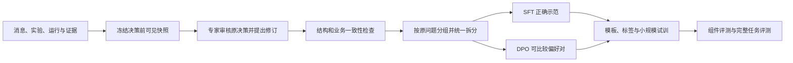

# Agent 后训练：数据、SFT、LoRA、DPO 与完整验证

本章前半部分解释什么时候值得训练；“技术详解”按真实学习顺序展开：从调查记录构造样本，生成训练批次，计算损失与梯度，配置 SFT，再按需要进行 DPO，最后用完整任务判断是否改善。

先举一个适合讨论微调的问题。

系统已经把最新条件、之前结果和工具说明都交给模型了。模型却反复犯同类错误：两组条件不同也直接比较，看到一条超时就宣布原因，或者新结果明显不支持原猜测，它仍然沿原方向查。

这时，训练模型学专家怎样做决定，才有明确意义。

如果最新条件根本没传进去，或者工具没有采到日志，先修程序。训练不能把丢失的信息补回来。

## 第一步，先跑原模型，看看错在哪里

固定模型、提示、工具和资料，用完整任务检查。

是入口听错？是参数用错？是没保留用户限制？还是调查时总安排没有价值的实验？

先把问题分开。资料版本错了就更新资料，计算错了就修计算。提示里没写清的地方先改提示和例子。

这些做好后仍然持续出错，再考虑微调。第一版不必以训练为前提。

## 训练要教哪些行为

除了正确调用工具，还要教模型怎样推进调查。

例如：

> 现在只测了新版本。正确下一步是安排相同条件的旧版本比较，而不是直接宣布新版本有缺陷。

或者：

> 低负载也出现了同类异常。应该重新检查“高负载是必要条件”的判断，而不是忽略这条结果。

再比如：

> 现有工具读不到内部资源。应该说明需要补什么记录，而不是写“已确认资源泄漏”。

正确报告失败、承认证据不足、达到次数后停止，都应进入训练示范。

## 专家记录比最终答案更重要

只给模型“问题是什么、最终原因是什么”，它学不到中间怎样选择。

更好的记录包含：当时知道什么、用户限制是什么、做了哪些测试、每次返回什么、专家下一步选择什么以及简短理由。

要保留当时可见的信息。后面才确认的原因，不能偷偷放进前面安排实验时的输入。

如果专家改了用例或参数，后续结果也要重新取得，或使用明确标注且检查过的模拟结果。不能把不再适用的旧结果接在新计划后面。

## SFT：给模型看正确示范

SFT 是监督微调。简单说，就是在原模型基础上继续训练，让它在类似上下文里更容易输出专家确认的做法。

示范可以是下一次工具调用、一小段实验计划、一次正确的条件修改，或者一份合理的停止说明。

训练时要分清谁说了什么。工具返回的实际结果是模型读到的信息，模型要学习的是自己该怎样回应和操作。

数据转成训练格式以后，抽几条真正解码看看，确认工具调用和正确回答确实被训练到了，关键条件没有被截掉。

先做小规模试训，再运行完整任务检验。训练损失下降，只表示它更会预测训练内容，不等于真实调查一定变好。

## DPO：比较两个决定，告诉模型哪个更合适

有时两种回答格式都对，但做法有明显差别。

在相同信息下：

- 先核对两组实际条件，比直接认定版本缺陷更合适；
- 为区分两个原因补查记录，比无理由地重复原测试更合适；
- 承认没有足够依据，比编一个确定原因更合适。

DPO 是一种偏好训练方法，可以利用这样的成对比较。

偏好要有理由。两个实验都可能合理，不能只因为其中一个后来碰巧找到答案，就倒推它在当时一定更好。比较时看到的信息也要相同。

实现时要固定参考模型、输入格式和数据处理方式。做完仍要测原来的工具能力。SFT 已经足够，或者没有可靠比较数据，就可以不做 DPO。

## 数据怎样分开

把同一个故障及其改写放在同一组。训练用一部分问题，调整参数用另一部分，最后再用没参与调整的问题检查。

不能把同一个案例换设备名字以后，分到训练和最终测试。SFT 和 DPO 数据也要一起检查，防止绕一圈把测试题用来训练。

除了成功调查，还要保留未复现、日志缺失、猜测被否定、工具失败和普通测试。否则模型可能变得过于积极，任何任务都想查到底。

## 显卡和训练时间怎样估

可以考虑 LoRA：保留原模型的大部分参数，只训练附加的一小部分，减少部分训练开销。但原模型和长输入仍要占显存，不能直接认为一张小显卡就够。

先固定模型、输入长度、批次、精度和训练方式，用一小批有代表性的数据试跑。测稳定更新速度、最长样本的峰值、验证和保存耗时，再规划正式资源。

实现时，有效批次约等于每卡样本数 × 设备数 × 梯度累积次数。更新步数结合数据量和轮数计算，实际以训练器记录为准。

生成数据、专家审核、工具等待、训练、评测和发布分别计时。原项目用过的显卡和时长，不直接作为新版预算。

## 怎么决定采用哪个模型

用同一组工具和任务，比较原模型、改提示后的模型、SFT 和可选 DPO。

看入口错误、条件保持、实验选择、错误原因判断、人工投入与费用。还要测普通按需测试、查询、暂停和取消。

模型更谨慎但把所有任务都交给人，不一定更好；查得更多但浪费大量实验，也不一定更好。

## 系统不会用一次就自动学会

保存日志、专家修改、经验入库，都没有直接改变模型参数。

需要定期整理记录、审核、训练、评测，再发布新版本。保留旧模型和回退办法，出现退步时能够恢复。

具体怎么比较效果，见 [评测](07_Agent评测体系设计.md)；资料什么时候更新，见 [知识库](16_知识库与经验沉淀.md)。

## 技术详解：训练对象是决策策略

新版主要学习的是：在当时已知的信息和约束下，选择什么动作、提出怎样的实验、怎样调整假设、何时交付或交接。训练不是让模型记住每次测试结果，也不是让模型替代执行器保存事实。

用 `s_t` 表示当前业务状态，`c_t` 表示构造给模型的可见上下文，`a_t` 表示模型输出。我们训练的是近似的条件策略 `πθ(a_t | c_t)`。工具执行得到的观测会更新业务状态，再产生下一轮输入。完整任务表现还依赖工具、规则、状态管理和调度，不能只由单次 loss 推断。

## 1. 四类训练行为怎样分开

| 训练单元 | 输入 | 输出目标 | 主要错误 |
| --- | --- | --- | --- |
| 意图理解 | 用户新消息、候选任务与当前条件 | IntentDecision 与字段补丁 | 错关联任务、只读误执行、丢失约束 |
| 调查决策 | 目标、实验摘要、反证、能力与预算 | PlanDecision / ExperimentPlan | 无效比较、重复探索、忽略反证 |
| 工具使用 | 任务信息、工具定义和已取得返回 | 合法调用及参数 | 虚构编号、前提未满足、乱用单位 |
| 阶段解释 | 已保存事实、规则、证据和当前目标 | 有证据的解释与交付 | 数字转述错误、原因说过头、遗漏限制 |

可以共享一个模型，但要标记任务模板与目标 schema。若把四类数据混在一起，模型却只收到“你是助手”，它可能在该输出计划时写报告，或在只读咨询时生成执行请求。

先单独评估每类行为，选择需要训练的部分。规则判定、计数、任务版本和环境恢复仍由程序负责，不作为可自由生成的真值。

## 2. 数据从运行记录变成监督样本



原记录包含最终结果，但导出的第 t 个输入只包含第 t 个动作前已经取得的信息。应依据当时保存的 `context_snapshot_id` 构造，不从最终报告逆向生成一段看似合理的前因。

专家修订计划后，如果需要接续完整轨迹，必须让新动作真正产生相应观测，或使用标明来源的可验证模拟。单纯改了动作文本，不能继续沿用原动作的后续工具结果。

### 2.1 一份完整的决策样本应包含哪些信息

下面把业务内容与训练元数据分开显示。实际 JSONL 可序列化为 messages；`target` 是希望模型生成的对象，而不是工具测量。

```yaml
sample_id: decision-sample-017
metadata:
  source_group: issue-family-07
  decision_id: decision-04
  context_snapshot_id: context-04
  reviewer: expert-01
  review_status: approved
  sample_type: experiment_decision
input:
  goal: REPRODUCE
  fixed_conditions:
    environment: lab
    device_id: device-A
    bandwidth_mhz: 100
  known_results:
    - experiment_id: exp-new-high
      conditions: {version: build-new, load: high, handovers: 3}
      valid_runs: 20
      anomalies: 6
  missing_evidence: [旧版本在相同条件下的观测]
  remaining_runs: 20
target:
  action: EXPERIMENT
  explanation: 只有新版本结果，先补版本对照，不能直接认定升级缺陷
  plan:
    question: 旧版本在同条件下是否出现同类异常？
    reason: 排除与版本无关的共同环境因素
    kind: control
    conditions:
      environment: lab
      device_id: device-A
      bandwidth_mhz: 100
      version: build-old
      load: high
      handovers: 3
    repeats: 20
    comparison_id: exp-new-high
    rule_id: BUSINESS-R1
```

这些观测是假设示例。target 不包含未来的“旧版本 0/20”，因为此刻尚未执行。输入中出现的实验 ID 可以复制使用；下一次运行 ID 由程序分配，不要求模型学会编随机编号。

本章与评测章沿用同一个教学场景说明格式，不表示真实训练集与最终测试集可以收录同一来源组。实际数据必须按下面的分组规则隔离。

### 2.2 messages、工具定义和工具返回怎样序列化

意图或实验决策可以用 `system + user(snapshot) + assistant(target)`。学习工具循环时，则保存 assistant 的调用、tool 的实际返回和下一次 assistant 行为，并保留调用 ID 对应关系。

工具定义同样必须对模型可见。某个 schema 出现在元数据里，不代表聊天模板一定把它送入模型；需要检查 token 化后的完整输入。工具结果与助手调用是不同角色，不能全部塞进一条 assistant 文本。

如果部署使用原生工具标记，训练也要使用该模型支持的工具模板；如果部署只读取计划 JSON，则训练计划 JSON。二者可以分别训练，但不能假设普通文本 `Action: xxx` 与原生调用格式天然等价。

## 3. 拆分与清洗：在 token 化之前完成

以原问题为分组单位，统一拆分 SFT、DPO 与评测。一个问题的不同措辞、不同决策点、简化过程和修复跟进保持同组。跨故障家族留出与同家族新配置测试分别报告。

检查重复与近重复时，不只比较文本：设备别名、参数名替换后，实验结构和故障关系可能仍相同。人工确认高相似样本的来源，避免将相同事实复制到不同集合。

| 清洗层 | 应检查什么 | 失败时处理 |
| --- | --- | --- |
| 结构 | 角色、字段、目标 schema、调用与返回配对 | 拒收或修订，不靠训练器静默容错 |
| 来源 | 对象、编号、规则、工具返回能否追溯 | 缺失则回到原记录补齐 |
| 时序 | 本轮输入是否含未来结果 | 重建快照或淘汰 |
| 业务 | 条件保持、可比性、监测、预算、停止依据 | 专家审核，必要时重做实验 |
| 标签 | 只教预期的助手行为 | 修模板或掩码 |
| 偏好 | 同输入、同可见信息、理由可辨 | 不确定或相同候选不做 DPO |

数据分布要覆盖普通测试、合理探索、反证、未复现、缺工具、暂停取消和修复副作用。只保留“找到根因”的成功故事，会教出过度积极且不愿承认证据不足的模型。

## 4. 从一条样本到一个训练批次

处理顺序为：加载消息 → 使用目标模型聊天模板 → 得到 token 与助手区域 → 长度检查 → 构造 labels → 组成批次与 padding → 输入模型。

对常见因果语言模型，设批次大小 B、序列长度 L、词表大小 V：

| 张量 | 常见形状 | 含义 |
| --- | --- | --- |
| input_ids | `[B, L]` | 模板后的全部输入 token |
| attention_mask | `[B, L]` | 有效输入位置，padding 通常为 0 |
| labels | `[B, L]` | 目标 token ID；忽略位置为 -100 |
| logits | `[B, L, V]` | 每个位置对后续 token 的未归一化打分 |

规则、用户消息和工具返回保留在 input_ids 中，作为后续预测的依据，但本项目不对它们直接计算监督损失。assistant 的工具调用和计划属于监督目标，不能因为有“工具”二字就一并屏蔽。

### 4.1 因果位移怎样对齐

假设简化 token 序列如下，数字只代表位置示意，不是真实分词：

```text
位置：          0       1        2       3        4         5
input_ids：   [规则]  [用户]  [助手头]  [计划1]  [计划2]  [结束]
labels：       -100    -100     -100    计划1    计划2     结束
用哪行 logits：                           2        3        4
```

第 2 个位置的 logits 预测第 3 个 token，依此类推。框架模型传入 labels 时通常已内部处理这一位移；下面的函数只用于学习损失计算，不与模型自动 loss 同时重复位移。

```python
import torch
import torch.nn.functional as F


def causal_token_loss(logits: torch.Tensor, labels: torch.Tensor):
    shifted_logits = logits[:, :-1, :].contiguous()
    shifted_labels = labels[:, 1:].contiguous()
    valid_tokens = (shifted_labels != -100).sum()
    if valid_tokens.item() == 0:
        raise ValueError("批次没有可学习的下一 token 目标")
    loss_sum = F.cross_entropy(
        shifted_logits.reshape(-1, shifted_logits.size(-1)),
        shifted_labels.reshape(-1),
        ignore_index=-100,
        reduction="sum",
    )
    return loss_sum / valid_tokens, valid_tokens
```

若两个目标 token 的正确概率分别为 0.8 与 0.5，平均负对数似然约为 `(-ln 0.8-ln 0.5)/2=0.4581`。训练降低的是这类预测损失，不是直接最大化复现率。

### 4.2 损失的归一化也会改变训练权重

上面按有效目标 token 平均，长回答含更多目标，因而对总损失贡献更多。按每条样本先平均再平均，则每条样本权重更接近。两种目标不同，应明确选择。

梯度累积时，若每个微批次有效 token 数不同，简单平均微批次 mean loss 不完全等于按整组 token 平均。自定义训练循环要按总有效 token 处理；分布式时还要考虑跨进程归约和梯度平均。使用训练器也要核对其实际口径，避免把优化目标差异误解为随机波动。

### 4.3 padding、截断与 packing 的边界

padding 的 attention mask 为 0，labels 为 -100。若 pad token 与 eos token 相同，也应按真实 padding 位置屏蔽，不能把所有相同 ID 的结束 token 都删掉。

长样本优先减少无关日志、合理拆分决策点。截断后必须仍保留目标所需的规则和观测；不能把前面的用户限制截掉，只留下一个看似正确的答案。

packing 把多条样本装进较长序列以减少 padding，但要确认样本边界、注意力隔离与标签仍符合目标。不同实现不完全相同，学习第一轮先关闭 packing，检查清楚后再比较效率。

模板支持时可取得助手区域掩码；不能用搜索字符串 `assistant` 的方式判定所有模型的边界。assistant-only 与 completion-only 分别按角色和提示/续写划分，也不是同一个开关。[TRL SFT 训练配置说明](https://huggingface.co/docs/trl/en/sft_trainer)

## 5. LoRA 的参数、前向与反向传播

对线性层 `W0∈R^(d_out×d_in)`，标准 LoRA 使用 `A∈R^(r×d_in)`、`B∈R^(d_out×r)`：

$$h=W_0x+\frac{\alpha}{r}BAx$$

基础权重冻结，梯度仍要通过相关网络传播以更新 A、B；冻结不表示可以跳过整条前向或不保存任何激活。常见初始化会让适配器初始增量为零，之后逐步学习，但具体方式由所用实现决定。

新增参数为 `r×(d_in+d_out)`。对 `4096×4096` 矩阵、r=16，为 131,072 个；加在多个层与多个投影后要求和，不能直接把单层数字当整模型的可训练参数。

| 参数 | 改变什么 | 选择方法 |
| --- | --- | --- |
| r | 适配器容量与参数量 | 对比较小与较大 r 的任务质量和成本 |
| alpha | 增量缩放 | 与 r、学习率一起记录；本文公式为标准 LoRA |
| target_modules | 哪些矩阵接收增量 | 核对模型实际模块名与注入结果 |
| dropout | 训练适配器输入的随机屏蔽 | 依据验证而非固定“最佳值” |
| learning_rate | 可训练参数更新幅度 | 检查收敛、退步和数值稳定性 |

若使用 rank-stabilized LoRA 等变体，缩放公式可能改变，不能继续照抄 `alpha/r`。冻结原权重也不保证通用行为保持不变，因为推理路径已经加入适配器。[PEFT LoRA 说明](https://huggingface.co/docs/peft/en/package_reference/lora)

## 6. 一份可解释的 SFT 配置

以下是教学起点，用于解释配置关系，不是针对所有模型的推荐最优值。

```yaml
training_goal: experiment_decision
precision: bf16
sequence_length: 4096
packing: false
assistant_only_loss: true
lora:
  rank: 16
  alpha: 32
  dropout: 0.05
  target_modules: [q_proj, v_proj]
optimization:
  learning_rate: 0.00005
  epochs: 1
  per_device_batch_size: 1
  gradient_accumulation_steps: 8
  warmup_ratio: 0.03
  lr_scheduler: cosine
  max_grad_norm: 1.0
```

BF16 需要相应硬件和软件支持；4096 需要用真实长度分布和关键证据保留率检查；q/v 模块名也不是所有架构通用。先确认实际 trainable parameters，再启动短试训。

下面的构造函数展示数据、模板、配置与 PEFT 的衔接，不会自行下载数据或启动训练。调用前必须提供已按原问题拆分的数据，以及兼容的模型与 tokenizer。

```python
from peft import LoraConfig
from trl import SFTConfig, SFTTrainer


def make_sft_trainer(model, tokenizer, train_data, validation_data, output_dir):
    args = SFTConfig(
        output_dir=output_dir,
        max_length=4096,
        packing=False,
        assistant_only_loss=True,
        per_device_train_batch_size=1,
        gradient_accumulation_steps=8,
        num_train_epochs=1,
        learning_rate=5e-5,
        warmup_ratio=0.03,
        lr_scheduler_type="cosine",
        max_grad_norm=1.0,
        bf16=True,
        gradient_checkpointing=True,
        eval_strategy="steps",
        eval_steps=50,
        save_steps=50,
        report_to="none",
    )
    adapter = LoraConfig(
        task_type="CAUSAL_LM",
        r=16,
        lora_alpha=32,
        lora_dropout=0.05,
        target_modules=["q_proj", "v_proj"],
        bias="none",
    )
    model.config.use_cache = False
    return SFTTrainer(
        model=model,
        args=args,
        processing_class=tokenizer,
        train_dataset=train_data,
        eval_dataset=validation_data,
        peft_config=adapter,
    )
```

这个例子走训练器的自动助手掩码路线，不再额外传一份可能冲突的手工 labels。模板需要支持助手区域。短训练不足 50 步时仍要主动执行最终验证，不能因为没触发周期事件就省略评估。

具体接口以锁定的依赖版本为准；学习时可从构造函数追踪到最终批次，确认 messages 怎样被转成 token，而不是只记参数名称。

## 7. 一次参数更新究竟发生什么

```text
取得一组微批次
  → 前向得到 logits
  → 按有效 labels 计算损失
  → 反向传播，梯度累积到可训练参数
  → 到达累积边界，检查与裁剪梯度
  → optimizer.step 更新适配器
  → scheduler.step 更新学习率
  → 清空梯度，进入下一组
```

验证使用未参与更新的数据，不执行 optimizer.step。梯度检查点会在反向时重算部分前向中间结果，用计算换显存；它与保存训练 checkpoint 是两种不同机制。

检查训练时既看 loss，也看有效标签数量、梯度范数、非有限值、token 吞吐与长样本峰值。训练 loss 持续下降、完整任务却没有改善，可能是只学会 JSON 风格、样本偏置或目标与部署格式不一致。

## 8. DPO 的偏好对怎样收集

输入 x 完全相同，生成两个候选，由专家按当时信息选择。候选必须回答同一种问题：不能把一个有新日志的决定与一个无日志的决定直接配成“同输入”的优劣。

```yaml
source_group: issue-family-07
prompt_ref: context-04
chosen_ref: 经审核的完整版本对照计划
rejected_ref: 未做对照就声称版本缺陷的完整输出
preference_dimensions:
  - evidence_sufficiency
  - condition_preservation
review_reason: 只有新版本异常记录，不能排除共同环境
```

存储时引用需要解析成实际 prompt/chosen/rejected 内容，并绑定内容版本。两个同样合理的实验，不因其中一个后来碰巧触发异常就强行标优。必要时保留不确定标注，暂不进入标准二元偏好训练。

将“短但缺证据”与“长且完整”比较时，注意模型可能学到只偏爱长文本。增加长度相近、格式相同但决策质量不同的对照，并在评测中单独看长度、拒绝和交接倾向。

## 9. DPO 损失逐项计算

定义完整候选的条件序列对数概率为各目标 token 对数概率之和，prompt 只提供条件，不加入候选似然。候选结束标记的处理在 policy 与 reference 中保持一致。

它可以从 logits 这样取得；labels 在 prompt 与 padding 位置为 -100，在候选位置保留目标 token。下面先做因果位移，再只聚合候选部分：

```python
import torch
import torch.nn.functional as F


def sequence_log_probs(logits: torch.Tensor, labels: torch.Tensor) -> torch.Tensor:
    targets = labels[:, 1:]
    mask = targets != -100
    if (mask.sum(dim=-1) == 0).any().item():
        raise ValueError("每个候选都必须有有效目标 token")
    safe_targets = targets.masked_fill(~mask, 0)
    token_log_probs = F.log_softmax(logits[:, :-1, :].float(), dim=-1)
    selected = token_log_probs.gather(-1, safe_targets.unsqueeze(-1)).squeeze(-1)
    return selected.masked_fill(~mask, 0.0).sum(dim=-1)
```

chosen 与 rejected 各自用“相同 prompt + 对应候选”前向，reference 使用同样 token、掩码和聚合方式，但不构造训练梯度。为了理解直接写出 log_softmax；大模型可采用更省中间存储的等价实现，不必实际保留整份对数概率张量。

$$r_w=\log\pi_\theta(y_w|x)-\log\pi_{ref}(y_w|x)$$
$$r_l=\log\pi_\theta(y_l|x)-\log\pi_{ref}(y_l|x)$$
$$\mathcal L=-\log\sigma\big(\beta(r_w-r_l)\big)$$

policy 初始与 reference 完全相同时，`r_w=r_l=0`，单对 loss 为 `ln 2≈0.6931`。假设更新后两者的对数概率分别为：

| 候选 | policy | reference | 相对参考的变化 |
| --- | --- | --- | --- |
| chosen | -80 | -82 | +2 |
| rejected | -100 | -95 | -5 |

若 beta=0.1，输入 sigmoid 的值为 `0.1×(2-(-5))=0.7`，loss 约 0.4032。这个例子说明目标在比较相对于参考的优势，不是只提高 chosen 的绝对概率。

```python
import torch
import torch.nn.functional as F


def dpo_pair_loss(
    policy_chosen: torch.Tensor,
    policy_rejected: torch.Tensor,
    reference_chosen: torch.Tensor,
    reference_rejected: torch.Tensor,
    beta: float = 0.1,
) -> torch.Tensor:
    preferred_gain = policy_chosen - reference_chosen.detach()
    rejected_gain = policy_rejected - reference_rejected.detach()
    margin = beta * (preferred_gain - rejected_gain)
    return -F.logsigmoid(margin).mean()
```

这段代码假设输入已经是正确聚合的候选 log probability；它不负责 token 化和掩码。不能把未经说明的每 token 均值替换进标准序列目标，也不能把 prompt 部分算进候选似然。

DPO 在特定偏好建模假设下建立目标，不代表它与任意 RLHF 训练流程都完全等价。完整推导见 [DPO 原论文](https://arxiv.org/abs/2305.18290)。

## 10. reference 与 policy 怎样组织

通常从选定的 SFT 模型开始，policy 可训练，reference 固定。若 SFT 用 LoRA，必须确认 reference 包含 SFT 行为：只关掉唯一的 SFT adapter 可能退回原始基座，得到的就不是预期 SFT 参考。

| 组织方式 | 优点 | 必须核对 |
| --- | --- | --- |
| SFT 合并后，独立冻结 reference | 概念直接，便于检查 | 双份基础权重及其显存与分片 |
| 共享基座，独立固定与可训练适配器 | 减少部分权重重复 | reference 适配器固定且切换语义正确 |
| 固定 reference 预计算 log probability | 训练时可少驻留一条参考路径 | 数据、模板、截断、token 化配置绑定缓存 |

标准固定参考的实验不要意外开启 reference 同步。重新 token 化或修改候选后，旧参考缓存不能继续使用。具体 PEFT 与缓存选项应按锁定版本核对。[TRL DPOTrainer 说明](https://huggingface.co/docs/trl/en/dpo_trainer)

## 11. DPO 配置与监控看什么

可从较小学习率、少量轮次和固定参考做短试训，再对 beta 与学习率做小规模验证。示例 `beta=0.1、learning_rate=1e-6` 只是待比较起点，不能脱离数据解释为最佳值。

同时监控 preference accuracy、偏好 margin、chosen/rejected log probability、验证 loss、输出长度和完整任务结果。训练偏好正确率升高，可能只是记住标注或长度特征，不表示会调查未见问题。

更谨慎而把所有任务交给人，也不是可靠改进。将拒绝率、合理交接率、目标完成率和主动人工一起评估，普通 TEST 与查询控制能力继续回归。

## 12. 显存、步数与时间怎样形成一份预算

常规数据并行下：

$$B_{effective}=b_{per\ device}\times N_{data\ parallel}\times G_{accumulation}$$

不 packing、无额外重采样时，总更新步数近似 `epochs×ceil(train_samples/effective_batch)`，实际以训练器记录为准。张量并行卡数不应不加区分地再乘进数据并行度。

假设 10,000 条训练样本，每卡 1 条、4 个数据并行进程、累积 8 次，有效批次 32。每轮约 313 步，两轮约 626 步。若短试训测到 8 秒每更新步，纯更新时间约 1.39 小时，加载、验证和保存另计。这里是演算，不是实测。

显存包括基础权重、适配器及其梯度和优化器、激活、词表输出与临时计算、通信缓冲。32B 模型 BF16 权重约 64 GB，仅为权重部分；LoRA 不消除长输入的激活开销。

ZeRO-3 分片参数、梯度和优化器状态；梯度检查点用重算换激活存储；CPU 卸载用主机内存与传输换设备存储。不能把权重除以卡数当峰值显存。

DPO 两候选的非 padding 输入规模粗略为 `2×prompt_tokens+chosen_tokens+rejected_tokens`，参考计算还会增加开销。先用代表性长度预热，再测若干更新步，另测长样本、验证和保存，不能只用短样本速度外推长调查轨迹。

## 13. 数据生成与审核的成本也要计算

目标保留 N 条、留存率 q，则期望候选约 N/q。并发 C 个工作槽、每候选生成与工具及评审时间 T，理想耗时约 `N×T/(q×C)`，受限流、依赖和长尾影响会增加。

人工审核单列。例如 1,000 条合格记录、每条 2 分钟，单看合格记录即约 33.3 人时；淘汰样本与争议复核另计。DPO 的每对偏好也需要有效判断，不是导出文件后就自动获得真值。

请求费用用实际 usage 计算，多轮重复发送上下文也计入。文件字节、消息条数和 token 数不是固定换算关系。

## 14. 一轮训练的实际操作顺序与交付物

| 步骤 | 操作与检查 | 产物 |
| --- | --- | --- |
| 1 | 固定任务集与基线，分类错误 | 基线报告与训练目标 |
| 2 | 导出决策前快照，审核计划和结果关系 | 原始样本、审核记录 |
| 3 | 统一来源分组，拆分 SFT/DPO 与评测 | 分组清单、数据版本与哈希 |
| 4 | 固定模型与模板，检查真实批次 | 输入与有效标签解码样例 |
| 5 | 短试训、长度峰值与速度检查 | 资源记录和可恢复 checkpoint |
| 6 | SFT，按验证与完整任务选择保存点 | adapter 或明确基座的模型版本 |
| 7 | 有可靠偏好且仍有明确问题时做 DPO | policy、reference 与数据配置 |
| 8 | 基础模型、提示、SFT、DPO 同条件对照 | 组件与完整任务评测报告 |
| 9 | 核对部署模板、合并或适配器加载 | 模型清单、回退版本与限制 |

用于恢复训练的 checkpoint 要保存相应优化器、调度器等状态；只保存 adapter 或合并模型不等于能无缝恢复原优化过程。分布式保存与合并按对应工具流程进行，不让多个进程任意覆盖同一目录。

采用哪个保存点，不只看最低训练 loss。先满足证据与执行约束，再比较目标完成、人工、设备与模型成本。最终测试集在选择前保持独立，不能反复用它挑 checkpoint。

SFT 足够就停在 SFT。资料更新解决动态事实，Skill 表达可复用方法，程序管理状态和规则，后训练改善模型在相同信息下的行为选择。
