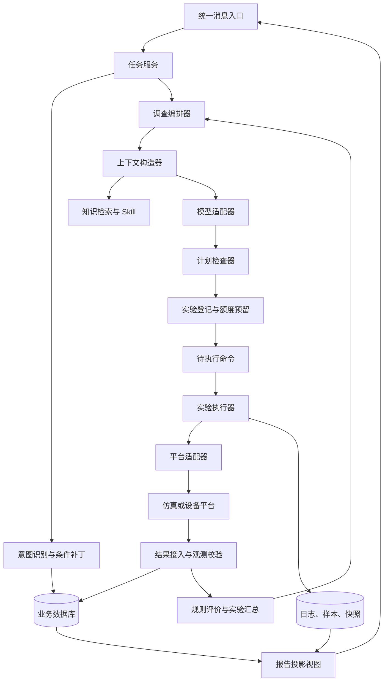
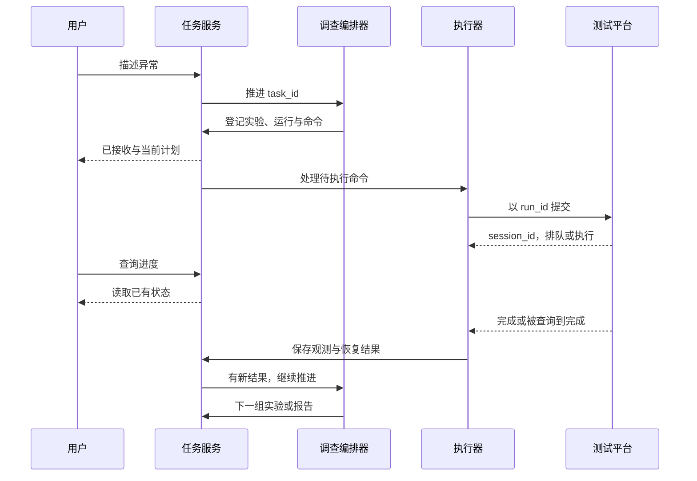

# 新版 Agent 整体框架：模块、状态机、编排与执行

本章先跟着一次请求理解分工，再从“技术详解”进入模块契约、LangGraph 图、实验执行状态机、异步时序、版本检查和恢复。所有结构都是学习设计，不以现有代码是否实现为前提。

原来后台已经能收测试请求、调用脚本、拿结果。新版首先要补的是：听懂用户中途说的话，记下每轮为什么测，并根据结果安排下一轮。

第一版可以在原应用里增加模块，不必一开始拆成很多服务。

## 跟着一次请求看后台怎样工作

用户说“升级后视频卡，帮我复现”。

消息入口确认用户和项目，把消息保存下来。意图模块读取已有任务，判断这是新排查，目标只到复现。

任务管理保存设备、环境、当前要求和最多允许跑几次。暂时缺设备编号，就先查资料或询问。

模型读这些信息，提出下一组测试。实验管理检查条件、监测、资源和次数，创建实际运行。

后台调度调用原有脚本，等待平台结果。完成以后保存数据、检查环境恢复，再把相关结果给模型。

模型选择继续还是出报告，程序继续检查和执行。用户中途问进度，则直接读取已有记录，不再走一遍测试流程。

## 可以先分成哪几块

| 部分 | 主要做什么 |
| --- | --- |
| 消息与任务 | 接受要求、理解修改、保存最新状态 |
| 调查安排 | 模型选择下一组测试，说明为什么 |
| 实验和执行 | 检查条件、控制次数、调用脚本、取消和收尾 |
| 数据与报告 | 保存结果、计算指标、查询记录、整理材料 |
| 资料查询 | 找用例、标准、版本说明和历史经验 |

这只是代码职责划分。可以在一个应用中实现，后面确实需要独立部署时再拆。

现有编排框架、接口服务、后台队列、数据库和推理服务都可以继续评估使用。新定位不自动要求更换技术栈。

## 哪些东西放数据库，哪些放文件

任务、计划、实验关系、运行状态、编号和结果摘要，适合放数据库。

大日志、原始样本和报告文件可以放文件或对象存储，数据库保存位置、版本和归属。

搜索服务保存可检索资料。搜索索引和摘要可以重建，原始运行记录则要按项目要求保留。

模型写的解释与平台返回的数据分开保存。报告里的关键数字可以追到原始记录。

## 两条要求同时到来怎么办

例如模型正在安排下一轮，用户又说“对象改成 C 到 D”。

同一任务的修改可以排队处理，也可以检查任务版本。新计划提交前再看一次当前版本；已经过期就重新安排，不执行旧计划。

平台返回可能重复或晚到。按事件和运行编号识别，写到原测试，不覆盖新要求。

保存“待执行”以后，提交平台前如果服务重启，恢复时应该知道是否已经提交。可以保留待发送记录和真实提交状态，避免漏执行或重复执行。

## 多组测试可以同时跑吗

只有不互相影响时才适合并行。

两组共用设备或流量源，可能改变对方负载，比较就不再公平。程序先检查资源是否冲突，再决定同时还是顺序运行。

每次提交前统一预留次数和资源，结束后按实际使用结算。不能每个任务都各自看见“还剩十次”，最后一起跑超了。

设备占用要有记录和时限。占用标记到期，不代表外部动作已经停止，仍要查询真实情况。

## 服务重启以后怎样接着做

查出未结束的运行，到平台确认排队、执行或完成状态，再补取结果或清理。

如果只是等资料、等审核或等修复版本，保存等待原因即可，不保持一条长时间模型请求，也不占无须使用的设备。

恢复以后，再检查用户要求、实际配置和剩余次数。具体状态见 [任务记录](05_记忆与上下文管理.md)。

## 用户界面应该显示什么

输入框保持一个。收到要求后，用简短话告诉用户系统理解的对象、目标和计划，方便纠正。

进度页优先显示“正在比较哪两种情况”“已经查到什么”“接下来测什么”“需要你补什么”。

原始工具调用放在可展开的详情里。用户通常更关心“为什么还没查出来”，而不是“日志工具已调用七次”。

实验页面并列显示条件、次数、异常、日志和恢复情况。读报告或查进度不触发测试。

## 给实现者：接口和运行检查

消息入口可用 POST /tasks/messages。GET /tasks/{task_id} 查任务，任务下的 experiments 查实验，GET /runs/{run_id} 查单次运行，报告单独查询。

这些只是建议路径。外部平台通知执行结果时，需要验证来源，不能当成普通用户消息。

每条调用保留消息、任务、实验、运行和工具编号，便于从报告追到平台。监控重点看误启动、错对象、无效测试、重复执行、恢复失败、人工接手和实际花费。

上线时固定应用、模型、提示、工具和资料版本。新版本退步可以回到旧模型或固定测试流程，但在途任务和设备收尾仍要处理好。

具体吞吐、延迟和并发目标，要在真实任务上测，不能直接复制旧项目数字。

## 技术详解：先分清三个控制层

新版的关键不是把所有工具接到同一个聊天循环，而是让三个控制层各自承担清楚的责任。

| 控制层 | 输入 | 输出 | 是否需要 LLM |
| --- | --- | --- | --- |
| 任务与意图 | 用户消息、已有任务、当前条件 | 创建、补丁、查询、暂停、取消与目标变更 | 模糊语言需要，明确状态操作不必 |
| 调查决策 | 任务快照、实验摘要、假设、资料与预算 | 下一组实验、交付、等待或交接 | 用于理解证据并选择路线 |
| 实验执行 | 已检查并登记的计划 | 实际运行、观测、判定与收尾 | 固定执行、计算和恢复不需要 |

例如“先比较旧版本”属于调查决策；“先启动监测，再提交测试，结束后恢复”属于执行流程。把后者全交给模型，会增加遗漏步骤、错误等待和重复动作的机会。

## 1. 整体架构：决策面、执行面和数据面



决策面负责“下一步做什么”，执行面负责“这个动作怎样可靠完成”，数据面保存事实和生成视图。它们可以在一个进程中运行，不必拆成多个服务。

**业务数据库是任务事实的权威来源**。图状态保存执行游标与少量工作数据，模型上下文是一次调用的输入投影，搜索索引是资料的检索视图。不能让四份数据各自成为一套相互矛盾的真相。

## 2. 模块边界具体到读写责任

| 模块 | 主要读取 | 可以写什么 | 不应承担什么 |
| --- | --- | --- | --- |
| TaskService | 消息、任务、授权范围 | 条件补丁、任务版本、目标和控制状态 | 伪造工具结果 |
| ContextBuilder | 当前条件、相关实验、反证、资料 | 可缓存的输入快照及其版本引用 | 更改历史测量 |
| Planner | 固定输入快照、工具能力 | 决策输出候选 | 直接执行平台操作 |
| PlanValidator | 候选、规则、预算、当前版本 | 校验结论和字段错误 | 用“模型认为合理”覆盖明确限制 |
| ExperimentService | 已批准候选、资源状态 | 实验、运行、预算预留、待执行命令 | 从自然语言摘要推测实际配置 |
| Executor | 已登记运行、适配器能力 | 执行事件、实际条件、恢复记录 | 选择扩大调查范围 |
| Evaluator | 样本、规则版本、观测完整性 | 逐项判定、实验摘要、证据缺口 | 编造缺失样本或确定原因 |
| ReportService | 指定版本的业务记录 | 报告修订与引用清单 | 查询时顺带启动实验 |

这些是建议的模块名，不要求现有代码使用同名类。学清谁能改什么，比先决定目录结构更重要。

## 3. 数据契约：模型提出计划，程序返回事实

模型侧输出先限定为结构化对象。下面是用于讲解的最小契约，条件中的单位和可用参数仍应按具体用例继续限定。

```python
from typing import Literal

from pydantic import BaseModel, ConfigDict, Field, model_validator


class ExperimentPlan(BaseModel):
    model_config = ConfigDict(extra="forbid")

    question: str = Field(min_length=1)
    reason: str = Field(min_length=1)
    kind: Literal["screen", "control", "minimize", "confirm", "fix"]
    conditions: dict[str, str | int | float | bool]
    repeats: int = Field(ge=1, le=100)
    comparison_id: str | None = None
    rule_id: str


class PlanDecision(BaseModel):
    model_config = ConfigDict(extra="forbid")

    action: Literal["EXPERIMENT", "REPORT", "HANDOFF", "WAIT"]
    plan: ExperimentPlan | None = None
    explanation: str = Field(min_length=1)

    @model_validator(mode="after")
    def validate_action(self):
        if (self.action == "EXPERIMENT") != (self.plan is not None):
            raise ValueError("只有 EXPERIMENT 必须且可以携带实验计划")
        return self
```

这里没有让模型填写 `run_id`、平台会话和测量值。编号由程序登记，实际状态由执行端写入。模型可引用已经存在的对照 ID，执行前检查其存在、归属、版本和适用条件。

这个模型只验证结构和动作关系。还要进一步检查：对象是否被替换、参数是否允许变化、用例是否支持条件组合、对照是否可比，以及次数和时间是否足够。

全书其他示例有时只展示 `ExperimentPlan`。如果用于 Planner 训练，应明确选择“输出纯计划”或上面的 `PlanDecision` 包装；同一训练集与部署节点不能混用两种目标却不标明。

## 4. 三种状态：业务状态、图状态、模型消息

| 状态 | 保存什么 | 生命周期 |
| --- | --- | --- |
| 业务状态 | Task、Experiment、Run、Evidence、预算与报告 | 整个任务乃至跨任务追溯 |
| 图状态 | 当前节点、任务引用、版本、候选计划和路由 | 一次编排与恢复 |
| 模型消息 | 本轮规则、上下文快照、工具调用和回应 | 一次或少数几次模型调用 |

不把 GB 日志、全部运行和每条采样复制进图状态。图中保留引用，需要时从业务存储加载；模型收到摘要和关键证据，可通过只读工具细查。

LangGraph 节点通常返回局部状态更新。未定义 reducer 的字段一般被新值替换；有 reducer 的字段按合并规则更新。因此消息累积、集合合并和当前候选覆盖要分开设计。[LangGraph Graph API](https://docs.langchain.com/oss/python/langgraph/graph-api)

例如消息使用框架的消息合并逻辑；事实记录按 ID 去重后保存到数据库；`candidate_plan` 用最新值覆盖。直接给所有列表用相加 reducer，重放或节点重入时容易追加重复项，也难以表达撤销旧候选。

## 5. 用 LangGraph 表达一次调查调度

建议把一次图调用设计成推进一个明确工作单元。提交长测试后保存状态并返回，完成事件到来后再次推进，不在图节点里无限轮询。

```text
load → refresh → decide
                   ├ EXPERIMENT → validate
                   │                  ├ SUBMIT → reserve → dispatch → END
                   │                  ├ REPLAN → load
                   │                  └ WAIT → wait → END
                   ├ REPORT/HANDOFF → report → END
                   └ WAIT → wait → END
```

`refresh` 汇总已入库的新结果，`decide` 调用计划器，`validate` 重新检查当前条件；`reserve` 登记实验、运行和待发送命令，`dispatch` 提醒执行器处理命令。它不等待整个测试完成。

下面只构建编排图，节点实现通过参数传入，以便看清图本身与业务服务的分工：

```python
from collections.abc import Callable
from typing import Literal, TypedDict

from langgraph.graph import END, START, StateGraph


class InvestigationState(TypedDict, total=False):
    task_id: str
    task_version: int
    plan_version: int
    decision: Literal["EXPERIMENT", "REPORT", "HANDOFF", "WAIT"]
    gate: Literal["SUBMIT", "REPLAN", "WAIT"]
    candidate_plan: dict | None
    experiment_id: str | None
    wait_reason: str


def build_investigation_graph(nodes: dict[str, Callable], *, checkpointer=None):
    builder = StateGraph(InvestigationState)
    for name in (
        "load",
        "refresh",
        "decide",
        "validate",
        "reserve",
        "dispatch",
        "report",
        "wait",
    ):
        builder.add_node(name, nodes[name])
    builder.add_edge(START, "load")
    builder.add_edge("load", "refresh")
    builder.add_edge("refresh", "decide")
    builder.add_conditional_edges(
        "decide",
        lambda state: state["decision"],
        {
            "EXPERIMENT": "validate",
            "REPORT": "report",
            "HANDOFF": "report",
            "WAIT": "wait",
        },
    )
    builder.add_conditional_edges(
        "validate",
        lambda state: state["gate"],
        {"SUBMIT": "reserve", "REPLAN": "load", "WAIT": "wait"},
    )
    builder.add_edge("reserve", "dispatch")
    for name in ("dispatch", "report", "wait"):
        builder.add_edge(name, END)
    return builder.compile(checkpointer=checkpointer)
```

`REPLAN` 应有有限次数上限，防止对象持续变化时无限空转。`REPORT` 也必须经过业务完成条件检查，不因模型选了该标签就认定复现或原因确认成功。

`dispatch → END` 只表示这一轮调度返回，**不是整个 Task 已完成**。图结束与业务结束是不同维度。下一次推进复用任务引用并重新加载数据库，在途实验存在时 `decide` 应选择 WAIT，而不是重复创建实验。

### 5.1 一个决策节点内部怎样写

图节点只负责连接“读状态、构造输入、调用模型、返回更新”，不直接改运行结果。下面假定 `structured_model` 已配置成输出本章的 PlanDecision，`read_snapshot` 返回业务存储生成的字典。

```python
def make_decision_node(read_snapshot, build_context, structured_model):
    def decide(state: dict) -> dict:
        snapshot = read_snapshot(state["task_id"])
        context = build_context(snapshot)
        decision = structured_model.invoke(context)
        return {
            "task_version": snapshot["task_version"],
            "plan_version": snapshot["plan_version"],
            "decision": decision.action,
            "candidate_plan": (
                decision.plan.model_dump() if decision.plan is not None else None
            ),
        }

    return decide
```

`build_context` 决定模型能看到哪些证据，`structured_model` 负责生成候选，后面的 validate/reserve 再对照快照版本提交。模型调用期间用户可能更新任务，因此“节点刚读过数据库”仍不能替代最终事务里的版本检查。

解析或模型服务错误应记录为决策失败事件，按有限重试或交接规则处理，不能构造一份空计划假装成功。等待日志与设备的条件则由业务状态表达，避免反复调用模型问同一个问题。

## 6. 执行工作流：一次运行内部怎样组织

执行器根据已登记运行推进固定状态：

```text
CREATED → PREPARING → MONITOR_READY → SUBMITTED → RUNNING
    → COLLECTING → RESTORING → COMPLETED
```

执行状态与以下结果分开：`validity` 表示观测是否支持原定判断，`test_verdict` 表示产品是否满足规则，`cleanup_status` 表示环境恢复。测试触发产品故障不代表执行器异常。

| 阶段 | 前提 | 保存的关键产物 | 出错后怎样处理 |
| --- | --- | --- | --- |
| PREPARING | 资源取得、版本和配置可核对 | 前置检查、配置快照、实际对象 | 不满足则停止动作，收尾已完成准备 |
| MONITOR_READY | 业务采集启动且覆盖要求明确 | monitor_id、就绪与时间窗 | 未就绪不能提交测试动作 |
| SUBMITTED | 本次运行已登记且使用幂等键 | session_id 或提交状态未知 | 超时先查询，不重建运行键 |
| RUNNING | 平台接受任务 | 平台状态、心跳和动作事件 | 有限查询，取消仍核实实际状态 |
| COLLECTING | 可取得对应窗口数据 | 原始样本、日志、配置与缺失项 | 部分数据可用时逐项说明 |
| RESTORING | 已完成必要取证 | 补偿动作、冲突、复核记录 | 未确认恢复则隔离资源或交接 |
| COMPLETED | 运行生命周期有结论 | 执行、有效性、产品和恢复结果 | 不把四类结果压成一个状态 |

研究连续动作的累积影响时，动作段内部不清空相关状态；独立运行之间按方案复位。执行器不自行改变实验问题或预算。

## 7. 长任务的消息时序



用户中途修改条件时，任务服务先保存补丁和新版本。在途运行属于原计划，完成后仍保留；下一次提交必须读取新版本。不能只在聊天消息里加入“带宽已改”，却让旧计划继续执行。

## 8. 并发一致性：用一次竞态说明版本检查

假设 Planner 读取 `task_version=7, plan_version=3`，生成旧带宽计划期间，用户更新带宽，版本变成 8 和 4。

生成结束后应在短事务里检查任务仍为版本 7 且状态允许提交，再同时保存预算预留、实验与命令。条件不匹配就不提交。模型调用本身在事务外，避免长时间锁住任务。

PostgreSQL 风格的示意更新为：

```sql
UPDATE task
SET reserved_runs = reserved_runs + :repeats,
    task_version = task_version + 1
WHERE task_id = :task_id
  AND task_version = :expected_version
  AND plan_version = :expected_plan_version
  AND status = 'READY'
  AND used_runs + reserved_runs + :repeats <= max_runs
RETURNING task_version;
```

同一事务还要登记对应运行和命令；更新未命中时整体不提交。这里 `used_runs` 是已发生运行，`reserved_runs` 是尚未结算的预留，二者不重复计数。

运行完成后原子地“预留减一、使用加一”；确定未发生的运行释放预留；未知是否发生则不能直接释放额度并重试。暂停恢复沿用已登记运行，不能再整组预留一遍。

## 9. 数据库与平台之间的三个故障窗口

| 故障时点 | 本地看到什么 | 正确恢复方式 |
| --- | --- | --- |
| 命令入库后、提交平台前 | 待发送，尚无平台结果 | Worker 重取同一命令，使用同一运行键 |
| 平台已接受、session_id 未落库 | 本地可能仍像未提交 | 按业务运行键查询平台，或使用平台幂等提交 |
| 结果已入库、触发下一轮前 | 本轮完成但任务未推进 | 重新产生推进事件，汇总保持幂等 |

事务发件箱把“保存运行”和“产生待执行命令”放在同一事务。消费可以至少一次，业务提交和事件写入通过稳定 ID 去重。不要因此声称所有外部副作用都变成恰好一次。

平台不支持幂等或按请求键查询时，第二个窗口无法完全自动消除。记录 UNKNOWN 并核查，才是与能力相符的行为。

平台回调需要校验来源、对象和状态流转；重复事件不重复计数。状态已完成后迟到的 running 事件不能把它退回运行中。

## 10. checkpoint、等待和人工恢复如何选择

checkpointer 保存图执行状态，但不能与外部平台天然组成事务。图节点重放时，数据库唯一约束与动作幂等仍不可少。[LangGraph 持久化说明](https://docs.langchain.com/oss/python/langgraph/persistence)

普通“等测试完成”可保存业务 WAITING 状态并结束本轮调度；接到事件后重新加载。需要在特定节点等待人工补充时，可以使用动态 `interrupt()`。

```python
from langgraph.types import interrupt


def request_missing_context(state: dict) -> dict:
    response = interrupt(
        {
            "task_id": state["task_id"],
            "question": state["pending_question"],
        }
    )
    return {"received_context": response}
```

恢复时传入同一 thread_id，并用 `Command(resume=...)` 提供返回值。节点会从开头重新执行，所以中断前只做读取或幂等准备，不先触发一次设备动作再暂停。[LangGraph 中断说明](https://docs.langchain.com/oss/python/langgraph/interrupts)

thread_id 是执行状态索引，不是用户权限凭据；Task ID 代表业务任务，二者建立映射。内存 checkpointer 适合课堂演示，跨进程恢复则需要可持久化实现。

## 11. 上下文构造器如何控制信息量

每轮输入按以下顺序组织：最新目标和固定条件、剩余预算、相关实验的实际结果、当前解释与反证、证据缺口、当前可用工具或方法。

每条事实附来源，假设附状态。完整日志保留外部引用，先提供异常前后窗口与同条件正常运行的对照摘要。资料检索结果带版本和适用范围，避免历史原因被当成当前事实。

保存本轮 `context_snapshot_id`，绑定 task_version、plan_version、证据和资料版本。它同时支持调试、评测和后续训练，避免训练时用最终报告回填早期输入。

## 12. 学习实现怎样逐步展开

先用一个应用、一个数据库、规则计划器和模拟平台完成全链路；再把计划器替换为真实模型。执行协议、数据结构和判分器保持一致，才能观察模型带来的变化。

外部 MCP 是平台适配的一种形式，Skill 是决策方法的输入，不改变业务状态的权威来源。多个分析 Agent 即使并行，也只写候选分析与证据引用，由同一任务规则汇合。

关键追踪链为 `message → task → context_snapshot → decision → experiment → run → evidence → report`。每次失败都能定位到其中一环，框架才真正可学习、可解释，而不只是一张组件图。
