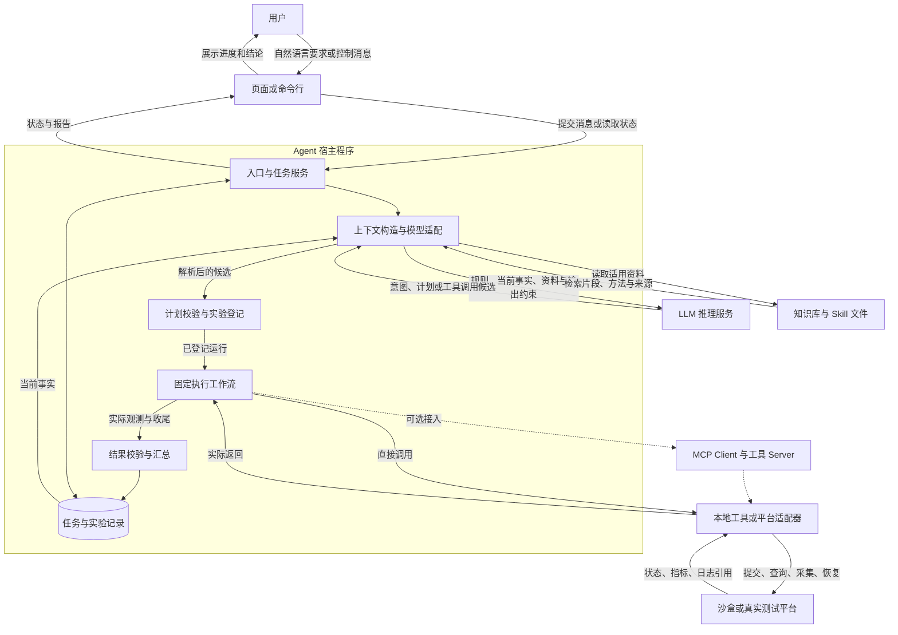
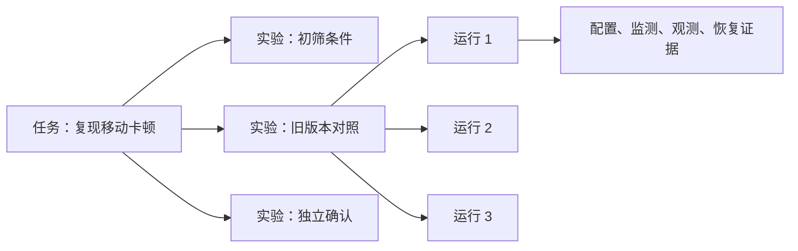
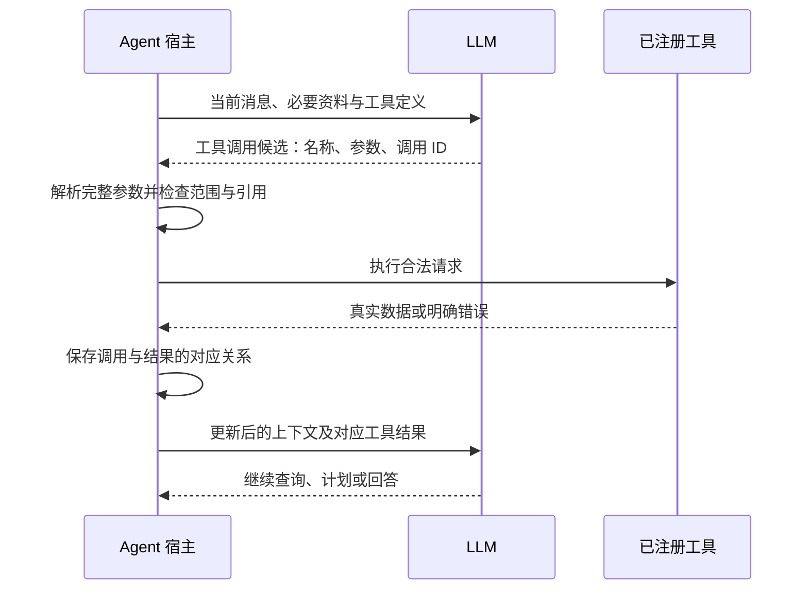
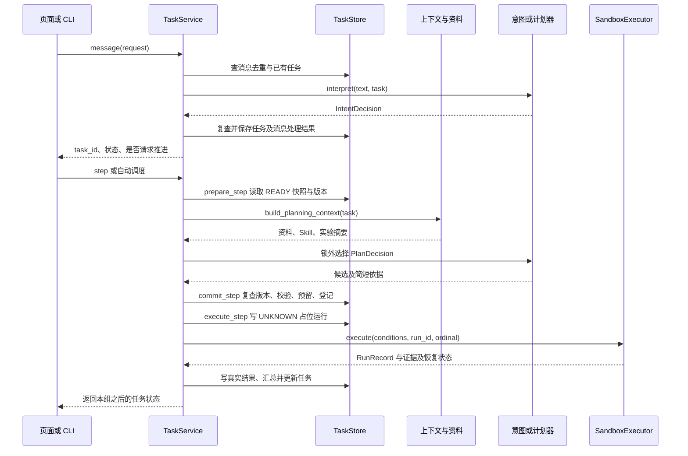

# Agent 系统运行全流程与交互拓扑

本章是整套文档的运行主线：先看系统由谁组成，再跟踪一条请求如何变成实验、证据和报告。各专题负责展开自己的环节，统一从本章定位。

需要逐次查看生产场景的模型交互、工具返回、事务与异步事件时，继续读 [19 生产级端到端案例](19_生产级端到端案例逐步拆解.md)。

## 一、直观理解

### 1. 先分清 LLM、Agent 程序和外部世界

可以把这个系统想成一个组织实验的助手。LLM 负责读材料、理解要求、提出下一步；Agent 程序负责保存任务、准备模型输入、检查计划和驱动执行；测试平台、设备、文件和知识库构成它可以接触的外部世界。

**LLM 与外界交互的桥梁是 Agent 程序。** 在本系统的工具调用路径中，模型收到的是应用整理的文字、结构化数据和能力说明，返回的是回答或调用候选。程序真正读取资料、调用接口，再把取得的结果放进下一次模型输入。

例如模型输出“比较旧版本”，还没有发生测试。程序要先检查条件，登记运行，调用执行器，取得结果；只有这些事实回到模型，它才有依据解释差异。

### 2. 整个系统的交互拓扑

下图表示职责关系。一个方框不必对应一台机器，第一版可以把宿主内的模块放在同一个进程。



实线表示基础交互，虚线表示可选 MCP 接入。当前当前系统教学代码使用本地沙盒，图中的真实设备适配与 MCP 执行路径属于扩展设计。LLM 推理服务仅在在线模式使用，默认离线模式由规则模块替代意图识别和计划决策。

阅读箭头时要看清传的是什么：进入 LLM 的是本轮输入，返回的是候选；进入测试平台的才是实际命令，返回的才是执行事实。知识库提供参考资料，运行记录提供本次证据，二者也要区分。

### 3. 跟着“升级后视频卡顿，帮我复现”走一遍

| 阶段 | 系统实际做什么 | 交给下一阶段什么 |
| --- | --- | --- |
| 接收 | 关联会话，检查消息是否重复 | 原话、已有任务和消息编号 |
| 理解 | 判断新建调查，目标只到复现；缺关键对象时先补信息 | 意图候选及明确修改的条件 |
| 建档 | 程序采用合法修改，保存目标、条件、预算和版本 | 可以推进的任务 |
| 准备上下文 | 取相关实验、资料、方法和剩余额度 | 本轮决策可见的输入快照 |
| 决策 | 选择下一组实验，说明要回答哪个问题 | 实验候选或报告、等待、交接决定 |
| 校验 | 重查最新要求，检查条件、规则和预算 | 已登记的实验 |
| 执行 | 准备、启动监测、执行动作、采集、恢复 | 一次次真实运行和证据 |
| 更新 | 判断哪些运行有效，汇总异常与反证 | 下一轮可用的事实 |
| 继续或结束 | 再选对照、简化、独立确认，或停止 | 下一组实验或有依据的交付 |

假设新版本高负载连续切换时出现了卡顿，下一步可以在相同条件下测旧版本。如果旧版本也异常，就检查共同环境；如果差异仍在，再减少步骤，最后用新运行独立确认。这些是示例分支，实际顺序应由已有证据和任务目标决定。

### 4. 一次模型回复、一次运行和一个任务有多大

一条用户要求可以产生一个任务；一个任务可以做多组实验；一组实验可以重复运行多次。模型在关键决策点被调用，等待平台和计算指标不需要逐次问模型。



“一轮模型调用”不等于“一次实验”，“图运行到 END”也不等于“任务已完成”。图可以只推进一组实验，后台再根据状态决定是否调度下一轮。

### 5. 用户中途插话时，系统怎样接住

用户问“现在怎么样”，程序读取已有进度；说“带宽改成 40 MHz”，程序更新条件和版本；说“暂停”，程序停止安排后续运行，并处理当前运行的可停边界。

这些操作不用等整个调查结束。已经发出的模型请求不会自动获得新消息，所以它返回后还要检查版本。旧实验稍后才结束，结果仍留在原计划下，不能被当成新条件的结论。

等待日志、设备或修复版时，系统保存等待原因并返回控制权。外部信息到来后再继续，不需要维持一条不停生成的模型请求。

## 二、详细技术拆解

### 1. 先确定本章描述的运行口径

| 路径 | 意图与计划从哪里来 | 动作在哪里发生 | 当前边界 |
| --- | --- | --- | --- |
| 默认离线教学 | `OfflineIntent`、`OfflinePlanner` | `SandboxExecutor` | 规则驱动的有限场景，可观察状态变化 |
| 在线教学 | `ModelIntent`、`ModelPlanner` 调用模型 | 仍为 `SandboxExecutor` | 结构化意图与计划；真实模型效果需另外验证 |
| 真实平台扩展 | 可复用在线决策接口 | 平台适配器及后台执行器 | 需实现认证、真实状态查询、资源管理和恢复 |

下文先解释共同契约，再标出扩展差异。使用 LangGraph 是编排表达方式，直接调用业务服务也可以完成同样的主线。

### 2. 一次 LLM 请求到底包含什么

LLM 请求由宿主组装，主要包含四类信息：

| 信息 | 本系统例子 | 来源与责任 |
| --- | --- | --- |
| 行为规则 | 只做本次目标，不编造对象，考虑反证 | 应用维护的提示与业务要求 |
| 当前事实 | 最新条件、已做实验、缺失证据、剩余次数 | 业务记录投影 |
| 参考资料 | 适用用例、相关知识片段、当前 Skill | 检索与文件读取 |
| 输出约束 | `IntentDecision` 或 `PlanDecision` 的字段 | 模型适配层与数据模型 |

概念上可以区分系统规则、用户消息、工具结果等角色；具体协议由适配器决定。当前 `ModelIntent` 和 `ModelPlanner` 将规则与状态组装成提示字符串，并通过 `with_structured_output(..., method="function_calling")` 获取类型化输出，不能把上表理解为代码已经分别发送了四条角色消息。

`build_planning_context` 当前取任务条件、固定字段、历史实验摘要、日志事件、假设、本地检索结果以及 Skill。`PreparedStep` 另外保存 `task_version`、`plan_version` 和 `context_snapshot_id`，供提交检查和追溯使用。不要因为服务层持有某个字段，就假定模型输入也包含它。

数据流是“业务记录 → 相关投影 → 提示与约束 → 模型返回 → 类型解析 → 业务检查”。完整日志、连接凭据和沙盒隐藏故障规则不应成为普通计划输入。

### 3. 模型如何借助工具获得外部信息

通用工具循环与当前系统计划循环要分开理解：



以只读查询为例，LLM 请求查询适用用例，宿主运行查询，返回 `test_case_id` 与规则来源，LLM 才能引用查到的编号。工具定义说明能力，工具结果提供本次事实；传入定义并不等于已经执行。

**当前系统在线主流程直接输出结构化意图和计划。** 本地检索与 Skill 加载由上下文构造器发起，未实现“模型自由选择任意查询工具直到资料足够”的通用循环。上图是可组合的工具模式；它的消息实例见 [03 消息协议](03_Function-Calling与消息协议.md)。

计划循环则是“模型提出一组实验 → 服务校验登记 → 执行器完成固定流程 → 下一轮读实验摘要”。同一个底层 API 请求，不需要一一映射为一次模型调用。

### 4. 当前系统一次实验的真实调用时序

以下时序对应当前单机教学实现；省略重复运行的内部循环。真实平台异步扩展另见下一节。



在线模式下，图中的意图器和计划器会在需要时请求 LLM；离线模式使用规则。明确的查询、暂停、继续和取消优先走控制规则；恢复尚未完成的实验也可以沿用原计划，并非每次 `step` 都调用模型。

三个阶段的职责不可混淆：

| 阶段 | 输入 | 输出 | 一致性边界 |
| --- | --- | --- | --- |
| `prepare_step` | 当前 READY 任务 | `PreparedStep` | 锁内取快照，锁外构造上下文并规划 |
| `commit_step` | 候选、原版本、冻结上下文 | `ExecutionBatch` 或无执行 | 短事务复查状态与版本、校验并登记 |
| `execute_step` | 已登记实验的引用 | 实际运行及任务新状态 | 每次运行前重查；执行调用在锁外；结果写回原运行 |

当前图 `task_workflow.py` 是 `plan → commit → execute → read → END`，复用这三个业务方法；没有额外配置 checkpointer。API 的自动执行由进程内异步任务驱动，阻塞步骤放入线程执行；CLI 则可直接循环或运行教学图。

### 5. 换成真实长任务后，控制权如何交接

真实测试可能持续数分钟，平台适配器宜区分“提交”与“完成”。推荐的扩展路径如下，不能把它当成当前沙盒已有功能：

1. 业务事务保存实验、运行与待发送命令，使用稳定的 `run_id` 关联提交。
2. 后台执行器取命令，检查资源和实际环境，提交平台；保存平台返回的 `session_id`。
3. 若仅返回 `queued/running`，保存等待状态并结束这次调度。后台轮询或经验证的回调负责接结果。
4. 收到完成事件后，检查来源、事件去重、运行归属与合法状态流转，再取得数据和收尾状态。
5. 计算有效性和指标，写回所属实验；条件仍适用且任务可推进时，再调度下一次决策。

提交超时要先按业务键核查平台。平台是否支持幂等键、查询和取消，需要在适配器契约中确认；仅在本地保存一个 UUID 不会自动让远端操作幂等。

等待过程中，用户查询直接读存储；用户修改或暂停写入任务状态。下一次提交检查最新状态，迟到结果仍保留原归属。待发送命令、跨进程调度及平台故障窗口详见 [14 工程设计](14_系统架构与工程实现设计.md)。

### 6. 一个贯穿全链路的数据例子

以下为冻结决策输入的概念示例，字段组合用于解释关系，不是可直接提交给现有 API 的完整请求：

```json
{
  "task_id": "task-demo",
  "task_version": 4,
  "plan_version": 2,
  "context_snapshot_id": "ctx-demo",
  "goal": "REPRODUCE",
  "conditions": {"version": "new", "load": "high", "handovers": 2},
  "facts": [
    {
      "statement": "新版本候选条件出现同类停顿",
      "experiment_id": "exp-screen",
      "evidence_refs": ["ev-observation"]
    }
  ],
  "missing_evidence": ["旧版本同条件对照", "独立确认"],
  "remaining_runs": 9
}
```

模型可以提出“用相同负载和切换次数测旧版本”的 `EXPERIMENT` 候选，带上问题、理由、完整条件、重复次数、类型和适用规则。程序检查可变字段和对照后，登记 `experiment_id`；逐次运行时再生成 `run_id`。平台身份来自真实提交返回，测量来自执行端。

假设期间用户更改了带宽，任务版本变为 5、计划版本变为 3，基于版本 4 的未提交候选就要丢弃。已经提交的旧运行仍然保存，明确检查可比性后才能引用到新计划。

| 引用 | 谁生成或确定 | 作用 |
| --- | --- | --- |
| `message_id` | 调用方按入口契约提供 | 同一消息重传去重 |
| `task_id`、`experiment_id`、`run_id` | 业务程序 | 定位任务、实验与实际运行 |
| `context_snapshot_id` | 业务程序 | 追踪决策当时可见输入 |
| `session_id` | 平台或教学沙盒 | 查询外部执行身份 |
| 模型工具调用 ID | 模型接口及适配层 | 配对一次调用请求与工具结果 |
| MCP JSON-RPC 请求 ID | 协议客户端 | 配对协议请求与响应 |

后三种编号不能替代业务主键。关联方法、消息格式与错误响应由 [03 消息协议](03_Function-Calling与消息协议.md) 和 [09 MCP](09_MCP协议与服务封装.md) 详细说明。

### 7. 工具、MCP、Skill 和 RAG 在拓扑中的位置

| 机制 | 本系统中的位置 | 传递或提供什么 |
| --- | --- | --- |
| Function Calling | 模型接口与宿主之间 | 工具名与参数候选，也可承载结构化计划输出 |
| 普通工具或平台适配器 | 执行端 | 真实查询和动作能力 |
| MCP | 宿主内 Client 与工具 Server 之间 | 能力发现、协议调用与返回 |
| Skill | 上下文的工作方法部分 | 适用范围、步骤、反证和停止建议 |
| RAG | 上下文的资料获取部分 | 相关事实、规则、案例及来源 |
| 编排与业务存储 | 宿主控制与数据部分 | 推进、版本、预算、事实和恢复依据 |

采用 MCP 时，宿主管理 Client，由 Client 连接 Server；宿主将发现的工具转换成模型接受的定义，接到候选后再检查并调用。这里选择由宿主负责本系统的模型请求，不启用额外的服务端采样路径。协议角色依据 [MCP 架构规范（2025-11-25）](https://modelcontextprotocol.io/specification/2025-11-25/architecture)。

Skill 正文和检索片段都必须真的读入本轮输入，才可能影响该次决策。执行边界仍由程序检查。方法更新与检索更新改变后续输入，模型参数更新则要经过独立训练发布。

### 8. 每轮结果怎样影响下一步与最终报告

执行端先提供事实，程序再计算四个维度，模型依据它们解释和选路：

| 维度 | 回答的问题 | 不能混成什么 |
| --- | --- | --- |
| 执行状态 | 动作是否提交、完成或失败 | 提交完成不能当作测试通过 |
| 观测有效性 | 条件和关键窗口是否可用 | 缺样本不能当作正常 |
| 产品判定 | 有效指标是否满足适用规则 | 产品 FAIL 不等于调查任务失败 |
| 恢复状态 | 本次改动和占用是否处理完 | 任务结束不等于环境已恢复 |

本组数据汇总后，程序更新复现记录、假设及反证；计划器下轮读取更新后的投影。模型提出 `REPORT` 时，服务还要检查是否具备完成依据。复现候选需要独立确认，不能重复引用搜索阶段的同一批运行来冒充确认。

最终报告沿“结论 → 实验 → 运行 → 原始证据与规则”追溯。原因没有验证就保留为假设；未达到目标时明确等待项或交接动作。报告查询读取已有事实，不触发新测试。

### 9. 中断、重启与离线改进分别怎样运行

**中断与恢复**处理当前任务。修改要求使未提交旧计划失效；暂停和取消需处理真实在途动作；进程重启后要核查外部状态。当前教学代码把未结束任务转为需核查状态，不连接真实平台自动恢复。

采用 LangGraph 持久化扩展时，checkpoint 保存图状态；业务数据库保存任务、实验和证据关系。动态 `interrupt` 恢复会从所在节点重新开始执行，因此副作用仍需要幂等或独立边界，不能把保存状态等同于动作只执行一次。参见 [LangGraph 持久化](https://docs.langchain.com/oss/python/langgraph/persistence) 与 [中断机制](https://docs.langchain.com/oss/python/langgraph/interrupts)。

**离线改进**处理跨任务质量：完整任务轨迹 → 独立评测与专家审核 → 更新资料或方法 → 必要时构造决策样本 → SFT 或 DPO → 完整任务对照 → 发布新版本。训练输入使用决策前快照，不能把后来得到的原因塞回当时输入。日常保存记录不会自动启动训练。

### 10. 沿着运行主线阅读整套文档

| 主线位置 | 文档 | 应回答的问题 |
| --- | --- | --- |
| 明确目标和边界 | [00 总览](00_项目总览.md)、[01 范围与约定](01_项目事实与实现状态.md) | 为谁做什么，哪些是设计或示例 |
| 理解循环 | [02 运行模式](02_Agent基础与运行模式.md) | 哪些决策需要模型，何时停 |
| 接收自然语言 | [11 统一入口](11_统一入口与意图识别.md) | 创建、修改、查询与控制怎样区分 |
| 表达调用 | [03 消息协议](03_Function-Calling与消息协议.md) | 输入、候选、工具结果怎样配对 |
| 提供执行能力 | [04 工具设计](04_工具设计与完整调用示例.md)、[09 MCP](09_MCP协议与服务封装.md) | 动作契约与平台接入怎样设计 |
| 获取方法与资料 | [10 Skills](10_Agent-Skills与渐进披露.md)、[16 知识库](16_知识库与经验沉淀.md) | 什么方法、什么资料真正进入输入 |
| 保存并可靠推进 | [05 状态与上下文](05_记忆与上下文管理.md)、[06 安全与恢复](06_安全机制与异常恢复.md)、[14 工程设计](14_系统架构与工程实现设计.md) | 哪份记录是真实状态，如何处理并发与重启 |
| 依据证据选实验 | [12 复现与实验](12_异常复现与实验设计.md)、[13 原因与修复](13_原因验证与修复检查.md) | 怎样复现、排除解释和检查修复 |
| 验证与迭代 | [07 评测](07_Agent评测体系设计.md)、[08 后训练](08_Agent模型后训练SFT_DPO.md)、[15 实施路线](15_实施路线与审阅清单.md) | 怎样检查收益、发现错误并逐步改进 |
| 串起实例和源码 | [17 完整案例](17_完整案例与对外讲述.md)、[代码学习指南](code/学习指南.md) | 一次真实形态的任务如何穿过以上环节 |
| 从生产理论逐条展开 | [19 生产级端到端案例](19_生产级端到端案例逐步拆解.md) | 每次模型和工具的输入返回怎样变成事实与最终交付 |
| 观察模型与人工审批接力 | [20 吞吐验收与 HITL](20_吞吐验收Agent_LLM轮次与HITL安全审计.md) | 恢复候选怎样暂停、审批、失效、复核并形成审计链 |

源码追踪顺序：`task_api.py / tasks_cli.py → TaskService.message → intent.py → TaskStore → prepare_step → build_planning_context / ModelPlanner → commit_step → execute_step / SandboxExecutor → summary / _update_evidence → _report`。需要图路由时再读 `task_workflow.py`，与直接驱动方式共用同一套业务方法。
