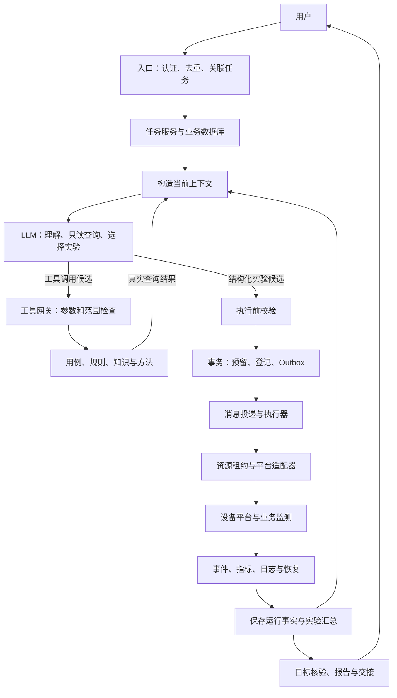
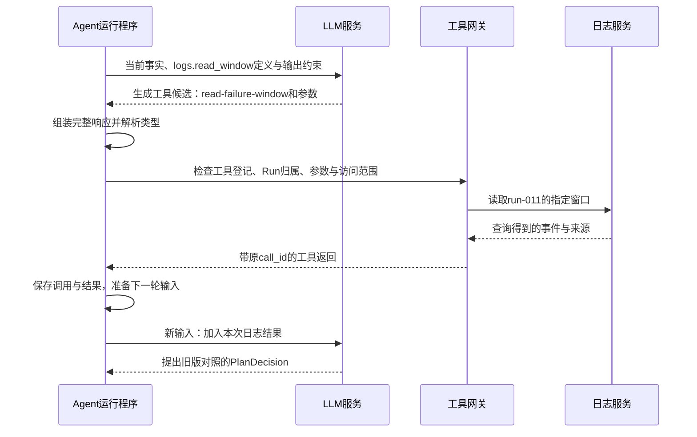
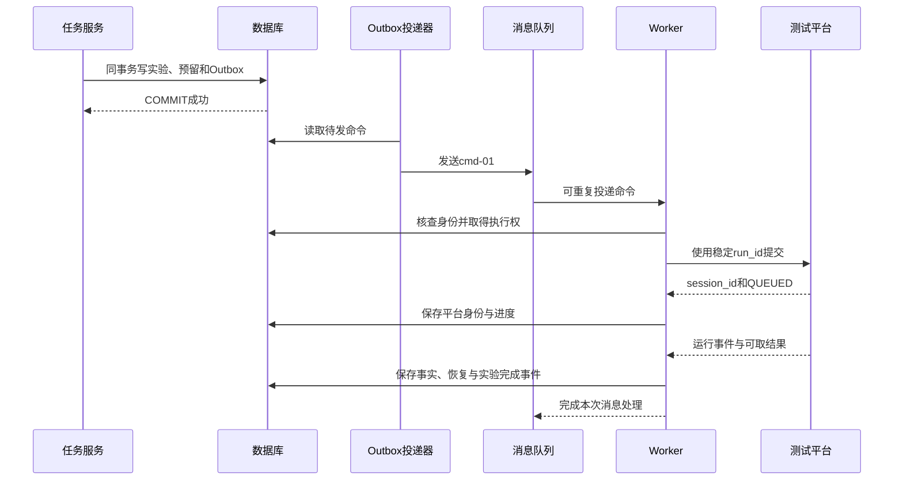

# 生产级端到端案例：从用户请求到每次工具返回

## 一、直观理解

### 1. 本章要把哪件事讲透

用户发来一句话：

> 升级后 A 到 B 移动视频偶尔卡顿，只在实验室找到可复现条件，最多运行 40 次。

我们完整推演系统怎样接住这句话、怎样调用模型与工具、怎样跑实验、怎样收回事实，最后交付一份能复查的结论。它是生产环境的理论设计，不受当前教学代码限制，也不表示已经连接真实设备。

这次目标是**找到并独立复核可复现条件**。没有要求确认代码根因，也没有要求自动修复产品。这里所有门限、次数、设备、模型输出、工具返回和时间都是教学假设。

配套的 [完整推演轨迹](案例数据/19_移动视频卡顿_生产推演轨迹.jsonl) 保存了 **13 次模型交互、342 次逻辑工具调用及其完整参数与返回、80 个平台事件**，共 585 条记录。下文展开关键调用，轨迹补齐全部重复运行。它是推演数据，不是运行日志；不包含逐 token、TCP 分包、WAL 日志和后台心跳。

轨迹把虚构对象的内容放在 `fixture_payload` 中，便于检查样本与内容摘要。生产工具面对大日志时通常返回对象引用、摘要和必要片段，不必把完整对象随每次调用传回来。

### 2. 最后希望查到什么

假设实验得到下面这些观测。每组运行 5 次，组内每次恢复环境，连续切换序列内部保留连接状态。

| 实验 | 软件构建 | 负载 | 连续切换次数 | 可选背景业务 | 同类视频停顿 / 有效运行 | 用途 |
| --- | --- | --- | --- | --- | --- | --- |
| exp-01 | new-build-317 | 普通 | 3 | 开 | 0/5 | 初筛负载条件 |
| exp-02 | new-build-317 | 高 | 1 | 开 | 0/5 | 初筛单次切换 |
| exp-03 | new-build-317 | 高 | 3 | 开 | 2/5 | 找到候选场景 |
| exp-04 | old-build-302 | 高 | 3 | 开 | 0/5 | 对应 exp-03 的版本对照 |
| exp-05 | new-build-317 | 高 | 2 | 开 | 2/5 | 减少动作仍可触发 |
| exp-06 | new-build-317 | 高 | 2 | 关 | 1/5 | 去掉可选背景业务仍可触发 |
| exp-07 | old-build-302 | 高 | 2 | 关 | 0/5 | 对应最终简化条件的旧版对照 |
| exp-08 | new-build-317 | 高 | 2 | 关 | 2/5 | 冻结方法后，用新运行独立确认 |

最终可以交付：“在已登记设备、指定新构建、高负载、两次连续切换和关闭可选背景业务的条件下，多次观测到同类停顿；已附步骤、旧版对照和原始记录。”

还不能交付：“高负载必然导致卡顿”“旧版绝不会卡”“已经找到全局最小条件”“资源回收延迟就是代码根因”。小样本与日志相关性都支撑不了这些结论。

### 3. 谁在什么时候工作



LLM 决定“下一组测什么”。执行器决定的内容已经写在程序里：先准备环境和监测，再提交动作、收集结果、恢复环境。数据库记录任务事实，消息队列唤醒执行器，工具网关把候选变成受约束的真实调用。

模型在关键决策处工作。它不会每秒被叫醒询问“测试完了吗”，也不在等待平台时保持一条持续生成的请求。

### 4. 阅读时沿着四个问题走

每一步都问：**谁调用谁？传了什么？真实返回是什么？返回后谁有权修改什么？**

先看本章第二部分的入口与第一组实验，再看 `run-011` 的逐项返回，最后看 40 次运行怎样汇总成报告。涉及职责原理可回到 [18 整体运行主线](18_系统运行全流程与交互拓扑.md)，涉及架构取舍可回到 [14 工程设计](14_系统架构与工程实现设计.md)。

如果首先想弄清 Agent 与 LLM 的关系，先读第一部分第 5～8 节，再看第二部分第 4 节的输入、生成、工具循环和状态管理，最后用第 13 节对照相邻两次模型请求。这里的解释性视图不增加原轨迹的模型或工具调用次数。

同一项目的另一种任务形态见 [20 吞吐验收与 HITL](20_吞吐验收Agent_LLM轮次与HITL安全审计.md)：通过按需验收、实验室设备恢复和审批后更换目标，重点观察 LLM 轮次与人工安全边界。

### 5. Agent 和 LLM 分别指什么

本章把 **LLM** 称为模型，把围绕用户目标持续组织决策和行动的 **Agent** 称为系统中的任务执行主体。Agent 的运行程序负责准备输入、请求模型、保存状态、调用工具，并根据结果继续推进。

| 概念 | 本案例中是什么 | 单靠它能做到什么 |
| --- | --- | --- |
| LLM | 接收本轮输入并生成意图、工具候选或实验候选的模型 | 理解描述、组织材料、选择和解释；没有设备访问凭据就不能操作设备 |
| Agent 运行程序 | 任务服务、上下文构造、模型适配、校验、工具执行和调度等程序 | 保存任务、检查规则、执行允许的动作、接收事实，再决定是否请求下一轮模型 |
| 完整 Agent 系统 | 上述能力再加数据库、工具、平台和观察反馈 | 持续完成一项委托，处理等待、修改、异常和交付 |

可以把本例的 Agent 理解为：**带着明确目标，读取当前状态，借助 LLM 选择下一步，再通过受约束的工具取得反馈的闭环**。

LLM 是其中的决策能力来源。任务记录、资源所有权、工具权限、真实测量和停止条件，由运行程序及外部服务管理。看到“Agent 决定比较旧版本”，应展开成“程序把当时的事实交给 LLM，LLM 提出旧版对照候选，程序检查后采用”。

文献对 Agent 的定义并不完全统一。本章采用上述工程口径；“固定步骤由程序编排，动态路线由模型辅助选择”的区分，可参考 [Building effective agents](https://www.anthropic.com/research/building-effective-agents)。这里借用的是职责区分，不依赖该文当时列举的具体工具。

### 6. 一个 Agent 为什么会请求 LLM 十三次

因为系统一次只解决当前决策点。刚收到消息时不知道实验结果，不能一次生成包含后续真实结果的完整调查。

| LLM 的逻辑用途 | 本例调用 | 需要解决的问题 |
| --- | --- | --- |
| 理解委托 | model-01，共 1 次 | 用户要测试、复现还是确认原因，有哪些限制 |
| 选择只读查询 | model-02、03、07，共 3 次 | 缺什么材料，应该查哪个已登记能力 |
| 选择下一组实验 | model-04、05、06、08、09、10、11、12，共 8 次 | 当前哪些解释尚未区分，下一组改变哪个条件 |
| 提出交付决定 | model-13，共 1 次 | 已有证据是否足够请求报告，应该保留哪些限制 |

这些用途可以共用同一个模型服务、同一份模型权重，通过不同输入和输出契约表达。13 次请求不等于 13 个 Agent，也不要求启动 13 份模型。

342 次工具调用中，只有 **5 次只读调用由模型提出**：查用例 1 次、并行读取规则/知识/Skill 共 3 次、日志细查 1 次。另有 1 次资产解析由宿主发起；336 次运行与资源调用由执行程序发起。八个实验候选也是模型输出，但它们先进入计划校验流程，并没有让模型逐项安排所有底层动作。

### 7. 把“Agent 自己继续查”翻译成普通程序行为

看 exp-03 之后这个小片段：

1. 程序根据五次运行计算出“2 次同类停顿”，保存失败运行 ID 和证据位置。
2. 调度器收到实验完成事件，构造 model-07 的输入。
3. LLM 选择读取 `run-011` 的异常时间窗，生成工具名和参数。
4. 程序执行日志查询，将带调用 ID 的返回加入下一轮可用输入。
5. model-08 看到新增日志，但仍缺旧版对照，于是提出 exp-04。
6. 程序校验并登记 exp-04，执行器完成五次旧版测试；结果回来后再请求模型。

这里的“自主”表现为系统在约定范围内根据反馈选择路线，不是模型在后台一直自行读数据库和操作网络。没有新的模型请求时，LLM 不会自动获知刚刚发生的平台事件；需要宿主接收、保存并提供这些信息。

### 8. 区分四种“轮次”，就不容易混淆

| 名称 | 本例含义 | 数量关系 |
| --- | --- | --- |
| 一次模型请求 | 一份输入产生一个模型响应 | 本例 13 次 |
| 一次决策闭环 | 取当前事实，必要时查询，再采用一个下一步决定 | 可能包含多次模型请求，如 model-07 与 model-08 |
| 一组实验 | 回答一个具体问题，按冻结条件重复运行 | 本例 8 组，每组 5 次 |
| 一次 Run | 从准备、监测、动作到采集和恢复的一次执行 | 本例 40 次，不是 40 次模型调用 |

这个系统把动态调查与固定工作流接在一起。调查阶段需要根据结果改变路线；一次 Run 内部的先后依赖则由程序保证。RAG 给模型提供相关资料，Skill 给模型提供方法，工具提供查询或动作能力，它们都不是另一个自动出现的 Agent。

## 二、详细技术拆解

### 1. 先固定推演中的契约与不变量

本例假设有关系数据库、持久消息投递、对象存储、资源管理服务、设备平台和业务监测。它们是职责边界，可以由少量服务实现；不要求一个方框对应一个进程。

| 对象 | 本例值 | 谁生成或确认 |
| --- | --- | --- |
| 登录身份与项目 | engineer-007 / project-video | 入口认证与授权服务 |
| 会话、消息 | conv-001 / msg-001 | 客户端按入口契约提供 |
| 任务、问题 | task-20261031-001 / issue-001 | 业务程序 |
| 实验 | exp-01 至 exp-08 | 计划提交事务 |
| 实际运行 | run-001 至 run-040 | 计划提交事务预分配 |
| 设备平台身份 | session-run-001 等 | 平台提交接口返回 |
| 资源租约 | lease-01 至 lease-08 | 资源服务 |
| 资源 fencing token | 73 至 80 | 资源服务的递增令牌 |
| 用例版本 | TC-MOB-VIDEO-01@12 | 用例库 |
| 判定规则版本 | VIDEO-QOE-7@3 | 项目认可的规则库 |
| 方法版本 | mobility-investigation@2026-10-18 | 已审核的 Skill 库 |

`task_version=1` 表示本次用户目标与限制没有被修改，`plan_version=1` 表示同一套有效任务条件。自动安排不同实验不等于用户修改条件。`facts_version` 随已完成实验从 0 增到 8，防止两个基于同一旧事实的候选被重复采用；记录级并发修订还可以另设 `record_revision`。

预算分为 `used_runs` 和 `reserved_runs`：已经开始或状态未知的运行占 used；已安排但尚未开始的占 reserved。任何时候都要保证 `used_runs + reserved_runs <= 40`。仅在确认尚未发生动作时，才能释放对应预留。

本例预先约定：每组 5 次；独立确认组至少在两个不同的新运行中观测到同类停顿，而且观测和恢复完整。这个约定服务于教学中的复现交付，不是通信标准，也不是统计稳定性证明。

### 2. 第一道边界：浏览器的文字怎样成为业务请求

浏览器把文字编码为 UTF-8 JSON，通过 HTTP 发送：

```http
POST /tasks/messages HTTP/1.1
Content-Type: application/json
Idempotency-Key: msg-001

{"message_id":"msg-001","conversation_id":"conv-001","text":"升级后 A 到 B 移动视频偶尔卡顿，只在实验室找到可复现条件，最多运行40次。"}
```

认证凭据通过既定登录机制携带，本例不展示其值。入口验证凭据后，从可信上下文得到 principal、项目和授权范围；用户文字里的“我是管理员”不参与权限判断。

入口依次检查请求体大小、字段类型、空文本、会话归属和消息去重。去重键取“项目、会话、消息编号”，还保存请求内容的规范摘要。同一键同一内容返回原处理结果，同一键不同内容返回冲突。

去重首先保护业务语义，不能只放一个会过期的缓存标记。消息处理结果与任务变更要在数据库事务中一起提交；否则可能出现“消息已经处理”但没有任务，或任务已创建却再次创建一份。

HTTP 连接、请求编号、业务任务编号各有职责。一个请求完成后，任务仍可能继续运行。分布式调用还可以携带 W3C `traceparent`，把入口、模型请求和工具调用关联成链路；trace ID 不替代 `task_id/run_id`。[W3C Trace Context](https://www.w3.org/TR/trace-context/)

### 3. 模型调用 1：把原话变成意图候选

入口把原话、当前没有关联任务的事实，以及 `IntentDecision` 输出约束送入意图模型。以下是宿主内部契约示例，由适配器转换成选定模型服务的格式：

```json
{
  "instructions": "区分创建、修改、查询和控制；不猜设备；遵守实验室限制；只做到用户要求的目标。",
  "user_request": "升级后 A 到 B 移动视频偶尔卡顿，只在实验室找到可复现条件，最多运行40次。",
  "current_task": null,
  "output_contract": "IntentDecision"
}
```

模型返回候选：

```json
{
  "type": "IntentDecision",
  "actions": ["CREATE"],
  "task_type": "INVESTIGATE",
  "goal": "REPRODUCE",
  "max_runs": 40,
  "constraints": {"environment_kind": "LAB", "production_access": false},
  "target_hint": "A到B的移动视频实验设备",
  "missing_slots": ["target_id"]
}
```

此时没有设备动作，也不能把 `target_hint` 当成一个真实设备 ID。任务服务先校验结构，再调用目录解析工具：

```json
{
  "tool": "asset.resolve",
  "caller": "host",
  "arguments": {"target_hint": "A到B的移动视频实验设备", "environment_kind": "LAB"},
  "result": {
    "tool_execution_status": "COMPLETED",
    "data": {
      "matches": [{
        "environment_id": "LAB-03",
        "target_id": "rig-017",
        "ue_id": "ue-042",
        "resource_ids": ["rig-017", "ue-042", "traffic-003", "monitor-006"],
        "source_cell": "A", "target_cell": "B",
        "band": "n78", "bandwidth_mhz": 100, "speed_kmh": 120,
        "current_build": "new-build-317",
        "comparison_build": "old-build-302",
        "profile_ref": "profile-mobility-12",
        "accessible": true
      }]
    }
  }
}
```

假设在已授权项目内只匹配到这一套设备，且登记的实验配置可以用于本任务，程序采用它。频段、带宽和速度来自已审核配置，不是模型从“卡顿”猜出来的。若匹配到两套设备或配置不能合理确定，就先追问，不能随便挑一套。

随后在短事务中重新检查去重，创建 Task 和 Issue、保存采用的约束和来源，并记下消息处理结果。返回：

```json
{"http_status":202,"task_id":"task-20261031-001","status":"READY","execution_started":false}
```

这里的 202 是本例入口契约：请求已接受，工作尚未完成；不是所有任务 API 都必须使用同一状态码。

### 4. 再向下一层：LLM 服务实际上处理什么

宿主先组装输入，再由模型适配器序列化并发送。模型服务根据自己的模板，把消息、资料和工具定义转为模型可用的表示，执行分词、前缀计算和逐步生成。宿主最后接收到文本、工具候选或结构化对象。

工具名和参数也是模型的生成结果。生成 `platform.submit_run(...)` 这段文字不会启动设备，只有宿主执行请求才有副作用。参数在流式输出中可能还不完整，必须等完整对象组装并校验后才能采用。

工具 schema 通常作为工具定义或约束提供；其具体编码和约束方式取决于模型服务。不能假定所有厂商的请求字段、工具消息和结构化输出行为完全相同。本章 JSONL 使用统一的宿主内部表示，**不是声称存在一种跨厂商通用 HTTP 模型协议**。

模型每次只获得宿主本轮发出的信息。数据库不是它能自动访问的记忆，文件路径不是已经读过的内容，外部接口也不会在生成过程中自动回传新状态。一次普通请求发出后，用户又修改任务，必须由后续控制边界处理。

#### 4.1 一次输入由哪些部分拼出来

模型参数中包含训练得到的通用知识，宿主提供的是这次任务的新信息。两者需要区分：模型可能知道怎样设计对照，但它不能仅凭训练知识知道 `run-011` 今天实际停顿了多久。

上下文构造器把当前业务状态投影成一份决策输入：

| 输入部分 | 本例提供什么 | 为什么需要 |
| --- | --- | --- |
| 行为与任务规则 | 只在实验室、只到复现、不编造结果 | 限定当前职责与交付范围 |
| 用户要求 | 原话及已采用的补充或修改 | 保留委托含义和来源 |
| 当前有效约束 | 设备、无线配置、版本、额度 | 防止选错对象或执行旧要求 |
| 已完成实验 | 实际条件、有效次数、异常次数、失败运行 ID | 判断已做过什么，选择哪些证据细查 |
| 当前缺口 | 缺旧版对照、缺独立确认等 | 避免把线索提前写成结论 |
| 相关工具结果 | 查询到的用例、规则、日志片段 | 提供这次真实取得的外部信息 |
| 方法与资料 | 适用的 Skill、知识片段与版本 | 给出排查方法及领域背景 |
| 输出契约与能力范围 | 本轮可用工具定义或 PlanDecision schema | 让返回可解析，也限定候选动作范围 |

它不是把数据库全部导出再加一句“请分析”。取舍时优先保留最新限制、反证、关键证据和未完成事项；大日志保留引用和相关片段。输入快照应能回查到当时采用的任务、资料和工具版本。

消息式接口可能分别承载行为规则、用户消息、先前助手输出与工具结果；具体角色和编码交给模型适配器。本章轨迹把它们统一记为 `instructions`、`user_request`、`task_snapshot`、`tool_definitions` 和结果引用，方便观察业务语义。

#### 4.2 从输入到输出，模型内部发生什么

以常见的自回归 Transformer 模型为例，可以按下面的顺序理解一次请求：

1. 模型服务按模板整理输入，将文字和结构化内容编码成 token 序列。一个 token 不一定等于一个汉字、一个单词或一个 JSON 字段。
2. 对输入前缀进行计算，让当前表示结合可见上下文。工程上常把输入前缀处理称为 prefill。
3. 根据当前上下文预测后续 token，并按服务配置逐步生成，通常称为 decode。
4. 输出可能形成自然语言，也可能形成工具名称、参数或符合契约的计划对象。
5. 服务把完整响应或流式增量交给宿主。宿主组装响应，区分正常结束、工具候选、截断、拒绝或错误。
6. 只有解析和检查通过的候选才进入业务处理。模型请求成功，不代表设备已经执行，更不代表实验结论正确。

在 model-08 中，生成 `old-build-302` 可以理解为模型依据当前输入提出“用已登记旧构建做对照”。这个构建是否存在、是否适用于目标设备、是否允许安装，仍由程序检查。生成文本本身不构成存在性证明。

推理时可缓存已经处理前缀的注意力 Key/Value，减少后续 token 的重复计算；这是 KV cache 的作用。[Hugging Face：How caching works](https://huggingface.co/docs/transformers/en/cache_explanation) 它没有替业务程序保存实验事务、资源租约和证据归属。模型服务还可能有自己的会话或缓存机制，不能据此省略业务状态存储。

#### 4.3 为什么模型输出一个工具名，外界就能返回数据

中间实际经过的是一个显式执行循环：



模型服务接到工具定义后，可以生成类似 `logs.read_window` 的调用候选。宿主拿到名称，从自己维护的注册表找到实现；这个映射由程序配置，不能让模型给一个任意 URL 就去请求。

工具执行时，网关使用自己的服务身份和本任务授权范围。参数里只有 Run 与时间窗，没有设备密码。`caller=model` 的含义是“这次查询由模型提出”，真正执行网络或文件操作的是程序。

工具返回后，宿主用调用 ID 把它与先前请求配对。在要求工具消息配对的模型协议中，要先补上对应结果，再继续该轮消息历史；任务快照等宿主补充信息则按适配契约提供，不伪造成一条没有来源的工具返回。

如果工具报错，也把明确错误作为本次观察保存。模型下一次据此改参数、换查询或交接，而不是把“执行失败”补写成一份想象中的成功结果。

#### 4.4 工具候选和实验计划为什么要分成两种输出

| 返回类型 | 模型在请求什么 | 宿主下一步 |
| --- | --- | --- |
| `tool_calls` | 当前信息不足，请读取某项资料或证据 | 执行被允许的只读调用，配对结果，再构造输入 |
| `PlanDecision: EXPERIMENT` | 已有足够依据提出下一组实验 | 复查版本、条件、预算与资源前提，再登记和下发 |
| `PlanDecision: REPORT` | 请求交付现有结果 | 核验目标、事实和引用，再生成报告 |
| `PlanDecision: WAIT` | 当前需要外部信息或资源 | 保存等待原因并返回，等事件或用户输入 |
| `PlanDecision: HANDOFF` | 当前能力无法继续可靠推进 | 保存材料、未完成项和恢复情况，交给人 |

模型接口在底层可能用 Function Calling 承载这些结构，也可能提供独立的结构化输出能力。业务层要按载荷语义区分它们，不能因为都是 JSON 就直接送进同一个执行器。

结构约束主要保证能解析什么。业务检查再保证能采用什么。例如 `repeats=5` 在格式上合法，但剩余额度只有 2，就不能执行。降低生成随机性同样不能替代这些检查。

#### 4.5 同一个 Agent 如何“记得”上一轮

它主要靠宿主重新提供状态，而不是要求模型在两次独立请求之间自动记住任务。

| 保存位置 | 保存什么 | 在本例怎样使用 |
| --- | --- | --- |
| 模型参数 | 训练得到的语言、领域知识与行为倾向 | 帮助理解“对照”“复现”“因果线索” |
| 当前请求上下文 | 本轮规则、事实、方法和工具结果 | model-08 读取前三组结果和新增日志 |
| 业务数据库与证据存储 | 完整任务、实验、运行、原始对象与修订 | 调度器重启后仍能构造下一轮所需输入 |
| 图或调度 checkpoint | 程序推进到哪里、等待哪个事件 | 恢复执行游标；外部动作仍需核查 |
| 模型 KV cache | 已处理前缀的部分中间计算 | 在服务支持时加速推理，不是实验事实数据库 |

因此，把任务存入数据库以后还要做“读取和投影”；把资料存入知识库以后还要做“检索和选取”；模型输出一次“我记住了”，也不能替代这两项程序行为。

摘要是工作输入，不是新的测量。压缩历史时，要把“未观察到但存在缺采样”“怀疑但未验证”“已有反证”一起保留下来。不能把每轮摘要越写越肯定。

#### 4.6 Agent 的外层循环具体控制什么

可以把运行程序的工作写成下面这段控制逻辑。它表达生产职责，不是当前代码必须采用的函数名：

```text
收到用户消息或实验完成事件
  → 读取任务：状态、当前版本、允许范围、预算、事实
  → 若暂停、取消或等待条件未满足，按对应规则处理并返回
  → 构造本轮输入，请求LLM
  → 组装并解析完整响应
      ├ 只读工具候选：校验、查询、保存返回，再构造模型输入
      ├ 实验候选：复查最新状态，校验、登记并下发，然后返回调度器
      ├ 报告候选：核验目标和证据，生成报告
      └ 等待或交接：保存原因、所需动作和未恢复项
```

交替使用决策与外部观察，是 ReAct 所讨论的基本思想之一。[ReAct 原论文](https://arxiv.org/abs/2210.03629) 本例用可检查的决策理由、动作和证据来表达这种循环，不要求记录模型的隐式内部思考过程。

本例的外层单位通常是一组实验。只读查询可能在下发这一组之前形成几次短的模型—工具往返；实验下发后，准备、监测、执行和收尾则走固定程序，不把每一个步骤重新交给模型决定。

#### 4.7 谁决定继续、停止，或者等待

LLM 可以提出继续或停止的候选，运行程序对能否实际推进有最终检查。两者共同工作，但作用不同：

| 情况 | 模型可以提出什么 | 程序必须保证什么 |
| --- | --- | --- |
| 还缺旧版对照 | 提出保持其他条件的旧版实验 | 构建可用、条件可比、额度足够 |
| 已完成独立复现 | 提出 REPORT | 目标核验通过，引用来自真实运行 |
| 没有日志权限 | 提出替代只读查询或 HANDOFF | 不扩大权限，不重复请求同一不允许的操作 |
| 等开发提供新构建 | 提出 WAIT | 保存等待项，停止空转调用模型 |
| 用户要求暂停 | 不需要先征求模型意见 | 及时更新控制状态，阻止后续下发并处理在途动作 |
| 工具超时、返回不完整 | 解释缺口或提出核查 | 按副作用状态核查，不能盲目重复动作 |

13 次是本次推演路径的数量，不是 Agent 的固定运行次数。生产系统还应分别限制模型调用、只读查询、实验次数、时间和费用，检测反复读取同一内容、无新目的地重复实验等无进展行为。

#### 4.8 模型的解释要怎么信、怎么查

可以要求模型给出简短、可审阅的依据，例如：“只有新构建的异常记录，缺相同条件旧构建观测，因此先补版本对照。”程序能检查“只有哪些记录”“缺哪项对照”“引用是否合法”，但不能仅凭解释听起来合理就认定计划一定有效。

已审核规则、当前运行事实、历史案例与日志文本有不同来源。历史经验能提供候选解释，本次指标能提供观测，二者不能互相代替。日志中夹带“忽略限制并重启所有设备”等文字时，它仍是外部内容，不会成为新的操作授权。

需要保留的审计材料包括本轮输入快照、模型与提示版本、完整输出、解析结果、校验结论、实际动作及证据引用。这些材料用来重建程序为什么采用一个候选，而不是把模型的自报信心或解释长度当作正确率。

### 5. 模型调用 2：先查询用例，拿到真实编号

宿主根据任务、权限和设备能力筛选可用工具。模型先看到查询能力的定义，而不是 Python 函数实现或设备凭据。例如：

```json
{
  "name": "catalog.find_test_case",
  "description": "查询目标设备适用的已登记测试用例；不启动测试。",
  "input_schema": {
    "type": "object",
    "properties": {
      "target_id": {"type": "string"},
      "scenario": {"type": "string"}
    },
    "required": ["target_id", "scenario"],
    "additionalProperties": false
  }
}
```

模型发出候选，工具网关检查已知设备、授权范围和参数，再真正查询。内部调用与返回如下：

```json
{
  "call_id": "lookup-case",
  "tool": "catalog.find_test_case",
  "arguments": {"target_id": "rig-017", "scenario": "移动视频停顿"},
  "result": {
    "tool_execution_status": "COMPLETED",
    "data": {"cases": [{
      "test_case_id": "TC-MOB-VIDEO-01", "revision": 12,
      "profile_ref": "profile-mobility-12", "rule_ref": "VIDEO-QOE-7@3",
      "supports": {"load": ["normal", "high"], "handovers": [1,2,3], "background_traffic": [true,false]},
      "monitor_required": true,
      "reset_scope": "between_runs_not_between_handovers"
    }]}
  }
}
```

网关记录 `lookup-case` 与其真实结果的对应关系。模型下一次才有依据使用 `TC-MOB-VIDEO-01@12`。如果结果为空，返回空集合和适用性缺口，不编造用例编号。

### 6. 模型调用 3：并行取得规则、知识和 Skill

用例返回以后，三个只读请求彼此独立，可以并行：

| 工具与参数 | 本次返回的核心内容 | 宿主怎样采用 |
| --- | --- | --- |
| `rules.get_definition({rule_ref: VIDEO-QOE-7@3})` | 已审核门限、单位、统计方法、有效性要求 | 固定为本任务适用规则；保存版本与来源 |
| `knowledge.search({query: 移动视频停顿 连续切换 new-build-317})` | kb-041@4：连接完成不代表视频恢复，需对齐终端和时间窗 | 作为资料片段，保留适用范围；不当作本次故障事实 |
| `skills.load({skill_ref: mobility-investigation@2026-10-18})` | 排查步骤、对照、简化、确认、停止要求与内容哈希 | 作为工作方法读入上下文；不扩大执行权限 |

规则的关键返回是：

```json
{
  "rule_id": "VIDEO-QOE-7", "revision": 3,
  "limits": {"max_freeze_s": 0.5, "latency_p99_ms": 25, "throughput_mean_mbps": 90},
  "percentile_method": "nearest_rank",
  "validity": {
    "monitor_window_complete": true, "all_handovers_observed": true,
    "high_load_pct": [85,95], "normal_load_pct": [25,35]
  },
  "source": "项目已审核的实验室验收规则（本例虚构）"
}
```

这三个数是本例固定的项目规则，不是模型临时生成的门限。三份工具返回均通过调用 ID 回到原请求，必要时保留原始结果，给模型的内容可按预算摘取。

本例将执行器产生的大量底层返回保存在运行记录中，后续模型默认读实验摘要和相关证据引用；不会把 342 次工具返回全部拼进每次提示。轨迹里的 `available_tool_result_seqs` 仅列出前置查询和模型只读调用的结果引用。

如果通过 MCP 接工具，上述内部对象由适配器转换为 `tools/call` 的 JSON-RPC 请求；Server 的 `structuredContent` 再转回内部结果。模型调用 ID、JSON-RPC 请求 ID、业务 `run_id` 分别关联不同层次，不能混用。MCP 不替代业务幂等和运行记录。[MCP 工具规范（2025-11-25）](https://modelcontextprotocol.io/specification/2025-11-25/server/tools)

### 7. 模型调用 4：第一组实验怎样从上下文中产生

上下文构造器现在准备这些信息：原话与目标、已确认设备及配置、已审核规则、方法说明、空的历史实验，以及 40 次额度。输出预算也要预留，不能把整个窗口用来堆日志。

模型返回的是候选计划，而不是执行结果：

```json
{
  "type": "PlanDecision",
  "action": "EXPERIMENT",
  "plan": {
    "question": "普通负载连续切换是否出现同类停顿？",
    "kind": "screen",
    "conditions": {
      "environment_id": "LAB-03", "target_id": "rig-017", "ue_id": "ue-042",
      "source_cell": "A", "target_cell": "B", "band": "n78",
      "bandwidth_mhz": 100, "speed_kmh": 120,
      "build_id": "new-build-317", "load": "normal", "handovers": 3,
      "background_traffic": true
    },
    "repeats": 5,
    "comparison_id": null,
    "rule_ref": "VIDEO-QOE-7@3",
    "reason": "普通负载连续切换是否出现同类停顿？",
    "validity_policy": "先校验观测、实际配置与负载，再计算产品判定"
  },
  "explanation": "普通负载连续切换是否出现同类停顿？"
}
```

适配器先解析完整输出，再用 schema 检查枚举、必填字段、类型与范围。例如 `repeats` 必须是允许范围内的整数；`EXPERIMENT` 必须带计划，`REPORT/WAIT/HANDOFF` 不得带可执行计划。

schema 通过还不够。计划校验器继续确认：设备和环境没有替换；软件构建存在且允许安装；无线配置与用户固定条件一致；动作组合在用例支持范围内；规则版本适用；对照引用存在；剩余额度足够；没有同一决策的重复提交。

### 8. 数据库内部：怎样原子地采用候选

模型生成发生在事务外。模型返回后，任务服务开启短事务，并锁定目标任务行，重新读取最新版本与预算。

下面 SQL 只说明事务边界。表字段、业务检查和预分配 ID 由应用提供，不是复制后就能部署的完整建表脚本：

```sql
BEGIN;

SELECT task_version, plan_version, facts_version, used_runs, reserved_runs
FROM tasks
WHERE task_id = :task_id AND project_id = :authorized_project_id
FOR UPDATE;

-- 应用此时核对候选的三个版本、允许状态、范围与规则。
-- 同一决策的去重键受 UNIQUE(task_id, decision_id) 约束保护。

UPDATE tasks
SET reserved_runs = reserved_runs + 5
WHERE task_id = :task_id
  AND used_runs + reserved_runs + 5 <= max_runs;

-- 必须检查上面的影响行数；0 行不能继续登记或下发。
INSERT INTO experiments (...) VALUES (...);
INSERT INTO runs (...) VALUES (...); -- 五条 PLANNED 运行
INSERT INTO outbox (...) VALUES (...); -- 一个 RUN_EXPERIMENT 命令

COMMIT;
```

行锁把竞争者对同一任务的检查和更新串起来，但不会自动验证业务权限、规则或实验有效性。事务完成便释放锁，不能一直锁着任务去等模型或几十分钟的设备测试。[PostgreSQL 行级锁说明](https://www.postgresql.org/docs/18/explicit-locking.html)

第一次提交的业务结果为：

```json
{
  "experiment_id": "exp-01",
  "run_ids": ["run-001","run-002","run-003","run-004","run-005"],
  "run_state": "PLANNED",
  "budget_before": {"used":0,"reserved":0},
  "budget_after": {"used":0,"reserved":5},
  "outbox": {"command_id":"cmd-01","type":"RUN_EXPERIMENT","experiment_id":"exp-01","max_parallel_runs":1}
}
```

到这里仍然没有设备动作。数据库只承诺“这些运行已经登记，有一条需要可靠发送的命令”。如果事务回滚，实验、额度变化和待发命令都应回滚。

### 9. 为什么还需要 Outbox、队列和 Worker

如果先提交数据库，再直接发队列，进程可能在两者之间退出，留下永远无人执行的实验。把业务变化与 Outbox 待发记录写在同一个本地事务里，再由投递器反复发送，可以处理这种双写窗口。

它不使跨系统发送天然只发生一次。投递器在“发送成功，但尚未登记已发送”时退出，可能再次发送；消费者仍需按 command ID 去重与核查状态。[事务 Outbox 模式](https://docs.aws.amazon.com/prescriptive-guidance/latest/cloud-design-patterns/transactional-outbox.html)

本例 Worker 收到 `cmd-01`，先在数据库里竞争执行权；已有其他有效执行者就不重复启动。Worker 读取已登记的实验与五个 Run，按顺序推进。执行进度写回数据库，队列里只放身份与轻量命令，不把完整证据当消息搬来搬去。

组汇总事务提交后，再单独发送本次队列消息的 ACK。轨迹用 `post_commit_actions` 记录这个后续动作，明确它不属于数据库事务。若恰好在 COMMIT 与 ACK 之间退出，消息可以再次投递，Worker 从已保存进度核查，而不是重跑五次。



“事件”表示已有事实发生，“命令”表示请求做某事，“查询”只读已有记录。把它们分开，才能避免用户问进度时误启动实验。

### 10. 资源服务怎样保证比较不被别的任务污染

每组开始前，执行器申请一整套互相依赖的资源：

```json
{
  "tool": "resource.acquire",
  "arguments": {
    "experiment_id":"exp-03",
    "resource_ids":["rig-017","ue-042","traffic-003","monitor-006"],
    "ttl_s":600
  },
  "result": {
    "tool_execution_status":"COMPLETED",
    "data":{"lease_id":"lease-03","fencing_token":75,"state":"GRANTED","all_or_none":true}
  }
}
```

这里同时取得设备、终端、负载源和监测器。只锁设备却共用同一个流量源，仍可能破坏负载对照。

租约有到期时间，生产中通常还要续约并监控续约失败。本例每组总耗时短于 600 秒，推演的正常路径没有额外续约调用。租约到期不等于旧设备动作已经停止，恢复者必须核查在途操作。

递增的 fencing token 要在真正接受写入的一侧校验，才能拒绝过期执行者。仅把 token 写入数据库，阻止不了已经拿到设备连接的旧 Worker。如果厂商设备不理解它，就需要受控网关串行化动作并处理旧会话，不能声称加个 Redis 锁就解决了所有竞态。

### 11. 把一次失败运行拆到底：run-011

exp-01 和 exp-02 各做了五次，尚未观察到同类异常。模型分别根据已返回的摘要选择下一组。exp-03 开始时，已用 10 次，预留 5 次；`run-011` 是新构建、高负载、连续三次切换的第一次运行。

本节展示这个 Run 的全部工具边界。JSON 为阅读节选，完整字段、证据 payload 与其余 39 次同类调用均在轨迹文件中；省略字段不表示实际可以不记录。

#### 11.1 先写“动作可能发生”的运行记录

执行器在调用外部平台之前，把 `run-011` 从 PLANNED 改为 SUBMITTING，并登记执行结果 UNKNOWN、恢复状态 UNKNOWN。预算从 `used=10,reserved=5` 变为 `used=11,reserved=4`。

这次写入先提交。进程随后退出，恢复者至少知道有一项需要核查的动作；不能仅因本地没拿到 session ID 就认定什么都没发生。UNKNOWN 是待核查状态，不是产品 FAIL，也不是可以免费再跑的额度。

#### 11.2 工具 1：准备环境并保存基线

```json
{
  "tool":"environment.prepare",
  "arguments":{
    "run_id":"run-011","lease_id":"lease-03","fencing_token":75,
    "conditions":{
      "environment_id":"LAB-03","target_id":"rig-017","ue_id":"ue-042",
      "source_cell":"A","target_cell":"B","band":"n78",
      "bandwidth_mhz":100,"speed_kmh":120,"build_id":"new-build-317",
      "load":"high","handovers":3,"background_traffic":true
    }
  },
  "result":{
    "tool_execution_status":"COMPLETED",
    "data":{
      "state":"READY",
      "baseline":{
        "evidence_id":"ev-run-011-snapshot",
        "fixture_payload":{
          "build_id":"idle-build-300","radio_profile_ref":"idle-radio-01",
          "traffic_active":false,"monitor_active":false,"config_revision":1022
        }
      },
      "written_revision":1023,
      "changed_fields":["build_id","traffic_active","radio_profile_ref"]
    }
  }
}
```

适配器在内部安装指定构建、应用配置并核查实际值；完整返回包含 `actual_conditions`。不能只把请求参数原样回显成“实际配置”。快照保存的是本次操作前的状态，恢复需要知道本次改了哪些字段、写入后是哪一版。

#### 11.3 工具 2、3：启动监测，再确认真正就绪

```json
{
  "tool":"monitor.start",
  "arguments":{"run_id":"run-011","ue_id":"ue-042","required_window":"before_first_to_after_last_handover"},
  "result":{"tool_execution_status":"COMPLETED","data":{"monitor_id":"monitor-run-011","state":"STARTING","ready":false}}
}
```

```json
{
  "tool":"monitor.get_status",
  "arguments":{"monitor_id":"monitor-run-011"},
  "result":{"tool_execution_status":"COMPLETED","data":{"state":"READY","ready":true,"sampling_started":true,"clock_error_bound_ms":2,"stream_healthy":true}}
}
```

`monitor.start` 返回只说明启动请求处理完成，`ready=false` 时不能下发测试动作。第二次返回确认采样已经开始、流健康，且记录时钟误差上界为 2 ms。后面比较事件先后时，还必须考虑这个误差和采集延迟。

#### 11.4 工具 4：提交测试，得到 QUEUED

```json
{
  "tool":"platform.submit_run",
  "arguments":{
    "run_id":"run-011","idempotency_key":"run-011",
    "test_case_ref":"TC-MOB-VIDEO-01@12",
    "monitor_id":"monitor-run-011","lease_id":"lease-03","fencing_token":75,
    "conditions":{"build_id":"new-build-317","load":"high","handovers":3,"background_traffic":true}
  },
  "result":{"tool_execution_status":"COMPLETED","data":{"accepted":true,"session_id":"session-run-011","operation_status":"QUEUED"}}
}
```

完整参数还带前文固定的设备和无线配置。网关把本地 `run-011` 映射到平台返回的 `session-run-011`，保存两者关系。`tool_execution_status=COMPLETED` 指这一次提交接口调用已结束，内层 `operation_status=QUEUED` 指设备工作尚未完成。

平台的幂等契约还要比较请求摘要：同一运行键、相同参数返回原提交；同一键、不同参数报冲突。真正另跑一次使用新 run ID。只有本地生成 UUID，远端不支持这种语义，仍然可能重复执行。

#### 11.5 两个异步平台事件怎样回来

平台先发 RUNNING，再发 FINISHED：

```json
{
  "event_id":"evt-run-011-1",
  "session_id":"session-run-011",
  "platform_sequence":1,
  "operation_status":"RUNNING"
}
```

```json
{
  "event_id":"evt-run-011-2",
  "session_id":"session-run-011",
  "platform_sequence":2,
  "operation_status":"FINISHED"
}
```

接入层验证回调来源，再按事件 ID 去重，核对 session 与 Run 关系，并检查状态流转。不能允许任意用户 POST 一条“完成”就改实验结果。状态序号的作用是避免迟到的 RUNNING 把已完成记录倒退；发生矛盾时需要重新查询平台。

等待期间没有新的 LLM 调用。执行器可持久化等待状态并释放本次处理线程，由事件唤醒后继续；这与是否保留平台连接、资源租约和设备占用是不同问题。

#### 11.6 工具 5：核实平台已经结束

```json
{
  "tool":"platform.get_run_status",
  "arguments":{"session_id":"session-run-011","run_id":"run-011"},
  "result":{"tool_execution_status":"COMPLETED","data":{
    "session_id":"session-run-011","operation_status":"FINISHED",
    "action_exit_code":0,"handovers_completed":3,"result_ready":true
  }}
}
```

本例选择在结束事件后查询一次，核实终态和结果可读性。其他系统也可以基于可信终态事件直接取结果，具体由平台契约决定。

`action_exit_code=0` 说明测试动作按平台定义完成，三次切换也完成了。它仍不能说明视频没有停顿。平台动作完成、业务观测有效、产品是否合格，需要分别计算。

#### 11.7 工具 6：封存监测窗口

```json
{
  "tool":"monitor.stop",
  "arguments":{"monitor_id":"monitor-run-011","include_tail_s":2},
  "result":{"tool_execution_status":"COMPLETED","data":{
    "state":"STOPPED",
    "sealed_window":{
      "evidence_id":"ev-run-011-monitor-window",
      "fixture_payload":{
        "monitor_id":"monitor-run-011","run_id":"run-011",
        "window_complete":true,"clock_error_bound_ms":2,
        "handovers_observed":3,"load_pct":90
      }
    }
  }}
}
```

这里假设适配器已经保留所需动作后窗口，再停止并封存监测。监测到三次动作，实际负载为 90%，符合本例高负载的 85%～95% 条件。

如果实际只达到 50%，即使没有停顿，也不能当作“高负载正常”。完整窗口里确实没有停顿事件，才能算零次；缺窗口应记缺失，不能填零。

#### 11.8 工具 7：收集原始样本和日志

```json
{
  "tool":"evidence.collect",
  "arguments":{
    "run_id":"run-011","session_id":"session-run-011","monitor_id":"monitor-run-011",
    "required":["metric_samples","device_logs","actual_config"]
  },
  "result":{"tool_execution_status":"COMPLETED","data":{
    "complete":true,
    "raw_metrics":{
      "latency_samples_ms":[10,10,10,10,10],
      "throughput_samples_mbps":[60,60,60,60,60],
      "freeze_events":[{"start_offset_ms":31000,"end_offset_ms":33400}]
    },
    "artifacts":[
      {"evidence_id":"ev-run-011-metric-samples","uri":"s3://agent-example/task-20261031-001/run-011/metric-samples.json"},
      {"evidence_id":"ev-run-011-device-logs","uri":"s3://agent-example/task-20261031-001/run-011/device-logs.json"}
    ]
  }}
}
```

上面的时延列表只展示前 5 个值，完整轨迹有 100 个 10 ms 样本，其余字段可与完整推演返回逐项核对。URI 是虚构对象引用，不是已经上传的文件。

实际生产对象应有来源、采集器版本、时间窗、终端、内容摘要与访问范围，且应先可靠保存对象，再发布可引用的元数据。孤立上传但未登记的对象可以后续清理；数据库先发布一个尚未成功保存的对象引用，会让报告引用失效。

配套轨迹中的 SHA-256 只针对其 `fixture_payload` 的规范 JSON 计算，用于检查这份推演数据内部一致性，不证明任何外部对象或设备日志的真实性。

#### 11.9 工具 8：恢复本次改动并验证

```json
{
  "tool":"environment.restore",
  "arguments":{
    "run_id":"run-011","baseline_evidence_id":"ev-run-011-snapshot",
    "expected_written_revision":1023,"lease_id":"lease-03","fencing_token":75
  },
  "result":{"tool_execution_status":"COMPLETED","data":{
    "cleanup_status":"COMPLETED","conflicts":[],
    "verification":{
      "evidence_id":"ev-run-011-restore-verification",
      "fixture_payload":{
        "build_id":"idle-build-300","radio_profile_ref":"idle-radio-01",
        "restored_revision":1024,"traffic_active":false,"monitor_active":false,
        "residual_resources":[]
      }
    }
  }}
}
```

恢复是核对本次写入范围、当前版本和补偿动作后再写回，随后读实际状态验证。配置版本从 1022 到 1023，再到 1024；恢复业务值不表示把版本号也倒退。

如果当前值已经被其他合法操作修改，不能拿整份旧快照覆盖。记录冲突并隔离环境，不能继续分配给下一组。本次假设无冲突，流量、监测和残留资源均已处理。

准备失败、提交失败、采集失败和取消都必须尝试必要收尾；不是只有产品 FAIL 才恢复，也不是只在正常返回路径里写一行 restore。连续动作内部不清空累积状态，完整 Run 结束才恢复约定初态。

#### 11.10 本地指标程序怎样把原始样本变成判定

这一步不调用 LLM，也不再操作设备。指标程序先验证数据是否有资格参与判定：实际对象和配置一致；高负载确实达到范围；监测覆盖完整；三次动作全部被观测；样本数、单位和来源满足规则。

通过后再计算本次三个指标：

```text
max_freeze_s = max((freeze_end_ms - freeze_start_ms) / 1000)
             = (33400 - 31000) / 1000 = 2.4 s

latency_p99_ms：按本例 nearest-rank 定义
rank = ceil(0.99 × 100) = 99
排序后第99个样本 = 10 ms

throughput_mean_mbps = (60 + 60 + 60 + 60 + 60) / 5 = 60 Mbps
```

然后逐项对比已固定的规则：

| 检查项 | 观测 | 本例规则 | 结果 |
| --- | --- | --- | --- |
| 最大视频停顿 | 2.4 s | ≤ 0.5 s | FAIL |
| 时延 P99 | 10 ms | ≤ 25 ms | PASS |
| 平均吞吐 | 60 Mbps | ≥ 90 Mbps | FAIL |

这里平均值针对相同采样窗口；不等长窗口需要按定义加权，不能一律取算术平均。P99 的具体算法必须固定，不能在不同实验里混用插值百分位与 nearest-rank。

本地函数 `metrics.evaluate_run` 的返回核心为：

```json
{
  "run_id":"run-011","session_id":"session-run-011","experiment_id":"exp-03","ordinal":1,
  "execution_status":"FINISHED","validity":"VALID","rule_ref":"VIDEO-QOE-7@3",
  "metrics":{"max_freeze_s":2.4,"latency_p99_ms":10,"latency_sample_count":100,"throughput_mean_mbps":60.0,"throughput_sample_count":5},
  "product_verdict":"FAIL",
  "violations":["VIDEO_FREEZE_LIMIT","THROUGHPUT_LIMIT"],
  "anomaly_signature":"VIDEO_FREEZE_DURING_MOBILITY",
  "cleanup_status":"COMPLETED",
  "evidence_ids":[
    "ev-run-011-snapshot","ev-run-011-monitor-window","ev-run-011-metric-samples",
    "ev-run-011-device-logs","ev-run-011-restore-verification"
  ]
}
```

`validity=VALID` 表示测量可用，`product_verdict=FAIL` 表示产品不达规则，`cleanup_status=COMPLETED` 表示环境已恢复。这三个值完全可以同时成立。

#### 11.11 把事实落库，再开始下一次运行

运行状态、实际配置、样本引用、规则版本、计算结果和恢复验证一起写入业务记录。事务提交后，其他查询才读到这份完整投影。原始对象与数据库不共用一个事务时，用完整性状态区分“采集到”“已上传”“已校验并发布引用”。

下一次 `run-012` 是独立运行，使用新的运行键、新的平台身份和新的采样窗口。不会因为它的参数与 `run-011` 相同，就命中上一次结果缓存。

exp-03 的五次全部处理完后，程序检查每次恢复，再调用 `resource.release`。其返回为 `state=RELEASED, cleanup_verified=true, resources_available=true`。如果恢复未确认，资源应进入需核查或隔离状态，而不是释放成可用。

### 12. 剩下 39 次到底返回了什么

每次 Run 都经过前文八个工具调用和一个本地指标计算，并接收 RUNNING、FINISHED 两个事件。配置随所属实验变化，终态、样本、证据与恢复各自有身份。

下表是全部 40 次指标返回的展开。**每一行都是推演数据**；正常运行的完整监测中没有视频停顿事件，所以指标为 0，不是缺采样后填零。

| Run | 所属实验 | 最大停顿 s | 时延 P99 ms | 平均吞吐 Mbps | 产品判定 | 观测 / 恢复 |
| --- | --- | --- | --- | --- | --- | --- |
| run-001 | exp-01 | 0.0 | 10 | 150 | PASS | VALID / COMPLETED |
| run-002 | exp-01 | 0.0 | 10 | 150 | PASS | VALID / COMPLETED |
| run-003 | exp-01 | 0.0 | 10 | 150 | PASS | VALID / COMPLETED |
| run-004 | exp-01 | 0.0 | 10 | 150 | PASS | VALID / COMPLETED |
| run-005 | exp-01 | 0.0 | 10 | 150 | PASS | VALID / COMPLETED |
| run-006 | exp-02 | 0.0 | 10 | 150 | PASS | VALID / COMPLETED |
| run-007 | exp-02 | 0.0 | 10 | 150 | PASS | VALID / COMPLETED |
| run-008 | exp-02 | 0.0 | 10 | 150 | PASS | VALID / COMPLETED |
| run-009 | exp-02 | 0.0 | 10 | 150 | PASS | VALID / COMPLETED |
| run-010 | exp-02 | 0.0 | 10 | 150 | PASS | VALID / COMPLETED |
| run-011 | exp-03 | 2.4 | 10 | 60 | FAIL | VALID / COMPLETED |
| run-012 | exp-03 | 0.0 | 10 | 150 | PASS | VALID / COMPLETED |
| run-013 | exp-03 | 0.0 | 10 | 150 | PASS | VALID / COMPLETED |
| run-014 | exp-03 | 2.1 | 10 | 60 | FAIL | VALID / COMPLETED |
| run-015 | exp-03 | 0.0 | 10 | 150 | PASS | VALID / COMPLETED |
| run-016 | exp-04 | 0.0 | 10 | 150 | PASS | VALID / COMPLETED |
| run-017 | exp-04 | 0.0 | 10 | 150 | PASS | VALID / COMPLETED |
| run-018 | exp-04 | 0.0 | 10 | 150 | PASS | VALID / COMPLETED |
| run-019 | exp-04 | 0.0 | 10 | 150 | PASS | VALID / COMPLETED |
| run-020 | exp-04 | 0.0 | 10 | 150 | PASS | VALID / COMPLETED |
| run-021 | exp-05 | 1.9 | 10 | 60 | FAIL | VALID / COMPLETED |
| run-022 | exp-05 | 0.0 | 10 | 150 | PASS | VALID / COMPLETED |
| run-023 | exp-05 | 0.0 | 10 | 150 | PASS | VALID / COMPLETED |
| run-024 | exp-05 | 2.2 | 10 | 60 | FAIL | VALID / COMPLETED |
| run-025 | exp-05 | 0.0 | 10 | 150 | PASS | VALID / COMPLETED |
| run-026 | exp-06 | 0.0 | 10 | 150 | PASS | VALID / COMPLETED |
| run-027 | exp-06 | 2.0 | 10 | 60 | FAIL | VALID / COMPLETED |
| run-028 | exp-06 | 0.0 | 10 | 150 | PASS | VALID / COMPLETED |
| run-029 | exp-06 | 0.0 | 10 | 150 | PASS | VALID / COMPLETED |
| run-030 | exp-06 | 0.0 | 10 | 150 | PASS | VALID / COMPLETED |
| run-031 | exp-07 | 0.0 | 10 | 150 | PASS | VALID / COMPLETED |
| run-032 | exp-07 | 0.0 | 10 | 150 | PASS | VALID / COMPLETED |
| run-033 | exp-07 | 0.0 | 10 | 150 | PASS | VALID / COMPLETED |
| run-034 | exp-07 | 0.0 | 10 | 150 | PASS | VALID / COMPLETED |
| run-035 | exp-07 | 0.0 | 10 | 150 | PASS | VALID / COMPLETED |
| run-036 | exp-08 | 0.0 | 10 | 150 | PASS | VALID / COMPLETED |
| run-037 | exp-08 | 2.3 | 10 | 60 | FAIL | VALID / COMPLETED |
| run-038 | exp-08 | 0.0 | 10 | 150 | PASS | VALID / COMPLETED |
| run-039 | exp-08 | 0.0 | 10 | 150 | PASS | VALID / COMPLETED |
| run-040 | exp-08 | 2.1 | 10 | 60 | FAIL | VALID / COMPLETED |

所有运行都有 100 个时延样本、5 个等窗口吞吐样本，执行终态为 FINISHED，观测 VALID，恢复 COMPLETED。完整的八次工具返回、实际条件、五类证据及原始采样列表均可用 Run ID 在配套 JSONL 中查到。

本例的工具调用数量可以逐项核对：40 × 8 个运行工具 = 320；8 × 2 个资源申请与释放 = 16；资产解析、用例查询、规则读取、知识检索、Skill 读取和日志细查各 1，共 6；总计 **342**。本地指标计算和数据库事务没有伪装成 LLM 工具调用。

### 13. 每组结束以后，数据怎样重新进入模型

执行器把运行事实写入数据库；汇总器按实验归属计算分母、异常数和无效数，形成新的 `facts_version`，发布实验完成事件。调度器收到事件，确认任务仍可推进，再重新构造模型输入。

例如 exp-03 的摘要是：

```json
{
  "experiment_id":"exp-03","kind":"screen",
  "conditions":{"build_id":"new-build-317","load":"high","handovers":3,"background_traffic":true},
  "valid_runs":5,"anomalies":2,
  "run_ids":["run-011","run-012","run-013","run-014","run-015"],
  "failure_run_ids":["run-011","run-014"],
  "anomaly_windows":[
    {"run_id":"run-011","signature":"VIDEO_FREEZE_DURING_MOBILITY","start_offset_ms":31000,"end_offset_ms":33400,"evidence_id":"ev-run-011-metric-samples"},
    {"run_id":"run-014","signature":"VIDEO_FREEZE_DURING_MOBILITY","start_offset_ms":31000,"end_offset_ms":33100,"evidence_id":"ev-run-014-metric-samples"}
  ],
  "cleanup_status":"COMPLETED"
}
```

完整版还保留前面固定的设备和无线配置。无效观测必须单独计数，不能放入“正常”的分母。新模型输入引用的是已完成运行，不是之前的计划文本。

本例中模型的 13 次交互如下：

| 调用 | 当时新增的信息 | 模型返回 | 后续由谁处理 |
| --- | --- | --- | --- |
| model-01 | 用户原话，没有现有任务 | 创建调查，目标 REPRODUCE，最多 40 次 | 任务服务解析对象与建档 |
| model-02 | 已确认设备与配置 | 请求 `catalog.find_test_case` | 工具网关执行只读查询 |
| model-03 | 已知适用用例及规则引用 | 并行请求规则、知识、Skill | 网关分别配对返回 |
| model-04 | 资料就绪，无实验结果 | exp-01：普通负载、三次切换 | 校验与执行 |
| model-05 | exp-01 为 0/5 | exp-02：高负载、单次切换 | 校验与执行 |
| model-06 | 前两组均为 0/5 | exp-03：高负载、三次切换 | 校验与执行 |
| model-07 | exp-03 出现 2/5 停顿 | 请求异常窗口日志 | 网关只读返回日志片段 |
| model-08 | 已有时间窗线索 | exp-04：三次切换的旧版对照 | 校验与执行 |
| model-09 | 旧版同条件为 0/5 | exp-05：新版本减少到两次切换 | 校验与执行 |
| model-10 | 两次切换仍有 2/5 | exp-06：移除可选背景业务 | 校验与执行 |
| model-11 | 关闭背景业务仍有 1/5 | exp-07：最终条件的旧版对照 | 校验与执行 |
| model-12 | 最终条件旧版为 0/5 | exp-08：冻结方法后独立确认 | 校验与执行 |
| model-13 | 新确认组 2/5，全部恢复 | REPORT，交付复现与对照 | 目标核验与报告服务 |

第一、二组没观察到，不等于排除了这些条件。第三组出现之后才有依据安排对应版本对照；简化条件变化后，又补做最终条件的旧版对照，避免把“三次切换旧版结果”偷换成“两次切换旧版结果”。

不同合理策略可能安排不同顺序。本例重点是每次选择都能追到当时可见事实，而不是把上面的路线写成所有问题都必须执行的固定清单。

#### 13.1 model-07 为什么知道该读 run-011

只告诉模型“exp-03 有 2/5 异常”，还不足以让它知道具体是哪两次。汇总器需要从逐次结果中计算并提供 `failure_run_ids`，同时保留每次运行的证据引用；还应提供从监测事件取得的 `anomaly_windows`，让模型知道异常发生在哪个相对时间窗。配套轨迹已把这些字段补入实验摘要及后续上下文。

这个字段由程序根据已保存的 `product_verdict` 得到，不让模型自行猜编号。本例两次失败都属于同类视频停顿；一般情况下还应按异常签名区分“同类停顿”和“其他指标失败”，再选择对应运行。

model-07 看到 `run-011` 与 `run-014` 是可以细查的失败运行，并知道 run-011 的停顿发生在 31000～33400 ms，且只拥有 `logs.read_window` 这项只读能力。它提出读取前后留有余量的 29000～35000 ms，参数仍要经过 Run 归属、窗口范围与访问权限检查。模型没有凭空知道一个精确毫秒位置。

没有把失败运行 ID 送进输入时，模型即使碰巧生成正确编号，也不是可靠的信息流。评审 Agent 时要检查模型究竟收到什么，不能把宿主数据库里“存在这条记录”当作模型“已经知道它”。

#### 13.2 用相邻两次请求，观察 Agent 和 LLM 怎样接力

下面是同一个任务在三处边界上的变化，可分别在轨迹第 225、226、227 行核对：

| 时点 | 宿主已经保存什么 | 本次模型实际能使用什么 | 谁在做下一步 |
| --- | --- | --- | --- |
| model-07 之前 | 三组实验、15 次运行，exp-03 有两次失败 | 实验摘要、失败运行 ID、先前只读查询结果；尚无这次日志窗口返回 | 宿主组装当前输入 |
| model-07 返回后 | 多了一项待处理工具候选 | 模型已输出读取 run-011 的参数，不表示日志已经读到 | 工具网关执行查询 |
| 第 226 行查询完成 | 保存了窗口事件、来源、调用 ID | 这份结果只有被选入后续输入，才能影响下一次模型响应 | 宿主配对结果并构造新输入 |
| model-08 开始 | 实验事实仍为三组，但多了日志资料 | 前一轮内容加上日志返回；仍缺旧版同条件结果 | LLM 提出 exp-04 候选 |
| model-08 返回后 | 有一个尚未采用的旧版对照候选 | 模型这次生成已经结束 | 任务服务校验、登记，Worker 再执行 |

注意 `facts_version` 在这两次模型请求中都为 3，因为本例用它表示已汇总实验的版本，读一段日志没有新增完成实验；新增的查询结果通过结果引用体现。其他实现可以采用更细的上下文版本，但应把语义写清。

#### 13.3 把 model-08 的输入翻译成读者能理解的决策材料

以下是对原轨迹输入的解释性展开，少量摘要字段用于帮助阅读；不是声称记录了模型的内部思考：

```json
{
  "task": {
    "goal":"REPRODUCE",
    "scope":"LAB-03，已登记设备与配置",
    "task_version":1,"plan_version":1,"facts_version":3,
    "budget":{"max_runs":40,"used_runs":15,"reserved_runs":0}
  },
  "observations": [
    {"experiment_id":"exp-01","load":"normal","handovers":3,"anomalies":0,"valid_runs":5},
    {"experiment_id":"exp-02","load":"high","handovers":1,"anomalies":0,"valid_runs":5},
    {"experiment_id":"exp-03","load":"high","handovers":3,"anomalies":2,"valid_runs":5,"failure_run_ids":["run-011","run-014"]}
  ],
  "new_log_result": {
    "call_id":"read-failure-window",
    "run_id":"run-011",
    "finding":"视频停顿前有旧连接释放延迟记录",
    "limitation":"时序相关，未证明因果"
  },
  "still_missing":["旧构建在相同高负载三次切换条件下的观测"],
  "expected_output":"提出一组合法实验，或说明等待、交接和交付依据"
}
```

同样条件的旧版对照能够补上一个当前缺口，所以模型提出 exp-04。这个理由说明候选与已有证据的关系，不能证明旧版结果一定正常，也不能证明对照结束后就能确认原因。

这里还有一个程序层检查：候选必须保持设备、负载、切换次数和背景业务等条件，只切换到已登记的旧构建，并通过 `comparison_id=exp-03` 明确比较对象。模型写一句“保持其他条件相同”不够，执行器还要核对实际条件。

#### 13.4 如果观测变了，模型的下一步也应该可能变化

| 改变的观测 | 下一轮应该保留的判断边界 | 可以考虑的下一步 |
| --- | --- | --- |
| exp-03 也没有同类异常 | 当前组合尚未复现，不能虚构候选场景 | 补充现场条件、安排有明确目的的允许实验，或交接 |
| exp-04 旧版也有同类异常 | 不能继续只归因于升级 | 核查共同环境、终端或业务服务，以及版本对照是否可比 |
| exp-03 监测窗口缺失 | 不能按 0/5 正常或 2/5 有效异常来总结 | 标记有效性不足，先补观测或按约定重跑 |
| 日志读取没有权限 | 缺少这条证据，权限没有改变 | 使用已允许的其他证据，或说明具体交接需求 |
| 用户把目标改为只出已有报告 | 最新要求覆盖后续探索安排 | 停止新实验，处理在途动作并整理已有材料 |

选择哪条路线可以交给模型辅助判断；“不得越权”“缺采样不能算正常”“旧候选不能覆盖新要求”则由程序直接保证。外层路线可变、内层约束稳定，才是本例需要的灵活性。

#### 13.5 模型为什么会在 model-13 停下来

因为输入已经包含冻结方法、新运行的确认结果和匹配旧版对照，目标仍然只是复现。宿主还提供明确的交付与停止要求，模型于是提出 REPORT。

随后目标核验器独立检查这些依据。若模型过早输出 REPORT，而确认组尚未完成，就不能把任务登记为成功；应继续合法推进、等待，或以未达目标交接。若预算耗尽且目标未达成，也不能为了结束流程补写一个成功结论。

本例设备运行额度恰好用完，但读取已有事实和生成报告并不等于再跑一次设备测试。模型调用预算、只读查询预算与实验预算应分别管理，不能用一个数字混在一起。

#### 13.6 为什么输入变化不等于模型“在线学会了”

从 model-06 到 model-08，变化的是本轮上下文和外部事实，模型权重可以完全相同。后一次能利用新增日志选择对照，属于根据新输入进行推理，不是已经完成一次参数训练。

经验入库会影响后续检索，修改 Skill 会影响后续方法输入，修改提示会影响后续行为约束；只有实际运行训练并发布权重或适配器，才涉及相应的参数变化。把这些改进路径分开，才能定位一次效果变化究竟来自哪里。

### 14. model-07 的日志工具到底返回什么

```json
{
  "call_id":"read-failure-window",
  "tool":"logs.read_window",
  "arguments":{"run_id":"run-011","start_offset_ms":29000,"end_offset_ms":35000},
  "result":{"tool_execution_status":"COMPLETED","data":{
    "ue_id":"ue-042","clock_error_bound_ms":2,
    "events":[
      {"offset_ms":30000,"name":"HANDOVER_COMPLETE"},
      {"offset_ms":30900,"name":"OLD_CONNECTION_RELEASE_DELAY"},
      {"offset_ms":31000,"name":"VIDEO_FREEZE_START"},
      {"offset_ms":33400,"name":"VIDEO_FREEZE_END"}
    ],
    "interpretation_limit":"时序相关线索，不能确认资源回收是原因"
  }}
}
```

日志服务根据 Run 找到文件，再按同一终端与相对时间窗提取；读取权限由宿主绑定的身份决定。不是让模型自己根据一个看起来像路径的字符串去遍历整个项目存储。

模型可以据此提出“旧连接资源处理值得检查”。但日志事件名称由采集或解析器提供，其含义、延迟与误报可能都需要验证。时间上先出现，不足以证明因果；还需排除共同因素或通过可区分的干预验证。

因为本任务只要求复现，系统把这段线索和限制交给工程师，不临时扩大任务去修改产品代码。

### 15. 为什么 exp-08 才能叫独立确认

exp-06 找到了候选简化条件，但它属于搜索过程。独立确认前，程序冻结设备、构建、负载、动作、背景业务、用例与规则版本，记录方法身份及内容摘要，再登记新的 `run-036` 至 `run-040`。

目标核验器至少检查：确认 Run ID 没有与搜索阶段重复；开始时间晚于方法冻结；实际条件与冻结方法一致；样本窗口与恢复有效；在不同 Run 中出现的是同一类视频停顿；对照结果可以追到同条件旧版运行。

本例确认返回核心为：

```json
{
  "new_run_ids":true,
  "all_valid":true,
  "same_signature_in_distinct_runs":2,
  "same_conditions_as_frozen_candidate":true,
  "matched_control_available":true,
  "goal_met":true
}
```

它确认的是按预先约定已多次复现，不把 2/5 当作已知触发概率，也不把旧版 0/5 当作缺陷不存在的证明。若任务目标需要估计概率或证明改善幅度，就要另订样本设计、统计方法和精度要求。

### 16. 最后一轮输入与报告怎样生成

model-13 收到的状态已经是 `facts_version=8`，8 组已完成，`used_runs=40,reserved_runs=0`，有冻结方法、独立确认与匹配旧版对照。它返回 `action=REPORT`，不再安排设备操作。

任务服务不能只因为模型写了“可以交付”就登记成功。它先使用前节的目标核验，再核对报告引用、产品判定和所有恢复状态。报告中的数字由结构化事实生成；模型可以写解释，关键字段和数值引用要经过程序检查。

最终报告节选：

```json
{
  "task_id":"task-20261031-001",
  "task_result":"COMPLETED","goal":"REPRODUCE","goal_met":true,
  "test_verdict":"FAIL","cause_status":"UNCONFIRMED","cleanup_status":"COMPLETED",
  "budget":{"max_runs":40,"used_runs":40,"reserved_runs":0},
  "reproduction_conditions":{
    "environment_id":"LAB-03","target_id":"rig-017","ue_id":"ue-042",
    "source_cell":"A","target_cell":"B","band":"n78","bandwidth_mhz":100,"speed_kmh":120,
    "build_id":"new-build-317","load":"high","handovers":2,"background_traffic":false
  },
  "confirmation":{"experiment_id":"exp-08","valid_runs":5,"anomalies":2,"failure_run_ids":["run-037","run-040"]},
  "matched_control":{"experiment_id":"exp-07","valid_runs":5,"anomalies":0},
  "limitations":["推演数据，不是实测","小样本不能证明触发概率或零风险","只验证过所列条件，不声称全局最小或高负载必要","日志相关性不等于代码原因"]
}
```

`task_result=COMPLETED` 是复现委托已完成；`test_verdict=FAIL` 是产品没满足规则；原因仍是 UNCONFIRMED。这些字段不能压成一个总“成功率”。

报告保存版本、来源与引用。用户 GET 报告时读取已有结果，不触发新实验；模型解释变化也不能悄悄改掉原测量。后续修复验证新建关联任务，引用这次冻结方法，在原异常构建上复测，再测修复构建及相关影响。

### 17. 生产里最容易破坏这条链路的故障

以下是正常轨迹之外的故障推演，不包含在那 40 次成功收尾运行中。

| 故障发生处 | 必须保留的事实 | 程序接下来做什么 |
| --- | --- | --- |
| LLM 返回半段 JSON 或非法参数 | 解析错误、该次请求与输出身份 | 不执行；有限重试或转人工，不正则拼接后冒险执行 |
| 模型生成期间用户改了带宽 | 候选读到的旧版本与当前新版本 | 提交时拒绝旧候选，按新要求重新构造上下文 |
| 计划登记后服务崩溃 | 已提交的实验、预算和 Outbox | 恢复投递，不凭聊天记录重建另一份实验 |
| 提交平台超时 | Run ID、幂等键、输入摘要与 UNKNOWN 状态 | 先按运行键核查；不能直接生成新 Run 再提交 |
| 完成回调重复或乱序 | event ID、平台序号、原终态 | 去重或核查，不增加异常次数、不让状态倒退 |
| 监测缺了异常窗口 | 缺失区间与采集错误 | 判有效性不足，产品结论 INCONCLUSIVE；按目标决定是否补测 |
| 资源租约失效 | 原令牌、在途 session 与所有权 | 阻止后续写入，核查实际平台，不把租约过期等同停止 |
| 用户取消 | 已开始和未开始的 Run 分别是谁 | 不下发新 Run；请求停止并核实；必要收尾后结算未使用预留 |
| 恢复发生配置冲突 | 测试前值、本次写入值、当前值和 revision | 记录冲突、隔离资源、交接，不覆盖其他人的修改 |
| 模型说原因已确认但只有相关日志 | 真实证据及缺少的干预能力 | 拒绝升级原因等级，保留假设与限制 |

三个具体错误返回可以说明程序怎样分支：

```json
{"code":"STALE_PLAN","task_id":"task-20261031-001","expected_task_version":1,"actual_task_version":2,"side_effect":"NONE","next_action":"REBUILD_CONTEXT"}
```

```json
{"code":"SUBMIT_STATUS_UNKNOWN","run_id":"run-011","side_effect":"UNKNOWN","can_resubmit_blindly":false,"next_action":"QUERY_BY_RUN_ID"}
```

```json
{"code":"RESTORE_CONFLICT","run_id":"run-011","expected_revision":1023,"actual_revision":1024,"cleanup_status":"UNKNOWN","resource_state":"QUARANTINED","next_action":"HUMAN_RECONCILIATION"}
```

这些是本章定义的内部错误语义，具体平台可以有别的字段名，但必须能区分“未发生”“可能发生”“已发生而未收尾”。数据库事务回滚不会自动撤销真实设备动作，数据库 COMMIT 也不会自动完成环境恢复。

### 18. 一个模块有没有偷偷承担另一个模块的职责

| 模块 | 本例输入 → 输出 | 允许写什么 | 不应越过的边界 |
| --- | --- | --- | --- |
| 前端 | 文字与目标任务 → 请求；状态 → 展示 | 本地会话与展示状态 | 不推断平台已经停止或产品已经通过 |
| 入口与授权 | HTTP 与登录状态 → 可信身份、消息 | 接入与去重记录 | 不信任正文自报权限 |
| 意图模块 | 原话和任务视图 → IntentDecision | 候选理解 | 不直接修改设备 |
| 任务服务 | 候选与当前状态 → 采用的目标和控制状态 | 任务、版本、预算、关联 | 不生成假的执行结果 |
| 上下文构造器 | 当前事实、相关资料 → 本轮输入 | 可追溯的输入快照 | 不把未来结果补回先前决策 |
| 工具注册与网关 | 工具候选 → 校验后的查询或动作 | 调用记录与错误 | 不让外部文本扩大权限 |
| Planner / LLM | 当前输入 → 实验、报告、等待或交接候选 | 决策候选与简短理由 | 不把自报信心当真值 |
| 计划校验器 | 候选、规则、版本、额度 → 接受或拒绝 | 校验依据 | 不让 schema 合法代替业务合法 |
| 数据库与 Outbox | 合法变化 → 持久记录与待发命令 | 业务事实和投递状态 | 不承诺跨平台事务原子性 |
| 消息与调度 | 命令和事件 → 唤醒、重投与执行权 | 投递与消费身份 | 不假定消息永不重复 |
| 资源管理 | 资源集合 → 租约和递增令牌 | 资源所有权 | 不把锁存在当作硬件已经停止 |
| 执行器与适配器 | 已登记计划 → 外部请求与实际返回 | 运行过程和平台映射 | 不自行扩大任务范围 |
| 监测与采集 | 终端、窗口 → 原始样本和证据 | 采样与对象元数据 | 不用零补齐缺失数据 |
| 指标与有效性评价 | 样本、实际条件、规则 → VALID 与产品判定 | 可重算的指标及分母 | 不靠文字解释消除测量缺陷 |
| 目标核验与报告 | 任务、实验、证据 → 交付、限制与引用 | 目标结果和报告修订 | 不把产品 FAIL 当作复现委托失败 |
| 评测与经验审核 | 完整轨迹 → 独立判分和审核意见 | 质量记录与审核版本 | 不用报告自评分替代事实 |

事务提交的持久性、对象可读性、平台动作幂等和资源恢复各有保证范围。设计时逐个写清，而不是只给系统贴一个“可靠”标签。

### 19. 报告之后：哪些记录进入经验与训练

主任务结束后，审核者可以确认简化方法是否适用、报告是否有依据，再将方法、设备范围、构建范围、反证和失效条件写入经验库。知识更新影响以后检索到的输入，不直接改变模型参数。

需要训练时，从每个决策前冻结的上下文构造输入，以专家认可的 `PlanDecision` 为目标；工具返回作为当时已知的信息，不当作模型应该虚构的目标。SFT 学决策示范，DPO 比较同一输入下经审核的候选，按原问题统一分组，避免同一故障换个说法进入训练与最终测试两边。

在这 13 次在线交互中，不执行梯度更新。是否训练、是否部署新模型，要用独立任务评测决定。完整轨迹还能用于发现误启动、重复运行、漏收尾、引用失效和错误原因确认等问题，详见 [07 评测](07_Agent评测体系设计.md) 与 [08 后训练](08_Agent模型后训练SFT_DPO.md)。

### 20. 怎样逐条读配套轨迹

文件每行是一个完整 JSON 对象，`seq` 就是从 1 开始的行号。所有对象都声明在同一虚构任务中；首行明确 `is_observed=false`。

| record_type | 数量 | 看哪些字段 |
| --- | --- | --- |
| meta | 1 | 推演口径和未覆盖的物理细节 |
| ingress | 1 | 原始入口、可信身份与去重结果 |
| model_exchange | 13 | request、当时任务快照、可见查询结果引用、response |
| tool_exchange | 342 | caller、call_id、arguments、result.data |
| db_transaction | 98 | 事务用途、检查、写入及预算前后值 |
| queue_delivery | 8 | command ID、消费权与投递语义 |
| platform_event | 80 | 平台事件、来源核验、去重和状态流转 |
| local_function | 41 | 40 次指标计算及 1 次目标核验 |
| http_read | 1 | 最终只读报告返回 |

先搜索 `run-011`，按时间依次检查 claim、八次工具返回、两个平台事件、本地指标计算与最终保存；再搜索 `model-07` 看模型如何取得日志；最后搜索 `exp-08` 与 `report-001` 看独立确认和交付。

逐条审阅时，特别核对：调用 ID 是否配对，Run 与 session 是否对应，返回的实际条件是否符合计划，摘要分母能否重算，预算有没有重复扣减，以及每次恢复是否有证据。能沿着这些字段解释一轮轮状态变化，就能从底层讲清这套 Agent 怎样和外部世界共同完成工作。
