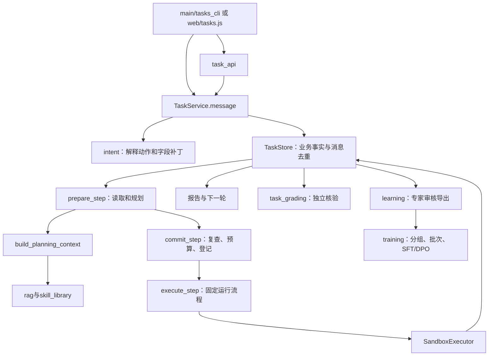

# 从文档读懂整套代码

本指南是源码阅读入口。正文解释完整设计，代码用单进程、SQLite 和确定性沙盒把核心机制做成可观察的教学流程。先看主线，再看旧版对照与训练扩展。

全部源文件及主要入口见 [代码文件索引](代码文件索引.md)。各 Python 模块开头标明学习定位、上下游与对应章节，关键步骤的注释解释为什么需要这些检查。

## 1. 先运行四种观察方式

在本目录执行：

~~~powershell
python -X utf8 main.py --graph
python -X utf8 demo.py --ui
python -X utf8 task_evaluation.py --output reports/evaluation.json
python -X utf8 -m training.inspect_batch
~~~

前两项不需要密钥，执行都在沙盒。第三项生成含事件轨迹的评测文件。第四项只计算 CPU 小张量，需要可选训练依赖，不加载真实模型。

基础安装使用 uv sync --group dev；训练模块按需使用 uv sync --extra training。Windows 统一带 -X utf8，避免第三方模板读取被系统默认 GBK 编码影响。

## 2. 先在脑中建立这张调用图

直接循环和 task_workflow 图复用同一套 prepare/commit/execute 方法。图负责可视化路由，业务服务负责真实约束，不维护两份相似但逐渐分叉的执行逻辑。

## 3. 按一次用户请求追踪代码

输入“升级后移动视频卡顿，请在实验室查到能复现”。

1. tasks_cli 或 task_api 构造 MessageRequest。message_id 表示这条消息，conversation_id 表示交互上下文，target_task_id 只在已有任务上操作时携带。
2. TaskService.message 先查消息是否已处理，再让意图模块理解。模型等待期间不持有数据库锁，回来后重新检查版本，防止旧理解覆盖新要求。
3. IntentDecision 表示 CREATE + INVESTIGATE + REPRODUCE；ConditionPatch 只包含明确修改的字段。TaskService 保存完整 Conditions，未修改条件继续保留。
4. TaskStore 保存 TaskRecord。SQLite 中用 JSON 保存聚合对象，get 每次反序列化独立副本，修改后必须显式保存。
5. 任务 READY 后才推进。查询已有进度不调用 step，回复“准备执行”也不表示设备已经运行。

建议在 message、_apply 和 TaskStore.remember 设置断点，观察原话、理解候选与实际采用的修改是三份不同记录。

## 4. 看懂一组实验的三个阶段

| 代码阶段 | 真正做什么 | 重点观察 |
| --- | --- | --- |
| prepare_step | 读取任务，冻结规划上下文，在锁外运行计划器 | task_version、plan_version、context_snapshot_id、候选 PlanDecision |
| commit_step | 短事务复查版本，验证条件和规则，预留次数，登记实验 | 过期计划被丢弃；此时还没执行设备动作 |
| execute_step | 逐次登记 Run，再执行、保存观测与收尾 | run_id、session_id、validity、verdict、cleanup_status |

文档中的 load/context/plan 在 prepare 中展开，validate/reserve 在 commit 中展开，固定工具工作流在 execute 和 SandboxExecutor 中展开。教学代码先保持这些边界，不要求每个概念都单独部署一个服务。

执行开始前先写 UNKNOWN 占位运行：如果提交前后进程退出，仍知道有一项需核查动作。正常返回后才替换成真实结果。每次下一运行前重新读状态，所以暂停、取消和修改会在运行边界生效。

## 5. 为什么有这么多编号和版本

| 字段 | 在代码里解决什么问题 |
| --- | --- |
| message_id | 网络重传不重复调度；同编号换内容报冲突 |
| task_id | 一项用户工作；可以包括许多实验 |
| issue_id | 同一异常及后续原因调查、修复验证的关联 |
| experiment_id | 一组回答明确问题的计划与重复运行 |
| run_id | 一次完整运行；重复提交用同一个键，另一次测试用新键 |
| session_id | 平台或沙盒返回的执行身份 |
| evidence_id | 日志、监测、快照、恢复等证据引用 |
| task_version | 用户修改或控制之后，拒绝迟到计划 |
| plan_version | 条件变化后，旧实验仍保留但不自动参与新结论 |
| context_snapshot_id | 本次计划真正读到的输入，后续训练不补入未来答案 |

reserved_runs 是为兼容旧页面保留的累计字段，等于已发生次数加未结算预留。文档中分开的 used + reserved 在教学代码里由这一字段合计限制；未执行部分才在收尾释放，已发生或未知动作不应免费重跑。

## 6. 调查怎样根据结果改变路线

读 experiments.OfflinePlanner.choose：先普通负载连续切换，再高负载单次，再高负载连续；出现候选异常后做旧版本对照，之后减少切换次数、移除可选背景业务，最后用 confirm 组重新确认。

每次 choose 都读取实际已完成实验，不是直接打印预写结论。规则替身只支持有限场景，不能代表 LLM 会处理任意故障。

ModelPlanner 接收同样的冻结输入，返回 PlanDecision。EXPERIMENT 必须携带计划；REPORT、HANDOFF、WAIT 不得携带计划。WAIT 保存 WAITING_EVIDENCE 并返回，继续消息才重新安排，等待时不空转调用模型。

## 7. 工具、知识与 Skill 分别读什么

SandboxExecutor 的快照、monitor、observation、restore 四类证据分别说明条件、监测、观测与恢复。隐藏故障规则只在执行端，不能提前交给计划器。

build_planning_context 将当前事实和相关摘要投影给模型。rag 的本地资料是教学夹具，向量和重排是近似；加权融合实际是 RRF，rsf_fuse 只保留为旧名字别名。资料中的数字不自动成为验收门限。

SkillLibrary 先给目录，再加载 mobility-investigation 的正文与内容哈希。首版按已支持业务范围选一个方法，没有声称具备通用自动Skill选择。Skill 只是指导，不执行文档命令，也不会扩大权限。

## 8. 报告为何不能只有一个成功/失败

TaskService._report 从记录生成视图。任务可 COMPLETED，同时产品 FAIL、原因 UNCONFIRMED、恢复 completed。复现任务发现可靠产品失败，正是有价值的结果。

修复验证先在原异常版本复测，再运行 fixed 或 slow_fix，并检查相关切换次数。slow_fix 演示原停顿改善但时延失败，报告不能只写“问题已修复”。

只读报告对副本生成，不改数据库，不安排额外实验。查看 task_api.report 与 web/tasks.js 的 GET/POST 区别可以验证这一点。

## 9. 评测按什么顺序阅读

先读 task_evaluation.EvaluationCase：request 是公开输入，环境注入与期望状态是评测端数据，不发送给 Agent。每个 episode 使用独立服务与沙盒。

再读 task_grading：按原始指标重算判定，核验快照、监测、实际条件、引用、逐组分母与恢复。confirmation_verified 检查冻结后的新运行，不能重复使用搜索运行刷确认。

最后区分 regression_passed 与 strict_success：监测缺失时程序正确停止，可以回归通过，但没有完成复现目标。确定性夹具的重复次数也不是独立故障数量，更不是模型效果置信区间。

可在保存的 evaluation.json 中沿 episode → trace → experiment_id → run_id 查看。更完整的跨任务评测设计见正文07，旧 eval_system 只适合指标公式和模拟演算。

## 10. 训练数据到模型参数的路线

先读 learning.export_decision_reviews，再读 prepare_investigation_data。输入来自实验开始前冻结的上下文，目标统一为 PlanDecision；新版 DPO prompt 保留 system/user 的消息边界。source_group 同时决定 SFT 与 DPO 拆分。

旧 ExperimentPlan 目标会显式规范成 PlanDecision，避免训练内层对象而部署要求外层动作。相同候选不构成偏好对，没有专家确认的记录不进入导出。

然后运行 training.inspect_batch，阅读 objectives：input_ids 和 labels 同形，但 prompt/工具返回/padding 的 labels 为 -100；logits[t] 预测 labels[t+1]。SFT 按目标token计算平均损失；DPO 按候选序列求和并与固定参考比较。

最后读 train_sft、train_dpo 与 runtime。它们延迟加载训练库，检查真实整理批次，显式验证最终效果。SFT 用模型模板产生助手区域，不硬编码ChatML；DPO 明确冻结独立SFT参考，不依赖“关adapter就正确”的猜测。

还可运行以下零下载演练，构造极小随机模型并在CPU上各更新一步：

~~~powershell
python -X utf8 -m training.tiny_smoke
~~~

它只验证训练链路结构，toy训练/验证材料不用于评价模型质量。真实GPU训练、真实任务收益和现场效果仍要单独验证。

## 11. 旧版代码怎样读，避免混成第二套主流程

| 文件组 | 用于学习什么 | 与新版的关系 |
| --- | --- | --- |
| graph、nodes、state、tools | ReAct、工具消息配对、依赖校验、人工中断 | 单次测试对照，入口 --legacy 或 /legacy |
| demo、teaching、visualize | 规则模型、节点解释与图形 | 只帮助观察旧图，不负责新版调查状态 |
| multi_agent | Send分发、Worker子图、Reduce汇总 | 多局点扩展例子，不是每组实验默认一个Agent |
| statistical | 原始样本比较、配对、区间和多重检验 | 可复用统计模块，未显著不等于通过 |
| offline_evaluation、evaluation、eval_system | 旧图回归、可选远程评测、历史指标演算 | 新版完整任务以task_evaluation和task_grading为准 |
| training/generate_sft_data、clean_data、prepare_dpo_data | 历史合成、清洗、HITL偏好采集 | 旧结论型数据不能直接套给新实验决策 |
| training_llamafactory | 可选框架的数据与配置转换 | 先按来源拆分，不再合并训练与最终测试 |

旧文件的前置说明标明了这些边界。它们保留是为了理解技术演变，不要求一开始全部运行，也不将模拟成绩移作新版成绩。

## 12. 前端与测试怎样帮助理解

web/tasks.html 是新版 DOM 骨架，tasks.js 发送消息、读状态、渲染实验，tasks.css 只管理显示。新会话不是取消任务；fetch期间切换任务时，要忽略旧回应。web/index.html、app.js、style.css 是旧图逐节点页面。

测试优先读 test_learning_pipeline 的过期计划、图路由、WAIT、伪造报告、独立确认与损失计算；再读 test_tasks 的中途控制与修复关联。API、旧图、RAG、多Agent与统计有各自的回归文件。

~~~powershell
python -X utf8 -m pytest tests -q
python -m ruff format .
python -m ruff check .
~~~

不要只看测试绿了：对每个行为都尝试说明输入、状态变化、真实副作用与最终证据。能沿着这四项解释代码，才算把整个项目串起来。
