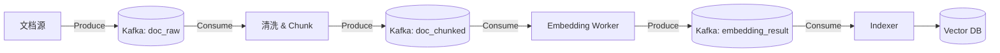

# Kafka 消息中间件与离线计算解耦

Kafka 用于缓冲和分发文档入库任务，将耗时的预处理与在线问答流程分开。

## 0. 技术原理与背景信息
*   **技术原理**：Kafka 是分布式发布订阅消息系统。生产者将消息追加到分区日志，消费者通过偏移量（Offset）记录读取进度。顺序读写、批处理、页缓存和零拷贝等机制有助于提高吞吐量。多副本配合确认、ISR 和故障处理提高可靠性，但不能单凭副本数量保证不丢消息。
*   **背景信息（为什么需要它）**：批量上传数万份 PDF 后，OCR、切片和向量化可能持续较长时间。让 Web 请求同步等待容易超时，同时执行过多任务还可能耗尽内存。Kafka 将任务暂存为消息，消费者按处理能力读取和执行，缓解批量任务对系统的压力。

## 1. 核心作用
*   **削峰填谷**：先缓冲批量上传产生的任务，再按后端处理能力消费，减少切片与向量化服务因任务过多而发生 OOM 的风险。
*   **异步解耦**：FastAPI 服务端只需将任务抛入 Kafka 即可返回，无需等待耗时的 PDF 解析和摘要生成。
*   **任务编排**：作为流水线的中转站，将一个文档处理流程拆解为多个阶段（OCR -> Clean -> Slice -> Embedding）。

## 2. 核心能力
- **消息持久化**：将消息写入日志，并通过副本与确认机制提高可靠性。故障时是否丢失消息，还取决于生产者、Broker 和副本配置。
- **消费者组隔离**：允许不同的服务（如：监控服务、解析服务、入库服务）同时消费同一份数据，互不干扰。
- **顺序保证**：基于 `Key`（如 `doc_id`）的哈希分区，确保同一文档的所有切片操作按顺序由同一个消费者处理。

### 集群控制面与消费者协议

Kafka 4.0 移除 ZooKeeper 模式，只支持 KRaft。KRaft 用 Kafka 自身的共识与元数据日志体系管理集群元数据；它改变的是控制面，不是把普通业务消息的消费改成另一套模型。分区、offset、消费者组和投递语义的基础解释仍适用。[官方升级说明](https://kafka.apache.org/40/getting-started/upgrade/)

4.0 还使下一代消费者重平衡协议正式可用。学习重平衡时要区分 Broker 的协议能力与具体语言客户端的支持，不能认为服务器升级后所有 Python/Java 客户端都会自动使用新机制。

原项目部署及代码保留对应时期版本。关联：[[04_工程与框架/Python设计模式与项目应用]]。

## 3. 常见用法
- **多 Topic 流水线**：
  - `doc_upload`: 原始文件数据负载。
  - `doc_parsed`: PDF 转 Markdown 后的结构化文本。
  - `vector_ingested`: 成功入库向量数据库的确认消息。
- **ACKS 配置**：`acks='all'` 等待当前 ISR 副本确认，需结合 `min.insync.replicas`、副本配置与故障处理；它不等于所有配置副本已刷盘，也不是绝对不丢消息的保证。

## 4. 技术实现示例
```python
from aiokafka import AIOKafkaProducer
import json
import asyncio


async def push_to_ingestion_pipeline(doc_metadata: dict):
    # 初始化原生异步高吞吐 Producer
    producer = AIOKafkaProducer(
        bootstrap_servers="kafka-cluster.internal:9092",
        value_serializer=lambda v: json.dumps(v).encode("utf-8"),
        acks="all",  # 等待当前 ISR 复制确认，不代表所有副本 fsync
        compression_type="lz4",
        max_batch_size=16384,  # AIOKafkaProducer 的批处理参数
    )
    await producer.start()
    try:
        # 发送处理任务
        await producer.send_and_wait(
            topic="doc_ingestion_tasks",
            value=doc_metadata,
            # 利用 doc_id 实现分区锁定，保证同文件语义时序相关性
            key=doc_metadata["doc_id"].encode("utf-8"),
        )
    finally:
        await producer.stop()
```

## 5. 注意事项与坑点
- **消息大小限制 (Message Max Bytes)**：默认 1MB。PDF 解析出的原始文本若超过此限制会导致发送失败。需调大 `message.max.bytes` 或将大文本存入 S3，Kafka 只传 URL。
- **消费积压监控**：必须严格监控 `Lag` 指标。若文档入库有数小时延迟，需及时横向扩展消费者 Pod 数量。
- **再平衡 (Rebalance) 震荡**：消费者频繁上下线会导致长时间不消费。需合理配置 `session.timeout.ms`。
- **幂等性保障**：由于 Kafka 的 `At-Least-Once` 特性，写入向量数据库的代码必须根据 `chunk_id` 实现幂等操作（即：重复消费同一消息不应导致数据库出现重复记录）。

## 6. Kafka 常见面试问题及回答

### Q1: Kafka 如何提高吞吐量、降低延迟？
**回答**：
顺序读写、页缓存和减少数据拷贝等机制有助于提高效率，下面重点说明两类操作系统机制：
1. **顺序追加写 (Sequential I/O)**：磁盘如果是随机读写寻道时间极慢，但顺序写盘的速度甚至堪比写内存。Kafka 的日志文件一经写入便不可修改，所有的写入都只是追加到文件末尾。
2. **零拷贝（Zero-Copy）与 Page Cache**：利用操作系统页缓存保存文件数据；在适用的传输路径上，通过 `sendfile` 等机制减少内核态与用户态之间的数据拷贝，降低 CPU 开销。实际路径取决于操作系统和传输配置。

### Q2: Kafka 的消费者组 (Consumer Group) 是什么概念？一个 Partition 可以被同一个组内的多个消费者消费吗？
**回答**：
- **消费者组**：是一组为了“共同分担”同一个 Topic 下消息消费压力的逻辑上组合在一起的 Consumer 实例（比如起了 5 台服务器一起处理文档解析）。
- **原则**：为了保证消息消费顺序性，Kafka 严格规定，**一个 Partition 只能被同一个消费者组内的一个消费者消费**。这也意味着，如果你的 Topic 只有 3 个 Partition，即使你在组里起了 10 个消费者实例，也最多只有 3 个实例在干活，剩下 7 个处于闲置饥饿状态。因此，**扩容消费者的前提是提前扩容好足够的 Partition**。

### Q3: 消息怎么保证不丢失（如何实现 At-Least-Once）？
**回答**：
需要生产者、Broker、消费者三端配合：
1. **Producer**：`acks=all` 等待当前 ISR 中副本的复制确认，不是所有配置副本都 fsync 落盘。结合重试与幂等生产者降低重复写入；耐久性还依赖副本、ISR、选主和 broker 配置。
2. **消息中间件端 (Broker)**：配置多副本（Replication Factor），并将 `min.insync.replicas`（最小同步副本数）设为至少大于 1，以防单点宕机丢失数据。
3. **消费者 (Consumer)**：必须**关闭自动提交 Offset (`enable.auto.commit=false`)**。只有当文档真正在后端入库（比如写入 Milvus / MySQL）确认无误后，才在代码尾部手动提交 Offset (`commitSync()`)，防止执行中途崩溃导致位点丢失从而漏消费。

## 多阶段离线摄入示意



### 2.1 关键概念说明

> [!info] 进阶技术点
> - **DLQ (死信队列)**：当 Embedding 失败或数据库写入异常且重试多次无效后，消息被转入死信队列，供后续人工排查。
> - **Offset 重放 (Replay)**：当 Embedding 模型升级时，可以通过重置消费者 Offset，让 Worker 从头开始重新处理 Kafka 中的历史数据，实现索引全量重建。

---
