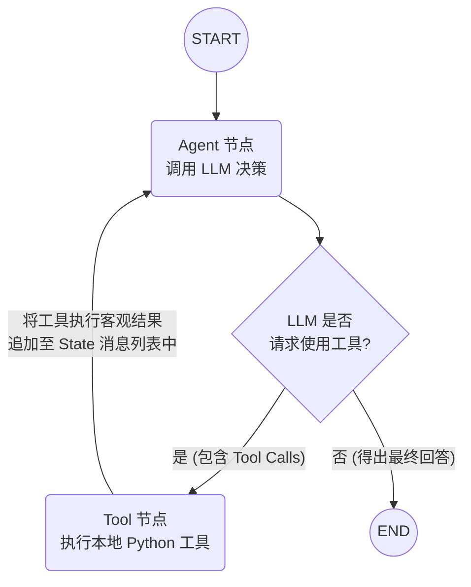

---
tags:
  - Agent
  - LLM框架
  - LangGraph
status: in_progress
---
# LangGraph: 基于图与状态机的复杂 Agent 编排框架

## 1. 简介

当前官方将预构建 `langgraph.prebuilt.create_react_agent` 路线迁移到 LangChain 的 `create_agent`。LangGraph 的 StateGraph、checkpoint、interrupt 等核心图编排思想仍有效；上层工厂变化不代表手写状态图被淘汰。[官方迁移指南](https://docs.langchain.com/oss/python/migrate/langgraph-v1)

可以把两层职责分开理解：上层 Agent 工厂提供常见工具循环与中间件扩展，StateGraph 用于明确节点、状态和控制流。二者是组合关系，不宜简单描述为互相替代的两个框架。

当前 LangChain Agent 的特定状态约束，不应直接套到所有 StateGraph。记忆方面，持久化 thread state 与跨线程 Store 也各有职责，详见 [[Agent系统/记忆与上下文管理]]。[LangChain 迁移说明](https://docs.langchain.com/oss/python/migrate/langchain-v1)

下面手写图和代码保留原项目版本；框架比较要注明具体版本与封装层。
**LangGraph** 是 LangChain 生态系统中的一个独立扩展库（目前已成为 LangChain 推荐的核心底层框架），专为解决**创建周期性（循环，Cyclic）、高可控的单 Agent 及多 Agent 复杂工作流**而设计。

简单的链式流程通常按预定顺序处理输入。ReAct 等 Agent 则需要反复执行“决策 → 工具调用 → 观察结果”，并保存每一步的中间状态。LangGraph 通过图结构表达这些循环与分支。

LangGraph 将 Agent 运行过程表示为**图（Graph）和状态机（State Machine）**，让开发者明确定义处理步骤、状态更新和跳转条件，适合需要恢复执行或人工介入的任务。

### LangGraph 解决的主要问题
与直接使用传统 `AgentExecutor` 的封装流程相比，自定义状态图更便于明确以下机制；具体差异需结合版本与实现判断：
1. **执行过程的检查与干预**：明确模型调用、工具执行和结束条件，便于在指定步骤加入审批或检查。
2. **状态持久化与恢复**：通过检查点保存执行状态，为中断后恢复提供支持。
3. **分支、循环与协作**：使用节点和条件边定义长任务、多分支和多 Agent 协作流程。

## 2. 核心架构与底层概念

StateGraph 是定义带状态工作流的一种核心入口。你需要掌握以下四大核心概念：

- **状态 (State / StateSchema)**: 
  - 工作流各步骤读取和更新的数据，通常使用 `typing.TypedDict` 或 `Pydantic` 定义字段与类型。
  - 图中的每个步骤都会接收当前的 State，并在执行后返回一个增量信息。LangGraph 会根据定义的归约（Reducer）规则（例如 `add_messages` 用于自动累加消息，或是直接覆盖局部变量）更新全局 State。
- **节点 (Nodes)**: 
  - 图中真正执行业务逻辑的工作单元。
  - 在代码层面，节点通常就是一个标准的 Python 函数。它的输入是当前的全局 `State`，运算（调大模型、查数据库）结束后，返回需要更新到状态里的字典结构。
- **普通边 (Edges)**:
  - 规定了节点之间的确定性先后流转方向。例如 `graph.add_edge("node_a", "node_b")`，意味着节点 A 执行完毕后，控制权无条件地交给节点 B。
- **条件边 (Conditional Edges)**:
  - 根据状态选择后续节点，用于实现**分支判断（if/else）**与**循环控制（while）**。
  - 它也是一个 Python 函数，接收 `State` 评估轻量级判定逻辑，返回下一个目的节点的名称。路由既可根据模型结果，也可使用确定性的业务条件，取决于图设计。

## 3. LangGraph 的核心优势与特性

1. **执行过程可查看、可控制（Controllability）**：
   - 将工作流拆分为独立函数节点，明确数据流向，便于在指定节点检查状态或中断执行。
2. **原生支持持久化与“时间旅行” (Persistence & Time Travel)**: 
   - LangGraph 支持通过 `Checkpointer` (如 `MemorySaver` 或 Postgres/Sqlite) 进行每个步骤的断点存档。
   - 可以读取历史检查点，查看或修改 State，并从相应状态继续执行。恢复时还需处理重复工具调用等外部副作用。
3. **支持人机协同（Human-in-the-Loop，HITL）**：
   - 例如，发送邮件或转账前，可按当前项目版本通过 `interrupt_before=["send_email_node"]` 等方式暂停执行。人工审核或修改参数后再恢复；应用仍需校验审批者身份和操作权限。
4. **灵活的多智能体架构支持 (Multi-Agent)**:
   - 将使用不同 System Prompt、知识库和工具的 Agent 定义为节点，例如调研、编写代码与审查。各节点通过约定的状态字段传递结果，由图中的边决定执行顺序。

## 4. 典型设计模式与工作流图

最基础的带工具调用能力的单体 Agent（Tool-Calling Agent / ReAct Agent）的 Graph 结构如下：

1. **Agent Node (思考与决策节点)**: 接收当前积累的消息，交给带有绑定工具的 LLM。模型如果觉得需要使用工具，会返回 Tool Calls 请求；如果觉得可以作答，则输出最终文字解答。
2. **Action/Tool Node（工具执行节点）**：读取模型生成的工具名称与参数，经校验后执行工具，将结果写回 State 的消息列表。
3. **条件路由（Should Continue 函数）**：检查模型是否发起工具调用：有工具请求则进入 Tool 节点，没有则进入 END。在此示例中，Tool 节点执行后返回 Agent 节点，由模型根据工具结果继续决策。



## 5. 核心代码样板 (构建 ReAct Agent)

下面是构建带工具调用循环的单 Agent 示例，保留原项目使用的接口版本：

```python
from typing import TypedDict, Annotated
from langgraph.graph import StateGraph, START, END
from langgraph.graph.message import add_messages
from langgraph.prebuilt import ToolNode
from langchain_openai import ChatOpenAI
from langchain_core.tools import tool


# 1. 定义全局共享的 State 结构
# add_messages 按消息 ID 合并：新 ID 追加，同 ID 更新；不是无条件 append
class AgentState(TypedDict):
    messages: Annotated[list, add_messages]


# 2. 准备可以被模型调用的工具
@tool
def get_weather(location: str):
    """获取指定城市的天气状况"""
    return f"{location}目前天气晴朗，气温25摄氏度。"


tools = [get_weather]
model = ChatOpenAI(model="gpt-4o").bind_tools(tools)


# 3. 编写业务节点函数
def agent_node(state: AgentState):
    # 用所有的上下文信息询问大模型
    response = model.invoke(state["messages"])
    # add_messages 按消息 ID 合并：新 ID 追加，同 ID 更新
    return {"messages": [response]}


# ToolNode 执行 AIMessage.tool_calls，并返回对应的 ToolMessage
tool_node = ToolNode([get_weather])


# 4. 判定函数（条件边的路由中心）
def should_continue(state: AgentState) -> str:
    last_message = state["messages"][-1]
    # 如果判断最后的信息是模型希望使用工具，则放行至工具节点
    if last_message.tool_calls:
        return "tools"
    # 否则直接终结整个事务流
    return END


# 5. 组装工作流编排网图 (Graph Construction)
workflow = StateGraph(AgentState)

# 注册节点声明
workflow.add_node("agent", agent_node)
workflow.add_node("tools", tool_node)

# 设置逻辑连线
workflow.add_edge(START, "agent")  # 从入口进入模型决策节点
workflow.add_conditional_edges(
    "agent", should_continue
)  # 智能体抉择后交由路由判决下个站去向
workflow.add_edge("tools", "agent")  # 工具执行后返回模型节点，根据结果继续决策

# 6. 编译工作流，可传入 checkpointer 保存状态并支持恢复
app = workflow.compile()

# 7. 投入生产与发起调用
inputs = {"messages": [("user", "北京今天天气咋样？适合不适合打高尔夫？")]}
for step_output in app.stream(inputs):
    print(step_output)
```
标准工具循环的预构建入口已从 `langgraph.prebuilt.create_react_agent` 迁移到 LangChain `create_agent`；需要细粒度业务编排时仍可使用手写 StateGraph。[迁移指南](https://docs.langchain.com/oss/python/migrate/langgraph-v1)

## 6. 生态配套与实战应用经验
- **监控与分析利器 LangSmith**: 提供开箱即用的兼容性。可以在官方数据看板上查看到工作图中每一次步进(Step)的过程，非常清晰地监控每一次 Token 消耗及延迟时间。甚至允许开发人员在服务端后台对一次特定的中途报错的状态树直接发起"重新播放 (Replay)" 和 Debug。
- **可视化调试**：图可视化、状态检查和追踪有助于定位执行问题。原项目使用的 Studio 体验按当时版本理解，图形界面不能替代实际执行轨迹与状态校验。

## 7. 总结指导大纲

- 固定的输入处理与生成流程可使用 Runnable/LCEL。
- 常见工具循环可使用 LangChain Agent 工厂与中间件。
- 自定义节点、路由、恢复和业务状态可直接使用 StateGraph。
- 线程内 checkpoint 与跨线程 Store 分工不同；旧项目选择按当时条件解释。

## 8. 面试高频 FAQ (八股)

**Q1：有了 LangChain 为什么还要推出 LangGraph？（解决了什么业务问题？）**
**标准回答：**
LangGraph 适合需要明确控制步骤、状态与恢复过程的 Agent 系统，主要提供以下能力：
1. **明确执行流程**：通过**有向图（Graph）和状态机（State Machine）**定义节点、分支与循环，使开发者可以查看数据如何传递，并在需要的位置加入检查。
2. **检查点与历史状态回放（Persistence & Time Travel）**：保存执行状态，支持查看历史、修改状态并继续运行。外部工具的写入操作不会随状态回放自动撤销，仍需处理幂等和补偿。
3. **人工审批（Human-in-the-Loop，HITL）**：在发送邮件、转账或删除数据等操作前暂停，等待授权人员审核；审核通过后，使用确认的参数继续执行。

**Q2：简述 LangGraph 的四大底层核心概念。**
**标准回答：**
1. **State（状态）**：节点之间传递的数据，通常用 Pydantic 或 TypedDict 定义。字段可以直接覆盖，也可以通过 reducer 合并更新；例如 `add_messages` 按消息 ID 合并消息。
2. **Nodes（节点）**：执行业务逻辑的函数。接收当前 State，调用模型、查询数据库或处理数据，再返回需要更新的状态字段。
3. **Edges（普通边）**：定义固定的执行顺序。例如，节点 A 正常执行完成后进入节点 B；异常处理则需要另行配置。
4. **Conditional Edges（条件边）**：由路由函数根据当前 State 选择下一步。例如，模型返回工具请求时进入 Tool 节点，否则结束任务。

**Q3：在 LangGraph 中如何实现 Multi-Agent（多智能体操作协作架构）？**
**标准回答：**
核心做法是将不同 Agent 定义为节点，再通过状态和路由传递任务与结果。
例如，在同一个 `StateGraph` 中定义调研、代码编写和审查三个节点，各自配置对应的 System Prompt、工具和输入输出字段。
节点通过约定的 State 字段或子图接口交换信息。例如，调研节点写入资料摘要，路由再将任务交给代码节点，最后进入审查节点。可以按需要设计串行、并行或 Supervisor 调度流程；共享状态不代表自动具备权限隔离，访问范围仍需单独控制。
