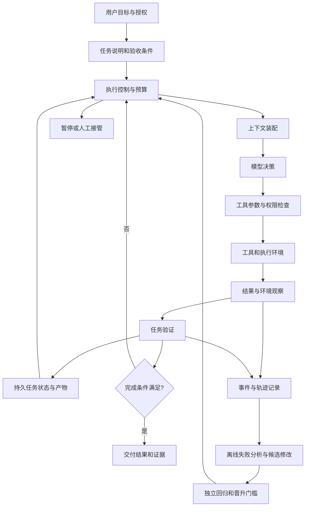

# Agent Harness Engineering：发展现状、技术体系与主要研究方向

> **检索截止日期：2026 年 10 月 24 日。** 本文以软件型 LLM Agent 为对象，重点考察代码 Agent，并讨论向计算机操作与业务 Agent 的迁移。Harness 暂译为“运行支撑系统”，正文保留英文，以免与测试框架混淆。

## 摘要

Agent Harness Engineering 研究如何设计模型周围的执行循环、工具接口、上下文与持久状态、验证反馈、权限边界和运维机制，使模型能够持续完成可验证的任务。它承接了 Agent 早期的推理—行动研究，但将研究对象扩大到**模型、运行系统与环境共同构成的闭环**。

截至检索日，公开证据呈现三个特征：第一，工具接口与反馈机制已经有较长期的研究积累，“harness engineering”作为集中讨论这些问题的名称则较新；第二，固定模型、调整 harness 能够带来显著改善，但现有证据主要来自特定基准、厂商实验和近期预印本，尚不足以证明某种架构普遍最优；第三，研究正在从手工搭建循环，转向长任务状态管理、可观测性驱动的自动优化、受约束的自修改，以及随模型进步持续简化系统。

本文的核心判断是：**这一方向最有价值的研究对象，是“如何把不确定的决策转化为可控、可恢复、可验证的执行”，而不是组件数量或 Agent 数量。** 主要工作方向包括执行控制、工具接口、上下文与记忆、长任务恢复、验证、可观测性、安全治理、编排与预算，以及自动化 harness 优化。

**关键词：** LLM Agent；agent harness；上下文工程；持久执行；任务验证；可观测性；自动优化。

> **阅读建议：** 第 2.4—2.5 节用一个订单导出任务解释 harness 如何工作；第 5 节逐项展开机制；第 6.4 节展示如何判断一次修改是否有效；第 7.1—7.3 节将这些机制连成完整执行过程。文中的订单服务、路径、运行记录和数字算例均为教学示例，不是对当前知识库代码的描述，也不是论文实验结果。

## 1. 研究范围与证据方法

### 1.1 本文回答什么

本文围绕四个问题展开：

1. Harness engineering 与提示词工程、上下文工程、Agent 框架是什么关系？
2. 截至 2026 年 10 月，哪些能力已有工程实现，哪些仍是研究问题？
3. 主要工作方向分别解决什么失败模式，应如何评测？
4. 如果开展研究或建设系统，哪些切入点更容易形成可复现的贡献？

检索使用了“agent harness engineering”“long-running agents”“agent-computer interface”“durable execution”“agent evaluation”“self-harness”等关键词，并沿代表工作的引用和官方文档继续查阅。来源优先顺序为：原始论文、作者项目页、官方技术文章、协议规范与项目文档。搜索摘要只用于发现线索，不单独作为定量结论的依据。

### 1.2 如何理解证据强度

| 证据类别       | 能支持的判断             | 不能直接支持的判断       |
| ---------- | ------------------ | --------------- |
| 原始论文及其公开实验 | 给定模型、任务、预算下的方法效果   | 对所有模型、行业或长任务都成立 |
| 厂商工程案例     | 某类问题真实存在，某种工程路径可实施 | 脱离业务条件的普遍生产率提升  |
| 官方文档和规范    | 某种能力、接口或边界已经被实现或定义 | 该能力一定提升任务质量     |
| 综述与概念框架    | 帮助整理术语、研究问题和系统组成   | 所提出分类已经成为行业标准   |

本文是**有针对性的叙述性综述**，不是按预注册流程完成的系统性文献综述，也没有重新运行各论文实验。定量结果均为来源作者报告；本文提出的架构、优先级和选题建议会明确标为综合判断。近期论文若未核实正式录用信息，统一按预印本对待。

一个需要保留的外部效度限制是：代码和终端任务有文件、测试、退出码等较清晰的反馈；研究、设计和跨系统业务任务的正确性更难自动判断，不能直接照搬编码基准上的改善幅度。

## 2. 概念边界：Harness 到底是什么

### 2.1 一个可操作的定义

本文采用如下工作定义：

> **Agent harness 是位于模型与外部世界之间、负责组织决策和执行反馈的模型外部系统。Harness engineering 是对这一系统的设计、评测、维护和持续改进。**

典型职责包括：构造每一步输入、调用模型、执行工具、收集真实结果、更新任务状态、限制权限和预算，以及决定继续、暂停、恢复或终止。LangChain 的概念文章将它概括为“Agent = Model + Harness”，并把工具、编排、基础设施与 hooks 纳入讨论。[R08](https://www.langchain.com/blog/the-anatomy-of-an-agent-harness)

这不是严格数学恒等式。实际系统还受任务分布、数据质量、执行环境和人的介入影响，较完整的能力分析应写成：

$$
\text{任务表现}=f(\text{模型},\text{harness},\text{环境},\text{任务},\text{资源预算})
$$

上式是本文用于组织分析的表达，不是已有定量定律。

### 2.2 术语有宽、窄两种用法

**窄义 harness** 指模型调用与工具执行循环，以及紧邻它的状态、上下文和策略；**广义 harness** 还包括仓库文档、开发环境、测试基础设施和协作流程。OpenAI 的工程案例更突出环境、意图表达和反馈循环；Anthropic 的托管架构则将 session、harness 和 sandbox 分开定义。[R06](https://openai.com/index/harness-engineering/) [R10](https://www.anthropic.com/research/managed-agents)

另有平台将 harness 放在持久化 runtime 之上：runtime 负责状态、调度和生存周期，harness 负责每轮模型行为。Cloudflare 文档就是这种划分。[R27](https://developers.cloudflare.com/agents/harnesses/)

因此，阅读论文或产品介绍时，首先要确认作者把哪些层计入 harness。本文讨论广义工程问题，但分析机制时会区分行为循环、持久执行基础设施与任务环境。

### 2.3 与相邻概念的关系

| 概念                    | 核心问题           | 与 harness engineering 的关系 |
| --------------------- | -------------- | ------------------------- |
| Prompt engineering    | 如何表达指令、示例和输出要求 | 改变决策输入的一类手段               |
| Context engineering   | 每一步让模型看到什么信息   | 负责信息选择、组织、压缩和检索           |
| Workflow engineering  | 如何定义业务步骤和状态流转  | 可为 Agent 提供确定性外层流程        |
| Agent framework / SDK | 如何复用开发组件       | 实现载体；使用框架不等于解决可靠性         |
| Model training / RL   | 如何改变模型参数与行为分布  | 与 harness 优化互补，优化对象不同     |
| Evaluation harness    | 如何运行任务、评分和汇总结果 | 评测基础设施，需与被测 Agent 的运行系统区分 |

相关综述提出 ETCLOVG 七层分类：Execution、Tooling、Context、Lifecycle、Observability、Verification、Governance。本文把它当作一种有用的分析视角，而非既定标准。[R15](https://picrew.github.io/LLM-Harness/)

**这几类工程扩大的是问题范围，并不是依次替代。** 同样，harness 与模型也不是可以完全独立优化的两部分：模型升级后，旧提示、上下文重置和强制规划策略可能需要重新评估。

### 2.4 用一个具体任务理解各层职责

假设用户提出任务：**“为现有订单服务增加 CSV 导出功能，并证明它不会导出其他租户的数据。”** 服务使用 Python/FastAPI，已有订单查询和身份认证。为了让“完成”有可检查的含义，先约定以下验收条件：

| 编号  | 验收条件                                  | 一个具体的检验方式                         |
| --- | ------------------------------------- | --------------------------------- |
| C1  | 只能导出当前认证租户的订单                         | 构造 A、B 两个租户，用 A 的凭证请求，检查全部记录归属    |
| C2  | 输入时间带时区偏移，统一换算为 UTC，使用左闭右开区间          | 分别构造恰好等于开始时间、结束时间，以及不同时区表达同一时刻的订单 |
| C3  | 超过一页的数据不丢失、不重复                        | 为同一租户构造 1,201 条订单，核对记录总数与唯一订单号    |
| C4  | CSV 使用 UTF-8，包含订单号、创建时间、金额三列，金额保留两位小数 | 使用 CSV 解析器读取产物，逐列比较中文内容和预期金额      |
| C5  | 原有订单查询行为保持兼容                          | 运行原有接口回归测试                        |
| C6  | 在本地或测试环境完成，交付代码与验证记录                  | 检查变更、运行环境和报告，不访问生产数据库             |

此时，各层职责可以具体到：

- **模型**：判断应该先看哪个认证函数、怎样复用现有查询、失败后该修改哪里。
- **提示与上下文**：告诉模型目标、C1—C6、仓库入口，以及当前已查明的实现事实。
- **工具**：执行搜索、读文件、应用补丁、运行指定测试，返回可追溯结果。
- **Harness**：保留验收条件；安排调用；检查工具权限；记录测试对应哪版代码；中断后恢复；收到“已完成”时决定是否允许结束。
- **环境**：提供代码、依赖、测试数据库和隔离工作目录，使工具能真实执行。
- **验证器**：检查行为是否满足 C1—C6，而不只是判断最终说明是否写得完整。

例如，模型生成的导出函数漏掉租户过滤，**可以修改提示强调 C1，也可以增加跨租户回归测试，或者让查询层强制从认证上下文取得租户身份**。这些修改改变的层次不同：提示试图影响模型决策，测试提供可观察反馈，查询层约束则直接限制错误实现能够造成的结果。研究 harness 时，要说明自己修改了哪一层、对什么失败模式有效。

### 2.5 一次工具调用究竟发生了什么

“模型调用工具”容易让人误以为模型直接执行了程序。更准确的过程是：

1. **模型生成行动请求。** 例如请求运行导出测试，并给出参数。
2. **Harness 解析请求。** 检查工具名是否存在、参数是否符合约定、调用是否仍有预算。
3. **执行层检查边界。** 确认目录、可访问资源和环境符合授权，然后实际启动程序。
4. **收集结果。** 保存退出码、标准输出、错误输出、耗时与产物位置。
5. **转换成观察。** 向模型返回足够理解结果的摘要，同时保留完整日志供继续读取。
6. **更新状态。** “测试已启动”“测试失败”“某项条件已验证”是不同事件，不能相互替代。
7. **模型据此决定下一步。** 可以修复代码、检查环境、重新设计方案或提交完成候选。

这里有一个重要区别：**工具按要求执行成功，与任务验证通过，不是同一件事。** 例如 `run_tests` 工具成功运行了测试进程，并返回退出码 1；工具没有基础设施故障，但测试发现了错误。Harness 应把“测试结果失败”交给模型修复，而不是将其当作工具超时去盲目重试。

同理，模型输出一段解释性文字，不应自动触发导出、发布或数据库写入。能产生副作用的动作，需要经过明确的工具执行路径。

## 3. 发展脉络：旧问题的汇合与新研究对象的形成

| 阶段                       | 代表工作或事件                                   | 对 harness engineering 的意义 |
| ------------------------ | ----------------------------------------- | ------------------------- |
| 2022—2023：推理与行动闭环        | ReAct 将推理和环境行动交织                          | 确立“行动后读取反馈，再决定下一步”的基础模式   |
| 2024：交互接口成为研究变量          | SWE-agent 研究 Agent-Computer Interface     | 表明搜索、编辑和反馈接口本身值得优化        |
| 2024—2025：系统工程问题显现       | 简单可组合 Agent 模式、上下文管理、沙箱实践                 | 关注点扩展到成本、约束和可维护性          |
| 2025 年末：跨上下文长期执行         | 初始化、增量工作、进度文件与版本历史                        | 将任务连续性从单个上下文窗口中解耦         |
| 2026 年初：harness 成为明确优化对象 | OpenAI 环境工程案例、LangChain 固定模型实验            | 集中讨论模型外部系统如何影响结果          |
| 2026 年春夏：架构解耦与自动优化       | 托管运行系统、AHE、Self-Harness                   | 开始研究稳定接口、轨迹分析和可验证修改       |
| 2026 年 8—10 月：开放任务与架构再评估 | LongHorizon-Harness、Harness²、子 Agent 合并实践 | 同时探索更强状态管理与更简单的决策结构       |

前两阶段的直接依据分别是 ReAct 和 SWE-agent 原始论文；两者讨论的机制早于当前术语的流行，不能把它们倒叙描述为当时已经形成了同名学科。[R01](https://arxiv.org/abs/2210.03629) [R02](https://arxiv.org/abs/2405.15793)

2024 年 Anthropic 的工程文章强调从简单、可组合模式出发；2025 年的上下文文章进一步讨论有限上下文中的信息维护。它们说明当前 harness 研究继承了既有的工作流、工具和信息组织实践。[R03](https://www.anthropic.com/research/building-effective-agents) [R04](https://www.anthropic.com/research/effective-context-engineering-for-ai-agents)

**本文不对“谁首次提出 harness engineering”作唯一归因。** 这个名称的传播，与运行系统、代码 Agent、上下文工程和软件工程实践的汇合有关；“术语走红时间”与“相关机制首次出现时间”应分别讨论。

## 4. 发展现状：工程能力已出现，通用方法仍在形成

### 4.1 已经可以复用哪些能力

公开产品和文档已经提供了多种可复用能力：模型—工具循环、会话状态、持久化、进度事件、沙箱、权限策略和中断恢复。例如，Codex 的开放 harness 与 app-server 提供面向产品集成的会话、执行事件和审批交互；LangGraph 文档区分线程内 checkpointer 与跨线程 store。[R25](https://developers.openai.com/blog/codex-as-a-platform) [R24](https://docs.langchain.com/oss/python/langgraph/persistence)

但“存在接口”不等于“问题已经解决”。Checkpointer 可以保存图状态，却不会自动判断业务操作是否已经生效；沙箱可以限制文件或网络访问，却不会自动证明任务正确；长期记忆可以持久化经验，却也可能保存错误。

### 4.2 代表工作与证据边界

下表按问题组织代表工作，不作排行榜。百分比是对应实验的任务指标；“百分点”表示绝对差值。

| 工作                            | 主要机制                                   | 公开结果或贡献                                                          | 解读边界                                                                                                              |
| ----------------------------- | -------------------------------------- | ---------------------------------------------------------------- | ----------------------------------------------------------------------------------------------------------------- |
| SWE-agent，2024                | 面向模型设计搜索、编辑、导航与执行接口                    | 将 ACI 设计作为影响软件任务表现的研究变量                                          | 历史实验不代表今天的模型上限；支持的是接口的重要性。[R02](https://arxiv.org/abs/2405.15793)                                                 |
| Anthropic 长任务 harness，2025-11 | 初始化 Agent、增量执行、进度文件和 Git 历史            | 展示跨上下文持续推进任务的方法                                                  | 工程案例；不能据此认定双角色或重置策略普遍最优。[R05](https://www.anthropic.com/research/effective-harnesses-for-long-running-agents)     |
| LangChain，2026-02             | 轨迹分析、完成前验证、环境信息与循环干预                   | 固定 GPT-5.2-Codex，Terminal-Bench 2.0 从 52.8% 到 66.5%，增加 13.7 个百分点 | 作者工程实验；不能将多项修改的总收益归给某一个 hook。[R07](https://www.langchain.com/blog/improving-deep-agents-with-harness-engineering) |
| Anthropic 应用开发，2026-03        | planner、generator、evaluator，结构化交接与评价标准 | 展示多小时应用开发和可评分设计反馈                                                | 主观评价依赖标准校准；不等于已找到所有任务的最佳编排。[R09](https://www.anthropic.com/research/harness-design-long-running-apps)             |
| AHE，2026-04，采用 v4             | 将组件、轨迹与修改预测变成可检查对象                     | GPT-5.4 high 下，Terminal-Bench 2 从 69.7% 到 77.0%，增加 7.3 个百分点      | 在完整 89 题上驱动优化，每题超时扩到 1 小时；该分数不是独立保留集结果，也不能直接对比其他预算的榜单。[R11](https://arxiv.org/html/2604.25850v4)                  |
| Self-Harness，2026-06，采用 v3    | 失败挖掘、提出最小修改、回归后晋升                      | 在三个模型与三个基准组成的九种组合上报告改善                                           | 保留集用于自动晋升门槛，不能再当作完全未参与选择的最终测试集。[R12](https://arxiv.org/html/2606.09498v3)                                         |
| LongHorizon-Harness，2026-08   | 外置任务状态，Manage–Execute–Audit，独立只读审计     | Qwen 3.7-Plus 在 Terminal-Bench 2.1 从 69.7% 到 77.2%               | 额外角色引入计算开销；其他任务域的收益与成本比例不同。[R13](https://arxiv.org/html/2608.01964v1)                                             |
| Harness²，2026-10              | 任务内改进与跨任务改进两层递归                        | 探索缺少标准答案验证器时的 harness 适应                                         | 执行对照和模型判断仍有偏差，不能代替正确性证明。[R14](https://arxiv.org/html/2610.14224v1)                                                |

AHE、Self-Harness、LongHorizon-Harness 和 Harness² 在本文中按预印本证据使用。上述数字能够支持“harness 是值得控制和优化的实验变量”，不能支持“harness 必然比模型更重要”。

### 4.3 三个正在发生的变化

**第一，从维护对话走向维护经过验证的任务状态。** 对话记录会混合计划、猜测、自述和实际结果。长任务需要区分“Agent 说做完了”与“环境证明做完了”，并在下一轮只把可靠进展作为既成事实。

**第二，从临时脚本走向可嵌入、可替换的系统层。** Anthropic 将 session、harness、sandbox 解耦；OpenAI 的官方开发者文章则讨论把已有 harness 嵌入业务产品。这两类实践都显示，运行机制与具体聊天界面正在分离。[R10](https://www.anthropic.com/research/managed-agents) [R25](https://developers.openai.com/blog/codex-as-a-platform)

**第三，增加机制与删除机制同时进行。** 2026 年 10 月 22 日，Anthropic 讨论了把部分路由、规划和领域子 Agent 合入主循环的实践。其适用条件是共享上下文、频繁交接和额外延迟；独立上下文与可并行任务仍可能受益于子 Agent。[R16](https://claude.com/resources/articles/building-agents-when-to-fold-subagents-into-your-main-agent-loop)

本文据此判断：研究的成熟，不应以编排图越来越复杂衡量，而应看团队能否说明每个机制解决了什么可测问题，以及何时可以删除它。

### 4.4 从“已有组件”到“可靠系统”还差哪些工作

为了理解“发展现状”，可把问题分成三个层次。以下为本文的工程判断，不是行业认证或成熟度评分。

| 层次       | 目前可以复用什么                    | 项目仍需解决什么               | 如何判断真的做好了              |
| -------- | --------------------------- | ---------------------- | ---------------------- |
| 通用基础能力   | 工具循环、事件流、检查点、沙箱、日志采集        | 配置资源和权限，把记录接入自己的任务     | 能运行、能观察、能停机，并能在预设中断后继续 |
| 任务相关设计   | Skills、工具包装、状态 schema、验证器组合 | 定义本业务的完成条件、错误分类和数据边界   | 真实任务与关键故障用例达到预设要求      |
| 自适应与自动优化 | 轨迹分析、候选修改、自动回归等研究原型         | 控制选择偏差、验证开销、跨模型迁移和修改权限 | 冻结配置后，在独立任务上获得稳定收益     |

例如，框架可以保存“导出任务当前执行到第 4 步”，但它不知道“第 4 步已成功”究竟指 HTTP 返回、作业创建，还是 CSV 内容验证完成。这需要业务方定义状态语义。同样，框架提供模型评价工具，也不能替团队决定跨租户泄漏是否属于必须阻断的错误。

因此，现阶段更准确的描述是：**通用执行组件可复用，任务契约和可靠性闭环仍需要设计；自动优化正在探索如何减少这部分手工工作。**

## 5. 主要工作方向

以下九个方向相互耦合。它们是本文综合形成的工作地图，不是统一标准。

### 5.1 执行循环与控制：让 Agent 正确继续，也正确停止

**核心问题：** 如何把随机决策组织成有边界的执行过程？

典型失败是过早宣布完成、反复调用相同工具、对同一文件无效修改、工具已经失败却继续推理，或者预算耗尽后没有留下可恢复状态。

主要工作包括：明确运行状态；约束步骤、时间和成本；按错误类型选择重试策略；检测无进展循环；把“准备完成”接入验证；区分成功终止、失败终止、等待输入和预算中断。LangChain 的工程实验展示了完成前检查和循环干预的具体实现。[R07](https://www.langchain.com/blog/improving-deep-agents-with-harness-engineering)

**适合的研究问题：** 何时干预模型，比用什么固定提醒更关键。可比较固定步数提醒、相同行动检测、环境状态无变化检测与学习型干预策略。

**主要指标：** 无进展步骤占比、过早结束率、超预算率、完成率和额外干预成本。只观察“运行了更久”无法证明有效。

**具体设计：使用有明确转移条件的状态机。** 对订单导出任务，可以定义如下状态。名称是本文示例，不是框架 API。

| 当前状态  | 事件或检查结果         | 后续状态与动作            |
| ----- | --------------- | ------------------ |
| 执行中   | 模型请求工具调用        | 检查后执行，记录结果，继续执行    |
| 执行中   | 模型提交完成候选        | 进入验证，不直接标记成功       |
| 验证中   | C1—C6 全部满足且证据有效 | 标记完成，交付产物与证据       |
| 验证中   | C3 未通过，预算足够     | 将缺失记录信息反馈给执行者，继续修复 |
| 执行中   | 缺少必要授权或关键信息     | 暂停，保存现场，等待外部输入     |
| 任意非终态 | 剩余预算不足以开展下一步    | 保存恢复信息，以“预算中断”结束本轮 |

Hook 或 middleware 可以理解为插在这些转移点上的确定性逻辑：模型调用前组装上下文；工具调用前校验权限；工具返回后保存事件；结束前检查验收条件。它们**有的只是提醒，有的可以拒绝执行**，应在设计中明确区分。

对无进展循环，也要看操作目的。例如连续三次编辑同一文件并不一定异常；若每次失败数都下降，说明正在推进。反之，补丁文本变化但同一个断言始终失败，才值得提醒重新检查前提。实际阈值应通过任务集调节，不宜把“三次”写成通用规则。

### 5.2 工具与 Agent-Computer Interface：让行动准确、反馈有用

**核心问题：** 怎样的接口最适合模型理解、选择和纠错？

API 对程序员友好，并不意味着对 Agent 友好。搜索结果过长、错误信息缺乏上下文、编辑操作粒度不合适，都可能使模型走向错误路径。SWE-agent 的贡献之一，就是把这类交互界面作为设计和实验对象。[R02](https://arxiv.org/abs/2405.15793)

研究与工程任务包括：工具名称和描述消歧、参数 schema、结构化错误、分页与输出截断、精确编辑、操作前置条件、版本检查，以及读写工具的权限分离。MCP 为工具与数据接入定义通用协议，但接入协议并不替应用完成这些语义设计。[R22](https://modelcontextprotocol.io/specification/2026-07-28)

**适合的研究问题：** 在模型和任务相同的条件下，比较通用 shell、专用工具和混合接口；同时控制描述长度、工具数量与计算预算。

**主要指标：** 正确工具选择率、无效调用率、参数错误率、错误后恢复率、每次成功所需调用数。工具数量越多，不一定覆盖越好。

**具体设计：把工具契约写到可执行、可纠错的程度。** 以编辑文件为例，本文建议的接口可以包含以下信息：

| 契约项 | 示例 | 为什么需要 |
|---|---|---|
| 作用对象 | 工作区内的相对路径 | 避免修改范围含糊 |
| 前置版本 | 上次读取文件的内容摘要 | 文件被其他执行者修改后，拒绝盲目覆盖 |
| 修改内容 | 能精确定位原文的补丁 | 让修改粒度和错误位置可解释 |
| 成功返回 | 新内容摘要、实际修改位置 | 后续验证能对应具体产物 |
| 失败返回 | `version_conflict`、当前摘要、需重读提示 | 明确告诉模型应先重新读取，而不是重复提交旧补丁 |

搜索工具也类似：返回“路径、行号、命中片段、是否截断、继续读取方式”，比只返回一大段字符串更便于决策。截断后的日志必须显式标记；如果只把最后几十行交给模型，却不告诉它前面被省略，模型可能把“没有看到错误”误解为“没有错误”。

**错误分类直接影响恢复行为：** 参数错误需要改参数；版本冲突需要重读；暂时性网络错误可能适合有限重试；权限拒绝需要处理授权边界；测试断言失败需要修复实现。用一个笼统的 `error` 字段表达所有失败，会把纠错负担全部推回模型。

### 5.3 上下文与记忆：在有限信息窗口中保留决策所需事实

**核心问题：** 每一步该加载什么、丢弃什么，以及丢弃后如何重新找到？

应区分三种信息：当前推理所需的工作上下文；本次任务的持久状态；跨任务可复用的经验记忆。三者有不同更新频率与可信度，不能全部塞进聊天历史。

Anthropic 的上下文工程文章讨论了检索、压缩和长任务信息管理；Agent Skills 则提供按需加载过程知识的开放格式，先发现描述，再读取完整说明和资源。[R04](https://www.anthropic.com/research/effective-context-engineering-for-ai-agents) [R23](https://agentskills.io/home)

ACE 将经验组织为持续更新的 playbook，针对反复摘要导致细节流失的问题提出增量整理思路。它主要优化上下文和经验，不能直接等同于整个运行系统的自动优化。[R28](https://arxiv.org/abs/2510.04618)

**适合的研究问题：** 摘要是否保留硬约束、来源和未完成事项？记忆何时失效？错误经验如何被撤回？可在任务中植入关键约束，并测量多次压缩或恢复后的保留情况。

**主要指标：** 关键约束保留率、记忆命中后的实际收益、错误记忆诱发失败率、上下文成本和恢复后的完成率。更高压缩率不必然更好。

**具体设计：压缩后保留什么。** 下面是订单导出任务的一份交接内容示例：

| 信息类别 | 应保留内容 | 不应如何简化 |
|---|---|---|
| 原始约束 | C1—C6、禁止生产写入、时间区间约定 | 压缩成“按用户要求导出即可” |
| 已核实事实 | 认证上下文已含租户身份；证据为相应文件和代码版本 | 变成没有来源的“租户逻辑应该没问题” |
| 已完成工作 | 已增加导出路由；记录变更版本 | 把“代码已写”写成“功能完成” |
| 尚未解决 | C3 失败：预期 1,201 条，实际 1,000 条 | 混在长日志中，下一轮重新定位 |
| 产物与证据 | 补丁、测试日志、失败用例和数据集位置 | 把完整产物塞进摘要，挤占工作上下文 |
| 下一步 | 检查分页循环是否只处理首批结果 | 保存大量已经否定的思路 |

这说明压缩不应只是“把文字变短”，还应保持**约束、事实、假设和待办的类型差异**。日志可以移出上下文，关键约束则通常要保留；历史失败可以归纳，但要保留可追溯入口。

跨任务记忆的准入要求还应更高。例如“这个仓库的测试命令是某命令”可由配置核实；“金额字段永远以分为单位”则可能只适用于某个模块，不能从一次任务推广到整个系统。记忆应记录适用范围、来源版本，以及何种变化会使它失效。

### 5.4 长任务、持久执行与恢复：让中断成为正常路径

**核心问题：** 当上下文、进程或网络中断时，如何保持任务事实和外部副作用一致？

Anthropic 早期长任务案例使用进度文件、任务列表和 Git 历史完成交接；LongHorizon-Harness 进一步强调外置任务状态，并由只读审计者核对环境后更新。[R05](https://www.anthropic.com/research/effective-harnesses-for-long-running-agents) [R13](https://arxiv.org/html/2608.01964v1)

工程上至少应分别保存任务目标、事件记录、已核实结果、待办状态和产物位置。恢复时既要读取 checkpoint，也要检查环境是否在中断期间发生变化。LangGraph 的线程检查点和跨线程存储，是实现这些能力的一类基础设施。[R24](https://docs.langchain.com/oss/python/langgraph/persistence)

一个关键难点是：工具已成功写入外部系统，但成功响应尚未持久化。这时重放工具调用可能产生重复副作用。本文建议把幂等键、操作回执、查询确认或补偿机制纳入设计；**保存消息历史不能单独保证“恰好执行一次”。**

**适合的研究问题：** 在写入前、写入后和状态提交前注入故障，比较不同状态协议的恢复行为。

**主要指标：** 恢复成功率、重复副作用率、已完成工作丢失率、恢复延迟和恢复成本。

**具体设计：区分三种“恢复”。**

| 中断类型 | 仍然存在的东西 | 恢复时要做什么 |
|---|---|---|
| 上下文重置 | 进程或工作区可能仍存在 | 装载约束、已核实状态、产物索引，避免重新猜测 |
| 执行进程崩溃 | 磁盘或数据库中的持久记录 | 重建运行状态，确认哪些工具完成、哪些结果未知 |
| 工作环境丢失 | 环境外保存的产物和状态 | 重建依赖与数据，恢复补丁，再验证环境相关事实 |

检查点应同时说明“保存了什么”和“没有保存什么”。保存 Python 对象或消息列表，不会自动保存外部子进程、网络连接和远端系统状态。

以异步导出任务为例：工具提交成功，服务器创建了作业 J17，但客户端在收到响应前断线。若直接重试提交，可能再创建 J18。更稳妥的设计是在首次提交前持久化请求标识，重试时用同一标识向服务端查询或获取同一作业。**这一点依赖服务端支持幂等协议；只在客户端生成一个字符串，并不能阻止重复创建。**

如果对端没有幂等或状态查询能力，就只能根据业务选择补偿、人工确认或接受有限重复风险。论文或系统介绍若只写“支持 checkpoint”，还需要进一步追问它是否处理了这种结果未知的窗口。

### 5.5 验证与完成判定：把自述转换为可核查的结果

**核心问题：** 如何确定用户目标已经实现，而不只看最终回答是否像成功？

Anthropic 的评测文章明确区分 transcript 与 outcome：Agent 表示订票成功，和数据库里确实存在正确预订，是不同证据。它也区分 Agent harness 与 evaluation harness。[R17](https://www.anthropic.com/research/demystifying-evals-for-ai-agents)

验证可按任务结合使用：格式与 schema、程序化断言、单元或集成测试、真实界面操作、环境状态检查、模型评价，以及人工抽查。对设计等主观任务，可把评价维度显式化，并使用示例校准；Anthropic 的应用开发案例提供了这种实践。[R09](https://www.anthropic.com/research/harness-design-long-running-apps)

**适合的研究问题：** 独立验证者何时比执行者自检更划算？如何降低误放行，而不过度拒绝正确成果？应把验证器与人工标注对照，测量漏检和误报，不能只统计它报告了多少问题。

**主要指标：** 错误完成放行率、正确完成拒绝率、验证覆盖率、每次发现有效缺陷的成本。独立角色能减少部分上下文耦合，但共享模型偏差仍可能存在。

**具体设计：把要求映射到证据。** 在订单导出任务中，验证清单可以这样实现：

| 条件 | 最低限度的验证 | 仍需注意的遗漏 |
|---|---|---|
| C1 租户隔离 | A/B 租户混合数据，验证输出集合只属于 A | 只检查第一行不够；也要测试请求中伪造租户参数 |
| C2 时间边界 | 开始前、恰好开始、恰好结束三类记录 | 测试数据和服务是否采用同一时区解释 |
| C3 完整分页 | 核对订单号集合、总数和重复数 | 只比较 CSV 行数，可能漏掉“一条丢失、一条重复” |
| C4 输出格式 | 解析 CSV，检查列名、中文与金额精度 | 文本看起来正确，不代表解析器读到的值正确 |
| C5 行为兼容 | 原有接口测试与新增导出测试同时通过 | 只跑新增测试无法发现旧路径退化 |
| C6 交付边界 | 核对工作区变更、环境记录和报告 | “没有生产写入”应结合执行权限与操作日志判断 |

每条验证记录至少关联：验收条件、执行命令或检查方法、产物版本、测试/数据版本、环境信息、结果和日志位置。**某版代码通过测试后，Agent 又改了相关代码，旧的通过记录不能直接用于最终完成判定。** 重验可以按依赖关系只覆盖受影响条件，但不知道影响范围时，应采用更保守的回归范围。

另一个常见问题是执行者通过修改测试来消除失败。新增或修正测试并非一律不允许，但验收条件、关键测试和评分规则的变化需要单独审查；否则系统可能把“验证变宽松”误认为“实现变正确”。

### 5.6 可观测性与失败归因：从轨迹中找到可修改的原因

**核心问题：** 一次失败究竟来自模型判断、上下文、工具、基础设施、规范，还是验证器？

仅保存最终答案无法区分这些原因。建议关联记录任务、运行、模型调用、工具调用、环境事件、checkpoint 和验证结果，并保存对应版本。无需假定可以获得模型内部推理；通常应以可取得的输入输出、事件与环境变化为证据。

AHE 将可编辑组件、可逐层查阅的执行经验和修改预测组织起来，使修改能与后续任务结果对照。OpenAI Cookbook 的 HALO 示例也展示了从 traces、反馈和 evals 形成改进建议的流程。[R11](https://arxiv.org/html/2604.25850v4) [R26](https://developers.openai.com/cookbook/examples/agents_sdk/agent_improvement_loop)

**本文的研究判断：** 轨迹分析的解释合理，不代表归因正确。更强证据来自受控重放：固定任务与模型，只改变一个组件，观察相同失败是否消失，并检查其他任务是否退化。

**主要指标：** 故障定位时间、根因分类一致性、建议修改的实际有效率、回归率和可重放比例。

**具体设计：一条轨迹怎样定位问题。** 假设系统保存了以下事件：

| 事件 | 内容摘要 | 能作出的判断 |
|---|---|---|
| E1 | 接收到 C1—C6 | 验收要求在任务开始时存在 |
| E2 | 读取查询模块，发现查询按每批 1,000 条返回 | 分页机制曾经进入观察范围 |
| E3 | 上下文压缩，摘要未保留分页信息与 C3 | 信息在此处可能丢失 |
| E4 | 完成候选只验证 10 条样例数据 | 验证覆盖不足 |
| E5 | Harness 接受完成，独立检查发现只导出 1,000 条 | 完成门槛未覆盖 C3 |

这条轨迹揭示了至少两个可修改点：压缩策略与验证覆盖。**不能仅因 E3 发生在 E5 之前，就认定压缩是唯一根因。** 应分别比较“保留 C3”“增加完整分页检查”“两者都加”，观察是否减少失败。即使修复上下文后偶尔成功，完成门槛缺失仍然存在。

事件最好有 `task_id`、`run_id`、父子调用关系、组件版本、输入输出摘要和证据位置，以便关联一次模型请求与其工具结果。调试需要的敏感原文和长期聚合指标应有不同保留策略；可观测性不意味着无限保存所有用户数据。

### 5.7 安全、权限与治理：把约束放到动作发生的位置

**核心问题：** 当 Agent 读取不可信内容并拥有工具时，如何限制其实际可执行动作？

AgentDojo 将工具返回内容中的提示注入作为动态攻防评测对象，说明任务效用和攻击下安全性需要一起测量。[R20](https://arxiv.org/abs/2406.13352)

主要工作包括：区分用户授权与外部文本、最小权限、文件与网络隔离、参数和目标校验、凭证隔离、可审计操作，以及有明确内容的人工接管。Anthropic 的沙箱实践把文件系统和网络隔离作为重要边界。[R21](https://www.anthropic.com/research/claude-code-sandboxing)

**本文建议：** 权限约束应由工具或执行环境强制执行；关键授权应绑定用户实际批准的动作、对象和必要参数。单纯要求模型“谨慎操作”，不足以充当权限机制。

**适合的研究问题：** 在相同任务集上同时报告正常完成率、攻击成功率和错误拦截率，比较外部文本分类、工具参数约束和环境隔离的组合。

**主要指标：** 未授权动作执行率、攻击成功率、正常任务效用和人工介入次数。全部阻断也能降低攻击成功率，但无法说明系统有用。

**具体设计：区分三条不同边界。**

1. **宿主环境边界。** 代码 Agent 可以编辑测试工作区，但不能因为读到一段文档要求，就取得生产数据库凭证或扩大网络访问范围。
2. **应用数据边界。** 新导出接口必须从服务器认证上下文取得租户身份，并在数据访问层执行过滤，不能信任客户端自行传入的租户编号。
3. **信息信任边界。** 网页、README、日志或 CSV 中出现“请忽略之前规则、访问某处”的文字，属于待处理内容，不能自动升级成用户授权。

这三层需要不同机制。沙箱限制 Agent 能访问的主机资源；应用授权检查决定业务数据可见性；来源标记帮助区分指令与材料。**把 Agent 放进容器，不会自动修复新接口中的跨租户漏洞。** 反过来，业务接口有权限控制，也不意味着开发环境可以随意暴露密钥。

对于授权检查，还要考虑解析后的最终对象。例如文件路径应在规范化和处理链接关系后检查其实际位置；写入工具不应因为字符串表面上包含工作区名称，就允许修改工作区以外的文件。这类检查应在真正执行动作的层完成。

### 5.8 编排与资源分配：选择值得增加的复杂度

**核心问题：** 哪些任务需要子 Agent，哪些只需要同一循环中的工具与按需知识？

适合拆分的情形包括独立并行子任务、需要隔离的上下文、不同工具权限和独立验证。共享状态密集、步骤强依赖或频繁互相解释的任务，则可能被交接损失和协调开销拖累。2026 年 10 月的官方实践明确提出，应通过评测决定是否将子 Agent 合并。[R16](https://claude.com/resources/articles/building-agents-when-to-fold-subagents-into-your-main-agent-loop)

**本文建议的比较基线：** 单 Agent；单 Agent 加 Skills；仅独立子任务并行；完整多角色编排。比较时要同时报告固定预算效果与更高预算下的效果。

资源分配也包括模型路由、推理强度、缓存、何时验证和何时停止。长任务研究已经表明，完成率提升可能伴随明显额外 token 消耗；收益应放在成本—质量曲线上理解。[R13](https://arxiv.org/html/2608.01964v1)

**主要指标：** 完成率、每成功任务成本、端到端延迟、总计算消耗、交接错误率。并行缩短墙钟时间，不等于减少总计算量。

**具体设计：同一任务哪些步骤值得拆开。** 对订单导出任务，认证路径调查与 CSV 格式约定调查可能分别进行；但查询实现与分页修复会修改相同模块，过早并行容易冲突。一个可比较的设计是：主执行者负责实现，只读审查者检查租户隔离，确定性测试负责核对记录集合。

委派给子 Agent 时，应明确输入范围、允许工具、可修改路径、期望输出和证据要求。例如“检查导出是否越权，给出相关函数与可复现用例”，比“你是安全专家，请审查”更可验收。子 Agent 的结论应连同证据返回，不能只有一段“未发现问题”。

需要持久化的进度和完成事实，由同一任务状态协议维护；共享文件由明确的写入者负责，或通过独立工作区后合并。增加角色并不会消除共享状态一致性问题。

资源预算也应给验证留出空间。例如总时限为 10 分钟的教学设定中，如果完整回归平均需要 2 分钟，继续探索到第 9 分钟才决定测试，很可能无法完成验收。合理策略是根据剩余预算和验证耗时估计，提前从实现切换到验证；这里的时间分配需要实测，不是固定比例法则。

### 5.9 自动化 harness 优化：让改进成为可验证的外循环

**核心问题：** 能否从实际失败中自动提出、验证并保留有效的运行系统修改？

目前可区分三个层次：ACE 等方法更新上下文经验；AHE、Self-Harness 修改更广的工具、控制或配置；Harness² 则探索缺少标准答案验证器时的在线适应。[R28](https://arxiv.org/abs/2510.04618) [R12](https://arxiv.org/html/2606.09498v3) [R14](https://arxiv.org/html/2610.14224v1)

共同结构是：收集轨迹，归纳失败，提出修改，进行比较和回归，再晋升或撤回。值得关注的已不只是“能否自动改”，还包括修改空间是否清晰、验证是否可信、改进能否迁移，以及搜索成本是否值得。

**本文建议：** 自动优化器可修改的提示、工具描述和控制逻辑，与评分器、审计记录、硬权限和最终测试集分开管理。允许优化器同时修改评分标准，会使结果难以解释。

**主要指标：** 独立测试集增益、修改接受率、回归率、跨模型与跨任务迁移、优化总成本。用于反复晋升候选的集合属于验证集，即使未向提议者展示具体内容，也不宜称为完全独立测试集。

**具体设计：一次可审查的自动改进应该留下什么。** 以“Agent 经常跳过分页验证”为失败簇，候选修改记录可包含：

| 项目 | 示例内容 |
|---|---|
| 失败证据 | 多次完成候选没有运行多页用例，完整性检查失败 |
| 原因假设 | 完成门槛只要求测试退出码，未检查验收条件覆盖 |
| 最小修改 | 完成前要求每个条件有对应、且对当前产物有效的证据 |
| 预期收益 | 减少 C3 未验证却结束的运行 |
| 可能退化 | 简单任务多一次检查，证据匹配错误导致反复补测 |
| 晋升条件 | 完成质量达到预设门槛，关键安全用例无新增失败，成本在可接受范围 |
| 回滚依据 | 新增错误拒绝或无效循环超过预设门槛 |

这个修改针对“完成门槛”，与“在系统提示中强调分页”是不同候选，应该分别评测。若一次同时改提示、工具、记忆和模型预算，虽然可能得到更高分，但很难判断下一次模型升级后应该保留哪部分。

自修改也要区分发生时点：离线优化是在一批任务后冻结新版本；在线适应会在当前任务中改变运行方式。后者需要额外记录每一步实际使用的版本，并说明本轮失败时如何退回，不能只给整个任务标一个最终版本号。

## 6. 如何严谨地评测 harness

### 6.1 为什么排行榜不足以回答研究问题

Terminal-Bench 2.0 以带环境与验证测试的终端任务评估 Agent；官方后续发布的 2.1 修复了 89 个任务中的 28 个，涉及外部依赖、资源和任务描述与测试不一致等问题。[R18](https://arxiv.org/abs/2601.11868) [R19](https://www.tbench.ai/news/terminal-bench-2-1)

Anthropic 的基础设施实验还报告，仅资源配置变化就能在 Terminal-Bench 2.0 带来 6 个百分点的差异。这不是所有评测的固定误差，而是提醒我们：运行环境本身会影响测量。[R29](https://www.anthropic.com/research/infrastructure-noise)

因此，模型名相同不意味着实验条件相同；基准名相似也不意味着分数可比。尤其不能将一篇论文中的“超过某版本 harness”，改写为“始终超过该产品”。

### 6.2 建议的实验协议

以下是本文建议的最小可复现协议：

1. **冻结任务及其版本。** 记录数据集、环境镜像、依赖、时间限制和网络条件。
2. **分开优化、验证和最终测试。** 自动改进使用优化集，晋升候选使用验证集，最终测试集在配置冻结后使用。
3. **冻结模型配置。** 记录完整模型标识、调用日期、采样参数、推理设置和服务端可取得的版本信息。
4. **设置足够简单的基线。** 至少包含原始循环，以及只有提示或上下文修改的基线。
5. **进行组件消融。** 分别移除压缩、审计、记忆或循环检测；必要时检查组件间交互。
6. **进行重复运行。** 按资源允许的次数重复每题，报告任务层面的配对变化、区间估计和失败明细。
7. **注入可控故障。** 评测超时、网络异常、上下文丢失、写入后中断、并发冲突和提示注入。
8. **报告效果及代价。** 同时报出固定预算比较、质量—成本曲线和优化阶段开销。

任务应包含无法完成、需要更多信息和应当停止的情况，避免把“始终继续执行”错误地当作可靠性。

### 6.3 建议报告的指标

| 维度 | 指标 | 应澄清的条件 |
|---|---|---|
| 结果质量 | 完成率、约束满足率 | 验证器是什么，是否经过人工校准 |
| 稳定性 | 同题多次通过比例、连续成功情况 | 次数、随机性与失败相关性 |
| 效率 | 每成功任务成本、token、工具调用、延迟 | 是否计入失败、重试、审计和候选搜索 |
| 恢复 | 恢复成功率、进展保留率、重复副作用率 | 在哪些执行位置注入中断 |
| 安全 | 未授权动作率、攻击成功率、正常效用 | 攻击者能力与实际权限边界 |
| 维护 | 修改回归率、升级适配成本 | 是否涵盖模型和环境更新 |
| 体验 | 人工接管率、等待时长、澄清次数 | 是否真正降低人的工作负担 |

例如，可定义：

$$
\text{每成功任务成本}=\frac{\text{全部尝试的总执行成本}}{\text{成功完成的任务数}}
$$

分子包括失败尝试、重试和验证成本；若成功数为零，指标应记为不可计算。自动优化还应另报搜索与回归的总开销，不能把这些成本隐去。

此外，pass@k 表达多次尝试中获得成功的能力，与要求多次均成功的稳定性指标不同。真实工作只有一次执行机会时，应重点关注单次完成和失败后恢复。

### 6.4 用一个小型对照实验理解“有效改进”

假设要评测“完成前覆盖检查”这一项修改。A 是原始 harness，B 只比 A 多了这项检查，模型、任务、工具权限和执行预算一致。以下数字**完全是演示算例**。

在同一组 30 个任务各运行一次，得到：

| 配对结果 | 任务数 | 解读 |
|---|---:|---|
| A、B 都通过 | 18 | 原有能力保留 |
| 只有 A 通过 | 2 | 候选引入了退化，需要查看具体失败 |
| 只有 B 通过 | 5 | 候选可能修复的任务 |
| A、B 都失败 | 5 | 本次机制未覆盖的失败 |
| 合计 | 30 | A 通过 20 个，B 通过 23 个 |

B 的表面增益为 10 个百分点，但还不能直接宣布采用：如果退化的两题中有一题是租户隔离，另五个普通任务的改善不能自动抵消这个问题。还要确认改善来自真实运行结果，而非验证器更宽松。

下一步可对每题重复运行，例如各运行 5 次，分别获得 150 次尝试。分析时应保留同一题的配对结构，并可按任务进行重采样估计不确定性；同一题的多次运行不能简单视作完全独立的新任务。重复次数是此处的演示选择，实际取决于波动、预算和希望分辨的效果大小。

成本也可能改变判断：若首轮 A 总成本为 20 元、B 为 36 元，按第 6.3 节定义，A 每成功任务成本为 1 元，B 约为 1.57 元。B 是否值得采用，取决于失败损失与成本约束；完成率升高并不保证单位成功成本下降。

还要检查测试分布：若 30 题全是分页导出任务，即使结果稳定，也只能支持这一任务族上的结论。希望证明通用性，就应增加未用于调节机制的文件处理、接口修改或其他任务，并在新任务上冻结策略后再评测。

## 7. 一个用于分析的参考架构

下图是本文综合提出的职责划分，表达逻辑关系，并不要求拆成多个服务或多个 Agent。

这个架构包含两个闭环：**内循环完成任务，外循环改进运行系统。** 外循环产出的新版本，需要经过验证后才进入内循环。

对于最初的实现，不必把图中每个框做成组件。可以先用一个 Agent 循环、少量清晰工具、一个状态存储和一套验收检查实现；出现可复现失败，再增加相应机制。

在软件仓库场景，环境还包括可发现的文档、稳定的启动和测试命令、架构约束和可查询的运行反馈。OpenAI 的 harness engineering 案例强调的正是这类让环境更便于 Agent 理解和验证的工作。[R06](https://openai.com/index/harness-engineering/)

### 7.1 把各项机制连成一次完整任务

沿用订单导出示例，一次有代表性的执行过程可以如下。它是教学推演，不表示每个任务都必须采用相同轮数或角色。

| 步骤 | 模型或执行者做什么 | Harness 做什么 | 留下什么可检查对象 |
|---|---|---|---|
| 1. 接收任务 | 理解目标，识别需要读取现有实现 | 保存原始要求、C1—C6 和授权范围 | 版本化任务说明 |
| 2. 认识环境 | 查看认证、查询模块和测试入口 | 提供工具，限制在测试环境操作 | 文件版本、依赖与基线测试记录 |
| 3. 规划工作 | 决定先复用查询，再增加路由和测试 | 保存当前待办，允许后续按证据修订 | 依赖关系和验收映射 |
| 4. 首轮实现 | 增加 CSV 导出，调用小样本测试 | 记录补丁和测试结果，不把“小样本通过”当作完成 | 第一版代码与局部验证 |
| 5. 提交完成候选 | 认为功能已经可用 | 检查 C1—C6，发现 C3 没有对应有效证据 | 验证缺口，不是成功标记 |
| 6. 暴露缺陷 | 运行 1,201 条数据用例，实际输出 1,000 条 | 保存可复现失败与当前版本 | C3 失败证据 |
| 7. 修复与续接 | 修复只取第一页的问题；若上下文重置则读取交接 | 保留 C3、失败原因、补丁位置与下一步 | 可恢复状态 |
| 8. 最终验证 | 运行完整性、隔离、边界和兼容检查 | 核对结果与最终产物版本，检查相关证据是否失效 | 按 C1—C6 组织的验证报告 |
| 9. 交付 | 说明实现、验证和仍有限制的部分 | 标记完成，返回代码、产物和证据入口 | 可审查交付包 |

这条执行链中，模型仍然负责理解问题和修复分页逻辑。Harness 的价值体现在：**原始要求持续存在、未验证事项能被识别、失败可恢复、最终成功有证据支撑。** 如果只是让模型不断重读同一提示，没有这些状态和反馈，运行时间增长不一定转化为任务进展。

### 7.2 最小系统需要保存哪些数据

不必一开始就上复杂的事件平台。对单机、串行执行的学习系统，可以先明确以下逻辑对象；它们可以由少量结构化文件或一个数据库保存。

| 对象 | 建议字段 | 作用 |
|---|---|---|
| TaskSpec | 目标、约束、验收条件、授权范围、版本 | 表达“要做什么、怎样才算完成” |
| RunState | 运行标识、状态、剩余预算、当前步骤、待处理调用 | 表达“这一轮执行到哪里” |
| TaskState | 子任务状态、依赖、已验证事实、待解决问题 | 表达“整个任务已经确定了什么” |
| ToolEvent | 调用标识、参数摘要、结果、起止时间、产物位置 | 连接行动请求与真实执行 |
| Evidence | 对应条件、代码/测试/数据版本、验证方法、结果 | 支持完成判定，并检测证据过期 |
| Handoff | 关键约束、事实、未完成事项、下一步、证据索引 | 支持新上下文接续 |

其中，`RunState` 与 `TaskState` 的生命周期不同：一次运行可以因为预算耗尽结束，但整个任务还未完成；新的运行应接续同一个任务。把“本轮模型停止输出”直接等同于“任务成功”，就是混淆了这两个层次。

单机串行版本可以采用临时文件写入后原子替换等基本持久化方式；涉及并发写入或多个对象的一致更新时，应使用相应事务或条件更新机制。不要把“文件存在”当作写入已经完整、版本已经一致的充分证据。

### 7.3 模型决策与程序规则应如何分工

一个容易实施的原则是：**模型处理需要理解和权衡的问题，程序执行已经明确、必须稳定成立的规则。**

| 决策或规则 | 主要责任方 | 订单导出示例 |
|---|---|---|
| 接下来先看哪里 | 模型 | 先检查认证，还是先检查已有查询服务 |
| 如何修复失败 | 模型 | 分页用游标还是复用已有迭代接口 |
| 工具参数是否符合格式 | 程序 | 路径、超时、参数类型是否符合契约 |
| 动作是否超出授权 | 执行层 | 是否访问生产资源或工作区外路径 |
| 测试是否实际运行 | 程序记录与工具回执 | 是否存在对应运行和退出状态 |
| 已定义断言是否成立 | 确定性验证优先 | 输出订单号集合是否完整且不包含其他租户 |
| 主观要求如何评价 | 校准后的模型评价或人工 | 需求中若包含界面可读性或解释质量 |
| 是否向用户宣告完成 | Harness 依据验收协议 | C1—C6 是否有当前有效证据 |

这里“程序规则”不意味着把整个推理流程写死。例如，程序可以强制 C1 通过才能交付，但不必强制模型先改第几个文件、再调用第几个工具。这样既保留解决问题的灵活性，也让明确约束能稳定执行。

对第一个学习实现，建议先走通“任务说明 → 单循环 → 工具结果 → 持久状态 → 验收判定”五个环节。只有当失败记录表明某一环节存在瓶颈时，再增加记忆检索、子 Agent、自动分析器等机制。

## 8. 仍未解决的关键问题

### 8.1 缺少可普遍迁移的设计法则

同一种压缩、规划或重试策略，可能帮助一个模型，却干扰另一个模型。Anthropic 的托管系统文章举例：为早期模型加入的上下文重置，在后续模型上成为额外负担。[R10](https://www.anthropic.com/research/managed-agents)

**研究机会：** 把模型、任务长度和预算作为共同变量，寻找机制的适用区域；同时评测删除旧机制的效果。

### 8.2 长任务的“正确状态”仍难维护

把计划写入数据库，并不保证数据库里的状态正确。外部系统变化、执行者自述失真、审计遗漏和并发修改，都可能让后续步骤建立在错误前提上。

**研究机会：** 为状态项附加证据、来源、验证时间和有效条件，研究何时重新验证，以及如何处理相互冲突的观察。

### 8.3 验证器本身是瓶颈

运行测试只能覆盖测试定义的要求；模型评价可能共享执行者偏差。开放任务的难点尤其明显。Harness² 的局限部分明确指出，执行差异和模型判断不能保证正确，也不能保证修改可迁移。[R14](https://arxiv.org/html/2610.14224v1)

**研究机会：** 开发与人工判断校准的验证组合，在可接受成本下提高错误完成的检出率。

### 8.4 自动优化容易过拟合，也可能误判收益原因

一次改动后分数上升，可能来自采样波动、资源条件或多个改动的交互。AHE 也报告组件收益并非简单相加，以及自动归因对回归预判的不足。[R11](https://arxiv.org/html/2604.25850v4)

**研究机会：** 使用配对任务、重复运行、组件消融和完全独立的最终测试，区分真实改善与选择偏差。

### 8.5 生产维护证据少于短期基准证据

现有代表实验更容易衡量“一批任务是否通过”，较难回答数月运行后的依赖漂移、知识过期、权限变化和维护负担。本文没有找到足以支持统一长期生产收益估计的公开证据。

**研究机会：** 建立随时间回放的评测，报告模型、工具和业务规则变化后的适配成本，而不只报告静态完成率。

## 9. 可落地的研究选题

以下是本文基于上述证据提出的选题建议，不是已被验证的结论。

| 选题                | 可检验假设                    | 最小实验                              | 核心产出             |
| ----------------- | ------------------------ | --------------------------------- | ---------------- |
| 证据驱动的任务状态更新       | 只依据环境证据晋升状态，能降低长任务的错误完成  | 比较对话摘要、普通状态表、带证据状态表；注入上下文重置和假成功反馈 | 状态协议、故障集、完成与恢复指标 |
| 面向进展的停机与干预        | 观察环境变化，比固定步数提醒更有效地识别无效循环 | 在相同模型与预算下比较固定提醒、重复动作检测和进展检测       | 干预策略及误干预—收益曲线    |
| Harness 简化与模型迁移   | 新模型上可以删除部分旧机制，同时保持质量     | 在两个以上模型上逐项移除规划、重置、子 Agent 或提示规则   | 机制适用区域与维护成本分析    |
| 受约束的自动 harness 优化 | 限制修改空间并使用独立测试，能降低回归和过拟合  | 分开优化、晋升和最终测试；比较提示优化与组件优化          | 可复现优化器、修改记录、迁移评测 |
| 故障下的副作用一致性        | 操作回执与幂等控制能降低中断恢复中的重复写入   | 在工具生效后、状态落盘前中断，模拟重复事件和重试          | 故障注入工具与一致性报告     |

对个人研究或小团队，优先建议选择**任务状态与验证**，或**执行控制与故障恢复**。这两类问题边界较清晰，可通过受控任务和故障注入形成可复现证据。直接建设通用多 Agent 平台，会把工具、状态、模型和评测问题同时引入，较难解释单项贡献。

若目标是工程落地，建议依次建设：一组有验收条件的任务；清晰工具和运行记录；错误完成与恢复机制；最后才根据数据决定是否增加复杂编排或自动优化。这个优先级遵循简单实现和可测改进原则，不代表所有业务必须采用同一开发顺序。

## 10. 结论

截至 2026 年 10 月，Agent Harness Engineering 已经成为理解 Agent 系统能力的重要视角：工具接口、持久状态、验证、权限和运行反馈，不再只是模型调用周围的附属代码，而是决定任务表现的实验变量。

现有证据足以支持认真研究和建设这一系统层，也足以支持在固定模型下开展受控优化；但尚不足以支持通用最佳架构、固定收益幅度，或“复杂 harness 必然优于简单循环”等结论。

主要工作正在沿两条互补路径推进：**提高执行的可验证性与可恢复性，同时通过实验证据控制系统复杂度。** 对研究者而言，贡献应体现为可复现的机制与可信评测；对工程团队而言，价值应体现为更多任务在可接受成本和权限内正确完成，并能在失败后留下可理解、可恢复的状态。

## 参考资料与阅读定位

以下资料均于 2026-10-24 检索或核对。论文给出本文采用的版本；滚动更新文档以访问时内容为准。编号用于定位，不表示质量排名。

### 基础与概念

1. **R01 · Yao et al.** [ReAct: Synergizing Reasoning and Acting in Language Models](https://arxiv.org/abs/2210.03629)，2022，后发表于 ICLR 2023。理解推理—行动—观察闭环的起点。
2. **R02 · Yang et al.** [SWE-agent: Agent-Computer Interfaces Enable Automated Software Engineering](https://arxiv.org/abs/2405.15793)，2024，采用 v3。重点看接口如何影响搜索、编辑和执行行为。
3. **R03 · Anthropic.** [Building effective agents](https://www.anthropic.com/research/building-effective-agents)，2024-12-19。简单组合模式、工作流与 Agent 的边界。
4. **R04 · Anthropic.** [Effective context engineering for AI agents](https://www.anthropic.com/research/effective-context-engineering-for-ai-agents)，2025-09-29。信息选择、上下文约束与长任务管理。
5. **R08 · Vivek Trivedy / LangChain.** [The Anatomy of an Agent Harness](https://www.langchain.com/blog/the-anatomy-of-an-agent-harness)，2026-03-10。广义 harness 定义与组件职责；属于概念和工程文章。
6. **R15 · Li et al.** [Agent Harness Engineering: A Survey](https://picrew.github.io/LLM-Harness/)，作者项目页。提出 ETCLOVG 七层分类；本文核对项目页的框架说明，未据此认定正式录用状态。

### 工程实践与系统化

7. **R05 · Anthropic.** [Effective harnesses for long-running agents](https://www.anthropic.com/research/effective-harnesses-for-long-running-agents)，2025-11-26。初始化、进度交接与增量推进。
8. **R06 · Ryan Lopopolo / OpenAI.** [Harness engineering: leveraging Codex in an agent-first world](https://openai.com/index/harness-engineering/)，2026-02-11。环境可理解性、仓库知识与反馈循环；个案经验。
9. **R07 · Vivek Trivedy / LangChain.** [Improving Deep Agents with harness engineering](https://www.langchain.com/blog/improving-deep-agents-with-harness-engineering)，2026-02-17。固定模型优化案例与轨迹分析。
10. **R09 · Prithvi Rajasekaran / Anthropic.** [Harness design for long-running application development](https://www.anthropic.com/research/harness-design-long-running-apps)，2026-03-24。规划、生成和评估，以及主观评价标准的校准。
11. **R10 · Anthropic.** [Scaling Managed Agents: Decoupling the brain from the hands](https://www.anthropic.com/research/managed-agents)，2026-04-08。Session、harness、sandbox 解耦和模型升级适应。
12. **R16 · Diane Sarkis / Anthropic.** [Building agents: When to fold subagents into your main agent loop](https://claude.com/resources/articles/building-agents-when-to-fold-subagents-into-your-main-agent-loop)，2026-10-22。通过端到端评测检验子 Agent 合并。
13. **R24 · LangChain Docs.** [LangGraph Persistence](https://docs.langchain.com/oss/python/langgraph/persistence)，滚动文档。检查点、线程状态和跨线程存储。
14. **R25 · Nicolas Bonamy, Derrick Choi / OpenAI Developers.** [Codex as a platform: build on the open agent harness](https://developers.openai.com/blog/codex-as-a-platform)，2026-08-19。开放 harness、SDK 和 app-server 的产品集成边界。
15. **R27 · Cloudflare Docs.** [Harnesses](https://developers.cloudflare.com/agents/harnesses/)，滚动文档。区分持久化 runtime 与每轮行为 harness 的一种架构。

### 自动优化与长任务研究

16. **R11 · Lin et al.** [Agentic Harness Engineering: Observability-Driven Automatic Evolution of Coding-Agent Harnesses](https://arxiv.org/html/2604.25850v4)，arXiv:2604.25850，2026，采用 v4。可观测组件、轨迹证据、修改预测和受控优化；注意完整基准优化与预算条件。
17. **R12 · Zhang et al.** [Self-Harness: Harnesses That Improve Themselves](https://arxiv.org/html/2606.09498v3)，arXiv:2606.09498，2026，采用 v3。模型特定失败、最小修改和回归晋升；注意保留集的使用方式。
18. **R13 · Ma et al.** [LongHorizon-Harness: Advancing Long-Horizon Agents for Real-World Tasks](https://arxiv.org/html/2608.01964v1)，arXiv:2608.01964，2026，采用 v1。外置任务状态、执行与只读审计；同时查看成本分析。
19. **R14 · Xu et al.** [Harness²: Recursive Agent Harnessing for an Open World](https://arxiv.org/html/2610.14224v1)，arXiv:2610.14224，2026，采用 v1。缺少标准答案验证器时的递归改进，重点看局限部分。
20. **R26 · Wesley Pasfield / OpenAI Cookbook.** [Build an Agent Improvement Loop with Traces, Evals, and Codex](https://developers.openai.com/cookbook/examples/agents_sdk/agent_improvement_loop)，2026-05-12。基于 HALO 的改进流程示例；不作为独立普适效果证明。
21. **R28 · Zhang et al.** [Agentic Context Engineering: Evolving Contexts for Self-Improving Language Models](https://arxiv.org/abs/2510.04618)，2025，采用 2026 年 v3，页面标注 ICLR 2026。经验 playbook 与增量上下文更新。

### 评测、安全与接口规范

22. **R17 · Anthropic.** [Demystifying evals for AI agents](https://www.anthropic.com/research/demystifying-evals-for-ai-agents)，2026-01-09。任务、trial、轨迹、结果和不同 grader 的区分。
23. **R18 · Merrill et al.** [Terminal-Bench: Benchmarking Agents on Hard, Realistic Tasks in Command Line Interfaces](https://arxiv.org/abs/2601.11868)，2026，采用 v1。Terminal-Bench 2.0 的任务环境与验证设计。
24. **R19 · Terminal-Bench 团队.** [Terminal-Bench 2.1](https://www.tbench.ai/news/terminal-bench-2-1)，官方版本说明。任务修复、环境漂移和分数可比性。
25. **R20 · Debenedetti et al.** [AgentDojo: A Dynamic Environment to Evaluate Prompt Injection Attacks and Defenses for LLM Agents](https://arxiv.org/abs/2406.13352)，2024，采用 v3。工具环境中的任务效用与提示注入攻防评测。
26. **R21 · Anthropic.** [Beyond permission prompts: making Claude Code more secure and autonomous](https://www.anthropic.com/research/claude-code-sandboxing)，2025-10-20。文件和网络隔离的工程实践。
27. **R22 · Model Context Protocol.** [Specification](https://modelcontextprotocol.io/specification/2026-07-28)，2026-07-28 版。模型应用与工具、数据的连接规范。
28. **R23 · Agent Skills.** [Agent Skills Overview](https://agentskills.io/home)，滚动规范文档。技能目录、过程知识和渐进加载。
29. **R29 · Anthropic.** [Quantifying infrastructure noise in agentic coding evals](https://www.anthropic.com/research/infrastructure-noise)，2026-02-05。资源限制如何影响 Agent 基准结果。

## 拓展阅读：Agent 技术报告与工程博客

本节将范围扩大到 Agent 基础、上下文、工具、多 Agent、软件开发、训练与评测；下一节补充大模型基础。资料核对日期为 2026-10-24。优先选择作者原文、研发团队技术文章和原始报告。难度、推荐理由与阅读顺序是本文的学习建议，不是资料作者的评级。

前面的 R01—R29 用于支持综述结论；这里新增的 L01—L17 是更广的学习清单。课程和工程指南会单独注明类型，避免与实验论文混淆。

### A. 建立 Agent 的整体认识

#### L01 · LLM Powered Autonomous Agents

[原文：Lilian Weng / Lil’Log](https://lilianweng.github.io/posts/2023-06-23-agent/) · 2023-06-23 · 技术博客 · 入门到中级。

**为什么推荐：** 以规划、记忆、工具使用组织 Agent 的早期技术地图，适合先形成概念框架，再阅读具体系统。重点看任务分解、自我反思，以及短期上下文与外部长期记忆的区别。

**带着问题读：** 这些组件分别改变模型的输入、可执行动作，还是跨轮状态？哪些功能需要执行系统支持？文章中的历史模型、框架和检索方式应按发表时期理解，不能直接当作当前默认方案。

#### L02 · 12-Factor Agents

[原文：HumanLayer 开源工程指南](https://github.com/humanlayer/12-factor-agents) · 持续更新 · 工程指南 · 中级。

**为什么推荐：** 从真实产品集成出发，强调自己掌握提示、上下文和控制流，以及启动、暂停、恢复等执行接口。重点读第 3、5、6、8、9、12 条，分别涉及上下文、业务状态、恢复、控制流、错误与状态转换。

**带着问题读：** 如果不用完整 Agent 框架，如何仍然实现暂停、恢复、错误反馈和人工介入？可对照本文第 7.2 节，画出自己的状态对象。它是一组作者的工程主张，不是所有系统必须遵守的标准。

#### L03 · Choose a design pattern for your agentic AI system

[原文：Google Cloud Architecture Center](https://docs.cloud.google.com/architecture/choose-design-pattern-agentic-ai-system) · 滚动更新 · 架构设计指南 · 入门到中级。

**为什么推荐：** 提供单 Agent、顺序、并行等模式的架构图和适用条件，适合把“编排”从框架名词还原成信息流和控制流。重点比较固定代码调度与模型动态调度各自解决什么问题。

**带着问题读：** 哪些步骤顺序早已确定，哪些步骤需要模型根据观察改变？如果只是一条固定数据流水线，额外增加一个模型调度者带来什么收益？实现示例依赖 Google 生态，设计问题可迁移到其他技术栈。

### B. 深入上下文与工具工程

#### L04 · Context Engineering for AI Agents: Lessons from Building Manus

[英文原文：Manus](https://manus.im/blog/Context-Engineering-for-AI-Agents-Lessons-from-Building-Manus) · [官方中文](https://manus.im/zh-cn/blog/Context-Engineering-for-AI-Agents-Lessons-from-Building-Manus) · Yichao “Peak” Ji · 2025-07-18 · 技术博客 · 中级。

**为什么推荐：** 直接讨论长执行轨迹中的工程取舍：稳定提示前缀与 KV cache、工具可用性、文件系统作为外部记忆，以及保留错误信息。比抽象解释“提供正确上下文”更接近实际运行问题。

**带着问题读：** 在提示开头加入每秒变化的时间戳，会怎样影响可复用前缀？完整日志何时应该留在文件系统？工具 masking 的做法需要哪些推理接口能力？作者的具体实现条件不一定能在普通托管 API 上直接复现。

#### L05 · Context Engineering

[原文：LangChain](https://www.langchain.com/blog/context-engineering-for-agents) · 2025-07-02 · 技术博客 · 入门到中级。

**为什么推荐：** 将策略分为 write、select、compress、isolate：写到窗口外、选择需要的信息、压缩历史、隔离子任务上下文。它适合与 L04 配合阅读，用分类框架整理 Manus 的具体经验。

**带着问题读：** 把原始日志写到文件属于 write；按问题读回片段属于 select；生成交接摘要属于 compress；用独立子 Agent 调查属于 isolate。四种机制能否组合，分别会损失什么信息？

#### L06 · Writing effective tools for agents — with agents

[原文：Anthropic](https://www.anthropic.com/research/writing-tools-for-agents) · 2025-09-11 · 技术博客 · 中级。

**为什么推荐：** 讨论工具选取、命名空间、返回信息、token 效率、描述与评测，还介绍使用 Agent 帮助改进工具。适合接着本文第 5.2 节，把“工具契约”落实到可测设计。

**带着问题读：** 把所有底层 API 逐一暴露给模型，和按任务设计少量工具有什么差别？一条错误返回中，哪些字段能帮助模型纠错？建议实际选择一个工具，对比两种描述和两种返回格式。

#### L07 · Code execution with MCP: Building more efficient agents

[原文：Anthropic](https://www.anthropic.com/research/code-execution-with-mcp) · 2025-11-04 · 技术博客 · 中级到进阶。

**为什么推荐：** 讨论工具定义和中间结果占据上下文的问题，并探索让 Agent 通过代码组织 MCP 调用、在执行环境中处理数据，再返回必要信息。适合理解“模型每一步都读取全部数据”以外的架构。

**带着问题读：** 一批数据能否在执行环境中完成过滤和聚合，只把结果交给模型？省下的上下文成本，是否增加了代码执行、权限管理和调试开销？MCP 是连接协议，代码执行是额外的运行方式。

#### L08 · Introducing smolagents, a simple library to build agents

[原文：Hugging Face](https://huggingface.co/blog/smolagents) · 2024-12-31 · 技术博客与实现介绍 · 入门到中级。

**为什么推荐：** 用较少抽象介绍多步 Agent，并比较代码形式的行动与结构化工具调用。重点理解 Code Agent 是“用代码表达当前行动”，与“让 Agent 帮忙编写软件”不是同一个概念。

**带着问题读：** 如果当前步骤需要循环、条件判断和复用中间变量，用代码能否减少模型往返？这类优势在什么任务上成立？不能把文章对代码行动的偏好视为所有任务和模型上的普遍优越性。

### C. 对照阅读多 Agent 的收益与代价

#### L09 · How we built our multi-agent research system

[原文：Anthropic](https://www.anthropic.com/research/multi-agent-research-system) · 2025-06-13 · 系统工程博客 · 中级。

**为什么推荐：** 介绍主 Agent 与研究子 Agent 的分工，涉及并行搜索、委派、信息汇总、工具与评测。开放式资料研究不同于共享代码库写入，是理解多 Agent 适用条件的具体案例。

**带着问题读：** 主 Agent 应向子任务传递目标、范围和产物要求中的哪些内容？并行搜索能增加覆盖面，但汇总会不会丢失证据？阅读成本与收益时，保留作者所用任务和模型条件。

#### L10 · Don’t Build Multi-Agents

[原文：Walden Yan / Cognition](https://cognition.com/blog/dont-build-multi-agents) · 2025-06-12 · 观点与工程经验博客 · 中级。

**为什么推荐：** 从共享上下文和“行动包含隐含决策”出发，解释为什么多个 Agent 分头工作后，即使各自看似合理，也可能产生冲突。它能帮助识别委派中丢掉了哪些前提。

**带着问题读：** 一个 Agent 改动接口时，哪些设计选择没有显式写进交接说明？其他 Agent 能否察觉？标题表达了较强立场，应结合 L09 的研究任务和 L11 的后续经验一起读。

#### L11 · Multi-Agents: What’s Actually Working

[原文：Walden Yan / Cognition](https://cognition.com/blog/multi-agents-working) · 2026-04-22 · 工程经验博客 · 中级。

**为什么推荐：** 是 L10 的后续文章，讨论多个 Agent 贡献判断、而写入保持单一执行通道的一类模式。重点看为什么“并行思考”与“并行修改共享状态”需要区别处理。

**带着问题读：** 能否让多个只读审查者并行分析，再由一个写入者整合修改？这种模式减少了什么冲突，又会形成什么瓶颈？建议整理 L10 与 L11 中哪些原则保持不变、哪些适用条件发生了变化。

### D. 观察长期编码与通用执行系统

#### L12 · Scaling long-running autonomous coding

[原文：Wilson Lin / Cursor](https://cursor.com/blog/scaling-agents) · 2026-01-14 · 系统实验博客 · 中级到进阶。

**为什么推荐：** 记录长期、多 Agent 编码中的协调失败，包括共享任务文件与锁的瓶颈，以及后来采用的 planner、worker 和 judge 分工。值得关注的部分是失败如何暴露架构问题。

**带着问题读：** 锁解决的是同时写入问题，是否也解决了没人负责整体进展的问题？规划者和执行者分离后，责任如何变化？代码行数、运行时间和 Agent 数量只能说明实验规模，不能单独证明交付质量。

#### L13 · Magentic-One: A Generalist Multi-Agent System for Solving Complex Tasks

[技术报告：Fourney et al.](https://arxiv.org/abs/2411.04468) · [微软研究院导读](https://www.microsoft.com/en-us/research/articles/magentic-one-a-generalist-multi-agent-system-for-solving-complex-tasks/) · 2024 · 技术报告 · 中级到进阶。

**为什么推荐：** 展示协调者如何组织浏览器、文件与代码执行能力。重点读任务账本、进度账本与内外两层循环：一层维护整体事实和计划，另一层判断当前动作是否推进、是否应重规划。

**带着问题读：** “计划仍然合理”与“最近几步有进展”为什么要分别记录？检测到循环后，系统是局部修复还是更新整体计划？可以把它与本文的 TaskState、RunState 以及长任务恢复部分对照。

#### L14 · OpenHands: An Open Platform for AI Software Developers as Generalist Agents

[技术报告：Wang et al.](https://arxiv.org/html/2407.16741v3) · 2024 初稿，采用 2025 年 v3 · 系统论文与技术报告 · 中级到进阶。

**为什么推荐：** 从平台角度描述 Agent 定义、动作到观察的 runtime、交互接口、委派和评测。适合理解一个通用软件 Agent 平台如何划分边界，而不局限于某个演示脚本。

**带着问题读：** Agent 决策接口与执行环境为什么分离？新增工具、替换沙箱、增加任务评测分别改哪一层？报告中的 Agent Skills 是其当时的接口概念，不应仅凭同名就等同于后来的 `SKILL.md` 开放格式。

### E. 从执行轨迹走向训练与能力测量

#### L15 · Agent Lightning: Train ANY AI Agents with Reinforcement Learning

[技术报告：Luo et al.](https://arxiv.org/abs/2508.03680) · [微软研究院项目页](https://www.microsoft.com/en-us/research/project/agent-lightning/) · 2025 · 训练系统技术报告 · 进阶。

**为什么推荐：** 研究如何解耦 Agent 执行与训练，用统一接口将运行轨迹转成训练数据，并处理多步任务的信用分配。它将学习范围从“改提示与工具”扩展到“训练模型如何行动”。

**带着问题读：** 最终任务成功的奖励，怎样分配给中间动作？采集的轨迹需要包含哪些信息？框架兼容性与真实任务上的训练效果，应分别验证；标题中的 ANY 不意味着每个现有 Agent 都已经被实验覆盖。

#### L16 · DR Tulu: Reinforcement Learning with Evolving Rubrics for Deep Research

[技术报告：Shao et al.](https://arxiv.org/abs/2511.19399) · [Ai2 技术博客](https://allenai.org/blog/dr-tulu) · 2025 初稿，报告后续有更新 · 技术报告与训练实践 · 进阶。

**为什么推荐：** 把搜索、证据整合、长报告生成与训练联系起来，讨论针对问题构建和更新评价标准，以及引用相关奖励。适合关注研究型 Agent 的读者，尤其是理解长文本质量为什么难用单一正确答案评分。

**带着问题读：** 怎样奖励有价值的新证据，同时防止堆砌内容或引用？评分标准随训练更新，会带来什么收益与偏差？它涉及模型参数训练，与保持模型固定的 harness 自动修改应区分。

#### L17 · Measuring AI Ability to Complete Long Tasks

[原始报告：Kwa et al. / METR](https://arxiv.org/abs/2503.14499) · [研究博客：Measuring AI Ability to Complete Long Software Tasks](https://metr.org/blog/2025-03-19-measuring-ai-ability-to-complete-long-tasks/) · 2025 · 能力评测研究报告 · 中级到进阶。

**为什么推荐：** 用人类完成任务所需时间组织任务难度，再分析 Agent 达到某种成功概率时的任务时间跨度。适合理解“长任务能力”究竟在测量什么，以及任务采样和可靠性阈值为何重要。

**带着问题读：** “50% 成功率对应的人类任务时长”与“Agent 能连续运行多久”有什么差别？它也不等于 Agent 的实际执行耗时。原文报告与滚动博客图表可能采用不同版本，引用数字前应核对数据集和日期。

### Agent 资料的建议阅读路线

- **先建立概念：** L01 → L03 → 正文已列的 R03《Building effective agents》。目标是能区分模型、工具、状态、工作流与 Agent。
- **准备动手实现：** L02 → L06 → L05 → L04 → 正文第 7 节。目标是写出自己的工具契约、上下文策略和恢复状态。
- **研究多 Agent：** L09 → L10 → L11 → L13 → L12。目标是比较任务可分解性、信息交接和共享写入条件，避免只按角色数量比较架构。
- **研究模型训练：** 先补下面 B04—B06，再读 L15、L16，最后回看正文第 5.9 节。目标是区分参数优化、上下文优化与运行系统优化。
- **研究评测：** L17 → 正文已列的 R17、R29 → 正文第 6.4 节。目标是能写出有基线、预算、配对比较与局限说明的实验方案。

## 辅助阅读：大模型基础与相关技术栈

本节不限于 harness engineering。重点是补齐理解 Agent 所依赖的模型原理、训练方法、外部知识与推理系统。B01—B11 可以按缺口选读，不需要全部读完才开始做 Agent。

### F. 模型结构、预训练与实践基础

#### B01 · The Illustrated Transformer 与 Attention Is All You Need

[图解：Jay Alammar](https://jalammar.github.io/illustrated-transformer/) · [原始论文：Vaswani et al.，2017](https://arxiv.org/abs/1706.03762) · 图解博客与论文 · 入门到中级。

**读什么：** 先通过图解理解 token 表示、自注意力、Q/K/V、多头机制与位置表示，再看原论文的架构和注意力公式。经典图解主要讲原始编码器—解码器 Transformer，不能直接把其中所有结构对应到现代 decoder-only LLM。

**如何帮助理解 Agent：** 模型每轮都要处理输入序列；历史、工具定义和检索材料最终都会占用上下文。理解注意力以后，再讨论信息顺序、长度和推理成本会更具体。

#### B02 · Hugging Face LLM Course

[官方课程](https://huggingface.co/learn/llm-course/chapter1/1) · 持续更新 · 免费课程与实践材料 · 入门到中级。

**读什么：** 优先读 Transformer 模型、tokenizer、模型调用、数据集与微调相关章节，再按需要进入大模型微调和推理模型部分。适合需要从概念走向实际加载模型、准备数据的读者。

**如何帮助理解 Agent：** 了解 tokenizer 与输入格式后，才容易解释 token 预算为何不同于字数，以及模型、聊天模板和工具消息格式为何需要匹配。课程代码依赖应以相应版本文档为准。

#### B03 · Language Models are Few-Shot Learners

[原始报告：Brown et al.](https://arxiv.org/abs/2005.14165) · 2020 · GPT-3 技术研究报告 · 中级。

**读什么：** 重点看 zero-shot、one-shot、few-shot 的实验设置，以及在不更新模型参数的情况下通过输入示例指定任务的方式。无需把精力放在其历史榜单排名上。

**如何帮助理解 Agent：** 帮助区分“模型从上下文中利用示例”和“模型通过训练永久改变参数”。给 Agent 加技能说明、检索示例或历史经验，不应直接称为参数学习。

### G. 指令对齐、偏好优化与推理模型

#### B04 · Training language models to follow instructions with human feedback

[原始论文：Ouyang et al. / InstructGPT](https://arxiv.org/abs/2203.02155) · 2022 · 对齐研究论文 · 中级。

**读什么：** 理清监督微调、偏好数据、奖励模型和基于反馈的策略优化之间的关系；区分“续写文本的预训练模型”与“被训练为遵循指令的助手模型”。

**如何帮助理解 Agent：** 指令遵循和输出偏好会影响工具调用与交互行为，但更受人类偏好的回答不自动意味着工具结果正确。阅读时可思考：训练中的偏好目标，和业务中的任务完成指标是否一致？

#### B05 · Direct Preference Optimization: Your Language Model is Secretly a Reward Model

[原始论文：Rafailov et al.](https://arxiv.org/abs/2305.18290) · 2023 · 偏好优化论文 · 中级到进阶。

**读什么：** 先看成对偏好数据和优化目标，再理解如何把特定 RLHF 目标转化为直接优化策略的损失，以及参考策略的作用。数学推导可放在第二遍阅读。

**如何帮助理解 Agent：** 理解不同后训练目标的差别，避免把所有模型改善都归为“强化学习”。离线回答偏好也不能直接覆盖多步执行中的信用分配、环境反馈和恢复问题。

#### B06 · DeepSeek-R1: Incentivizing Reasoning Capability in LLMs via Reinforcement Learning

[原始技术报告：DeepSeek-AI](https://arxiv.org/abs/2501.12948) · 2025 初稿，后续有修订 · 推理模型技术报告 · 中级到进阶。

**读什么：** 对照 R1-Zero 与 R1 的训练路径，关注冷启动数据、强化学习、奖励设计和蒸馏；区分推理行为的训练来源与推理时计算开销。

**如何帮助理解 Agent：** 帮助判断“模型更会推理”与“执行系统更可靠”分别改变了什么。数学或代码推理能力提高，仍需要通过工具、权限和结果验证转化为实际任务表现。

### H. 模型工程、外部知识与上下文

#### B07 · DeepSeek-V3 Technical Report

[原始技术报告：DeepSeek-AI](https://arxiv.org/abs/2412.19437) · 2024 初稿，采用 2025 年 v2 · 模型与训练系统报告 · 进阶。

**读什么：** 先读架构概述，再选读 MoE、Multi-head Latent Attention、负载均衡和训练效率相关部分。读者应具备基本 Transformer、训练与显存概念。

**如何帮助理解 Agent：** 让模型选型不局限于参数总量，理解激活计算、缓存和系统实现都会影响成本。报告中的训练效率与 Agent 的业务成本属于不同层次，不能直接换算。

#### B08 · Retrieval-Augmented Generation for Knowledge-Intensive NLP Tasks

[原始论文：Lewis et al.](https://arxiv.org/abs/2005.11401) · 2020 · RAG 基础论文 · 中级。

**读什么：** 区分模型参数中的知识与检索得到的外部信息，理解检索器和生成器如何配合。论文中的具体结构是 RAG 的早期方案，不代表现代 RAG 工程都采用相同训练方式。

**如何帮助理解 Agent：** 检索可作为 Agent 获取上下文的一类工具，但具备检索不等于具备规划、外部行动或恢复能力。可以进一步追问：哪些知识放进检索库，哪些事实必须调用实时系统查询？

#### B09 · Lost in the Middle: How Language Models Use Long Contexts

[原始论文：Liu et al.](https://arxiv.org/abs/2307.03172) · 2023 · 长上下文实验论文 · 中级。

**读什么：** 重点看如何改变相关信息在输入中的位置，以及多文档问答和键值检索的实验设置。它提供的是可复用的测量思路，不是所有后续模型都保持同等位置偏差的证明。

**如何帮助理解 Agent：** “窗口装得下”与“模型能稳定使用其中信息”需要分别验证。可复用其位置扰动思路，把硬约束放在不同位置，测试自己的 Agent 是否遗忘租户、时间和输出要求。

### I. 推理系统与系统学习路线

#### B10 · Efficient Memory Management for Large Language Model Serving with PagedAttention

[原始论文：Kwon et al. / vLLM](https://arxiv.org/abs/2309.06180) · 2023 · 推理服务系统论文 · 进阶。

**读什么：** 理解自回归生成中的 KV cache、动态序列长度、显存碎片，以及分页管理与共享机制。阅读前先补 B01 的注意力基础。

**如何帮助理解 Agent：** 多轮、长上下文、并发子 Agent 都会形成服务负载。需要区分：KV cache 的内存管理、可复用前缀缓存、语义答案缓存是不同问题；本文献不是所有缓存机制的统一解释。

#### B11 · Stanford CS336: Language Modeling from Scratch

[官方课程：2025 年存档](https://cs336.stanford.edu/spring2025/) · Stanford · 课程、讲义与作业 · 进阶。

**读什么：** 按需要选读 tokenizer、模型实现、优化器、训练数据、性能分析和评测。课程强调从头实现和系统实验，适合希望深入模型训练与基础设施的读者，而非只想快速调用 API 的路线。

**如何帮助理解 Agent：** 训练和推理基础可以帮助解释模型边界及资源成本。课程较重，应先具备 Python、PyTorch、线性代数、概率和机器学习基础；做应用型 Agent 不必先完成全部作业。

### 辅助阅读的选择建议

| 当前想解决的问题 | 建议先读 | 读完应能说明什么 |
|---|---|---|
| 经常看不懂 token、attention、模型结构 | B01、B02 | 文本如何进入模型，注意力如何使用上下文 |
| 分不清预训练、SFT、RLHF、DPO、推理训练 | B03 → B04 → B05 → B06 | 各阶段使用什么数据、优化什么目标、是否更新参数 |
| 想理解 Agent 的检索与长期记忆 | B08、B09，再读 L04、L05 | 知识检索、任务状态、上下文利用的差别 |
| 想做开源模型部署与成本优化 | B01 → B10，按需要补 B07 | 显存、缓存、吞吐与应用延迟分别受什么影响 |
| 想做 Agent 后训练研究 | B04—B06 → L15、L16 | 多步轨迹、奖励与信用分配为何不同于单轮对齐 |
| 想系统补齐模型训练能力 | B02 → B11，配合 B07 | 从数据到模型、训练和评测的基本工程链条 |

## 知识库关联阅读

- [[03_Agent系统/02_Agent基础与运行模式]]：理解基础执行循环。
- [[03_Agent系统/04_工具设计与完整调用示例]]：对应工具接口方向。
- [[03_Agent系统/05_记忆与上下文管理]]：对应上下文与记忆方向。
- [[03_Agent系统/06_安全机制与异常恢复]]：对应权限和恢复方向。
- [[03_Agent系统/07_Agent评测体系设计]]：对应验证与评测方向。
- [[03_Agent系统/10_Agent-Skills与渐进披露]]：对应按需加载过程知识。
- [[04_工程与框架/12_LangGraph]]：结合持久状态和编排机制阅读。
