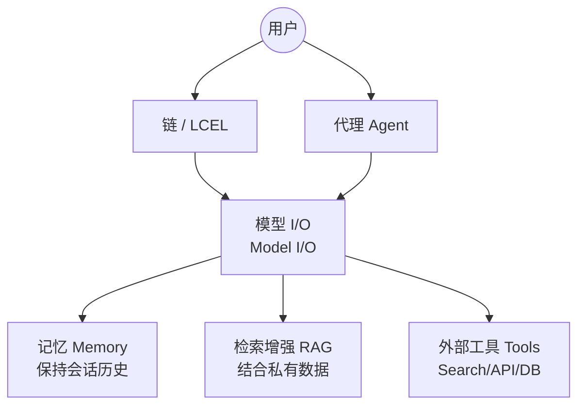

---
tags:
  - Agent
  - LLM框架
  - LangChain
status: in_progress
---
# LangChain

## 1. 简介

LangChain 提供模型、工具、检索和消息等统一接口，用于搭建 LLM 应用。接口抽象减少集成工作，但不同提供方的能力仍有差异，不能仅凭同一个调用接口推断支持全部功能。

当前 1.x 的常见 Agent 入口是 `langchain.agents.create_agent`，底层依赖 LangGraph。它与直接使用 StateGraph 是不同抽象层，可按任务组合。[官方迁移指南](https://docs.langchain.com/oss/python/migrate/langchain-v1)

## 2. 核心架构与组件

- **Model I/O**：模型适配、Prompt 模板、消息与输出解析；解析校验不等于约束解码。
- **Retrieval / RAG**：加载、切分、Embedding、VectorStore 与 Retriever。
- **Runnable / LCEL**：以 `prompt | model | parser` 等方式组合调用，支持相应的异步、批处理和流式接口。
- **Agents / Tools**：模型提出工具调用，应用执行并反馈，直到任务结束或达到限制。
- **State / Memory**：管理当前线程状态、恢复与跨线程信息访问。

下面保留原项目时期的组件示意；其中旧 AgentExecutor、Memory 类按历史接口理解。



旧 Chain 等组件转入 `langchain-classic`，LCEL 与全部 Runnable 并未因此弃用。[迁移说明](https://docs.langchain.com/oss/python/migrate/langchain-v1)

## 3. 典型应用与选型

常见场景包括文档问答、多轮对话、信息提取和工具调用。清晰、固定的处理流程可以使用 Runnable/LCEL；常见工具循环可使用 Agent 工厂；需要自定义节点、分支、循环和业务状态时，可直接使用 LangGraph。

框架封装和版本演进增加调试、适配与维护成本，应关注具体版本、可观测性和控制点，而不是认定某一层封装必然不适合生产。

## 4. Agent 工厂与 Middleware

当前推荐的 Agent 工厂是 `langchain.agents.create_agent`，底层依赖 LangGraph。框架提供 before/after model、工具调用包装等中间件扩展点，可用于摘要、人工审批和异常处理。因而“没有中间件”“不能做人工介入”等旧版限制，不能直接推广到当前 LangChain。[官方迁移指南](https://docs.langchain.com/oss/python/migrate/langchain-v1)

Middleware 可以改变运行行为，Callbacks 主要提供事件观察与回调；两者不能仅因为都能挂在执行流程上就视为完全等价。

当前 LangChain Agent 的状态约束不应直接推广到所有 StateGraph。[迁移指南](https://docs.langchain.com/oss/python/migrate/langchain-v1)

## 5. 调用与代码示例

### 5.1 LCEL

管道连接各 Runnable，实际流式能力还取决于中间组件是否支持增量传递。以下保留原有示例。

```python
from langchain_core.prompts import ChatPromptTemplate
from langchain_openai import ChatOpenAI
from langchain_core.output_parsers import StrOutputParser

# 1. 配置 Prompt 模板
prompt = ChatPromptTemplate.from_template("讲一个关于 {topic} 的笑话")
# 2. 实例化模型对象
model = ChatOpenAI(model="gpt-4o")
# 3. 指定输出提取器 (将模型返回值强转为纯字符串)
output_parser = StrOutputParser()

# 4. 组成 Pipeline (这就是 LCEL，极大降低了链式调用的代码量)
chain = prompt | model | output_parser

# 5. 触发执行 invoke 
response = chain.invoke({"topic": "AI程序员"})
print(response)
```

### 5.2 历史 AgentExecutor 工具调用示例

原项目通过 `create_tool_calling_agent` 与 AgentExecutor 构建执行循环。学习当前 1.x 应了解 `create_agent`；下面示例仍对应当时依赖版本。

```python
from langchain.agents import AgentExecutor, create_tool_calling_agent
from langchain_core.tools import tool
from langchain_openai import ChatOpenAI
from langchain_core.prompts import ChatPromptTemplate

# 1. 定义具有功能描述的工具（LLM依靠这段 Docstring 理解何时使用该工具）
@tool
def get_weather(location: str):
    """获取指定位置的当前天气情况。"""
    return f"{location} 晴天，25度"

tools = [get_weather]
model = ChatOpenAI(model="gpt-4o", temperature=0)
prompt = ChatPromptTemplate.from_messages([
    ("system", "你是一个得力的助手。"),
    ("placeholder", "{chat_history}"),
    ("human", "{input}"),
    ("placeholder", "{agent_scratchpad}"), # Agent 存放思考和工具调用的“草稿本”
])

# 2. 绑定工具与模型，创建 Agent 引擎
agent = create_tool_calling_agent(model, tools, prompt)

# 3. 创建执行器循环 (负责实际调用函数并在遇到错误时重试)
agent_executor = AgentExecutor(agent=agent, tools=tools, verbose=True)

# 4. 执行 Agent 任务
agent_executor.invoke({"input": "今天北京天气如何？适合穿什么？"})
```

## 6. 流式、回调与记忆

### 6.1 流式传输

`.stream()` / `.astream()` 用于逐步交付结果，改善感知等待时间；它不保证底层首 token 计算更快。

```python
from langchain_openai import ChatOpenAI
from langchain_core.prompts import ChatPromptTemplate
from langchain_core.output_parsers import StrOutputParser

prompt = ChatPromptTemplate.from_template("写一首关于{topic}的四行诗。")
chain = prompt | ChatOpenAI(model="gpt-4o") | StrOutputParser()

# 使用 .stream() 返回一个生成器（如果是异步环境使用 .astream()）
for chunk in chain.stream({"topic": "星空"}):
    # chunk 已经是被 StrOutputParser 解析出的字符串片段
    print(chunk, end="", flush=True)
```

### 6.2 Callbacks 与 Middleware

Callbacks 常用于日志、追踪、token 使用和事件观察；Middleware 用于扩展或改变 Agent 运行行为。两者职责不同。原回调示例如下。

```python
from langchain_core.callbacks import BaseCallbackHandler
from langchain_openai import ChatOpenAI

# 1. 继承 BaseCallbackHandler 打造自己的生命周期钩子
class MyCustomHandler(BaseCallbackHandler):
    def on_llm_new_token(self, token: str, **kwargs) -> None:
        print(f"✅ 截获Token: {token}")
        
    def on_llm_end(self, response, **kwargs) -> None:
        print("\n🏁 模型回答完毕，准备落表或者统一计算扣费！")

# 2. 在实例化模型或者调用 invoke/stream 时传入回调列表
model = ChatOpenAI(
    model="gpt-4o", 
    streaming=True, 
    callbacks=[MyCustomHandler()]
)

model.invoke("你好")
```

### 6.3 线程状态、Store 与 Runnable 消息历史

Agent 的 thread state 与 checkpointer 提供线程内状态和恢复；跨线程的长期记忆使用 Store/namespace。将历史写入数据库仍可属于短期记忆。`RunnableWithMessageHistory` 可保留在对应 Runnable 场景，不是全部 Agent 记忆的统一入口。[官方记忆概念](https://docs.langchain.com/oss/python/concepts/memory)

关联：[[Agent系统/01_技术栈/LangGraph]]、[[Agent系统/01_技术栈/Memory机制与向量库接入]]。

摘要、裁剪和选择性检索控制实际输入上下文；被保存的历史不必全部送入模型。以下 `RunnableWithMessageHistory` 示例用于对应 Runnable 场景，保留原版本写法。

```python
from langchain_core.runnables.history import RunnableWithMessageHistory
from langchain_community.chat_message_histories import ChatMessageHistory
from langchain_core.prompts import ChatPromptTemplate, MessagesPlaceholder

# 1. 准备一个全局数据源（生产环境应替换为 Redis 或数据库）来存放多用户对话记录
store = {}
def get_session_history(session_id: str):
    if session_id not in store:
        store[session_id] = ChatMessageHistory()
    return store[session_id]

# 2. 编写 Prompt，使用 MessagesPlaceholder 为历史对话"留坑"
prompt = ChatPromptTemplate.from_messages([
    ("system", "你是个聪明的私人管家。"),
    MessagesPlaceholder(variable_name="history"), 
    ("human", "{question}"),
])
chain = prompt | ChatOpenAI(model="gpt-4o")

# 3. 使用 RunnableWithMessageHistory 对其进行增强包裹，实现黑魔法的自动注入与追加
chain_with_history = RunnableWithMessageHistory(
    chain,
    get_session_history, # 告知框架去哪里拉取/存入历史
    input_messages_key="question",     # 告诉框架用户的新消息存在哪个变量
    history_messages_key="history",    # 告诉框架历史记录填取到哪个坑位
)

# 4. 调用时传入 config 参数指定当前的用户身份隔离 (session_id)
chain_with_history.invoke(
    {"question": "记住哦，我叫张三"},
    config={"configurable": {"session_id": "user_123"}}
)
```

## 7. 学习与选型建议

优先理解消息、工具请求、状态和执行控制，再选择封装层。常见 Agent 工厂与 StateGraph 可以组合；需要额外控制时，确认 Middleware 或自定义图能否覆盖需求。

相关：[[Agent系统/01_技术栈/LangGraph]]、[[Agent系统/01_技术栈/主流Agent框架对比]]。

## 8. 面试高频 FAQ

**Chain 与 Agent 有什么区别？** Chain 常组织预先定义的执行步骤；Agent 在循环中根据模型和工具结果决定下一步。固定流程中的模型输出也可能具有随机性，不能将 Chain 概括为所有结果都确定。

**LangChain 能否做人工介入？** 当前 Agent 可通过中间件扩展审批等行为，底层也依赖 LangGraph。传统 AgentExecutor 的限制不能视为当前全部能力的结论。

**LCEL 是否已经淘汰？** 没有。旧 Chain 迁移到 classic 与 Runnable/LCEL 的使用需要分别理解。

**持久化历史是不是长期记忆？** 不是按是否持久化划分。thread state 与 checkpointer 负责线程状态；Store/namespace 负责跨线程信息访问。
