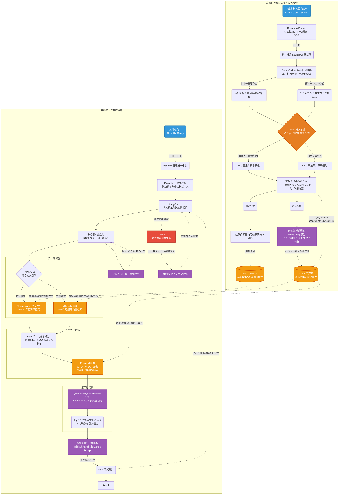
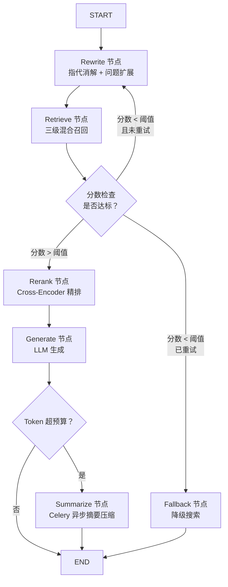

# 背景

> [!note] 记录口径（2026-10-10 修订）
> 文中包含设计方案、历史配置与效果数字。未关联数据集版本、运行 ID、checkpoint 或评测日志的数字需核实，不直接作为实测结论；本地示例代码与生产部署状态分别说明。

无线豆包是 ICT AI 辅助工作的重点项目，对标秘塔搜索，核心理念为：**一个入口、报告式回答、答案可信**。

## 最终性能

在 TOP20 召回条件下，端到端（E2E）准确率达到 **93%**。

---

# 整体架构

系统整体分为**知识召回**、**知识库构建**、**知识预处理**三大核心模块。

以下架构图展示在线问答流程、离线文档处理流程，以及两者之间的数据关系：



**上述流程图包含两个主要部分**：
1. 上方为**在线问答流程**：FastAPI 接收请求，LangGraph 编排 Query 改写、混合检索、重排和生成，最后向用户返回带引用的回答。
2. 下方为**离线文档处理流程**：Kafka 缓冲并分发任务，由 CPU/GPU Worker 完成解析、清洗和向量化，再写入 Elasticsearch 与 Milvus。将耗时的文档处理与在线问答分开，有助于减少批量入库对问答延迟的影响。

---

**知识召回：**
- **多路召回**：将原始问题改写为多个子问题，基于多问题并行检索，提升召回覆盖率
- **三级召回**：初筛 → 二筛 → 精排，逐层缩小候选集并提升精度
- **混合召回**：融合 BM25 关键字检索与向量语义检索，兼顾精确匹配与语义理解

**知识库构建：**
- **向量知识库**：基于微调后的 Embedding 模型构建
- **BM25 词频库**：基于无线领域专有词表，保证独立语义的词语在分词时不被拆分

**知识预处理：**
- **知识标签**：采用 1+X+Y 架构设计，保证知识有序存储与分类管理（**关键设计**）
- **知识切片**：针对不同知识类型采用差异化切片策略
- **知识清洗**：根据知识来源和格式，定制相应的清洗方式

---

## 多路召回

### 目的

将与用户 Query 相关的全部知识尽可能**召回完整**，避免因单一检索路径遗漏关键信息。

### 主要内容

多路召回包含两个核心步骤：

1. **指代消解**：还原多轮对话中的指代内容。例如：多轮问答中，"随机接入是什么" → "它有什么关键技术" ⇒ 改写为 "随机接入有什么关键技术"。
2. **问题扩展**：将原始问题扩展为 1~3 个语义等价或相关的检索问题，以提高 RAG 检索的命中率。例如："CA 是什么" → 扩展为 "载波聚合是什么"。

#### 实现流程

采用 **Prompt + LLM** 的方案：在用户输入的基础上进行属性识别与提取，将识别结果作为上下文提供给 LLM。使用 **Qwen3-4B** 执行 Query 改写，该模型在准确度与推理时延之间取得了较好的平衡，当前单次改写耗时可控制在 **1s** 以内。

#### Prompt 设计

##### User Prompt
- **目标**：明确改写的任务目标
- **受众**：定义目标用户角色
- **规则**：
	- 多轮问题解析规则
		- 指代词推断
		- 主语切换但意图延续的场景合理改写
		- 时间描述的推断
		- 人称指代的替换（如结合用户信息）
		- 相关示例
	- 术语和关键词提取
	- 问题改写策略
	- 相关性排序逻辑
	- 最终输出格式

##### System Prompt
- **目标**：定义模型角色与任务边界
- **输出格式**：JSON 结构约束描述
- **输出示例**：标准化的输出样例

---

## 三级召回

系统组合使用 **[[01_技术栈/Milvus]]** 向量检索与 **[[01_技术栈/Elasticsearch]]** BM25 全文检索，并采用**三层逐步筛选**策略，在召回覆盖率、排序质量和查询开销之间取得平衡：

1. **第一层（粗筛）**：BM25 + 384 维向量库检索，各召回 1500 条，合并去重后共约 3000 条（实验验证该层**召回率**达 **99% 以上**，即正确答案被包含在 3000 条候选集中的概率）。输入为无线统一知识库，输出 3000 篇候选文档。
2. **第二层（精筛）**：对第一层粗筛输出的 3000 条候选集，**复用**第一层 BM25 的原始分数排序取 Top 160，同时以 768 维向量库对这 3000 条候选进行**深语义重算**也取 Top 160（两路共 320 条，去重后约 280~320 条）。随后通过 **RSF（Rank Score Fusion，内部命名的线性分数融合方法）归一化融合打分**，计算综合得分取 Top 80 输出。其中动态权重 **α 由 Query Token 数量决定**（Query 越长则 α 越偏向向量语义）。输入：3000 篇候选 ，输出：80 篇文档。
3. **第三层（精排）**：使用 Rerank 模型进行精排，模型选择 [gte-multilingual-reranker-0.3B](https://huggingface.co/Alibaba-NLP/gte-multilingual-reranker-base)。输入 80 篇文档，输出最终 **10 篇**高相关文档。

> [!tip] 第二层并未重新执行 BM25 检索
> 第二层精筛中的 BM25 分数来自第一层粗筛的缓存结果，并非再次对全量知识库执行 BM25 检索。这样既避免了重复计算开销，又保留了关键词匹配信号参与融合打分。

**耗时分布**：三级召回整体耗时约 **2s**（第一层 0.5s，第二层 0.5s，第三层 1s）。

> [!question] 为什么要用两个维度的向量库？
> 384 维向量在第一层大规模粗筛中计算效率更高，适合从海量文档中快速缩小候选集；768 维向量语义表达能力更强，在第二层较小候选集上可提供更精准的语义排序。两者配合实现了效率与精度的平衡。

> [!info] SAP 画像说明
> SAP 画像是基于公司 HR 系统（SAP）和历史行为日志提取的用户特征，包含 `所属 PDU`、`CQIC 方向`、`技能等级`、`岗位职能` 等维度。SAP 画像作为标量过滤条件参与 RBAC 权限控制（详见 RBAC 章节）。

---

## 混合召回

词法与语义互补可以在同一数据库中实现：Milvus 提供 BM25/稀疏向量，ES 9.x 扩展向量与混合检索能力。以下 ES+Milvus 分工记录原项目；当前能力和选型条件见 [[RAG系统/01_技术栈/Milvus]]、[[RAG系统/01_技术栈/Elasticsearch]]。

混合召回是三级召回中**第二层**的核心策略：向量匹配侧重**语义相似度**，BM25 侧重**关键字精确匹配**，两者互补。

### 1. BM25 算法计算方法简析

BM25 并不是单一的词频统计，而是一种基于概率检索模型的变体，主要通过词频（TF）和逆文档频率（IDF）结合文档长度约束来进行相关度打分。其核心计算公式如下：

$$Score(Q, D) = \sum_{i=1}^{n} IDF(q_i) \cdot \frac{TF(q_i, D) \cdot (k_1 + 1)}{TF(q_i, D) + k_1 \cdot (1 - b + b \cdot \frac{|D|}{avgdl})}$$

- **$IDF(q_i)$**：查询词 $q_i$ 的逆文档频率。表示词汇的语料库稀有程度。
- **$TF(q_i, D)$**：查询词 $q_i$ 在文档 $D$ 中的本页命中词频。
- **$|D|$ 与 $avgdl$**：分别是当前被计算文档的长度和整体知识库的平均文档长度。通过引入这两个变量的比值，BM25 有效惩罚了过长的文档（避免内容庞杂的噪声烂文档由于涵盖废话词太多而占据优势）。
- **$k_1$ 与 $b$**：人工可干预的手工经验调节参数。$k_1$（通常在 1.2~2.0 之间）用于限制词频的无脑叠加增加影响权重；$b$（通常为 0.75）用于控制文档长度对得分归一化的施加力度。

### 2. 混合召回具体实现

采用 **RSF（Rank Score Fusion，内部命名的线性分数融合方法）** 算法。其本质是对归一化后的各路检索分数进行**加权线性求和**（Weighted Linear Score Fusion），区别于业界常见的基于排名倒数的 RRF（Reciprocal Rank Fusion, $\text{score} = \sum \frac{1}{k + rank_i}$）：

> [!note] RSF vs RRF 选型理由
> - **RRF** 仅依赖排名序号，丢弃了原始分数的绝对值信息，适合异构分数分布差异极大且难以归一化的场景。
> - **RSF（线性分数融合）** 保留了归一化后的分数梯度信息，在 BM25 与向量检索的分数分布经 Min-Max 归一化后相对可比的前提下，能更精细地区分候选文档的相关度层次。我们在实验中对比发现，RSF 在通信领域数据上的 Recall@80 比 RRF 高 **3.2 个百分点**，因此最终选择 RSF。

**具体计算步骤**：

1. 在第一层粗筛输出的 3000 条候选集内，复用 BM25 原始分数排序取 Top 160，768 维向量深语义重算取 Top 160（两路共 320 条，去重后约 280~320 条）
2. 分别对两路召回的得分进行 **Min-Max 归一化**处理，映射至 $[0, 1]$ 区间
3. 将归一化后的得分**加权求和**，计算综合得分
4. 按综合得分排序，返回 **Top 80** 文档

**综合得分公式**：

$$\text{FinalScore} = \alpha \times \text{VectorScore}_{\text{norm}} + (1 - \alpha) \times \text{BM25Score}_{\text{norm}}$$

其中，$\alpha$ 代表**向量语义检索的权重**。当 $\alpha$ 趋近 0.7 时（长问题场景），系统更依赖向量语义匹配；当 $\alpha$ 趋近 0.4 时（短问题场景），系统更依赖 BM25 关键字匹配。

**动态权重 $\alpha$ 的计算**：基于 Sigmoid 变体函数，根据用户 Query 的 Token 数量动态调整：

$$\alpha = \alpha_{\text{base}} + \frac{0.3}{1 + e^{-\frac{L - k}{s}}}$$

- **$\alpha_{\text{base}}$**：基准权重，默认为 0.4，可受用户 SAP 画像微调（如研究岗位下调至 0.35，项目管理岗位上调至 0.45）
- **$L$**：用户查询的 Token 数量
- **$k$**：中心值，设为 8。当 $L = k$ 时，$\alpha = \alpha_{\text{base}} + 0.15$（即基准值与上限的中点）
- **$s$**：平滑系数，设为 1，控制权重过渡的坡度

---

## 知识库构建

### 向量知识库

**Embedding 模型选择**：基于 [gte-multilingual-base](https://huggingface.co/Alibaba-NLP/gte-multilingual-base) 进行领域微调。微调的核心在于**高质量训练语料的构建**。

**语料构建方式**：使用 **Qwen2.5-72B** 自动生成训练语料对。针对不同类型的数据内容，通过 Prompt 引导大模型生成 JSON 格式的 QA 对。共生成 **75 万** QA 对，经数据处理后 **48 万**条参与微调训练，在 **A30 × 2** 上训练两周。

**核心要点**：
- **问题丰富性**：分别从文档块内容、文档块标题、文档块生成的摘要等多角度出发；摘要可直接作为问题，也可基于文档块同时生成问题与答案
- **后处理的必要性**：异常字符剔除、MinHash 问题去重、Rerank 相关性筛选、去除指代性问题（含 "本文""这""那" 等模糊指代词）
- **长度配比平衡**：使用不同长度的语料进行训练，避免模型对特定长度的偏好
- **多维度联合微调**：同时微调 384 维和 768 维向量表示

**微调效果**：
- 自有数据集：Top10 召回率从 **62% → 88%**（提升 26 个百分点）
- 开源数据集 [DuRetrieval](https://huggingface.co/datasets/mteb/DuRetrieval)：98.8% → 97.8%（微降 1 个百分点，属于合理范围，表明模型在领域适配的同时未严重损失通用能力）

### BM25 词频库

BM25 词频库的构建有两个核心要点：

1. **单一知识库设计**：由于知识总量庞大，为降低维护复杂度和保障检索一致性，仅建立一个统一的 BM25 知识库
2. **分词准确性**：TF-IDF 的正确计算依赖于准确的文本分词，因此需要构建无线领域专有词表，确保领域术语不被错误切分

#### 词表构建流程

1. **语料汇集**：将 DTS 工单内容、Support 网站全部支持文档、全部 IDP 文档作为语料库
2. **语料清洗**：去重、去除目录页、去除特殊符号、剥离 HTML 标签等
3. **种子词表构建**：爬取华为术语库内容作为基础正标签（约 5000 词）；抽取维基百科高频词作为通用领域负样本
4. **新词发现**：使用 **AutoPhrase** 算法自动发现新词，强制保留 "名+名" 或 "形+名" 结构，大幅过滤无意义的动词性短语
5. **人工迭代校正**：将人工确认的正确词作为标签数据，重复执行 AutoPhrase 迭代。最终发现约 10000 词。人工校正时**优先挑选算法评分在 0.5 左右的边界样本**，以最大化每轮迭代的标注增益
6. **LLM 辅助过滤**：使用 **Qwen2.5-72B** 对候选词进行打分过滤，结合人工审核，最终得到 **6800** 个有效领域词

> [!info] AutoPhrase 算法说明与选型理由
> **AutoPhrase** 是一种基于远距离监督（Distant Supervision）的短语质量评分算法（Shang et al., 2018）。其通过利用外部知识库（如维基百科）作为正样本种子集，自动训练一个短语质量分类器，无需人工标注。相比基于 HMM 的新词发现方法（如 jieba），AutoPhrase 的优势在于：
> 1. 能识别**多词短语**（如"载波聚合"、"随机接入"），而非仅限于单个新词
> 2. 通过迭代 Robust Positive-Only 训练，在领域语料上能达到更高的准确率
> 3. 支持领域自适应——仅需提供领域种子词表即可在无标注条件下完成训练
>
> 词性过滤（POS Filtering）基于 jieba 或 HanLP 的词性标注结果，仅保留 `NN+NN`（名+名）或 `JJ+NN`（形+名）结构的短语候选，有效过滤"动+名"等无意义的搭配。

---

## 知识预处理

> **核心原则**：所有文本内容统一转换为 Markdown 格式；基于 Markdown 结构的切片策略以最大程度保留语义完整性。

### 知识格式处理

**不同文件格式的处理方式**：

| 格式 | 处理方式 |
|------|----------|
| Word | 转为 Markdown |
| HTML | 转为 Markdown |
| PPTX | 按页处理：转为图片 → OCR 提取文字 → 生成图片链接 |
| Excel / CSV | 转为纯文本 |
| PDF | 转为 Markdown |
| 图片 | 保留链接；链接不参与检索召回，仅参与最终总结生成 |

**不同数据源的针对性处理**：

| 数据源         | 处理策略                                 |
| ----------- | ------------------------------------ |
| Support 文档  | 增加目录结构信息；特定内容增加标签（如 gNodeB 增加 5G 标签） |
| Wiki        | 增加目录层级信息                             |
| iCase（反思案例） | 内容不做切片处理，标题增加产品信息                    |
| 设计文档        | 仅保留最新版本，增加 PDU 信息                    |
| 3GPP 协议     | 缩进格式适配；文件名与协议编号重映射                   |
| 华为知道、华为案例   | 不切片，整篇入库                             |

### 知识切片

采用**基于章节结构的层次化切分**策略，按节点类型分为三类：

- **非叶子节点**：包含子章节的文本段。若总长度 > 2K Token，则由 LLM 生成摘要作为替代 Chunk，同时继续向下递归切割；若 ≤ 2K Token，直接作为 Chunk
- **叶子节点**：文档末端的纯内容段落，按固定步长结合语义换行进行切割
- **无标题节点**：连续长文本、代码块或公式组，强制继承最近的有效标题

| 维度           | 非叶子节点（章节层级）                   | 叶子节点（最小语义单元）        | 无标题 / 特殊节点（正文块）            |
| ------------ | ----------------------------- | ------------------- | -------------------------- |
| 判定标准         | 带有子标题的导航层级（如 `#` / `##`）      | 文档末端的纯文本 / 细节描述段落   | 连续长文本、代码块、或数学公式组           |
| 切分规模         | 阈值：2K Tokens                  | 512 ~ 800 Tokens    | 继承父级大小，按语义边界对齐             |
| 核心动作         | ≤2K：保留全文并打标；>2K：LLM 生成摘要作为替换块 | 固定步长 + 语义换行切割       | 强制关联：继承最近一个有效标题            |
| 重叠度（Overlap） | N/A（由摘要覆盖全局语义）                | 10% ~ 15%           | 保持上下文连贯，避免截断公式 / 代码        |
| 元数据注入        | 包含子节点 ID 列表、层级路径              | 回填父级摘要、层级路径、原始页码    | 标注 `is_continuation: true` |
| 检索价值         | 解决 "宏观 / 综述类" 问题召回            | 解决 "具体事实 / 数值" 问题召回 | 提供技术实现细节、代码片段              |

### 父子索引与文档层级检索 (Parent-Child Indexing)

在 RAG 系统的知识检索中，单纯依赖单一粒度的切片往往面临两难：切片过小会导致大模型生成时缺乏全局上下文，切片过大则会引入过多噪音、降低向量搜索的精确度。为了破解这一矛盾，系统引入了**父子索引 (Parent-Child Indexing)** 机制。

> [!tip] 父子索引与知识切片的映射关系
> 在上述切片体系中，**叶子节点和无标题节点**的切片作为"子切片"参与向量索引的精确匹配；**非叶子节点**（含 LLM 摘要的章节概览）作为"父文档"，在子切片命中时被整体召回供大模型使用。非叶子节点的摘要**也会参与向量索引**（用于宏观/综述类问题的直接命中），但其主要角色是作为父级上下文提供者。

1. **精准命中（子切片索引）**：在文档摄入管道中，将知识拆分为极细粒度的“子切片”（如短叶子节点、单句、独立小段、具体公式等），并为其建立密集的向量索引库。这些子切片语义纯粹、主题聚焦，保障了相似度检索时的极高命中率。
2. **完整上下文提取（父文档召回）**：命中某个子切片后，根据元数据中的 `parent_id` 取回其父文档，例如上层章节或合并后的完整内容，再提供给大模型，减少孤立片段造成的信息缺失。
3. **核心作用与业务价值**：
   - **兼顾检索算力与大模型推理质量**：实现了“在极细维度下进行精确检索匹配，在较粗维度下提供详实丰富的上下文给 LLM”。
   - **弥补语义断层**：避免了传统固定步长切分导致的上下文割裂，降低了模型在综合推理跨段落指代关联时的幻觉概率。

---

## 知识更新

### 1+X+Y 知识集架构

从两个管理视角出发，形成 **1+X+Y** 的知识分类架构：

- **X（能力视角）**：从 CQIC 能力维度划分，共 7 个方向——设计、软件、硬件、测试、研究、产品管理、项目管理。涵盖产品技术规范、CQIC 建设课程、Wiki、社区文档、博客、案例、需求文档等
- **Y（组织视角）**：从 PDU 维度进行管理，共 8 个方向——基站产品、基站平台、解决方案、MAE、DIS、微波、GUC 等。涵盖 PDU 建设课程、交付大典、Wiki、文档、博客等
- **1（公共视角）**：通用性、跨领域的公共文档，如 IPD 流程、3GPP 协议、无线百科、技术连载、公共业务课程等

> **注意**：同一份文档允许在多个知识集中出现（即允许重复索引），但入库时仅保留一条物理记录，同时**合并所有知识集的标签**（在 Milvus 中以数组字段存储，如 `cqic_tags: ["软件", "测试"]`、`pdu_tags: ["基站产品", "MAE"]`）。

**知识集架构的设计考量**：
- 用户需要能**可见全部**的知识集
- 每个知识集的构建需要**独立看护**，不同团队优先管理和消费自己领域的知识

因此，知识集的构建过程分为三步：

1. **知识生产者**：将各自领域的知识接入 Athena 知识中心，统一看护与版本管理
2. **知识集构建者**：在 Athena 中选择本领域关注的数据源，组装形成知识集，触发向量库入库流程
3. **数据 IT**：将 1+X+Y 的知识集分别匹配对应的流水线进行知识处理（清洗 → 格式转换 → 切片 → 向量化 → 元数据标签注入），最终送入 RAG 知识库

> [!info] 1+X+Y 标签在检索时的协同过滤机制
> 检索时，系统根据用户的 SAP 画像自动取出其所属的 PDU（Y 维度）和 CQIC 方向（X 维度），构造 Milvus 标量过滤表达式（如 `expr="'基站产品' in pdu_tags or '1' in knowledge_set"`），仅在匹配的知识集范围内检索。同时结合 RBAC 的安全级别进行二次过滤（详见 RBAC 章节），实现"业务范围过滤 + 安全权限过滤"的双重保障。1（公共视角）的文档对所有用户可见，不受 X/Y 维度过滤限制。

### 元数据管理 & 标签管理

文档的元数据共分为**四类属性**：

| 属性类别       | 来源            | 内容说明                                              |
| ---------- | ------------- | ------------------------------------------------- |
| **基础属性**   | 产生于原作业系统，直接使用 | 文档唯一性标识：文档 ID、名称、作者、原链接、产生时间、创建时间、URL、密级等         |
| **管理属性**   | 产生于原作业系统，映射适配 | 文档归属信息：产品、版本、部门、领域等。需屏蔽不同原系统的差异，统一管理              |
| **知识管理属性** | 知识管理作业过程中产生   | 分类标记：CQIC 方向、PDU 归属、适用产品线、数据类型（结构化数据、文档、代码、音频、视频） |
| **召回属性**   | 入库时产生         | 检索支撑信息：向量表示、切片内容、权重、切片 ID                         |

**向量化过程**：支持通用流水线处理，如需特殊处理亦支持各产业自定义适配流水线；切片逻辑可定制；Embedding 模型可按需选择。

---

# 评估方式

## 自研召回评测数据集的背景

公司研发资产具有以下特性：

- **使用场景化**：遵循 IPD 研发流程，资产有特定的消费方式
- **信息复杂化**：包括非结构化文档、结构化数据库、代码仓等多种资产形态
- **高度专业化**：包含大量专业术语及内部流程用语，如 AR、IR 等
- **逻辑关系复杂**：包括增量/全量关系、设计-开发-测试分层挂接文档

因此需要构建**专用的评测集**，以贴合公司的实际应用场景。

## 召回评测集构建方案

从三个能力层级递进评测：

1. **单文档上下文获取**：重点评测 RAG 的基础能力，评估端到端检索链路是否合理
2. **多文档、多跳、复杂上下文获取**：评测进阶能力，如多文档比较、复杂推理等
3. **Agent 作业上下文获取**：评估 RAG 是否能支撑 Agent 精准获取上下文

### 单文档上下文获取能力

主要从以下几个维度出发：

- **多模态格式兼容性**：检索图、表、附件、代码块、文本的能力
- **结构感知与连贯性**：检索单句、长文、多个片段、各级标题的能力
- **语义与边界鲁棒性**：使用同义词、行业术语、特殊用词获取上下文的能力

**三种提问方式**：

| 提问方式 | 说明 |
|----------|------|
| 原文 | 针对检索目标，使用原文构造 Query |
| 总结 | 针对检索目标生成总结性需求 |
| 容错 | 编写具有部分表达错误的 Query |

**评测指标**：仅评价召回率，分为正确召回、部分召回、无召回三个等级。

**评估数据量**：2034 条用例。


---

# 核心算法与策略深潜

## 上下文与对话记忆管理

在多轮对话场景中，盲目拼接历史记录不仅会导致大模型的 Token 快速耗尽上限，还会导致“注意力稀释”。为此我们在记忆模块实现了**多级状态管理与动态修剪机制**：

### 1. 基于 LangGraph 的状态流转与记忆存储（Memory）

多轮状态改用 LangGraph 与持久化 checkpointer 管理，与 Redis 结果缓存是不同职责。缓存策略区分两类：设计上保留满足复用条件的精确答案缓存，停用仅凭问题向量相似度直接返回旧答案的语义缓存。精确答案缓存、Reranker 缓存是否上线仍需部署配置核实，本地演示代码的行为另见代码总结。

**① 统一结构化持久状态 (AgentState & Checkpoint)**
- 核心代码定义了包含 `messages`（历史消息序列）、`retrieved_docs`（召回文档候选池）、`rewrite_queries`（改写子问题）等成分的全局上下文数据状态类（State）。 
- checkpointer 按 `thread_id` 组织状态，但它不自动提供身份认证、租户授权或并发顺序控制。应用需校验 thread_id 的任务归属、绑定 tenant/user，并处理同会话并发更新与 checkpoint 命名空间，才能建立会话隔离。

**③ LangGraph 状态图完整节点与边定义**



- **条件边（ScoreCheck → Rewrite）**：当检索打分极差且尚未重试时，系统回退到 Rewrite 层进一步衍生 5~6 句等价短语再次检索，最多重试 1 次
- **降级边（ScoreCheck → Fallback）**：重试后仍低于阈值，执行 Return Fast 降级策略

**② 保留精确查询缓存，停用仅凭语义相似度复用答案的缓存**

- **相同问题，满足条件时可以复用答案**：例如，用户再次问“SIB1 是什么”，如果知识库、模型和 Prompt 版本、用户权限以及影响答案的对话上下文都没变，就可以使用精确答案缓存，减少重复检索和生成的时间与费用。缓存键应包含这些影响答案的条件，不能只使用 Query 文本；命中后仍需检查有效期和当前权限。知识库更新或相关配置变化后，相关旧缓存应失效。对于“它是什么”这类依赖上下文的问题，无法确认上下文一致时，应跳过答案缓存。
- **相似问题，不直接共用答案**：例如，“SIB1 是什么”和“SIB2 是什么”虽然问法相似、讨论的对象也有关联，但答案不能互换。即使两个问题的向量接近，也只能说明它们相关，不能证明旧答案适用于新问题。因此，设计上停用仅凭向量相似度直接返回旧答案的语义缓存。这不等于认定 Embedding 失效，也不能未经测试就断言它们必然误命中。
- **未命中有效精确缓存时，再走检索生成流程**：在权限校验后，依次执行 Query 改写、带权限与版本过滤的 BM25 + 向量混合检索、融合、重排和答案生成。通过关键词匹配、元数据约束和重排进一步区分术语；这些机制能降低答错对象的风险，实际效果仍需评测，不能保证绝不出错。

> 一句话解释：**完全相同的问题，相关条件没变时可以用缓存；只是看起来相似的问题，不直接拿旧答案回复。**上述为设计策略，生产是否启用精确答案缓存仍需核对部署配置。

### 2. 动态滑动窗口与 Token 计费
- **事前 Token 估算**：并非机械地保留“最近 5 轮对话”，而是引入了与大模型严格对齐的本地 Tokenizer（如 tiktoken 或 Qwen 原生分词器）。在每次发起组合请求前，先计算历史队列的总体 Token 排量。
- **保留与裁剪规则**：
  1. **System Prompt 永驻**：系统级人设指令必须占用前置固定 Token。
  2. **优先保留当前问题**：保留当前提问（Query）及紧邻的上一轮 Q&A 轮次。
  3. **中间轮次按需断尾**：当历史累计超过设定预算（例如 4000 Tokens 阈值），按照时间线从旧到新依次剔除闲聊或过渡轮次。

### 3. 超长对话的摘要压缩机制（Summarization）
当用户在一个 Session 中深度探讨复杂技术且轮次极长时，直接截断会导致关键线索丢失。此时系统会触发旁路异步能力：
- 后台任务（[[01_技术栈/Celery]] 调度）侦测到历史 Token 超过预算，会调用一个轻量级模型（如 Qwen3-4B）传入历史内容并指令：`“请总结上述用户与 AI 的交互核心技术点与已确认的客观事实，需以精简的要点呈现。”`
- 将摘要打包为一条 `{"role": "system", "content": "前情提要:..."}`，放在新一轮对话前部，以减少历史消息占用的 Token，并保留后续回答需要的背景信息。

---

## 单次查询 Token 消耗精细估算

为了科学地制定记忆预算和模型上下文窗口选型，我们对每次 RAG 查询的 Token 消耗进行了分项拆解（以 Qwen 原生分词器为基准）。

### 输入 Token (Input) 构成

| 组成部分 | 最小值 | 典型值 | 最大值 | 说明 |
| ---- | ---- | ---- | ---- | ---- |
| **System Prompt** | ~400 | ~500 | ~650 | 角色定义 + 防幻觉约束 + 引文格式说明，固定负担 |
| **多轮历史对话** | 0 | ~2,000 | ~4,000 | 受动态裁剪预算上限控制（详见下节分析） |
| **当前 Query（改写后）** | ~15 | ~50 | ~100 | 中文技术问题，含指代消解展开后的版本 |
| **Top 10 召回 Chunk** | ~5,500 | ~7,500 | ~15,000 | ⚠️ 最大变量，详细拆解见下表 |
| **XML 元数据标记开销** | ~400 | ~500 | ~600 | 每片 `<doc id="..." title="...">` 约 +50 tokens，×10 片 |

**Top 10 Chunk 大小分场景拆解：**

| 召回策略 | 单片 Tokens | ×10 片总计 |
| ---- | ---- | ---- |
| 纯叶子节点（512–800 tokens/片） | ~650 | ~6,500 |
| 父子索引 → 返回 Parent 文档（≤2K） | ~1,500 | ~15,000 |
| **实际混合场景（中位估算）** | ~700 | **~7,500** |

### 输出 Token (Output) 估算

| 回答类型 | 估算 Token |
| ---- | ---- |
| 简短事实性回答（单段） | 100–300 |
| 标准技术说明（带 inline citation） | 300–600 |
| 复杂综合推理（多段落报告式） | 600–1,200 |
| **典型均值** | **~450** |

### 单次请求总量汇总

```
┌─────────────────────────────────────────────┐
│       单次查询 Token 消耗（典型场景）           │
├──────────────────────┬──────────────────────┤
│ 输入（Input）         │ ~10,000 tokens        │
│  ├ System Prompt      │   ~500                │
│  ├ 历史对话           │  ~2,000               │
│  ├ 当前 Query         │    ~50                │
│  └ 召回 Context       │  ~7,500               │
├──────────────────────┼──────────────────────┤
│ 输出（Output）        │    ~450 tokens        │
├──────────────────────┼──────────────────────┤
│ 合计（Total）         │ ~10,450 tokens / 次   │
└──────────────────────┴──────────────────────┘

最小（首轮，无历史）：  ~8,500 tokens
典型（2-4 轮多轮）：   ~10,000 - 13,000 tokens
最大（深度长对话）：   ~18,000 - 20,000 tokens
```

---

## 记忆 Token 上限分析与推导

理论上，记忆预算 = **模型总上下文窗口** - **不可压缩的固定消耗** - **安全缓冲量**。

### 固定消耗（不可裁剪）

```
System Prompt          ~500 tokens   （固定）
Top 10 召回 Context   ~7,500 tokens  （每次查询重新填充）
当前 Query             ~  50 tokens  （固定）
输出保留预算           ~ 600 tokens   （max_new_tokens 预留）
XML 元数据标记         ~ 500 tokens   （固定）
─────────────────────────────────────
固定合计：            ~9,150 tokens
```

### 记忆可用空间推导
以 **Qwen2.5-72B-Instruct**（推荐选型，见下节）128K 上下文窗口为例：

$$\text{记忆预算} = 128{,}000 - 9{,}150 = 118{,}850 \text{ tokens（理论上限）}$$

然而，**理论上限远不等于实践推荐值**。研究表明，LLM 存在"**中间迷失（Lost in the Middle）**"现象：当上下文过长时，模型对头尾信息的注意力权重高于中间段，导致长对话历史中的关键细节被忽视。

### 实践推荐与分档策略

| 对话阶段               | 建议历史 Token 预算       | 对应约 N 轮 | 触发策略                        |
| ------------------ | ------------------- | ------- | --------------------------- |
| **常规对话**（1~5 轮）    | ≤ 4,000 tokens      | 约 4~6 轮 | 正常裁剪，丢弃最老轮次                 |
| **深度技术探讨**（5~12 轮） | 4,000–6,000 tokens  | 约 6~9 轮 | 触发 Celery 摘要压缩，历史浓缩为 `前情提要` |
| **超长会话**（12 轮+）    | ≤ 2,000 tokens（压缩后） | 压缩摘要    | 保留压缩摘要 + 最近 1~2 轮原文         |

> [!IMPORTANT]
> **本方案将历史记忆预算设为 4,000 tokens（硬上限）**，超出后触发摘要压缩。按当前估算，可保留约 5～6 轮上下文，并为 Context（7.5K）与 System Prompt（0.5K）预留空间，将 Prompt 控制在约 13,000 tokens 以内。该预算是否合适，需结合召回质量、回答准确性和 TTFT 验证。

---

## RAG 答案生成模型选型分析

答案生成模型会影响回答质量，但最终效果也取决于检索结果、上下文组织和提示词。以下根据系统需求分析模型选型。

### 核心需求清单

| 维度 | 要求 |
| ---- | ---- |
| **上下文窗口** | 至少 32K，最好 ≥ 128K（应对深度多轮 + 大 Context） |
| **指令遵循能力** | 能稳定遵循防幻觉提示词，并按要求添加原文引用 |
| **中文语言质量** | 优秀（5G 技术文档语境，大量专有名词） |
| **结构化输出** | 支持 JSON / 带引文的 Markdown 格式输出 |
| **推理时延** | 搭配 vLLM 后 TTFT ≤ 3s，TPS ≥ 30 tokens/s |
| **部署灵活性** | 支持私有化本地部署（企业数据合规要求） |

### Qwen2.5 系列横向对比

| 模型 | 参数量 | 上下文 | 指令遵循 | 中文质量 | 推理速度 | 私有部署显存需求 | 推荐度 |
| ---- | ---- | ---- | ---- | ---- | ---- | ---- | ---- |
| Qwen2.5-7B-Instruct | 7B | 128K | ⭐⭐⭐ | ⭐⭐⭐ | ⭐⭐⭐⭐⭐ | ~14 GB (fp16) | 🟡 资源极限场景 |
| Qwen2.5-14B-Instruct | 14B | 128K | ⭐⭐⭐⭐ | ⭐⭐⭐⭐ | ⭐⭐⭐⭐ | ~28 GB (fp16) | 🟡 中档备选 |
| Qwen2.5-32B-Instruct | 32B | 128K | ⭐⭐⭐⭐⭐ | ⭐⭐⭐⭐⭐ | ⭐⭐⭐⭐ | ~64 GB (fp16) | 🔵 次选（算力受限） |
| **Qwen2.5-72B-Instruct** | **72B** | **128K** | **⭐⭐⭐⭐⭐** | **⭐⭐⭐⭐⭐** | **⭐⭐⭐⭐** | **~144 GB (fp16)** | **✅ 首选推荐** |
| Qwen2.5-7B-Instruct-1M | 7B | **1M** | ⭐⭐⭐ | ⭐⭐⭐ | ⭐⭐⭐⭐ | ~14 GB | 🔵 未来超长文档场景 |

### 最终推荐：Qwen2.5-72B-Instruct

作为企业核心应用，服务全员日常研发查询，质量是第一优先级，硬件成本是第二位的考量——因此选用旗舰级 **Qwen2.5-72B-Instruct**。

**推荐理由（逐条分析）：**

**① 候选模型的回答质量**
历史选型记录将 Qwen2.5-72B-Instruct 作为高质量回答的候选，并列出 MMLU、C-Eval 和指令遵循等比较维度。笔记中的 8–12% 质量增益仍需对应的评测报告支持，不能仅凭通用榜单推断领域问答效果。

**② 对复杂指令的遵循能力**
System Prompt 包含禁止捏造、添加 inline citation 和角色约束等要求。历史选型倾向使用 72B 模型，期望提高指令遵循的稳定性；是否优于 32B，以及引用错误减少多少，需要领域评测验证。

**③ 128K 上下文窗口提供容量余量**
根据当前 Token 预算估算，单次请求最多约 20,000 tokens。128K 窗口提供超过 6 倍的容量余量，可用于更长历史或更多检索片段；实际可用长度与长文本效果仍需验证。

**④ 搭配 vLLM 可满足 TTFT < 3s 时延目标**
在 vLLM + PagedAttention 加速下，Qwen2.5-72B 在 **4×A100 (80G)** 张量并行部署时，可实现 **25–40 tokens/s** 的生成速度，TTFT 稳定控制在 **2–3s** 范围内，满足系统时延硬性要求。

> [!note] vLLM 推理部署配置细节
> - **引擎**：vLLM v0.4+，底层利用 PagedAttention v2 实现动态 KV Cache 分页管理，避免静态预分配造成的显存浪费
> - **并行策略**：4× A100-80G 上采用 Tensor Parallelism（`--tensor-parallel-size 4`），模型权重均匀切分至 4 张卡
> - **Batch 调度**：启用 Continuous Batching（连续批处理），最大并发请求数 `--max-num-seqs 64`，动态合并短请求以最大化 GPU 利用率
> - **量化降本路线**：AWQ 4-bit 量化后，可在 2× A100-80G 上部署，TTFT 增加约 15%，质量损耗 < 3%
> - **关键参数**：`--max-model-len 32768`（限制单次请求最大上下文，防止 OOM），`--gpu-memory-utilization 0.90`

**⑤ 企业级私有化部署，数据不出域**
fp16 全精度需 ~144GB 显存（4 张 A100-80G 或 2 张 H100-80G 即可）。如需进一步降本，可使用 **AWQ / GPTQ 4-bit 量化**，显存需求压缩至 ~40GB（2 张 A100-80G），质量损耗 < 3%，完全可接受。

> [!NOTE]
> **降级备选方案说明（按算力排序）：**
> - **算力受限（2×A100-80G）**：选用 `Qwen2.5-32B-Instruct`（fp16 ~64GB），综合性能仍超越 Qwen2-72B，是性价比最高的次选。
> - **单卡场景（1×A100-40G）**：选用 `Qwen2.5-14B-Instruct`，AWQ 4-bit 量化后约 7GB，适合 POC 验证或内部测试环境。
> - **未来演进方向**：关注 `Qwen2.5-14B-Instruct-1M`（100 万 token 上下文），探索减少切片、直接处理完整章节或书籍的长上下文方案。

---

## 防幻觉与系统兜底策略

由于面向的是企业内部的严密研发体系，系统首要原则是“不知为不知”，从检索到生成层层阻断幻觉：

### 1. 防幻觉 Prompt 设计深度
- **事实性强约束**：通过精细构造大模型的 System Prompt 来强制约束输出范围。
  - **标准话术示例**：`“你是一个严谨的华为无线通信技术专家。请仅基于以下<context>和</context>标签内部的参考资料回答问题。如果不包含相关答案，请输出标准回复‘根据当前已知知识库，暂时无法回答该问题’，严禁捏造不存在的术语、协议编号与事实。”`
- **强制内联引用（Inline Citation）机制深潜**：
  强制要求模型在表述关键论点后添加引用标记，如 `...这种技术能使吞吐量提升20% [doc_id_1]。`。这并非单纯的前端展示优化，而是系统中遏制幻觉、构建业务信任的核心设计：
  - **外部化思维链（Externalized CoT）压制幻觉**：强迫模型在输出任何实质观点前，必须在其工作记忆中去“扫描”并锚定 `<context>` 块里的文档 ID。这种在生成论点前寻找“落地出处”的注意力强制对齐机制，让模型做到了“找不到依据就不生成”，从根本上抑制了凭空捏造。
  - **全链路元数据贯通（数据组装 -> Prompt 呈现）**：
    在组装给 LLM 的上下文中，必须进行结构化的 ID 标识（例如 `<doc id="doc_1" title="...">内容...</doc>`）。System Prompt 则需配合增加严厉指令约束：_“在每句话结尾必须使用方括号精确标注引用的 doc id。严禁引用上下文中未提供的 id。”_
  - **流式拦截与前端组件化渲染**：
    服务端在 SSE（Server-Sent Events）流式推送过程中，前端通过正则表达式（如 `/\[doc\_(\d+)\]/g`）实时捕获引文标签，并结合随路下发的文档元数据字典，动态将其转换为**上标超链接**（如 `[1]`）。用户悬浮交互（Hover）即可气泡查看摘要，点击则直达原始系统源文件。
  - **建立可防守的系统信任与快速错误归因**：
    用户可以通过引用查阅原文、核对回答；研发也可以在收到错误反馈后，沿引用检查问题来源：若支持答案的文档未被选中，先排查召回与重排；若相关文档已提供但结论仍错误，再排查上下文组织和生成过程。引用有助于定位问题，但不能单独证明回答正确。

### 2. 失败边界归因与监控闭环
我们将不佳回答的定性细分为三类，便于对症下药：
- **第一类：召回失败（Retrieve Failure）**：排查日志发现最终填入 `<context>` 的 Top 10 片段中，根本没有任何包含答案的信息。此类往往触发重新调整分词词表、同义词库或切分 Chunk 的步长参数。
- **第二类：重排失败（Ranking Failure）**：答案存在于前 3000 的粗排候选池中，但在二筛或 Rerank 阶段得分过低被挤出。这通常说明 Cross-Encoder 对该领域独有词汇的语义交互判定不准，需补充领域数据进行微调（Fine-Tuning）。
- **第三类：生成错误（Generation Failure）**：即使 `<context>` 已包含正确证据，模型仍可能误解重点或生成无依据的内容。可比较降低 `temperature`（如 `0.1~0.2`）、减少无关上下文等方案，并通过评测确认效果。

### 3. 系统降级搜索机制
如果在向量库检索阶段，最高相似度得分依旧**低于系统设定的双底线（bm25_score_threshold + vector_similarity_threshold）**，RAG 系统将不会发起耗时的大模型推理请求，而是直接执行 `Return Fast` 的降级策略，在界面回退为传统搜索引擎呈现形式：即直接挂载展示 BM25 命中的标题及局部关键字高亮，交回给员工人工阅读。

---

## 基于 LangChain 的权限控制与数据隔离 (RBAC)

过滤会影响 ANN 的候选覆盖，后过滤可能导致结果不足；pgvector iterative scan 与 Qdrant ACORN 在部分场景通过额外扫描改善召回，不能视为无成本优化。详见 [[Agent系统/01_技术栈/Memory机制与向量库接入]]。

企业级 RAG 系统需要防止**数据越权访问**，例如普通员工访问无权查看的源码或内部方案。仅在接口入口检查权限还不够，检索、父文档取回、缓存和引用原文访问也需要执行一致的权限规则。这里通过 LangChain 传递用户权限信息，并在各处理步骤中校验。

### 1. 权限信息的端到端透传 (RunnableConfig)
大模型应用常同时处理多个请求，并采用异步流式输出。如果用全局变量传递权限信息，容易混用不同请求的用户数据。这里使用 LangChain 的 `RunnableConfig` 传递每次请求的权限信息：
- 当应用网关 (FastAPI) 接收并验证用户的鉴权 Token 后，会向统一下游解析出用户的关键画像信息（包含其所属的 `PDU 部门`、`安全控制级别 (Level)` 以及参与的封闭 `安全项目组标签`）。
- 将用户画像封装进 `RunnableConfig` 的 `configurable` 字典，通过 LCEL 将其传给**向量检索、工具调用和模型生成**等节点。各节点仍需显式读取并执行权限规则，配置传递本身不等于完成鉴权。

### 2. 深入底层的数据拦截 (自定义 BaseRetriever)
最安全的防泄密做法不是指望大模型去“懂事地闭嘴”，而是在**数据库拉取数据之前就执行强制的物理隔离过滤（Pre-Filtering）**。
- 我们摒弃了调用 `similarity_search` 等默认封装，而是继承并重写了 LangChain 的基类 `BaseRetriever`，打造了带有企业鉴权机制的自定义检索器 `RBAC_Milvus_Retriever`。
- 在内部拦截 `_get_relevant_documents` 与 `_aget_relevant_documents` 核心方法，动态提取出游走至此的权限 Config。
- 将用户的多维度权限拼接为一个符合底层检索引擎（ES 或 Milvus）语法的**强校验标量表达式（Boolean Expr）**。

### 3. 结合 "1+X+Y" 构建坚固防线
这一系列流转最终落地于我们的 1+X+Y 元数据分类架构上：
- 一份最高级的架构设计文档入库（Ingestion）时，早已被打上了诸如 `security_level: 4` 和 `project_tag: ["CQIC_Core_TopSecret"]` 等预制签。
- 在 Milvus 检索请求中附加权限过滤条件，例如 `expr="(doc.security_level <= user.level) and (doc.project_tag in user.projects)"`，限制候选文档范围。该表达式为示意，实际语法需与字段类型和部署版本一致。
- **权限边界**：召回、父块回溯、引用原文获取和缓存读取都必须执行相同 ACL 检查。限制 `<context>` 能减少知识库泄露，但不保证模型不会依赖预训练知识、其他输入或猜测输出敏感内容；还需应用鉴权与输出策略。

---

## 设计决策：MMR、重排与去重的分工

MMR（Maximal Marginal Relevance）在贪心选取候选时同时考虑查询相关性和与已选文档的冗余：

$$\operatorname{MMR}=\arg\max_{d_i\in R\setminus S}\left[\lambda\operatorname{Sim}(d_i,q)-(1-\lambda)\max_{d_j\in S}\operatorname{Sim}(d_i,d_j)\right]$$

这里 R 是候选集、S 是已选集合，lambda 控制相关性与多样性的权衡。相关性和证据覆盖并不冲突：技术问答也可能需要多份互补证据。

- **Cross-Encoder 重排**：通常独立对每个 query-document pair 打分，不比较文档间冗余。两个重复且相关的片段可能都得高分，分数阈值不会自动去重。
- **Query Rewrite**：可扩大不同问题方向的召回覆盖，但不同分支仍可能返回相同文档。
- **精确去重**：合并召回分支时先按 chunk_id、规范化正文哈希等去除重复，保留来源与版本信息。
- **MMR**：可在较小候选集上减少语义冗余、提高证据覆盖；过强的多样性惩罚可能牺牲相关性，需要调 lambda 并做消融。

候选数 n、选取数 k、向量维度 d 下，缓存每个候选的最大冗余分数可将相似度计算开销控制在 O(nkd)；简单重复比较所有已选项的实现更贵。不能仅由候选数断言延迟不可接受。

**当前决策口径**：可先采用显式去重 + 重排 + 截断的简单流程。是否加入 MMR，应在固定候选集、上下文 token 预算下比较检索召回、答案质量、证据覆盖和 P95 时延；缺少消融结果时不能断言 MMR 没有价值或已被重排完全替代。

---

## 重排（Rerank）机制进阶实现细节

重排用于进一步筛选召回结果。双塔模型分别编码问题和文档，匹配时缺少两段文本之间的 token 级交互；交叉编码器（Cross-Encoder）将两者一起输入模型，以更细致地判断相关性，但计算开销也更高。

### 1. Reranker 内部模型架构解析 (Cross-Encoder 结构)
不同于召回层大量使用的**双塔模型 (Bi-Encoder)**（它将问题和文档分别独立经过网络得到降维向量后再求余弦距离，缺乏深层交互），我们在重排阶段采用了 **交叉编码器模型 (Cross-Encoder)**。
- **输入拼接与深层交互层 (Self-Attention)**：
  将用户查询与候选文档拼接为一个序列，例如 `[CLS] Query [SEP] Document [SEP]`，一起输入 Transformer。自注意力让问题与文档的 token 交换信息，帮助模型识别术语、数字和条件之间的关系。具体输入格式取决于所用模型。
- **打分输出分类层 (Classification Head)**：
  对于使用 `[CLS]` 分类头的模型，取出该 token 的最终表示，送入**线性分类头（Linear Classification Head）**，得到一个相关性分数（logit）。根据模型和训练目标，也可以再经过 Sigmoid 映射到 0～1；该值不自动等于文档相关的概率。

### 2. Reranker 模型微调技术细节 (Fine-Tuning)
通用的开源 Reranker 模型（如 gte-reranker）虽然适用于多种场景，但对“A3 事件”“Xn 切换”等通信领域术语可能不够熟悉，导致相关文档得分偏低，或把容易混淆的文档排在前面。为改善领域内的排序效果，我们在原模型基础上进行微调：

- **训练样本构建 (Triplet Generation)**：结合开源大模型生成的数据与线上真实问答日志，半自动构建三元组 `<Query, Positive_Document, Hard_Negative_Document>`，即“问题、正确文档、容易混淆但不能回答该问题的文档”，减少完全依赖人工标注的工作量。
  - **正例 (Positive)**：让大模型根据原文档生成问题，将问题与能回答它的原文片段配对；也可以使用经过专家确认的线上问答或工单记录。生成的问题与文档是否匹配，仍需核对。
  - **难负例挖掘 (Hard Negative Mining)**：只使用明显不相关的文档，模型较难学会区分相近术语。因此，利用 BM25 找出**用词相似、但不能正确回答问题**的片段，确认后作为难负例。例如，问题是“5G SIB1 广播读取时间”，可以从“4G SIB1 广播参数”或“5G SIB2 配置描述”等候选中筛选难负例。训练目的是让模型更重视“4G/5G”“SIB1/SIB2”等影响答案的差异，把正确文档排在容易混淆的文档前面。
- **训练方式与损失函数 (Loss)**：
  - **候选损失函数**：BCEWithLogitsLoss 用于学习每个问题与文档是否相关；Margin MSE 用于学习教师模型给出的文档分数差；listwise softmax 用于学习一组候选文档的相对排序。具体选择取决于标签形式和验证集效果，不能预先认定某一种一定更好。
  - **候选微调方式**：可以全量微调，也可以使用 LoRA。LoRA 主要训练新增的低秩矩阵，作用于哪些模块、是否同时更新输出头，由具体配置决定。概要曾记录 Margin MSE + LoRA，详解记录全量微调 + listwise；这些属于不同候选或历史方案，最终采用哪一版，仍需核对训练配置与保存的模型检查点（checkpoint）。
- **效果记录待核实**：笔记中 NDCG@10 从 0.62 提升至 0.76 等历史数字，需要对应的评测集版本、样本量、运行日志和模型检查点支持，才能作为实际测得的结果。

> [!note] Reranker 历史候选配置（待核实）
> - **训练数据记录**：12 万组三元组、Hard Negative 占比约 40%，需数据清单支持
> - **LoRA 候选**：`rank=8`、`alpha=16`、`target_modules=["query", "key", "value"]`、`dropout=0.05`；模块名需与实际模型匹配
> - **训练硬件与时长**：A30 × 1，训练约 **3 天**完成
> - **候选损失**：Margin MSE 用教师分数差监督；是否优于 BCE 或 listwise 需同条件评测，最终选择待配置核实


### 3. 推理耗时与计算开销优化
- **GPU 批量推理**：将粗排得到的前 80 篇候选片段组成 Batch，交给 gte-multilingual-reranker 统一打分，利用 GPU 并行计算减少逐条调用开销。历史记录称在 A30 上耗时可控制在 1s 以内；候选数 80 是否合适，仍需结合排序质量、输入长度和实际延迟评估。
- **动态截断（Threshold Cutoff）过滤低相关文档**：为减少无关内容占用上下文，按 Reranker 分数降序排列候选文档，并检查相邻分数差。历史方案以 Top 4 和 Top 5 为例：若 `diff > 0.8` 且 Top 5 的绝对分数较低，则移除 Top 5 及之后的文档。该阈值依赖模型分数尺度，需要验证；不能据此保证保留的文档都正确相关。

---

# 数据处理与索引管道

## 深度数据预处理与多模态扩展

### 1. 复杂页面与结构化抽取
- **PDF 与图文排版还原**：研发协议 PDF 或 Word 可能包含封面、目录和侧栏注释，直接按长度切分容易破坏上下文。利用 LayoutLMv3 等文档布局分析技术，识别正文结构并去除无关页眉、页脚，再进行切片。
- **表格内容转为文本**：合并单元格等复杂结构直接转 Markdown 容易丢失对应关系。可用轻量模型或脚本把表格整理为完整语句，例如 `"在 5G 基站参数表中，配置项 x 的上行频点限制为 y..."`，核对内容后再切片和建立索引。

### 2. 清洗去噪的工业级实践
- **文本清洗防污染**：实践中曾发现历史系统的垃圾数据（不可见十六进制控制字符、`\r\n\t` 滥用、冗余的日志时间戳等）会导致分词器的 Token 无效率飙升。必须采用正则清洗池，运用 Unicode `NFKC` 强制标准化。
- **图文多模态处理（当前实践与预研方案）**：
  - **现阶段（图文抽位保存与链接下发）**：提取图片周边的上下文生成 Caption（说明文字）并向量化以参与检索，大模型最终匹配后返回包含独立图床 URL 的内容展示给用户。
  - **预研探索一（多模态联合嵌入 Multimodal Embedding）**：利用 CLIP / SigLIP 等纯视觉编码器直接抽取图片的视觉特征矩阵，与文本特征进行数学求和或拼接，投射到同一个混合特征空间中进行相似度计算。
  - **预研方案二（VLM 图像描述）**：入库时使用 Qwen-VL、GPT-4o 等视觉语言模型，识别通信网络拓扑图、信令时序图中的实体和关系，生成 Markdown/JSON 描述，再接入现有文本索引流程（ES + Milvus）。这样可以复用文本检索组件，但图像识别、术语提取和关系描述的准确性仍需评测。
  - **预研方案三（文档图像检索，Vision-Language Retrieval）**：参考 `ColPali` 等架构，将 PDF 或 PPT 页面直接编码为视觉表示，通过后期交互（Late Interaction）匹配文本查询与页面特征，减少对 OCR 和人工切片的依赖。该方案可能保留更多版面信息，但仍需评估细节识别、召回质量、存储和查询开销，不能保证没有信息损失。

---

## 知识库索引更新机制与底座建设

### 1. [[01_技术栈/Milvus]] 向量检索与索引优化
知识库达到千万级 Chunk 后，项目引入 **[[01_技术栈/Milvus]]** 承担向量检索，将其与 ES 全文检索分别部署，以便独立分配资源、调整索引和扩展容量。实际并发与延迟仍需压测确认。

**核心技术细节与调优策略：**
- **索引类型选择与硬件调优（HNSW）**：
  应对大量高维向量检索，在 Milvus 底层建立基于图的 `HNSW` 索引：
  - `M` (每个节点允许最大连接边数) 压至 32，在内存占用及图搜素精度间取得甜点。
  - `efConstruction` 提至 256，以增加建索引时的搜索范围，尝试改善图结构和召回效果；同时评估建库时间与资源开销。
  - 动态 `ef` 搜素配置：单机搜索调整在 128 上下，以微弱延迟获取 99% 精搜召回质量。

- **多标签标量混合搜索（Hybrid Search & Scalar Filtering）**：
  在 Milvus Collection 的 Schema 中定义 `pdu`、`cqic_tags` 等业务字段，检索时通过标量过滤限制候选范围，减少不相关文档参与后续处理。

### 2. 数据生命周期与平滑更新保障

区分 doc_id、doc_version、chunk_id，并按 chunk_id 幂等写入。新版本先在不可见范围建立全部子块、父块和 ES/Milvus 索引，验证完整性后通过应用版本目录或索引别名切换；跨数据库不具备自动原子事务，需要版本过滤及失败重试。清理旧版本与已删除切片，缓存同时失效，父块取回再次检查版本和 ACL。
面对线上随时可能发生的文档修正与淘汰：
- **软删除与版本更新（Soft Delete & Override）**：收到文档变更事件后，根据 `doc_id` 写入新版本切片，再将旧记录标记为 `deleted: true`，通过 ES/Milvus 的过滤条件排除旧版本。具体切换过程还需与下文的版本管理和失败重试策略配合。
- **低峰期索引维护**：高频更新会产生旧数据和索引维护开销，可在业务低峰期执行清理或合并。具体维护方式需区分 ES 与 Milvus 的机制，并评估对在线检索的影响。

---

# 工程架构与代码实现

## 基础设施与极简框架组件思路
LangChain、LlamaIndex 等框架能提供通用组件，但百万级文档处理和定制重排流程仍需要明确的模块边界。因此，项目对文档处理、检索和生成接口做了单独抽象：
- **自定义核心接口**：定义 `DocumentParser`、`ChunkSplitter`、`PipelineRetriever` 和 `LLMGenerator` 四个抽象类，分别负责文档解析、切片、检索和生成。使用 **[[01_技术栈/Pydantic]]** 校验配置与参数的类型和范围；权限、事实和其他业务规则仍需单独检查。
- **文档入库（Ingestion）的限流与重试**：并行切片和生成摘要时，请求量可能超过模型服务的 Rate Limit，产生 HTTP 429 错误。通过**指数退避（Exponential Backoff）**重试和任务队列控制请求速率，减少入库失败。

## 服务端技术栈与实时交互链路

### 1. Python + [[01_技术栈/FastAPI]] 的微服务架构
- 在线系统使用 **[[01_技术栈/FastAPI]]** 作为 Web 框架，通过 `asyncio` 事件循环并发等待 ES 检索、RPC/HTTP 模型调用等网络 I/O，适合需要流式输出的 RAG 服务。实际吞吐量仍取决于下游服务和部署配置。
- **基于 [[01_技术栈/Kafka]] 消息中间件剥离离线高耗时计算**
  大体量的 PDF 解析、知识多模态归纳与向量组装入库不仅耗时长，且极易诱发尖刺性 OOM 资源耗尽。我们将处理层剥离解耦，服务端采用 **[[01_技术栈/Kafka]] 作为核心消息总线枢纽**。

**流水线机制与部署策略详情**：
1. **异步推投 (Producer 生产化发后即忘)**：FastAPI 线上节点接取工单后即作 Producer 推送 JSON 指令快速返回 200，绝不阻滞主协程。
2. **多态资源组隔离隔离 (Consumer Group 分区隔离)**：利用 Kafka Topic 特性拆解流水操作（如：`topic_pdf_ocr` 分发给装载 T4 GPU 集群专做图像，`topic_text_slice` 送去纯 CPU 高主频节点计算词性）。由 Kafka Broker 的 Consumer Group 调配偏移量，做到容错不重漏（At-Least / Exactly-Once）。
3. **缓冲批量任务**：知识库并发重建时，利用 Kafka 的持久化队列暂存任务，由消费者按处理能力执行，减少短时任务高峰对服务的影响。

### 2. 高效推流交互（Server-Sent Events）
流式输出可以减少用户等待首段内容的时间。Rerank 与长回答生成可能需要数秒，因此应分别观察首 Token 延迟和完整回答耗时：
- 使用生成器（Generator）和 `StreamingResponse` 实现 **SSE 长连接**，在生成过程中逐步返回内容，减少用户等待完整答案的时间。
- 前端无需等待全句返回，只要服务端接受到由于大模型自回归特性产生的第一枚新 Token，便即时刷入界面中形成“逐字敲打（Typewriter Effect）”的视觉效果，显著掩盖了整体实际耗时。

## 系统压测与工程可用性度量体系

为了支撑内部上千甚至上万人的全员日常使用，系统具有三项刚性压测基准（SLI指标库）：
1. **首字 TTFT（Time To First Token）**：全系统经历文本 Embedding（0.5s）-> 粗筛精排二连击（共 1s）-> 模型网络往返开销之后，规定用户从按下回车到见到首个字符蹦出的极限响应时延**不得超出 2.5 ~ 3 秒**。
2. **生成吞吐率（TPS，Token-per-Second）**：后端采用 vLLM 进行推理服务和 KV Cache 管理。历史记录中的生成速度为 30～50 token/秒，具体结果需结合模型、硬件、上下文长度和并发负载核实。
3. **并发容量**：通过 Gunicorn/Uvicorn 多 Worker 与 Nginx 转发分担请求。历史记录中的百并发容量需通过实际负载下的压测确认。

---

# 业务表现与评测闭环演进

## 1. 全链路在/离线双循环智能评测体系

RAG 各模块会相互影响，例如修改词表可能改变检索分数和最终回答。因此，需要**端到端（E2E）评测**与分层指标共同验证变更效果。

### 离线研发层全量回归评估（E2E Eval Pipeline）

RAGAS 0.4 的 experiment 架构与 Agent 轨迹指标提供新的组织方式；评测应记录库版本、Judge、提示词、输入字段和评分规则，避免把不同口径分数直接当作连续基线。详见 [[RAG系统/02_评测系统]]、[[Agent系统/03_Agent评测体系设计]]。以下数据与流程属于原项目记录。
在更新底层底座库、调参切块（Chunk Size）或者重构 System Prompt 后，必须经由 CICD 准入触发包含 **2034 题金标准用例库（Golden Dataset）** 的自动化批量跑批。我们借鉴了开源 RAGAS 及 TruLens 框架的思想，并在内部重写了四大核心评估算子池：
1. **端到端生成准确率 (E2E Accuracy)**：目前录得 **93% 的通过率**，代表输出答案与预先专家撰写的 Ground Truth 在核心要点与意图上的高度重合。
2. **上下文精确度与召回率 (Context Precision & Recall)**：评价召回。**Recall** 测度“系统是否把所需的全部核心知识捞出来了”（防漏捞）；**Precision** 则判定“在这个 Top 10 片段库中，到底有多少比例是废话噪声文件”（防无关资料污染 Token）。
3. **事实忠实度 (Faithfulness/Hallucination Check)**：评价生成层抗幻觉。采用“逆向声明提取算法”（大模型提炼自己的回答为N句断言），然后再利用大模型核对这 N 个断言是否严丝合缝地源于被给予的 `<context>` 文本块。
4. **回答相关度 (Answer Relevance)**：用于过滤那些“啰嗦车轱辘话”或“答非所问”的情况，利用 Embedding 模型交叉对比生成答案与最初 Query 的语义距。

> [!note] 核心评估算子的计算逻辑
> **Faithfulness（事实忠实度）计算流程**：
> 1. 将大模型生成的回答拆分为 N 个原子声明（Claims），使用 LLM 进行 claim extraction
> 2. 对每个声明，使用 NLI（Natural Language Inference）模型判断其是否能被 `<context>` 中的文本蕴含（Entailment）
> 3. $\text{Faithfulness} = \frac{\text{被蕴含的声明数}}{N}$
>
> 它衡量回答是否受到给定上下文支持，不保证上下文真实、最新或适用于当前版本；需另测事实正确性、版本适用性与引用质量。
>
> **Context Recall 计算流程**：
> 1. 将 Ground Truth 答案拆分为 M 个要点
> 2. 判断每个要点是否能在 Top-K 召回的 Context 中找到支持证据
> 3. $\text{Context Recall} = \frac{\text{有支持证据的要点数}}{M}$
>
> **Answer Relevance 计算流程**：
> 1. 使用 LLM 基于生成的答案逆向生成 K 个可能的原始问题
> 2. 计算每个逆向问题与原始 Query 的 Embedding 余弦相似度
> 3. $\text{Answer Relevance} = \frac{1}{K} \sum_{i=1}^{K} \text{cos\_sim}(q_{\text{original}}, q_i^{\text{reverse}})$

### 利用线上反馈持续改进（Flywheel Effect）
- **显性与隐性埋点追踪**：系统不仅包含明显的“有用 / 没用（点赞点踩）”及“意见反馈框”，更带有“直接点击并复制了某代码块”的隐性采纳追踪指标。
- **夜间自动诊断流程（Auto-Diagnosis）**：将用户点踩、未采用回答便大幅改写问题等行为作为排查线索，通过 Kafka 汇总到待诊断队列。此类行为不一定代表回答错误，仍需检查具体样本。
- **按阶段定位问题**：先检查支持答案的源文档是否进入 Top 160：未进入则排查 BM25/向量召回；进入但未进入 Top 10 则排查重排；已进入 Top 10 但回答仍错误，则检查上下文组织与生成。汇总诊断结果，作为下一轮优化的依据。

## 2. 运营核心业务价值与收益
项目记录称系统已用于一线业务，以下使用量和收益仍需结合实际日志核实。
- **核心数据表现**：日均处理千次级别的深度且聚焦的技术协议查询以及跨代产品资料的汇总查阅。
- **减少资料查找时间**：工程师原先需要在不同版本的设计文档、DTS 系统和内网维基中查找信息。项目记录称，部分原先需要 20 分钟以上的查询可通过带原文引用的 RAG 回答在秒级获得结果。年度节省工时需结合查询量、采纳率和前后耗时统计，不能直接由个别案例推算。

## 3. 面向未来的项目演进路线图 (Roadmap)
- **第一阶段（完善检索系统）**：完成文档解析、混合检索和重排等基础能力，并通过评测检查召回率、回答质量和多模态资料处理效果。
- **第二阶段（作为 Agent 的检索工具）**：将 RAG 封装为 Agent 可以调用的知识查询工具。例如，工程师要求检查 5G 告警并给出修改建议时，Agent 可先通过 RAG 查阅配置规范，再调用其他工具完成后续步骤。涉及配置下发时，还需独立执行权限检查和审批。
- **第三阶段（结合长上下文与检索）**：探索支持 128k～1M 上下文的模型，尽量保留完整章节，减少切片造成的信息缺失；比较传统 RAG 与长上下文结合的方案（Hybrid Context Architecture），评估回答质量、延迟和成本。

---

# 项目高频 FAQ (面试与汇报应对指南)

基于无线豆包 RAG 架构设计与工业落地经验，以下是核心高频问答汇总：

## Q1: 项目最大的工程难点与架构亮点是什么？
**解答**：
- **难点**：同时支持大规模、多模态文档的离线处理，以及在线问答的低延迟要求（TTFT < 3秒）。两类任务共享计算和内存资源时，可能相互影响，资源不足还会导致 OOM。
- **亮点**：将在线问答和离线文档处理分开。FastAPI 处理在线请求，LangGraph 管理对话流程与状态；离线任务经 Kafka 分发给 CPU/GPU Worker，按资源能力消费。会话隔离还需校验 Thread ID 的用户/租户归属，并处理并发更新，不能仅依赖 Thread ID。

## Q2: 为什么第一层使用 384 维向量与 BM25，第二层再使用 768 维向量？
**解答**：
这是在**向量存储、传输、查询延迟和检索质量**之间进行权衡的设计。
- 第一层面向大规模知识库，先用 384 维向量与 BM25 筛选约 3000 篇候选文档。较低维度可以减少向量存储、传输和相似度计算开销；历史记录中的 99% 召回和 0.5s 延迟需要同条件评测支持，不能直接由维度减半推导出来。
- 第二层只对这约 3000 篇候选使用 768 维向量进一步排序。候选范围缩小后，可以在较少文档上使用更高维表示。该方案是否优于单层检索，需比较两种维度的实际召回质量和完整流程延迟。

## Q3: 如何向业务方说明 RAG 的防幻觉措施及验证方法？
**解答**：
基本原则是：证据不足时拒答或降级，并提供可核对的来源。具体分为三层：
1. **检索阶段检查**：BM25 和向量检索结果均未达到设定阈值时，不调用生成模型，改为展示检索结果，交由用户阅读判断。
2. **提示词约束与原文引用**：要求模型依据 `<context>` 回答，并为关键结论添加文档引用。引用便于核对依据，但提示词和引用都不能保证回答一定正确。
3. **离线评测与持续监控**：通过端到端评测及 Faithfulness 等指标检查历史回答，结合人工复核定位问题并改进系统。

## Q4: RAG 系统为什么用 LangGraph 架构进行重构？为什么保留精确查询缓存，而停用仅凭语义相似度复用答案的缓存？
**解答**：
引入 LangGraph 是为了明确各处理步骤的输入、输出和状态，支持条件分支、中断与恢复。
1. **明确处理步骤与重试路径**：使用 LangGraph 将 `Rewrite`、`Retrieval`、`Rerank`、`Generation` 定义为独立节点。检索结果不满足要求时，可回到 `Rewrite` 改写后重试；超过重试上限则降级。这样更容易检查状态、定位问题和调整流程。
2. **为何区分精确缓存与语义缓存**：完全相同的问题，在权限、有效对话上下文、知识库及模型/Prompt 版本等条件一致时，可以使用精确答案缓存，减少重复计算。但“SIB1 是什么”和“SIB2 是什么”只是相关，不能因为向量相似就共用答案。因此，设计上保留满足条件的精确答案缓存，停用仅凭向量相似度直接返回旧答案的语义缓存。未命中有效缓存时，再执行 Query 改写、混合检索、融合、重排和生成；相关资料或配置更新后，旧缓存应失效。生产是否已启用精确答案缓存，仍以部署配置为准。

## Q5: 除了用交叉模型（Cross-Encoder）重排外，我们在提高业务准确率上（召回层）还用了什么关键但容易被忽视的机制？
**解答**：
**元数据过滤与问题改写（Query Rewrite）**是两项重要措施。
- **元数据过滤**：将 `1+X+Y` 分类和 `CQIC标签` 等信息写入业务字段，检索前按用户权限和业务范围过滤，减少跨项目、跨版本的无关文档。
- **问题改写**：使用 4B 级模型结合对话历史，将“它是什么”等指代不清的问题改写为对象明确的问题，再交给检索组件，减少因问题缺少背景而漏检或检索错误。
---

# 核心模块深度解析：Embedding微调、Reranker微调、Query改写与指代消解

---

## 一、Embedding 模型微调

检索表示还包括稀疏和多向量 late interaction；Qwen3 检索模型提供新候选，Sentence Transformers 6.x 提供多向量入口。表示、指令、维度、pooling 与索引必须兼容，不能仅将新模型向量直接混入旧索引。具体原理与官方来源见 [[RAG系统/03_Embedding与Reranker微调全流程]]。以下模型和数据记录原项目方案。

### 1. 底层逻辑：为什么通用 Embedding 不够用

通用 Embedding 模型（如 gte-multilingual-base）是在开放互联网语料上训练的，其向量空间的语义近邻关系反映的是通用语境。但企业 RAG 的问题是：

**用户问的是"SIB1 的 periodicityAndOffset 参数怎么配"，通用模型认为语义最近的文档可能是"定时器参数配置"这种泛化内容，而不是那份精确描述 3GPP TS 38.331 小区重选参数表的 5G 协议文档。**

根本原因在于：**语义空间的度量对象不对**。通用模型学的是自然语言中词汇共现和上下文替换关系，而领域模型需要学的是"这个问题在这个知识库里能被哪个文档回答"这一检索对应关系。这是两种本质不同的相似度。

### 2. 训练目标：对比学习与 InfoNCE 损失

Embedding 微调的核心是**对比学习（Contrastive Learning）**，目标是让正样本对（问题-答案文档）在向量空间中靠近，负样本对拉远。

损失函数为 InfoNCE（也称 NT-Xent）：

$$\mathcal{L} = -\log \frac{e^{\text{sim}(q, d^+)/\tau}}{\sum_{j=1}^{N} e^{\text{sim}(q, d_j)/\tau}}$$

- $q$：Query 向量
- $d^+$：正样本文档向量（能回答该问题的文档）
- $d_j$：批次内所有文档（包含 1 个正样本 + N-1 个负样本）
- $\tau$：温度系数，控制分布的陡峭程度，通常取 0.02~0.05

**直觉理解**：模型需要在一批文档中"找出"能回答该问题的那一篇，损失越小说明正样本得分越高于所有负样本。

### 3. 训练数据构建：高质量语料是关键

#### 为什么用 LLM 生成 QA 对而不是人工标注

人工标注 75 万 QA 对不现实（成本高、速度慢）。用 Qwen2.5-72B 生成有如下优势：
- 能从文档任意角度出发提问，覆盖多样问法
- 能生成语义等价但表达不同的问题（即难负样本训练所需的"近似但不等"样本）
- 速度可达数千条/分钟

#### 三种提问角度的设计逻辑

| 角度 | 示例 | 设计意图 |
|------|------|---------|
| 基于文档块内容 | "随机接入的 preamble 格式是什么" | 覆盖精确事实查询 |
| 基于文档块标题 | "随机接入流程介绍" | 覆盖导航型/综述型查询 |
| 基于生成摘要 | "4步随机接入流程的核心机制" | 覆盖理解型/总结型查询 |
| 近似术语区分 | "SIB1 与 SIB2 的广播内容有何差异" | 覆盖相似名词辨析查询，迫使模型学习细粒度语义边界 |

三种角度对应了用户实际查询时的不同意图模式，确保微调后模型对各类问法均有良好的向量对齐能力。

#### 近似术语区分样本的特殊价值

通信领域存在大量形态相近但语义迥异的术语，例如 SIB1（System Information Block Type 1，承载小区接入参数）与 SIB2（承载无线资源配置参数），或 RRC\_IDLE 与 RRC\_INACTIVE 状态。通用 Embedding 模型在处理这类术语时，往往因训练语料中的共现关系将其映射到向量空间的相邻位置，导致检索时"问 SIB1 返回 SIB2 文档"的混淆错误。

为此，在 QA 对生成阶段，Prompt 中显式要求大模型针对同一文档中出现的近似术语**生成对比性问题**，即在问题中同时点名两个术语并追问其差异。训练时这类样本以相同文档作为正样本，而描述另一术语的文档则作为**强制硬负样本（Forced Hard Negative）**加入同一批次。模型在对比学习压力下，必须将 SIB1 相关查询的向量拉向 SIB1 文档，同时推离 SIB2 文档，最终在向量空间中为两者划出清晰的语义边界。

#### 后处理流程及其背后的思考

**① 异常字符剔除**
LLM 生成时偶尔会输出乱码、截断JSON、混入控制字符。这类样本不仅无效，还会在 Tokenizer 处理时产生异常，需首先清洗。

**② MinHash 问题去重**
75 万条语料中，针对相似文档块往往会生成语义高度相近的问题。如果大量近似问题都指向同一文档，模型会过度记忆该文档的表面词汇，而非学习真正的语义对齐关系——这是一种隐性的过拟合。

MinHash 是局部敏感哈希（LSH）的一种，通过比较文本 n-gram 的 Jaccard 相似度高效去重，时间复杂度远低于两两比较。阈值通常设为 0.8~0.9，相似度超过阈值则保留一条。

**③ Rerank 相关性筛选**
LLM 生成的 QA 对不保证质量：有时生成的问题与文档块关联很弱（如 LLM 自由发挥引入了文档块中没有的信息）。用 Reranker 模型对每个 (问题, 文档块) 对打分，过滤掉低分样本，确保训练语料的"问答对应"关系是真实有效的。

这一步解决了一个核心问题：**模型学的是"问题和文档的对应关系"，如果这个对应关系本身是噪声，则再多数据也无用。**

**④ 去除指代性问题**
"本文提到的参数是什么"这类问题含有指代词，脱离了原文档上下文后语义不完整。向量化后此类问题的向量无法泛化表达真实查询意图，会污染向量空间。

**⑤ 长度配比平衡**
若训练样本全部是短问题，模型会对短文本产生偏好，遇到长问题时向量质量下降。显式控制不同长度样本的比例（如短问题: 中等问题: 长问题 ≈ 5:3:2）可以让模型在各长度场景下均保持稳定表现。

### 4. 训练参数设置

| 参数 | 设置 | 原因 |
|------|------|------|
| 基础模型 | gte-multilingual-base | 原生 768 维表示，支持 Matryoshka 前缀截断，384 维为其中一种选择 |
| 训练数据 | 48万条（过滤后） | 质量优先，过滤掉约36%的低质语料 |
| 硬件 | A30 × 2 | 两卡数据并行 |
| 训练时长 | 约两周 | 对比学习收敛慢，需要充分迭代 |
| 批次大小 | 较大（对比学习依赖 in-batch negatives） | 批次越大负样本越多，训练信号越丰富 |
| 多维度训练方案 | 384 维 + 768 维 | 同一向量的不同长度前缀联合计算损失，不是两个独立投影头；本次微调是否保留该目标待配置核实 |

### 5. 效果评估

| 评估集 | 微调前 | 微调后 | 变化 |
|--------|--------|--------|------|
| 自有数据集 Top10 召回率 | 62% | 88% | +26pp |
| DuRetrieval（开源通用集） | 98.8% | 97.8% | -1pp |

通用集下降可能来自数据分布偏移、训练设置或评测噪声，领域适配并不必然损害通用能力。表内历史数字需对应同一评测协议与日志，才能判断遗忘程度。

---

## 二、Reranker 模型微调

### 1. Reranker 的底层逻辑：为什么需要 Cross-Encoder

Embedding 模型（Bi-Encoder）的局限：它将问题和文档**分别独立编码**为向量，再用余弦相似度比较。这意味着问题和文档之间没有发生任何"Token 级别的交互"——模型不知道文档中哪个词和问题中的哪个词对应。

**Cross-Encoder 的工作方式**：将 `[问题] + [SEP] + [文档]` 拼接后一起输入模型，所有 Token 之间通过 Self-Attention 互相交互，最终输出一个相关性打分。

代价：计算量为 O(n)（n = 候选文档数），无法用于全库检索（千万级别）。但在 80 篇候选文档上做精排完全可行。

### 2. 本项目的 Reranker 选型

选用 **gte-multilingual-reranker-0.3B**（Alibaba-NLP，0.3B 参数）。

选型理由：
- 多语言支持，中文效果好
- 0.3B 参数量小，80篇文档精排耗时约 1s，满足时延预算
- 与 Embedding 模型同源（gte 系列），向量空间语义对齐更好

### 3. 微调数据构建

Reranker 微调需要**相关性标注三元组**：

```
(Query, 正相关文档, 负相关文档)
```

**正样本**：与 Embedding 微调共用的 QA 对，问题对应的文档即为正样本。

**难负样本（Hard Negatives）构建**——这是微调质量的关键：

简单负样本（随机从知识库采样的文档）对模型帮助有限，因为模型很容易区分"完全不相关"的文档。真正有价值的训练信号来自**难负样本**：那些 Embedding 检索认为很相关、但实际上不能回答该问题的文档。

构建方法：
1. 用微调后的 Embedding 模型对每个问题检索 Top-50
2. 去掉正样本文档
3. 剩余 49 篇即为难负样本候选
4. 通常每个问题采样 7~15 个难负样本参与训练

**直觉**：Reranker 被强制训练去区分那些"表面相似但实际答非所问"的文档，这正是它在精排阶段需要解决的问题。

### 4. 有效性评估

对应报告中提到的"第二类故障：重排失败"的定量监控：

- **Recall@80**（精排前）→ **Recall@10**（精排后）：衡量 Reranker 有没有把真正相关的文档保留在 Top10 中
- **NDCG@10**：衡量 Top10 中相关文档的排序质量
- 微调后系统 E2E 准确率从更低基线提升至最终的 93%，其中 Reranker 的贡献是将第二类故障率（在候选池中但未进 Top10）显著降低

---

## 三、Query 改写：指代消解与问题扩展

### 1. 问题的本质：检索系统无法理解对话上下文

单轮问答中，用户问题通常是完整自包含的。但多轮对话场景下：

```
第1轮：随机接入是什么？
第2轮：它的 preamble 序列是如何设计的？
第3轮：这个机制在 5G NR 里有什么改进？
```

第2、3轮的"它"和"这个机制"对检索系统来说是语义空洞——向量模型无法从这几个词中知道要检索什么。

此外，用户的原始问题表达往往不够检索友好。"CA 是什么"这个问题，如果知识库里的文档标题是"载波聚合技术原理"，字面匹配和短语向量都可能出现偏差。

### 2. 指代消解：还原对话中的省略主语

**任务定义**：给定多轮对话历史 + 当前问题，输出一个语义完整、不依赖对话上下文的独立问题。

**实现方案：Prompt + Qwen3-4B**

选择 4B 小模型而非 72B 大模型的核心考量是**时延**：指代消解是每次用户提问必须走的路径，必须控制在 1s 以内。4B 模型在 vLLM 加速下可以稳定达到这个目标，而 72B 会引入 3~5s 的额外延迟，严重破坏用户体验。

**Prompt 设计的关键规则**（User Prompt 部分）：

| 规则类型 | 示例 | 处理逻辑 |
|---------|------|---------|
| 指代词推断 | "它" → 上轮主语 | 从最近一轮Q&A中提取主语实体 |
| 主语切换但意图延续 | "那5G NR呢" → 5G NR的[上轮话题] | 保留上轮话题，替换主体 |
| 时间描述推断 | "上次说的那个方案" → 具体方案名称 | 回溯对话历史定位实体 |
| 人称指代替换 | "我们公司的设备" → 结合用户SAP画像中的产品线 | 引入用户画像上下文 |

**System Prompt 的约束**：
- 强制 JSON 输出格式，防止模型自由发挥
- 给出标准化输出样例（Few-shot in system prompt）
- 明确定义"改写范围"：只消解指代和补全语义，不允许改变问题的查询意图

### 3. 问题扩展：提高召回覆盖率

**任务定义**：将原始（或消解后的）问题扩展为 1~3 个语义等价或相关的检索问题。

**设计动机**：
- 用户可能用缩写（"CA"），但文档用全称（"载波聚合"）
- 用户可能用通俗描述，文档用标准术语
- 某个复杂问题的答案可能分散在多篇文档中，单一问题无法全部命中

**扩展策略**：
- 术语扩展：缩写 → 全称，反之亦然
- 同义改写：不同的技术描述方式
- 子问题分解：复杂问题拆分为可独立检索的子问题

**扩展数量控制在 1~3 个**的原因：
- 过多子问题会导致检索系统需要并发更多请求，增加时延
- 子问题过多时各问题语义差异减小，边际收益递减
- 每个子问题都会返回 1500 条候选，3 个问题合并去重后约 3000~4500 条，与第一层粗筛的设计容量相符

### 4. 多路并发检索的时延处理

问题扩展后，系统对 1~3 个子问题**并发**发起检索请求（而非串行）。这是一个关键的工程细节：串行会将时延乘以子问题数量（3倍），并发则几乎不增加时延。

```
并发框架：FastAPI async + asyncio.gather()
并发检索：[ES BM25 for Q1, ES BM25 for Q2, Milvus 384d for Q1, Milvus 384d for Q2, ...]
合并策略：所有结果合并 → 按 doc_id 去重 → 进入第二层精筛
```

### 5. 有效性评估

| 评估维度 | 评估方法 |
|---------|---------|
| 指代消解准确率 | 人工抽样100条多轮对话，判断改写后问题是否语义完整且意图正确 |
| 问题扩展召回增益 | 对比"无扩展"与"扩展后"的 Recall@3000，统计因扩展而新增命中的比例 |
| 端到端耗时 | 改写模块单次推理控制在 1s 以内（Qwen3-4B + vLLM） |
| 消融实验 | 关闭指代消解后，多轮对话场景 E2E 准确率下降幅度（验证必要性） |

---

## 四、三个模块的联动关系

```
用户输入 Query
    ↓
[指代消解] → 语义完整的问题 Q'
    ↓
[问题扩展] → {Q'₁, Q'₂, Q'₃}
    ↓
[三级召回：使用微调后的 Embedding 模型]
  第一层：BM25 + 384维向量 → 3000候选
  第二层：复用BM25分 + 768维向量深语义重算 + RSF融合 → 80候选
  第三层：微调后的 Reranker (Cross-Encoder) → 10候选
    ↓
[生成层]：Top10 文档 + 防幻觉 Prompt → 流式答案
```

三个模块是层层递进的质量保障链：
- Query 改写保证检索的**输入质量**（问题语义完整、检索词多样）
- Embedding 微调保证**向量空间的领域对齐**（近邻关系反映领域相关性而非通用语义）
- Reranker 微调保证**精排阶段的细粒度判断**（区分"表面相似但答非所问"的文档）

任何一个环节的失效都会直接体现在最终的 E2E 准确率上——这也是报告中"三类故障归因"（召回失败、重排失败、幻觉生成）能精确定责的前提。
