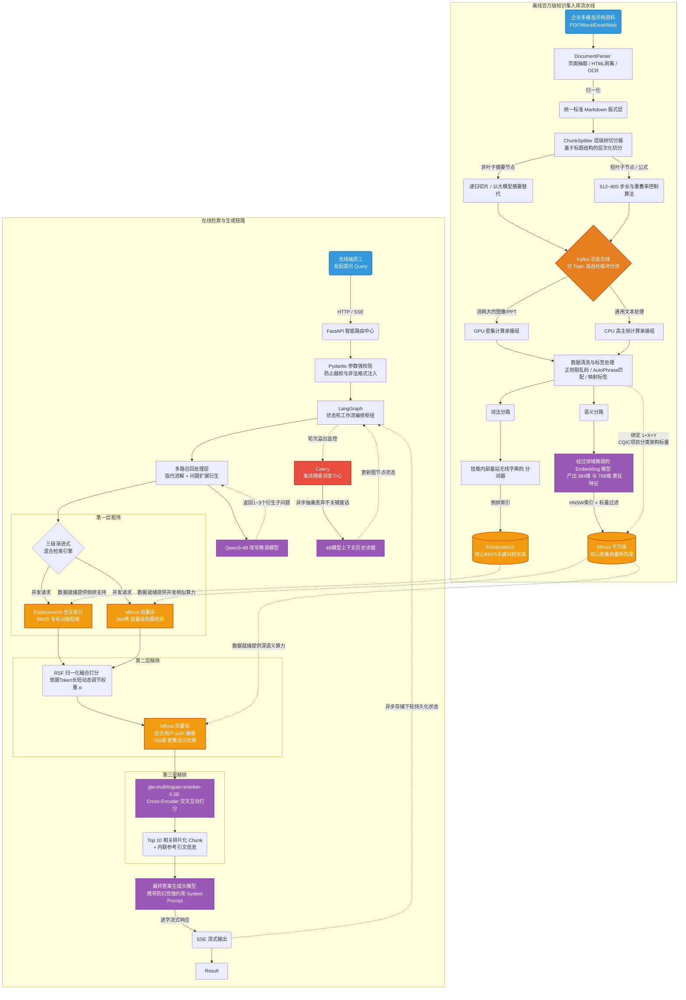

# 无线豆包 RAG 项目总览

这是无线豆包知识问答项目的唯一总览。规模、指标、配置冲突与实现状态以 [[RAG系统/项目事实与实现状态]] 为准。

- [[RAG系统/文档处理与知识库构建]]
- [[RAG系统/查询改写与检索排序]]
- [[RAG系统/知识治理与权限隔离]]
- [[RAG系统/答案生成与上下文管理]]
- [[RAG系统/服务架构与性能优化]]
- [[RAG系统/03_Embedding与Reranker微调全流程]]
- [[RAG系统/02_评测系统]]
- [[RAG系统/04_防幻觉机制]]
- [[RAG系统/code/RAG系统代码总结]]

## 背景

> [!note] 记录口径（2026-10-10 修订）
> 文中包含设计方案、历史配置与效果数字。未关联数据集版本、运行 ID、checkpoint 或评测日志的数字需核实，不直接作为实测结论；本地示例代码与生产部署状态分别说明。

无线豆包是 ICT AI 辅助工作的重点项目，对标秘塔搜索，核心理念为：**一个入口、报告式回答、答案可信**。

## 项目演进路线
- **第一阶段（完善检索系统）**：完成文档解析、混合检索和重排等基础能力，并通过评测检查召回率、回答质量和多模态资料处理效果。
- **第二阶段（作为 Agent 的检索工具）**：将 RAG 封装为 Agent 可以调用的知识查询工具。例如，工程师要求检查 5G 告警并给出修改建议时，Agent 可先通过 RAG 查阅配置规范，再调用其他工具完成后续步骤。涉及配置下发时，还需独立执行权限检查和审批。
- **第三阶段（结合长上下文与检索）**：探索支持 128k～1M 上下文的模型，尽量保留完整章节，减少切片造成的信息缺失；比较传统 RAG 与长上下文结合的方案（Hybrid Context Architecture），评估回答质量、延迟和成本。

---

## 整体架构

系统整体分为**知识召回**、**知识库构建**、**知识预处理**三大核心模块。

以下架构图展示在线问答流程、离线文档处理流程，以及两者之间的数据关系：

**上述流程图包含两个主要部分**：
1. 上方为**在线问答流程**：FastAPI 接收请求，LangGraph 编排 Query 改写、混合检索、重排和生成，最后向用户返回带引用的回答。
2. 下方为**离线文档处理流程**：Kafka 缓冲并分发任务，由 CPU/GPU Worker 完成解析、清洗和向量化，再写入 Elasticsearch 与 Milvus。将耗时的文档处理与在线问答分开，有助于减少批量入库对问答延迟的影响。

---

**知识召回：**
- **多路召回**：将原始问题改写为多个子问题，基于多问题并行检索，提升召回覆盖率
- **三级召回**：初筛 → 二筛 → 精排，逐层缩小候选集并提升精度
- **混合召回**：融合 BM25 关键字检索与向量语义检索，兼顾精确匹配与语义理解

**知识库构建：**
- **向量知识库**：基于微调后的 Embedding 模型构建
- **BM25 词频库**：基于无线领域专有词表，保证独立语义的词语在分词时不被拆分

**知识预处理：**
- **知识标签**：采用 1+X+Y 架构设计，保证知识有序存储与分类管理（**关键设计**）
- **知识切片**：针对不同知识类型采用差异化切片策略
- **知识清洗**：根据知识来源和格式，定制相应的清洗方式

---

## 主链路与职责

在线：鉴权 → Query 改写 → 多路与混合检索 → 融合精筛 → Reranker → 上下文组装 → 带引用生成。

离线：资料接入 → 解析清洗 → 层次切片 → 向量化与词法索引 → 完整性校验 → 可见版本切换。模型微调与评测作为独立闭环维护，不在总览重复配方。

## 项目讲述

个人职责、团队分工与复盘见 [[05_面试与算法/项目讲述与追问]]。

## 检索模型训练

- [[RAG系统/03_Embedding与Reranker微调全流程]]
- [[RAG系统/Embedding领域微调]]
- [[RAG系统/Reranker领域微调与标注]]

## 指标与实现范围

历史准确率、候选数、数据规模及其冲突统一见 [[RAG系统/项目事实与实现状态]]；不从不同实验条件拼接结果。
